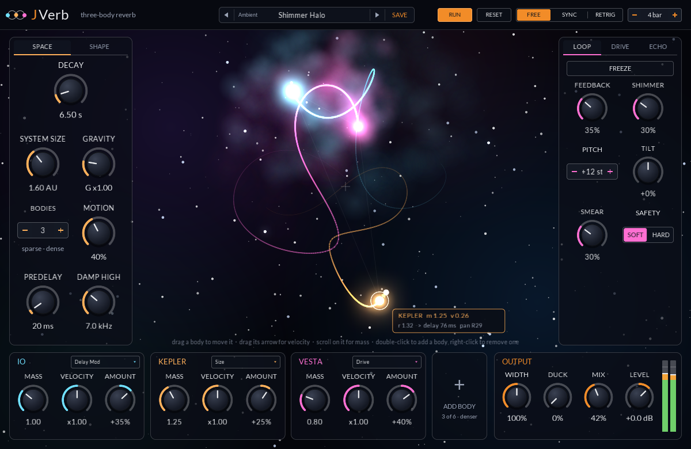
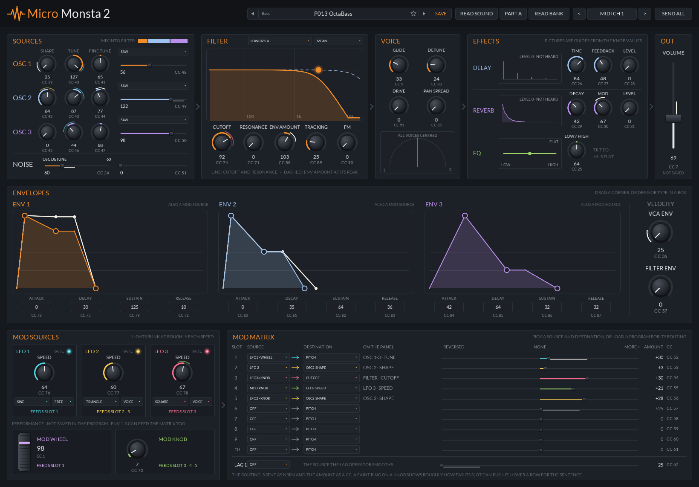
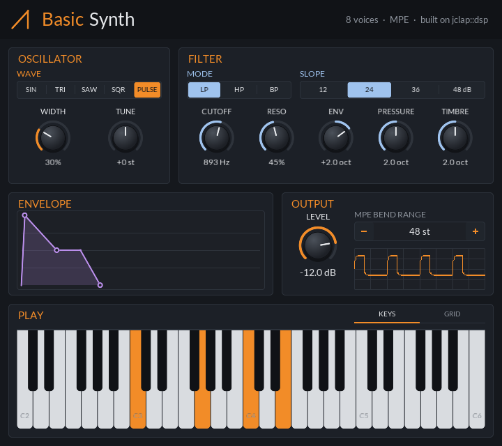
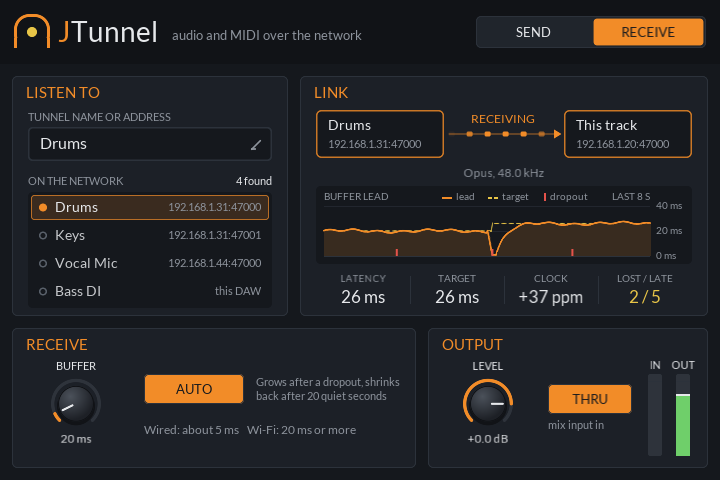
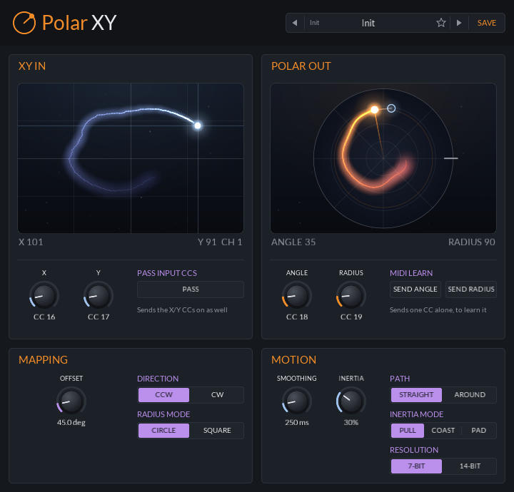

<div align="center">

# JClap

Small, single-purpose CLAP plugins, plus the shared toolkit they are built with.

[](https://github.com/jeffmhopkins/Jclap/actions/workflows/build.yml) [](https://github.com/jeffmhopkins/Jclap/releases/latest) [](CMakeLists.txt) [](https://github.com/free-audio/clap) [](.github/workflows/build.yml) [](https://github.com/VitalAudio/visage)

</div>

Each plugin does one job. Settings are plain host parameters, so they can be automated and modulated,
and plugins that need a panel get one from the shared GUI library.

## Plugins

<table>
<tr>
<td align="center" valign="top"><a href="plugins/jsynth"></a><br><b>JSynth</b></td>
<td align="center" valign="top"><a href="plugins/jverb"></a><br><b>JVerb</b></td>
</tr>
<tr>
<td align="center" valign="top"><a href="plugins/matrixbrute"></a><br><b>MatrixBrute CC</b></td>
<td align="center" valign="top"><a href="plugins/micromonsta2"></a><br><b>MicroMonsta 2 CC</b></td>
</tr>
<tr>
<td align="center" valign="top"><a href="plugins/monolith"></a><br><b>Monolith</b></td>
<td align="center" valign="top"><a href="plugins/basic-synth"></a><br><b>Basic Synth</b></td>
</tr>
<tr>
<td align="center" valign="top"><a href="plugins/jtunnel"></a><br><b>JTunnel</b></td>
<td align="center" valign="top"><a href="plugins/polar-xy"></a><br><b>Polar XY</b></td>
</tr>
</table>

Panels are shown at one-third size. They are the screenshot-test references, so they always match the current build.

| Plugin | Type | What it does |
|---|---|---|
| [JSynth](plugins/jsynth) | Instrument | Two-part MPE FM synth where every note is a creature in a flock, and how the creatures fly shapes how they sound ([manual](plugins/jsynth/docs/JSynth-User-Manual.pdf)) |
| [JVerb](plugins/jverb) | Audio effect | Reverb moved by a live three-body gravity sim, each body its own voice in the tail, with a long echo, a loopable drive and presets ([manual](plugins/jverb/docs/JVerb-User-Manual.pdf)) |
| [MatrixBrute CC](plugins/matrixbrute) | Note effect | Two-way knob panel for the Arturia MatrixBrute: sends every parameter as a MIDI CC (14-bit where it can) and follows the synth's own knobs |
| [MicroMonsta 2 CC](plugins/micromonsta2) | Note effect | Knob panel that sends every MicroMonsta 2 parameter as a MIDI CC and loads the synth's programs |
| [Monolith](plugins/monolith) | Note effect | Note generator that reads a slab of alien glyphs as MIDI phrases in time with the host, from a one-bar loop to a 55-glyph script that drifts and erodes, in five scripts, with presets |
| [Basic Synth](plugins/basic-synth) | Instrument | Eight-voice MPE synth: dual detunable oscillators, key-tracking filter, VCA, two looping envelopes and an LFO |
| [JTunnel](plugins/jtunnel) | Audio effect | Sends a track's audio and MIDI over the network to other JTunnels (found by name over mDNS), or plays what one sends, with Opus or PCM, a drift-following buffer for Wi-Fi, and redundancy against loss |
| [Polar XY](plugins/polar-xy) | Note effect | Turns two XY CCs into angle/radius CCs for Omnisphere's Orb |

## Download

Grab the zip for your OS from the [latest release](https://github.com/jeffmhopkins/Jclap/releases/latest).
`jclap-<OS>.zip` contains every plugin; to get just one, take `jclap-<Plugin>-<version>-<OS>.zip` instead
(for example `jclap-JSynth-0.12.1-macOS.zip`). Copy the `.clap` files (bundles on macOS) to your CLAP folder:

- macOS: `~/Library/Audio/Plug-Ins/CLAP`
- Windows: `C:\Program Files\Common Files\CLAP`
- Linux: `~/.clap`

Polar XY also comes as a VST3, for hosts without CLAP: take `jclap-PolarXY-<version>-VST3-<OS>.zip` and copy
`PolarXY.vst3` to your VST3 folder (`~/Library/Audio/Plug-Ins/VST3` on macOS,
`C:\Program Files\Common Files\VST3` on Windows, `~/.vst3` on Linux).

> [!WARNING]
> **macOS: browser downloads are quarantined.** The plugins are only ad-hoc signed (not notarized), so
> files downloaded through a browser are quarantined and Bitwig silently skips them. Files downloaded
> with `curl` aren't flagged, so the easiest install is from Terminal:

```sh
curl -fsSL https://raw.githubusercontent.com/jeffmhopkins/Jclap/main/install-macos.sh | bash
```

That runs [install-macos.sh](install-macos.sh), which installs the latest release's CLAPs and VST3s
(`bash -s v0.15.0` instead of `bash` picks a release). It replaces older copies outright, since
unzipping over an old bundle can leave stale files that stop it loading, and clears Bitwig's plugin
cache so the next scan starts fresh.

If you downloaded with a browser instead, clear the quarantine flag once after copying:

```sh
xattr -dr com.apple.quarantine ~/Library/Audio/Plug-Ins/CLAP/*.clap
```

The VST3 needs the same after a browser download: `xattr -dr com.apple.quarantine ~/Library/Audio/Plug-Ins/VST3/PolarXY.vst3`.

> [!TIP]
> Then restart Bitwig, or rescan plug-ins under Settings → Locations.

When a release has a newer version of a plugin, that plugin's header says so (plugins a release
didn't change stay quiet); click the notice to open the release page, or its cross to hide it until
the next one. The plugins look at GitHub at most once a day. To stop
them, right-click the panel background and untick **Check for Updates**.

## Building

```sh
cmake -S . -B build -DCMAKE_BUILD_TYPE=Release
cmake --build build --config Release
ctest --test-dir build -C Release
```

> [!NOTE]
> On Linux, install `libx11-dev libxrandr-dev libgl1-mesa-dev` first (the GUI library uses them).

All plugins land in `build/clap/`, and the VST3s (only Polar XY has one) in `build/vst3/`. CI builds
Linux, macOS (universal) and Windows on every push, runs the tests, and checks every plugin with
[clap-validator](https://github.com/free-audio/clap-validator) and every VST3 with Steinberg's validator.

> [!NOTE]
> **VST3.** A VST3 is the plugin's CLAP sources wrapped by [clap-wrapper](https://github.com/free-audio/clap-wrapper)
> into one self-contained `.vst3`; `jclap_add_vst3` in [cmake/JClap.cmake](cmake/JClap.cmake) adds one.
> The VST3 SDK it builds against is MIT licensed (since 3.8). Configure with `-DJCLAP_BUILD_VST3=OFF`
> to skip them.

## Adding a plugin

> [!TIP]
> **Start from the template.** It is a working gain/pan/width plugin whose panel uses every widget,
> and one command copies and renames it:

```sh
cmake -DNAME=my-plugin -DFILE_NAME=MyPlugin "-DDISPLAY_NAME=My Plugin" -P cmake/NewPlugin.cmake
```

It creates `plugins/my-plugin/` (plugin id `com.jeffmhopkins.jclap.my-plugin`), adds it to the
top-level `CMakeLists.txt`, and prints what to change next. See
[plugins/_template](plugins/_template) for the details, then add a row to the table above.

Plugins build on three shared libraries:

- [jclap::core](libs/core): the CLAP boilerplate. A `Plugin` base class, `JCLAP_ENTRY` for the
  factory, param/state/port/event helpers, the GUI edit queue and `TestHost` for host-style tests.
- [jclap::ui](libs/ui): the GUI. Knobs, sliders, buttons, dropdowns, an XY pad, meters and panels
  on [Visage](https://github.com/VitalAudio/visage), a design-grid layout, one-line param binding
  and the CLAP window glue.
- [jclap::dsp](libs/dsp): audio building blocks. A band-limited oscillator with pulse width, a
  resonant low/high/band pass filter with 12 to 48 dB/oct slopes, an ADSR envelope, an LFO and a VCA.

> [!NOTE]
> **Screenshot tests.** Configure with `-DJCLAP_BUILD_TOOLS=ON` and `ctest` also renders the panels and
> the widget gallery and compares them with the PNGs in each `docs/` folder. CI does this on Linux.
> After an intended visual change, re-render the reference (the failing test prints how).

## Releasing

> [!IMPORTANT]
> In GitHub, open Actions → build → Run workflow and enter a version such as `v0.2.0`. The run builds
> every platform, tags the commit and publishes a release with one zip per OS. Pushing a `v*` tag does
> the same. Bump the release's version in `CMakeLists.txt` (`project()`) first.
>
> Each plugin also has its own version, `jclap_plugin_version(...)` at the top of its
> `CMakeLists.txt`, which its descriptor, bundles and update notice use. Bump it only when that plugin
> changed since the last release: CI warns on a pull request that changes a plugin still on the last
> release's version, and a release with one fails. The release notes list every plugin's version,
> and the update notice in each plugin only shows when its own version moved.

Every push to `main` also rebuilds the [dev pre-release](https://github.com/jeffmhopkins/Jclap/releases/tag/dev)
from that commit, for testing merged changes before a real release. It replaces itself each time and is
never marked latest.
