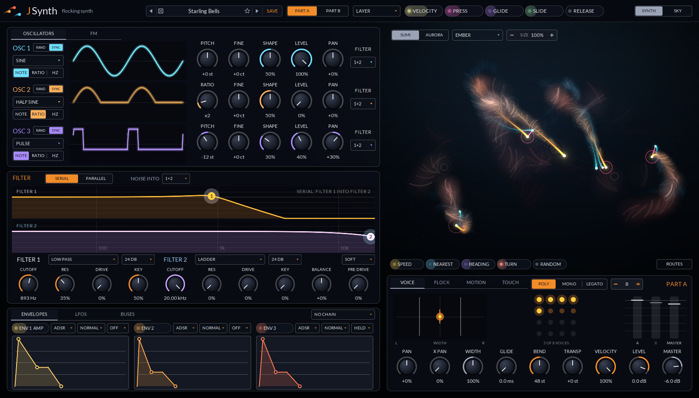
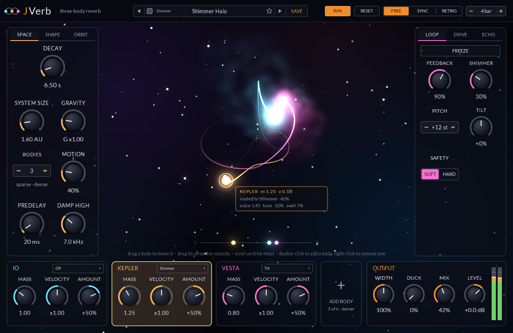
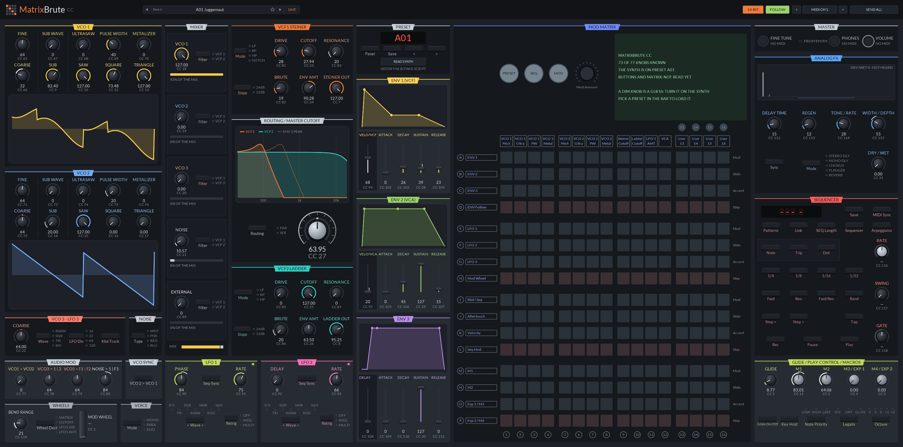
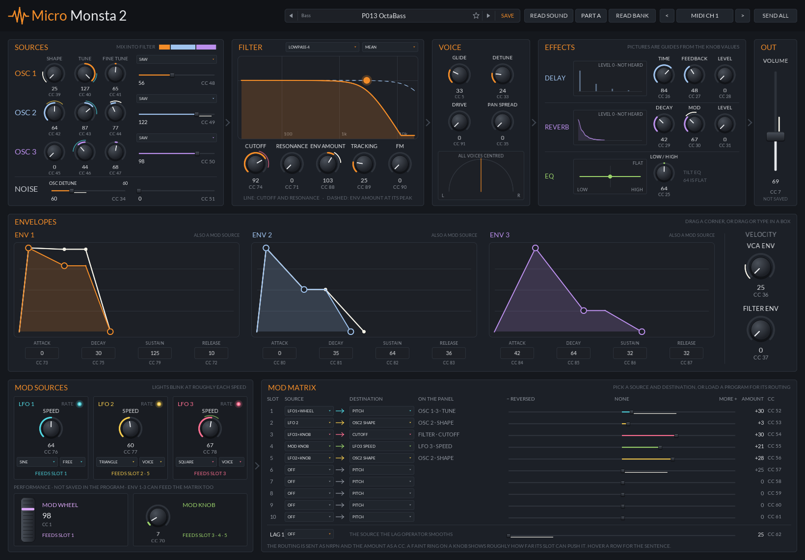
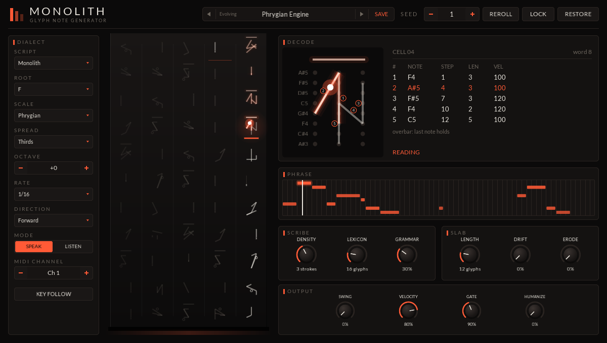
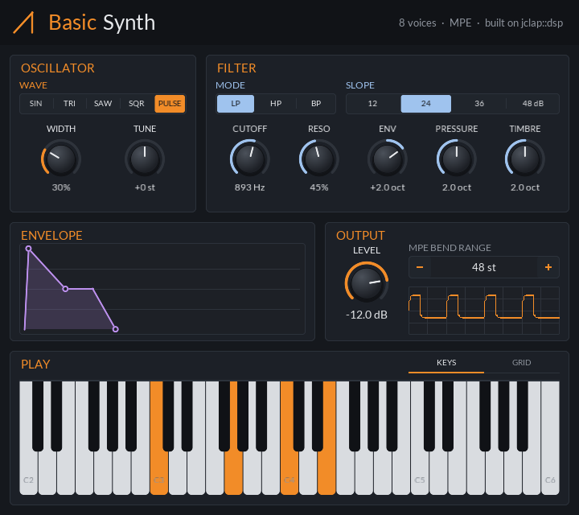
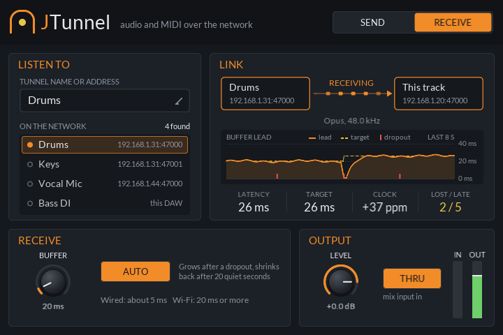
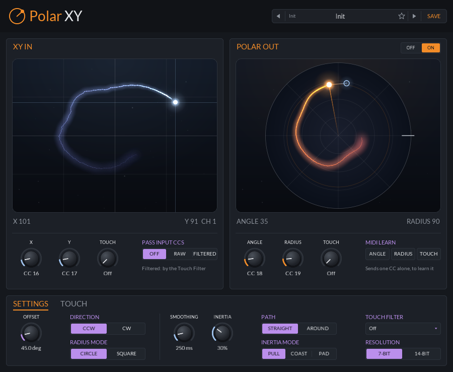
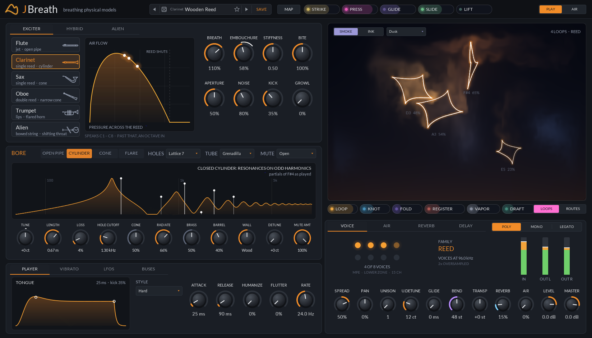

<div align="center">

# JClap

Small, single-purpose CLAP plugins, plus the shared toolkit they are built with.

[](https://github.com/jeffmhopkins/Jclap/actions/workflows/build.yml) [](https://github.com/jeffmhopkins/Jclap/releases/latest) [](CMakeLists.txt) [](https://github.com/free-audio/clap) [](.github/workflows/build.yml) [](https://github.com/VitalAudio/visage)

</div>

Each plugin does one job. Settings are plain host parameters, so they can be automated and modulated,
and plugins that need a panel get one from the shared GUI library.

## Plugins

<table>
<tr>
<td align="center" valign="top"><a href="plugins/jsynth"></a><br><b>JSynth</b></td>
<td align="center" valign="top"><a href="plugins/jverb"></a><br><b>JVerb</b></td>
</tr>
<tr>
<td align="center" valign="top"><a href="plugins/matrixbrute"></a><br><b>MatrixBrute CC</b></td>
<td align="center" valign="top"><a href="plugins/micromonsta2"></a><br><b>MicroMonsta 2 CC</b></td>
</tr>
<tr>
<td align="center" valign="top"><a href="plugins/monolith"></a><br><b>Monolith</b></td>
<td align="center" valign="top"><a href="plugins/basic-synth"></a><br><b>Basic Synth</b></td>
</tr>
<tr>
<td align="center" valign="top"><a href="plugins/jtunnel"></a><br><b>JTunnel</b></td>
<td align="center" valign="top"><a href="plugins/polar-xy"></a><br><b>Polar XY</b></td>
</tr>
<tr>
<td align="center" valign="top"><a href="plugins/jbreath"></a><br><b>JBreath</b></td>
<td></td>
</tr>
</table>

Panels are shown at one-third size. They are the screenshot-test references, so they always match the current build.

| Plugin | Type | What it does |
|---|---|---|
| [JSynth](plugins/jsynth) | Instrument | Two-part MPE FM synth where every note is a creature in a flock, and how the creatures fly shapes how they sound ([manual](plugins/jsynth/docs/JSynth-User-Manual.pdf)) |
| [JVerb](plugins/jverb) | Audio effect | Reverb moved by a live three-body gravity sim, each body its own voice in the tail, with a long echo, a loopable drive and presets ([manual](plugins/jverb/docs/JVerb-User-Manual.pdf)) |
| [MatrixBrute CC](plugins/matrixbrute) | Note effect | Two-way knob panel for the Arturia MatrixBrute: sends every parameter as a MIDI CC (14-bit where it can) and follows the synth's own knobs |
| [MicroMonsta 2 CC](plugins/micromonsta2) | Note effect | Knob panel that sends every MicroMonsta 2 parameter as a MIDI CC and loads the synth's programs |
| [Monolith](plugins/monolith) | Note effect | Note generator that reads a slab of alien glyphs as MIDI phrases in time with the host, from a one-bar loop to a 55-glyph script that drifts and erodes, in five scripts, with presets |
| [JBreath](plugins/jbreath) | Instrument | Eight-voice MPE wind instrument from physical models (flute, clarinet, sax, oboe, trumpet), each a waveguide blown by a model of the player, every voice drawn as a loop of its own breath |
| [Basic Synth](plugins/basic-synth) | Instrument | Eight-voice MPE synth: dual detunable oscillators, key-tracking filter, VCA, two looping envelopes and an LFO |
| [JTunnel](plugins/jtunnel) | Audio effect | Sends a track's audio and MIDI over the network to other JTunnels (found by name over mDNS), or plays what one sends, with Opus or PCM, a drift-following buffer for Wi-Fi, and redundancy against loss |
| [Polar XY](plugins/polar-xy) | Note effect | Turns two XY CCs into angle/radius CCs for Omnisphere's Orb |

## Download and install

### Mac

This installs every plugin from the latest release, and replaces any older versions.

1. Quit Bitwig (or whichever music app you use).
2. Open **Terminal**: press **⌘ Command + Space**, type **Terminal**, and press **Return**.
3. Copy the line below (the copy button is at its right), paste it into Terminal with **⌘ Command + V**, and press **Return**:

```sh
curl -fsSL https://raw.githubusercontent.com/jeffmhopkins/Jclap/main/install-macos.sh | bash
```

4. Wait until it says **Done**. It takes under a minute.
5. Open Bitwig again. The plugins are in its plugin list.

Please don't download the plugins with a web browser on a Mac: macOS blocks plugins downloaded that way, and Bitwig quietly leaves them out. If you already did, see [Mac: installed from a browser download?](#mac-installed-from-a-browser-download) below.

### Windows

1. Download **jclap-Windows.zip** from the [latest release](https://github.com/jeffmhopkins/Jclap/releases/latest).
2. Right-click the downloaded file and choose **Extract All**.
3. Open the extracted folder. Copy everything in its **CLAP** folder into `C:\Program Files\Common Files\CLAP` (make that folder if it isn't there).
4. If your music app uses VST3, also copy everything in the **VST3** folder into `C:\Program Files\Common Files\VST3`.
5. Restart your music app.

### Linux

Download **jclap-Linux.zip** from the [latest release](https://github.com/jeffmhopkins/Jclap/releases/latest), unzip it, copy the `.clap` files to `~/.clap` and the `.vst3` folders to `~/.vst3`, and restart your music app.

### Ableton Live

Polar XY also comes as a Max for Live device, in the **Max for Live** folder of the Mac and Windows zips. See [Using it in Ableton Live](plugins/polar-xy#using-it-in-ableton-live-max-for-live).

### More

- **One plugin only:** each release also has a zip per plugin, such as `jclap-PolarXY-0.18.0.zip`, with a macOS, Windows and Linux folder inside.
- **An older release:** add its number to the Mac install line, for example `bash -s 20` instead of `bash` at the end.
- **What the Mac install line does:** it runs [install-macos.sh](install-macos.sh) (you can read it first). It downloads `jclap-macOS.zip`, puts every plugin in `~/Library/Audio/Plug-Ins/CLAP` and `~/Library/Audio/Plug-Ins/VST3`, replacing older copies, and clears Bitwig's plugin list so Bitwig looks again.

#### Mac: installed from a browser download?

macOS blocks plugins downloaded with a web browser unless Apple has approved them (notarized them), which needs a paid Apple developer account this project doesn't have. The easiest fix is the Terminal steps above. Or, after copying the plugins into `~/Library/Audio/Plug-Ins/CLAP` and `~/Library/Audio/Plug-Ins/VST3`, open Terminal, paste this line, and press Return:

```sh
xattr -dr com.apple.quarantine ~/Library/Audio/Plug-Ins/CLAP/*.clap ~/Library/Audio/Plug-Ins/VST3/PolarXY.vst3
```

Then restart Bitwig.

### Update notices

When a release has a newer version of a plugin, that plugin's header says so (plugins a release
didn't change stay quiet); click the notice to open the release page, or its cross to hide it until
the next one. The plugins look at GitHub at most once a day. To stop
them, right-click the panel background and untick **Check for Updates**.

## Building from source

### One command (macOS)

```sh
curl -fsSL https://raw.githubusercontent.com/jeffmhopkins/Jclap/main/build-macos.sh | bash -s polar-xy
```

downloads the source to `~/Jclap-src`, builds Polar XY, and installs its CLAP and VST3. Leave off
`-s polar-xy` to build and install every plugin, or name others (their folder names under
[plugins/](plugins)). Run it again to update: it pulls the latest code and rebuilds only what changed.
It needs Apple's command line tools (`xcode-select --install`) and CMake (`brew install cmake`); it
says so if either is missing. See [build-macos.sh](build-macos.sh).

### What you need

- **CMake** 3.17 or newer, **git**, and a **C++17** compiler. The first configure downloads the CLAP
  headers, the GUI library and the VST3 SDK, so it needs to be online.
- **macOS:** Apple's command line tools (`xcode-select --install`) and CMake (`brew install cmake`,
  or the installer from [cmake.org](https://cmake.org/download/)).
- **Windows:** Visual Studio 2022 with the *Desktop development with C++* workload, which includes
  CMake. Run the commands below in the *Developer PowerShell for VS 2022*.
- **Linux (Debian/Ubuntu):** `sudo apt install build-essential cmake git libx11-dev libxrandr-dev libgl1-mesa-dev`

### Build

```sh
git clone https://github.com/jeffmhopkins/Jclap.git
cd Jclap
cmake -S . -B build -DCMAKE_BUILD_TYPE=Release
cmake --build build --config Release --parallel
ctest --test-dir build -C Release        # optional: runs the tests
```

To build just one plugin, name its target. For Polar XY, CLAP and VST3:

```sh
cmake --build build --config Release --parallel --target polar-xy polar-xy-vst3
```

Each plugin's target is its folder name under [plugins/](plugins). On a Mac, add
`-DCMAKE_OSX_ARCHITECTURES="arm64;x86_64"` to the first `cmake` line for a universal build that runs
on both Apple Silicon and Intel; without it, the build is for your Mac only. To update later, run
`git pull` and the `cmake --build` line again.

### Install

Copy the built plugins (from `build/clap/` and `build/vst3/`) to where your DAW looks, then rescan:

| | CLAP | VST3 |
|---|---|---|
| macOS | `~/Library/Audio/Plug-Ins/CLAP` | `~/Library/Audio/Plug-Ins/VST3` |
| Windows | `C:\Program Files\Common Files\CLAP` | `C:\Program Files\Common Files\VST3` |
| Linux | `~/.clap` | `~/.vst3` |

On a Mac, for example:

```sh
mkdir -p ~/Library/Audio/Plug-Ins/CLAP ~/Library/Audio/Plug-Ins/VST3
cp -R build/clap/PolarXY.clap ~/Library/Audio/Plug-Ins/CLAP/
cp -R build/vst3/PolarXY.vst3 ~/Library/Audio/Plug-Ins/VST3/
```

All plugins land in `build/clap/`, and the VST3s (only Polar XY has one) in `build/vst3/`. CI builds
Linux, macOS (universal) and Windows on every push, runs the tests, and checks every plugin with
[clap-validator](https://github.com/free-audio/clap-validator) and every VST3 with Steinberg's validator.

> [!NOTE]
> **VST3.** A VST3 is the plugin's CLAP sources wrapped by [clap-wrapper](https://github.com/free-audio/clap-wrapper)
> into one self-contained `.vst3`; `jclap_add_vst3` in [cmake/JClap.cmake](cmake/JClap.cmake) adds one.
> The VST3 SDK it builds against is MIT licensed (since 3.8). Configure with `-DJCLAP_BUILD_VST3=OFF`
> to skip them.

## Adding a plugin

> [!TIP]
> **Start from the template.** It is a working gain/pan/width plugin whose panel uses every widget,
> and one command copies and renames it:

```sh
cmake -DNAME=my-plugin -DFILE_NAME=MyPlugin "-DDISPLAY_NAME=My Plugin" -P cmake/NewPlugin.cmake
```

It creates `plugins/my-plugin/` (plugin id `com.jeffmhopkins.jclap.my-plugin`), adds it to the
top-level `CMakeLists.txt`, and prints what to change next. See
[plugins/_template](plugins/_template) for the details, then add a row to the table above.

Plugins build on three shared libraries:

- [jclap::core](libs/core): the CLAP boilerplate. A `Plugin` base class, `JCLAP_ENTRY` for the
  factory, param/state/port/event helpers, the GUI edit queue and `TestHost` for host-style tests.
- [jclap::ui](libs/ui): the GUI. Knobs, sliders, buttons, dropdowns, an XY pad, meters and panels
  on [Visage](https://github.com/VitalAudio/visage), a design-grid layout, one-line param binding
  and the CLAP window glue.
- [jclap::dsp](libs/dsp): audio building blocks. A band-limited oscillator with pulse width, a
  resonant low/high/band pass filter with 12 to 48 dB/oct slopes, an ADSR envelope, an LFO and a VCA.

> [!NOTE]
> **Screenshot tests.** Configure with `-DJCLAP_BUILD_TOOLS=ON` and `ctest` also renders the panels and
> the widget gallery and compares them with the PNGs in each `docs/` folder. CI does this on Linux.
> After an intended visual change, re-render the reference (the failing test prints how).

## Releasing

> [!IMPORTANT]
> Releases are counted: Release 19, Release 20 and so on, one number per release, so a release never
> looks like a plugin's version. In GitHub, open Actions → build → Run workflow and enter the next
> number, such as `20`. The run builds every platform, tags the commit `v20.0.0`, and publishes
> "Release 20" with one zip per OS and one per plugin ([.github/package.sh](.github/package.sh) packs
> them). Pushing a `v20.0.0` tag does the same. Set `project()` in `CMakeLists.txt` to `20.0.0` first.
>
> The tag stays three numbers because plugins already installed read the newest release's tag that
> way to find their update. The count carries on from the older `v0.N.0` tags: `v0.19.0` was Release 19.
>
> Each plugin also has its own version, `jclap_plugin_version(...)` at the top of its
> `CMakeLists.txt`, which its descriptor, bundles and update notice use. Bump it only when that plugin
> changed since the last release: CI warns on a pull request that changes a plugin still on the last
> release's version, and a release with one fails. The release notes list every plugin's version,
> and the update notice in each plugin only shows when its own version moved.

Every push to `main` also rebuilds the [dev pre-release](https://github.com/jeffmhopkins/Jclap/releases/tag/dev)
from that commit, for testing merged changes before a real release. It replaces itself each time and is
never marked latest.
