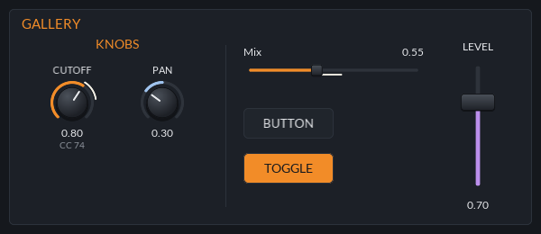

<div align="center">

# jclap::ui

Shared GUI widgets, layout and CLAP glue for JClap plugins.

[](https://github.com/jeffmhopkins/Jclap/actions/workflows/build.yml) [](../../CMakeLists.txt) [](https://github.com/VitalAudio/visage) [](https://github.com/free-audio/clap) [](docs/gallery.png)

</div>

Drawn with [Visage](https://github.com/VitalAudio/visage), pinned to a commit in `CMakeLists.txt`.
Link it from a plugin's `CMakeLists.txt`:

```cmake
target_link_libraries(<name> PRIVATE jclap::ui)
```



## Widgets

| Header | What it is |
|---|---|
| `jclap/ui/knob.h` | Rotary knob: label, arc, value and an optional caption. Shows host modulation as an outer arc |
| `jclap/ui/slider.h` | Horizontal or vertical fader with the same value model as the knob |
| `jclap/ui/button.h` | Push button, or an on/off toggle with `setToggle(true)`. `onWheel` makes steppers easy |
| `jclap/ui/dropdown.h` | Pick one of a list of options (menu on click, wheel to step), for enum params |
| `jclap/ui/xy_pad.h` | Two values at once, each with its own range, modulation and param. `setGrid(Grid::Polar)` makes it a circle of angle and radius |
| `jclap/ui/meter.h` | Level meter with a falling peak marker, fed from a timer |
| `jclap/ui/section.h` | `Section` (titled panel box), `Label` and `Divider`. They ignore the mouse |
| `jclap/ui/theme.h` | Colours shared by every widget, and the `font()` helper |

Knob and Slider share `ValueControl`: a `ValueRange` (min, max, default, wheel step, bipolar), the
host's value and modulated value, and `onBeginEdit` / `onChange` / `onEndEdit` callbacks. Drag
(shift for fine), scroll for one step, double-click to reset. Right-click opens a menu with "Reset
to default", "Enter value..." (type a number) and the host's own items for the param.
`setShowValuePopup(true)` floats the value above the control while dragging (the XY pad always
does).

Every widget points at `defaultTheme()`; pass another `Theme` to `setTheme()` to restyle one, or
`setAccent()` for just the accent colour.

## Layout

`jclap/ui/design_frame.h`: derive the panel from `DesignFrame(width, height)` and add widgets at
design-grid coordinates. They are re-laid out whenever the window is resized, so the panel scales
as one picture. `row()`, `column()` and `grid()` split a `Rect` into cells:

```cpp
class Panel : public jclap::ui::DesignFrame {
public:
   explicit Panel(ParamAccess &params) : DesignFrame(600, 300), bindings_(params) {
      add<Section>({10, 10, 580, 280}, "FILTER");
      const auto cells = row({20, 50, 560, 100}, 4);
      bindings_.bind(add<Knob>(cells[0], ValueRange{20, 20000, 1000}), kCutoff);
      // ...
   }
   ParamBindings bindings_;
};
```

> [!TIP]
> Right-clicking the panel background offers UI sizes from 75% to 200%, as long as the panel is the
> window's root.

## Params

`jclap/ui/params.h` and `jclap/ui/param_bindings.h` connect widgets to CLAP params in one call.
The plugin implements `ParamAccess` (read a value, begin/set/end an edit, by param id), usually
storing values in atomics and forwarding gestures to a `jclap::core::EditQueue`. Then
`ParamBindings::bind(widget, id)` wires a Knob, Slider, toggle Button, Dropdown or XY pad (two ids):
edits go to the host as gestures, a 30 ms timer pulls automation, modulation and state loads back
in, and the right-click menu gets the host's items through CLAP's context-menu extension (return a
`HostMenu` from `ParamAccess::hostMenu()`).

## Window and CLAP glue

`jclap/ui/window.h` wraps a Visage window around one root frame and handles host sizing and zoom.
It doesn't include Visage, so the plugin's main file doesn't have to either. 

> [!NOTE]
> Visage picks up the monitor's DPI itself, so HiDPI screens work without the host's `set_scale`.

`jclap/ui/clap_gui.h` implements the CLAP `gui` and `posix-fd-support` extensions for that window.
With a `jclap::core::Plugin` subclass:

```cpp
// member:      jclap::ui::ClapGui gui_;   (declare it last)
// init():      gui_.init(host()); gui_.createWindow = [this] { return createEditor(*this); };
// extension(): return jclap::ui::ClapGui::extensionFor<MyPlugin, &MyPlugin::gui_>(id);
```

> [!IMPORTANT]
> Declare `gui_` as the plugin's last member, so the window closes before anything it reads is
> destroyed.

`createEditor` returns `std::make_unique<jclap::ui::Window>(std::move(panel), WindowOptions{w, h})`.
`plugins/_template` is a small complete example; `plugins/micromonsta2/src/editor.cpp` a big one.

## Gallery

`docs/gallery.png` is rendered by `jclap-ui-gallery` (configure with `-DJCLAP_BUILD_TOOLS=ON`).

> [!NOTE]
> With tools on, `ctest` checks the render against `docs/gallery.png`, and CI does it on Linux. `jclap::ui::renderToPng()` does the same offscreen render for
any frame.
