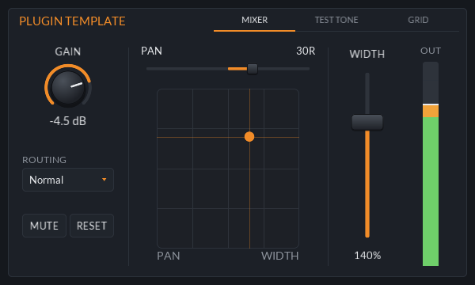
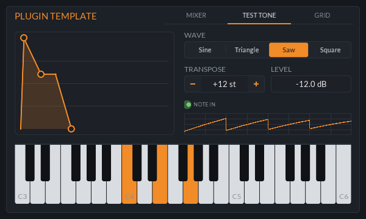
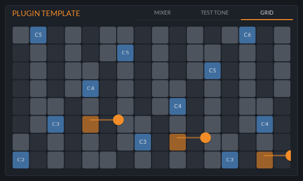

<div align="center">

# Plugin Template

The starting point for a new JClap plugin, with params, state, a panel and tests.

[](https://github.com/jeffmhopkins/Jclap/actions/workflows/build.yml) [](../../CMakeLists.txt) [](https://github.com/free-audio/clap) [](https://github.com/VitalAudio/visage) [](#plugin-template)

</div>

The starting point for a new JClap plugin, built on [jclap::core](../../libs/core) and
[jclap::ui](../../libs/ui): a stereo gain, pan, width and routing utility, plus a one-voice test tone
you can play from the panel or the host, with per-note expression (MPE). Across its three tabs the
panel uses every widget in the library, so there is always an example to copy and the rest is
easy to delete.
It is built and tested in CI (`-DJCLAP_BUILD_TEMPLATE=ON`, output in `build/template/`) but never
shipped.

| Mixer | Test tone | Grid |
|---|---|---|
|  |  |  |

## Making a plugin from it

```sh
cmake -DNAME=my-plugin -DFILE_NAME=MyPlugin "-DDISPLAY_NAME=My Plugin" -P cmake/NewPlugin.cmake
```

That copies this folder to `plugins/my-plugin`, renames everything (target, plugin id
`com.jeffmhopkins.jclap.my-plugin`, class, namespace, display name) and adds it to the top-level
`CMakeLists.txt`.

> [!IMPORTANT]
> Change `kStateMagic` in `src/plugin.cpp` so saved states can't be confused with another plugin's.

Then:

- Replace the params in `src/params.h`, the DSP in `process()`, and the panel in `src/editor.cpp`.
- No GUI? Drop `editor.*`, the `gui_` member and the `jclap::ui` link, and link `jclap::core` instead.
- Add a row to the plugin table in the top-level README.

## Files

| File | What's in it |
|---|---|
| `src/params.h` | Param ids, ranges and display text, shared by the plugin and the panel |
| `src/plugin.cpp` | The `jclap::core::Plugin` subclass: params, state, audio, GUI hookup |
| `src/editor.cpp` | The panel: a `DesignFrame` with tabs and one of each widget, bound to params by `ParamBindings` |
| `tests/test_plugin.cpp` | Host-style tests through `jclap::core::TestHost` |
| `tools/screenshot.cpp` | Renders a tab of the panel to `docs/` (needs `-DJCLAP_BUILD_TOOLS=ON`): `plugin_template-screenshot out.png [tab]` |
