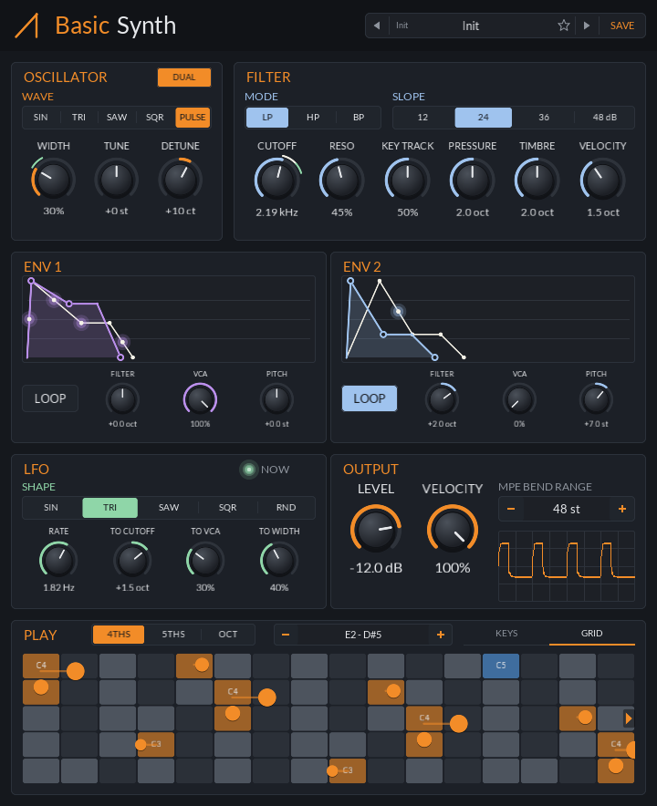

<div align="center">

# Basic Synth

An eight-voice MPE synth built from jclap::dsp: one or two detuned oscillators, a key-tracking filter and a VCA, two looping envelopes and an LFO per voice.

[](https://github.com/jeffmhopkins/Jclap/actions/workflows/build.yml) [](https://github.com/jeffmhopkins/Jclap/releases/latest) [](../../CMakeLists.txt) [](https://github.com/free-audio/clap) [](#the-voice) [](#mpe) [](#automation-and-modulation) [](../../libs/dsp) [](https://github.com/VitalAudio/visage) [](../../.github/workflows/build.yml) [](https://github.com/jeffmhopkins/Jclap/releases/latest)

</div>

The simplest complete synth: it exists to show [jclap::dsp](../../libs/dsp) in a real plugin, and to
start a new instrument from.


## The voice

```
oscillator ──> filter ──> VCA ──> out
    ^            ^         ^
    │            │         │
   Env 1, Env 2: each sends to pitch, filter and VCA by its own amount
   LFO: to filter, VCA (tremolo) and pulse width
   Velocity: to filter and VCA, each by its own knob
   MPE pressure, timbre: to filter
```

- **Oscillator**: sine, triangle, saw, square or pulse, with pulse width, band-limited. DUAL adds a second oscillator of the same wave, detuned from the first by DETUNE: a few cents either side of the centre for beating, up to an octave up or down at the ends.
- **Filter**: low, high or band pass at 12, 24, 36 or 48 dB/oct, with resonance. KEY TRACK moves the cutoff with the note, up to an octave per octave from C4. VELOCITY opens the cutoff for harder notes, by up to 4 octaves at full velocity (off to start with).
- **Env 1 and Env 2**: two ADSRs, each with a **loop** toggle and three amounts: to the filter (±5 octaves), to the VCA (0 to 100%) and to the pitch (±24
  semitones). They start as Env 1 on the VCA and Env 2 on the filter. Whatever share of the VCA the
  envelopes don't take follows the key, so with both VCA amounts at 0 it is a plain organ-style gate.
  A glowing dot rides each envelope's curve for every sounding voice, so you can watch all eight.
- **Looping**: a looping envelope is one shared cycle, not one per note. It starts the moment LOOP is
  switched on and runs freely, attack and decay over and over, like an LFO with an envelope's shape;
  every voice follows the same cycle, and it shows as a single dot. On the VCA it is let through
  while a key is held.
- **LFO**: sine, triangle, saw, square or random, 0.05 to 20 Hz, restarted with each note. It moves the
  cutoff (±4 octaves), the VCA (tremolo) and, for the pulse wave, the pulse width (TO WIDTH sweeps it
  either side of the WIDTH knob, up to the whole range). The light next to it shows the newest note's LFO.
- **Output**: LEVEL, and VELOCITY, how much velocity sets each note's loudness. It starts at 100%, so
  a soft note is quiet; at 0 every note plays as loud as the hardest.
- **Voices**: eight. A ninth note takes the quietest releasing voice, or else the oldest.

## Automation and modulation

Every parameter is a host parameter: Bitwig can automate it, and its modulators can move it. Every
one except MPE Bend Range can also be modulated **per voice**, so a polyphonic modulator in Bitwig
(a per-note LFO, velocity or random, for instance) moves each note on its own. The knobs and
envelope drawings show the host's modulation as a light ring or line over the value. The LFO's own movement shows
the same way in green, carrying on from the host's: on CUTOFF and WIDTH while a note sounds.

## MPE

Every note bends, presses and slides on its own.

| Expression | CLAP note expression | MPE MIDI | Does |
|---|---|---|---|
| Bend | Tuning | Pitch bend on the note's channel (±48 st, set by MPE Bend Range) | Pitch |
| Pressure | Pressure | Channel pressure | Opens the cutoff, by up to the Pressure knob's octaves |
| Timbre | Brightness | CC 74 | Moves the cutoff either way from its centre, by up to the Timbre knob's octaves |
| Volume | Volume | | Level |

Plain MIDI works too: notes on channel 1 play, and its pitch bend moves every note by ±2 semitones (as
the MPE manager channel does). The sustain pedal (CC 64) holds notes on its channel, or on every
channel from channel 1. A host that sends notes as CLAP events and its controllers as MIDI (REAPER
can) still gets bend, pressure and CC 74 on those notes. The synth reports each finished voice to the
host (`NOTE_END`), so Bitwig's per-note modulators know when a note is done.

> [!TIP]
> In Bitwig, MPE controllers and per-note expressions from the piano roll arrive as CLAP note
> expressions, with no MPE setup needed.

## Presets

The preset bar in the header steps through a factory bank of 27 presets and then your own. Click the
name for a menu of them by category:

| Category | What's in it |
|---|---|
| Init | Every knob at its default |
| Bass | Analog, acid, sub, pulse and wobble basses, with Env 2 snapping the filter shut |
| Leads | Saw and square leads, a pitch blip, and one played with MPE pressure and slide |
| Keys | Soft keys, an organ and a clav, with velocity opening the filter |
| Plucks | No sustain, so each note dies away by itself |
| Pads | Slow envelopes, with the LFO or a looping Env 2 keeping them moving |
| Motion | A trance gate, looping envelopes, random steps and a band-pass sweep |
| FX | The envelopes on the pitch: a zap, a siren, and a thin high-passed air |

**SAVE** names the current settings and writes them as a small text file:

- macOS: `~/Library/Application Support/BasicSynth/Presets`
- Windows: `%APPDATA%\BasicSynth\Presets`
- Linux: `~/.config/BasicSynth/Presets`

Click the **star** beside the name to make the current preset a favorite. **Favorites** at the top of
the name menu lists every starred preset, factory or your own. The project keeps the name of the
preset last loaded or saved.

## Panel

The **GRID** tab is a LinnStrument-style note grid: rows a fourth apart (or a fifth, or an octave for
the widest range), and every held note shows its bend (sideways), pressure (size) and timbre (height).
Play it with the mouse too: press, slide sideways to bend, up and down for timbre. **KEYS** is a piano
keyboard.

The **− / +** buttons move both up or down by octaves, three either way, and show the range in view. A
note held outside it lights an arrow at that edge.


