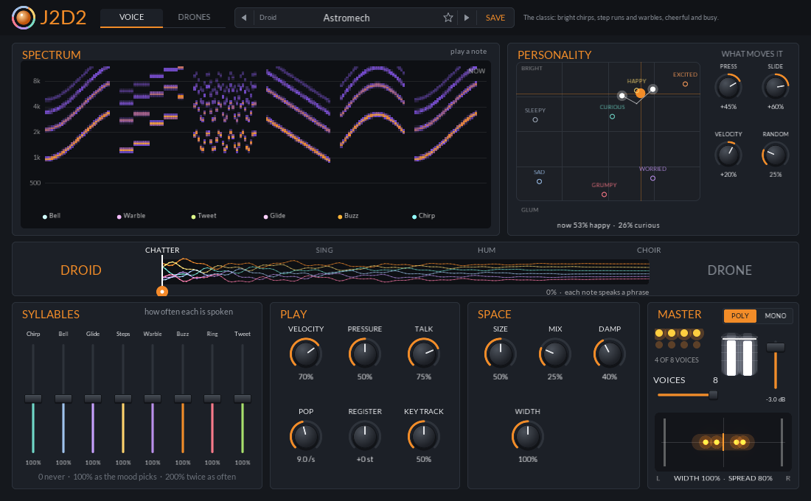
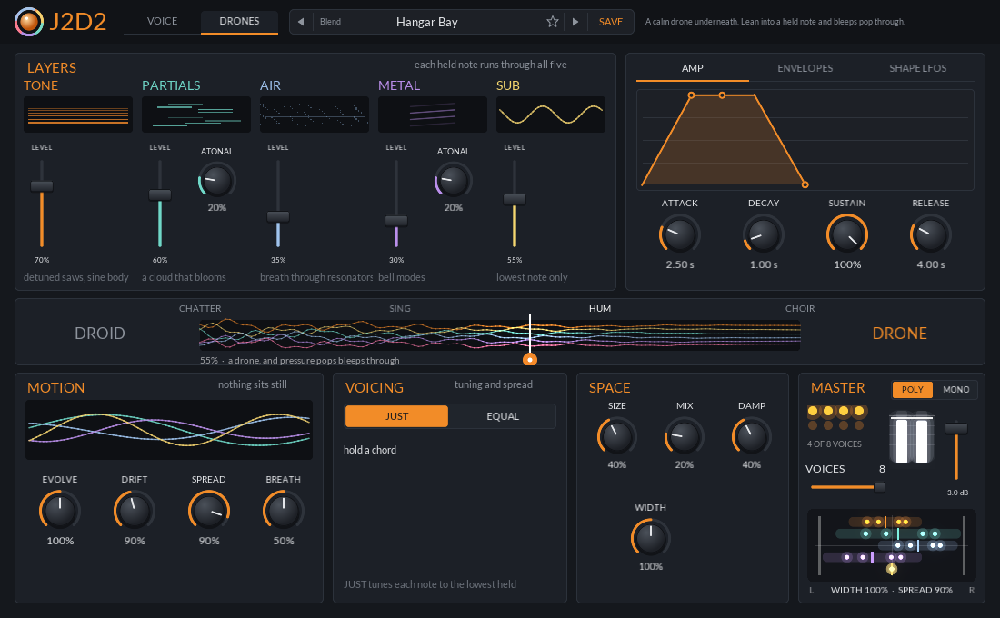

# J2D2

An MPE droid synth. Every note can speak in droid phrases (fast collages of chirps, sweeps, step runs,
trills and buzzes), hum a slowly moving, layered drone, or do both at once. One ribbon takes it from
pure droid to pure drone. A personality pad sets the mood, and pressure and slide move each note's mood
on their own.

      

Version 0.1.0

## How it sounds the way it does

The droid voice comes from measurements, not guesses. Spectrograms of real droid recordings show
that a droid line isn't one smoothly bending tone. It is a quick collage of short, hard-cut sounds,
6 to 10 a second, each 60 to 300 ms long, centred around 1.5 kHz (600 Hz to 3.6 kHz), with the pitch
almost never holding still for more than about 23 ms. Each sound is one of eight kinds, and J2D2
plays all eight:

| Syllable | What it is |
|---|---|
| **Chirp** | a quick bend up or down, often with a bright harmonic stack |
| **Bell** | a sweep that rises and falls, like a whistle |
| **Glide** | a slow, smooth slide |
| **Steps** | sample-and-hold runs of 3 to 8 pitches, often in two voices at once |
| **Warble** | a 45 to 90 Hz trill on the pitch |
| **Buzz** | a low, narrow pulse block |
| **Ring** | two tones multiplied, one sweeping across the other |
| **Tweet** | a wandering whistle chopped by fast tremolo |

Two timbres alternate, also as measured: an almost pure sine, and a bright stack whose 2nd, 3rd and
4th harmonics sit at -10, -14 and -18 dB. Every sound starts and stops with a hard gate.

The droid voice goes through a small "speaker" (band-limited to 250 Hz to 10 kHz and gently clipped).

## The personality

PERSONALITY is an XY pad. **Energy** runs across it, from calm to excited, and **feeling** runs up
it, from glum to bright. Seven moods are marked where they sit (excited, happy, curious, sleepy, sad,
grumpy and worried), but the pad is continuous, so any point blends the moods around it. The readout
under it names the two nearest, for example "now 53% happy · 26% curious".

Mood shapes every sound, not only which ones get picked:

- **Tempo:** excited sounds are about 0.6 times as long, and sad ones about 1.7 times.
- **Direction and register:** happy and excited pitches climb and sit higher. Sad ones sink, stay
  in a narrow band, and droop at the end of every sound.
- **Brightness and drive:** worried and grumpy are bright and harsh. Grumpy picks buzzes and ring
  crossings and drives them hard.
- **Tremble:** worried trembles, and sad wavers.
- **The end of a phrase:** curious and happy phrases end on a rising question, sad ones on a long
  sigh down, and excited ones on a squeal.

WHAT MOVES IT sets how each note's own expression moves its point on the pad: **PRESS** (MPE
pressure) pushes energy, **SLIDE** (MPE slide, CC 74) and **VELOCITY** move feeling, and **RANDOM**
gives every note its own nudge. The white dots on the pad are the playing voices, each with a line
back to the point you set.

## The VOICE page

- **SPECTRUM** is a waterfall of what J2D2 is playing. The newest sound is at the right edge and
  the picture scrolls left. Each droid sound is tagged with its kind as it starts.
- **SYLLABLES** sets how often each kind is spoken: 0 never, 100% as often as the mood picks it,
  200% twice as often.
- **PLAY** sets how the droid voice answers your playing:
  - **VELOCITY** and **PRESSURE**: how far each opens the voice's filter (from 2.2 kHz up to about
    12 kHz) and pushes its drive. Velocity also sets the level.
  - **TALK**: how often a held note speaks again. At 0 it speaks once per note.
  - **POP**: how many bleeps a second full pressure pops through a held drone (see below).
  - **REGISTER** and **KEY TRACK**: where the droid's voice sits, and how far the key you play moves
    it.

## The DROID ⟷ DRONE ribbon

The ribbon runs from **CHATTER** through **SING** and **HUM** to **CHOIR**. Drag it anywhere.

- **All the way left (DROID):** every note speaks a phrase, and there's no drone.
- **In between:** each new note speaks a phrase over its own drone, and the drone fades in toward the
  middle. Leaning into a held note pops bleeps through it, as many a second as POP at full pressure
  (they rise with the square of the pressure). Notes played over the drone each fire a burst.
- **All the way right (DRONE):** every held note hums its own line, and only pressure brings the droid
  through.

The ribbon's six lines are jagged at the droid end and settle into calm held lines at the drone end.
They have the same brightness end to end, a little brighter around the thumb, with a soft glow
within a fifth of the width either side of it.

## The DRONES page

### LAYERS

Each held note runs through all five layers, each with its own LEVEL:

| Layer | What it is |
|---|---|
| **TONE** | three saws a few cents apart and a sine body, under a lowpass that a slow "hand" opens and closes |
| **PARTIALS** | a cloud of harmonics, each blooming, fading and drifting across the stereo field on its own |
| **AIR** | noise through narrow resonators at the note's harmonics, plus a moving band of breath |
| **METAL** | four bell modes swelling in and out, each with a slow tremolo |
| **SUB** | a sine an octave under the lowest held note |

**ATONAL** on PARTIALS and METAL moves each from in tune to inharmonic, with both ends kept musical:

- **PARTIALS:** at 0 every partial is an exact, consonant harmonic (octaves, fifths and thirds), and
  they barely drift. Turning it up fades in the 7th, 9th, 11th, 13th, 14th and 15th harmonics,
  stretches the series (at most 60 cents), detunes each partial (about 10 cents) and widens the
  drift. Even at 100% each partial stays within about a quarter-tone of a harmonic.
- **METAL:** at 0 the modes sit on tuned ratios (3, 5, 8 and 12 times the note), a singing bell.
  Turning it up slides each mode toward a free bar's (2.76, 5.40, 8.93 and 13.34). That end is
  metallic but still bell-like, never noise.

The drone is tuned in **just intonation** against the lowest held note, so chords ring without
beating (VOICING can switch to equal temperament).

### AMP, ENVELOPES and SHAPE LFOS

- **AMP** is the drone's envelope: ATTACK, DECAY, SUSTAIN and RELEASE, in seconds. The attack eases
  in and the release eases out.
- **ENVELOPES** are two more per-note envelopes, ENV 1 (slow) and ENV 2 (short), each sent **TO** one
  destination by an **AMOUNT** (either way).
- **SHAPE LFOS** are two free-running LFOs, LFO 1 (breath, 12 s) and LFO 2 (weather, 7.5 s), with
  JSynth's shapes (sine, triangle, saw, square, S&H and smooth), each sent to one destination.

Destinations: Droid/Drone, Energy, Feeling, Tone, Partials, Air, Metal, Sub, Partials Atonal, Metal
Atonal, Cutoff (TONE's lowpass), Evolve, Drift and Pan. By default LFO 1 breathes PARTIALS between
pure and atonal, LFO 2 does the same to METAL, and ENV 1 swells PARTIALS in over each note.

### MOTION and VOICING

- **EVOLVE:** how fast every layer's motion moves.
- **DRIFT:** how far pitches wander, in cents.
- **SPREAD:** how wide the voices and partials spread across the field.
- **BREATH:** a slow swell in each note's level.
- **VOICING:** JUST or EQUAL tuning. It also lists the held notes and how far just intonation
  moves each one.

## SPACE and MASTER

Both pages share these:

- **SPACE** is a small room: SIZE (closet to hall), MIX and DAMP, plus WIDTH for everything.
- **MASTER:**
  - POLY or MONO, the number of VOICES (1 to 8), and a dot for each voice in use.
  - The output meters and the master fader. The meters are JSynth's: a soft halo that grows with
    the level, and a white tick where the fader is set.
  - JSynth's stereo field. It shows one lane for the droid's voices on the VOICE page, and one lane
    per drone layer on the DRONES page. Each lane has its spread as a soft pill, its pan as a line,
    and a dot for each voice.

## Playing it

J2D2 takes CLAP notes with per-note expression, MPE over MIDI (it follows the MPE configuration
message, with ±48 semitone note bends) and plain MIDI with channel or poly aftertouch:

- **Pitch bend** bends the note (and its drone).
- **Pressure** opens the droid's filter and drive, opens TONE and AIR, pushes the note's energy, and
  pops bleeps through a held drone.
- **Slide** (CC 74) moves the note's feeling.

## Presets

18 factory presets in four groups:

| Group | Presets |
|---|---|
| Init | Init |
| Droid | Astromech, Question Mark, Overjoyed, Nervous Wreck, Grumble, Little Sigh, Low Battery: one for each mood |
| Blend | Hangar Bay, Night Watch, Workshop, Distress Call: a drone underneath, with pressure popping bleeps through |
| Drone | Choir of Circuits, Reactor Hum, Deep Space, Rust Bells, Thermal Drift, Glass Partials: tuned and warm through to METAL-heavy and atonal |

The header shows a line about each one. SAVE keeps your own in the J2D2 preset folder.

## Building

J2D2 builds with the rest of JClap (see the [top-level README](../../README.md)). Its tests and tools:

- `j2d2-tests`: the engine and the plugin through a test host. It checks that mood shapes the
  phrases (excited is faster and climbs, sad is slower and sinks), that each drone layer sounds at
  about the same level, ATONAL's bounds, pure droid and pure drone, pressure popping bleeps through a
  drone, every preset's level, MPE over MIDI, param text and state.
- `j2d2-screenshot-test`, `j2d2-screenshot-drones-test`: the panel pictures above.
- `j2d2-render out.wav` (with `JCLAP_BUILD_TOOLS`): renders every factory preset to a WAV, each one
  played the same way, for listening and level checks.
