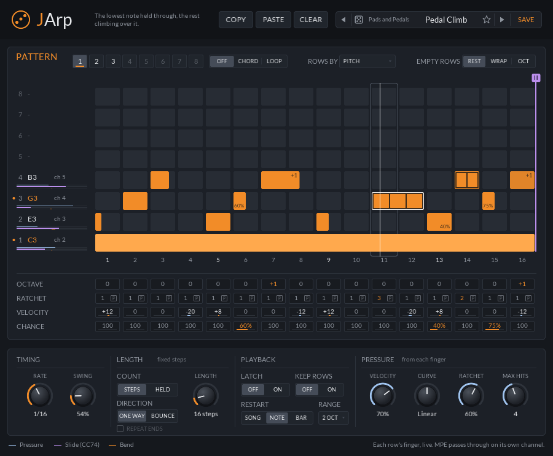

# JArp

An MPE arpeggiator that plays the notes you hold through a grid pattern.

   

A CLAP note effect, made for an MPE controller such as the LinnStrument. Hold a chord and the grid
plays it: each row is one of the notes you hold, each column a step, and a lit cell plays that row's
note on that step for as long as the cell is drawn. Every note goes out on the finger's own channel and
key, so the synth after it still hears that finger's pressure, slide and bend. Put it before any MPE
instrument.

Version 0.1.0.

## The grid

Eight rows by sixteen steps. Row 1 is at the bottom.

- **Click an empty cell** for a one-step note, and drag right while you hold the button to make it
  longer.
- **Drag a note's right edge** to set how long it sounds, in quarter steps, from a quarter of a step to
  the whole pattern. A note stops at the next note in its row.
- **Click a note** to remove it.
- **Drag the purple bar** (or its tab) to set the pattern's length, from 1 to 16 steps. The LENGTH knob
  is the same setting.

There is no gate setting: a note's length on the grid is its gate. A note on row 1 drawn across the
whole pattern holds a pedal under the rest.

The column with a frame round it is the step playing. A note playing lights up, and so does its row's
note name, with a dot beside it.

## Rows

**ROWS BY** decides which held note each row plays.

- **PITCH**: row 1 is the lowest note you hold, row 2 the next up, and so on. Hold a 7th chord and rows
  1 to 4 are its four notes. **EMPTY ROWS** says what rows above the notes you hold do: **REST** stays
  silent, **WRAP** starts again from the lowest note (with four notes held, row 5 plays row 1's note).
- **DEGREE**: rows count up a scale from the lowest note you hold: row 1 is that note, row 3 the 3rd
  above it, row 5 the 5th, and so on. Pick the scale's key and MAJOR or MINOR beside it. A degree you
  aren't holding plays the held note nearest to it, so JArp never plays a note you didn't hold. Where
  two held notes are equally near, the one in the scale wins, and then the lower. So rows 1 and 5
  alternating play the root and fifth of any chord.

Each row's label shows the note it plays and its MIDI channel. In DEGREE mode a row whose degree
isn't held shows the note it wanted, as `wants F3`. Three hairlines along the bottom of each label follow
that finger live: pressure (blue), slide, CC74 (purple), and bend from the middle (orange).

## The lanes

Under the grid, one cell per step, for the notes that start on that step. Drag a cell up or down, or
scroll on it, to change it; double-click to set it back.

- **OCTAVE**: -3 to +3 octaves. A note shows its octave in its corner.
- **RATCHET**: splits the note into 1 to 8 equal hits across its length. The note on the grid shows
  its hits. Click **P** to make the step's ratchet follow pressure: pressing harder adds hits, up to
  MAX HITS. The note shows the extra hits it could take as blue outlines, filled as the finger presses.
- **VELOCITY**: an offset from -64 to +64, added to the note's velocity.

## Settings

**TIMING**

- **RATE**: how long a step is, from 1/32 to 1/4, with triplets.
- **SWING**: moves every second step later, from 50% (straight) to 75%.
- **LENGTH**: steps before the pattern loops, 1 to 16.

**PLAYBACK**

- **LATCH**: on, the notes keep playing after you let go, until you play a new chord.
- **RESTART**: where the pattern starts. **FREE** follows the song position, so the pattern lines up
  with the bar. **NOTE** starts it on the first note you play. **BAR** starts it at the start of the
  bar the first note falls in.

With the host stopped, JArp runs on its own clock at the host's tempo, so you can play it without
pressing play.

**PRESSURE**, from each finger:

- **VELOCITY**: how far each note's velocity follows its finger's pressure, rather than how hard the
  key was struck. At 0 it's the strike velocity alone. The Velocity lane's offset is added after.
- **CURVE**: how pressure maps. SOFT reaches high values with a light touch, LINEAR is as played, HARD
  needs a firm press. It shapes both Velocity and Ratchet.
- **RATCHET**: how far pressure adds hits on steps with P lit, from the step's own count up to MAX HITS.
- **MAX HITS**: the most hits a pressed P step splits into, 1 to 8.

The pressure is read when the note starts.

## MPE

Each arp note plays on the channel and key of the finger it comes from (plus the step's octave), so
an MPE synth plays it with that finger's expression:

- Channel pressure, CC74 and pitch bend pass straight through on their channel.
- Poly aftertouch and CLAP note expressions (pressure, brightness, tuning) are sent on to every arp
  note playing from that finger.
- Letting go of a finger ends its notes at once (unless LATCH is on).

The notes you hold don't pass through: only the arp's notes do.

## Dice

Click the die in the preset bar for the dice card.

- **RANDOMIZE** builds a new pattern from a plain base (one note per step on row 1, octave 0, one hit,
  velocity offset 0), rolling each ticked item within its range.
- **MUTATE** nudges the pattern you have, each ticked item by up to its range. Click again to keep
  going.
- **UNDO** and **REDO** step back and forward through what the dice replaced.

Untick an item to keep it as it is. The ranges:

| Item | Range | |
|---|---|---|
| PLACEMENT | 25% | The share of steps left empty (RANDOMIZE) or flipped between a note and a rest (MUTATE) |
| NOTES | rows 1-3 | Which rows notes land on |
| LENGTH | ¼ to 2 | Note lengths, in steps |
| OCTAVE | ±1 oct | Octave lane values |
| RATCHET | up to 3 | Ratchet lane counts |
| VELOCITY | ±20 | Velocity lane offsets |
| PRESSURE | 20% | The share of steps with P lit (unticked to start with) |

Only the steps up to the pattern's length are rolled. The dice only ever change the pattern, never
the held notes, so JArp still plays only notes you hold.

## Presets

The preset bar steps through the factory bank and then your own. Each factory preset brings its
pattern with it:

| Preset | |
|---|---|
| Init | Up through four notes and back |
| Root Fifth | The 1st and 5th of whatever you hold, alternating (DEGREE rows) |
| Broken Thirds | 1 3 2 4 3 5 4 6 up the scale (DEGREE rows) |
| Wrap Run | Up all eight rows, wrapping round the notes held, an octave up on the way back |
| Pedal Climb | Row 1 held under the whole pattern, the rest climbing over it, with ratchets and accents |
| Gallop | Triplets, restarting on the bar |
| Stabs | All four notes at once, with octave jumps |
| Press Roll | Steps with P lit roll faster the harder you press |

**SAVE** names the current settings and writes them as a small text file:

- macOS: `~/Library/Application Support/JArp/Presets`
- Windows: `%APPDATA%\JArp\Presets`
- Linux: `~/.config/JArp/Presets`

A saved preset holds the settings only. The pattern is saved with the project.

Click the **star** beside the name to make the current preset a favorite.

## Building

Built with the rest of the repo; see the [top-level README](../../README.md). The engine is plain C++
in `src/engine.h`, tested on its own in `tests/test_engine.cpp`; the dice are in `src/randomize.h`.
