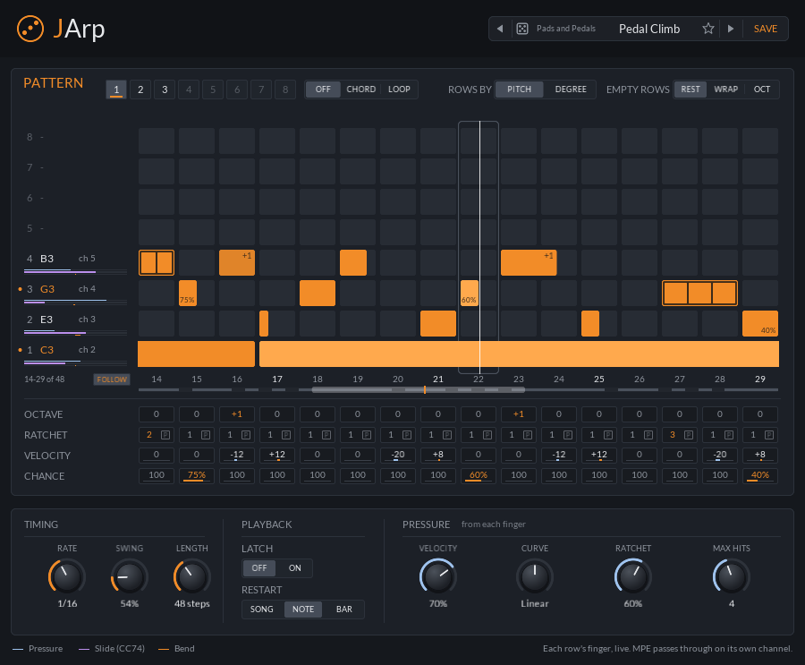
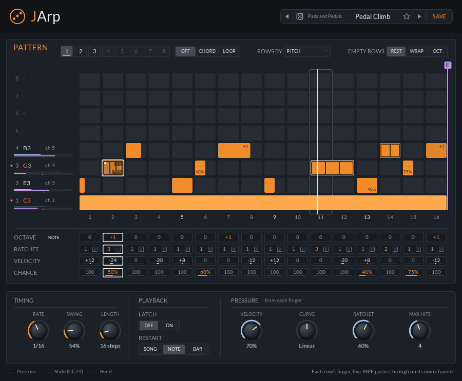
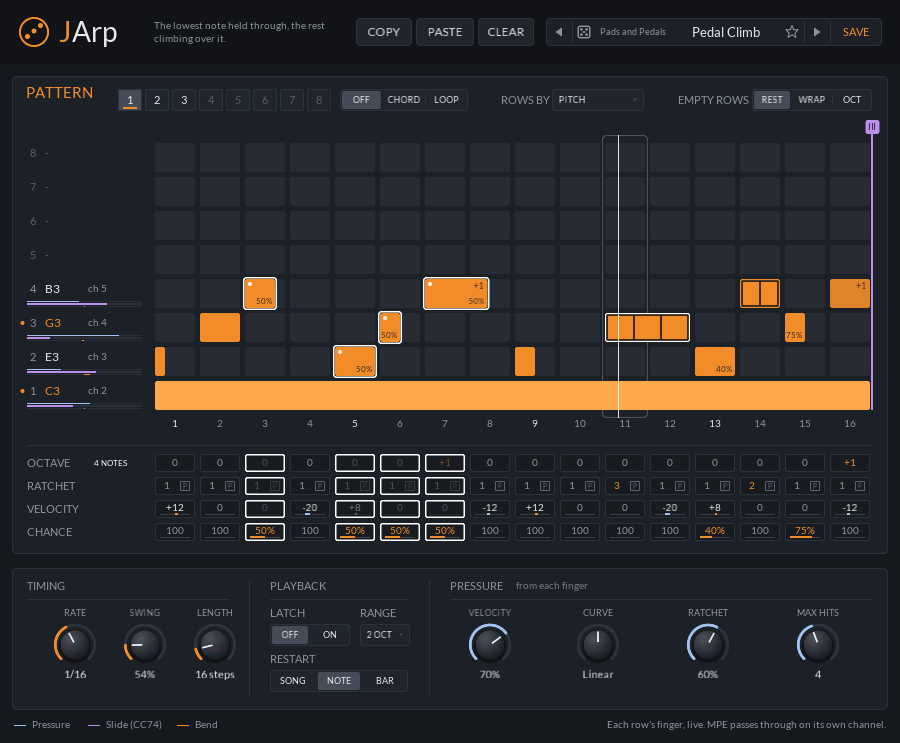
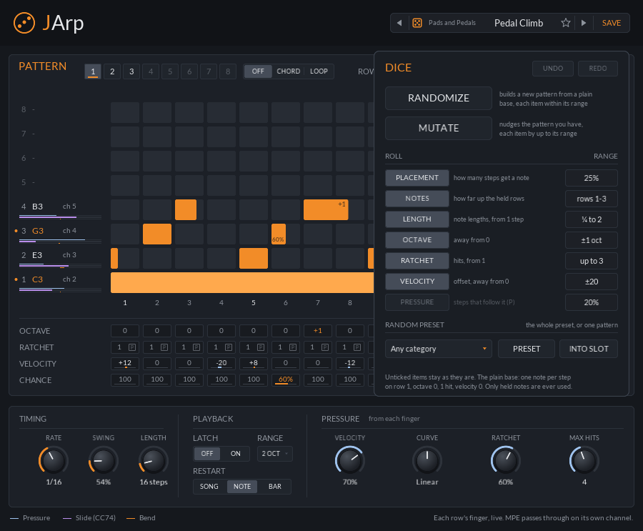

# JArp

An MPE arpeggiator that plays the notes you hold through a grid pattern.

   

A CLAP note effect, made for an MPE controller such as the LinnStrument. Hold a chord and the grid
plays it: each row is one of the notes you hold, each column a step, and a lit cell plays that row's
note on that step for as long as the cell is drawn. Every note goes out on the finger's own channel and
key, so the synth after it still hears that finger's pressure, slide and bend. Put it before any MPE
instrument.

Version 0.18.0.

**[User manual (PDF)](docs/JArp-User-Manual.pdf)**: every control, how rows find their notes, length
and direction, MPE, chains, the dice, the full preset list with each preset's blurb, recipes and a
settings reference.

Hover over a control for a one-line tip. The grid and the lanes have none, so nothing pops up while
you draw.

## The grid

Eight rows by up to 128 steps, sixteen in view at a time. Row 1 is at the bottom.

- **Paint**: press an empty cell for a one-step note, and keep the button down to drag across the
  grid: every empty cell the mouse passes gets a note too, until you let go.
- **Erase**: press a note to remove it, and keep the button down to drag: every note the mouse passes
  is removed too, until you let go.
- **Drag a note's right edge** to set how long it sounds, in quarter steps, from a quarter of a step to
  the whole pattern. A note stops at the next note in its row. The handle is a narrow strip just
  inside the edge: it lights white, and the pointer turns to a resize arrow, when you're on it. The
  length only follows a deliberate drag, so a click that wobbles leaves it as it was.
- **Pick notes** to move them or give them lane values of their own (see [the lanes](#the-lanes)):
  **shift-drag** from anywhere draws a box that picks every note it touches (adding to what's
  picked), **shift-click** a note to add it to the pick or drop it, and **right-click** a note to pick
  just that one. **Right-drag** from an empty cell draws a box too. Picked notes have a white edge.
- **Drag a picked note** to move every picked note together, keeping their shape and each note's
  length (shortened if it lands just before another note) and lane values. A move that would take a
  note off the grid, past the pattern's end or onto another note stops where it last fit. Hold
  **Alt** (Option on a Mac) to drag a note that isn't picked. Clicking a picked note without dragging
  removes it.
- **Drag the purple bar** (or its tab) to set the pattern's length, from 1 to 128 steps. Drag it past
  the right edge and the grid scrolls on with it. The LENGTH knob is the same setting. Each pattern
  has its own length. With LENGTH by HELD notes the bar follows the notes you hold instead (see
  Settings), and steps past it dim.

A white line moves through the steps in time with the transport, and the step it is in is outlined.
A softer note (a lower VELOCITY) draws fainter, and a note left to chance (a CHANCE under 100%) shows
its percent in its lower corner.

There is no gate setting: a note's length on the grid is its gate. A note on row 1 drawn across the
whole pattern holds a pedal under the rest.

### Long patterns

A pattern longer than 16 steps scrolls. A bar under the step numbers shows the whole pattern: the
lighter part is the 16 steps in view, the ticks are steps where notes start, and the orange line is
the playhead. Beside it, the steps in view (`17-32 of 48`) and **FOLLOW**.

- With **FOLLOW** lit, the grid follows the playhead: it holds still until the playhead reaches the
  middle, then glides along with it, smoothly with the transport rather than a step at a time, until
  the pattern's end reaches the right edge.
- **Drag along the bar** (or the step numbers above it), or scroll the mouse wheel over the grid, to
  look elsewhere. That turns FOLLOW off; click it to follow again.
- The lanes under the grid scroll with it.

Notes and lane settings past the pattern's length are kept, dimmed, so shortening a pattern and
lengthening it again loses nothing.

The column with a frame round it is the step playing. A note playing lights up, and so does its row's
note name, with a dot beside it.

## Patterns and chains

JArp holds eight patterns, **1** to **8**, in the strip beside the PATTERN title. Click a number to
play it and edit it on the grid. A lit number has notes in it; the one playing has an orange bar under
it. **COPY**, **PASTE** and **CLEAR** in the header act on the pattern on the grid: copy one, show
another and paste over it, or clear out every note (keeping its length). PASTE lights once something
is copied, and the dice card's UNDO takes back a paste or a clear. Right-click a number to **copy** it,
**paste** into it, or **clear** it the same way, or to **load from
preset**: pick a preset, or one pattern of a preset that has several, and only that pattern loads into
this slot, leaving the other slots and the settings as they are.

The switch beside the numbers says how playing moves along them:

- **OFF**: the pattern selected plays.
- **CHORD**: each new chord moves to the next pattern. Let go of every note, play again, and the next
  pattern starts. The first chord plays the one selected.
- **LOOP**: while you hold, each time a pattern ends the next one starts, so 1, 2 and 3 play as one
  long phrase. Each new chord starts the phrase again from the one selected.

In the CHAIN card under the pattern, **REPEAT** and **THEN** say when and where the chain moves on:

- **REPEAT** (x1 to x16): how many times each pattern plays before the chain moves on. In LOOP that's
  times round: at x2, 1 1 2 2 3 3. In CHORD it's chords: at x2, each pattern plays for two chords.
- **THEN**: where it goes after that. **NEXT** moves to the next pattern with notes in it. **RANDOM**
  picks one of the other patterns with notes in it, never the one that just played, so with 1, 2, 3
  and 4 filled and REPEAT x2 you might hear 1 1 3 3 2 2 4 4 1 1 ...

Empty patterns are skipped, and after the last pattern with notes it goes round to the first. To chain
1, 2 and 3, fill those three and leave the rest empty; clear one to drop it from the chain.

While a chain plays, the grid and lanes follow it: when CHORD or LOOP moves on, the pattern now
playing is the one shown, and edits go to it. Click a number in the strip to show and edit that one;
the grid stays on it until the chain moves on again, and goes back to the selected pattern when
playing stops.

With RESTART on **SONG** the chain follows the song too. In LOOP the patterns are laid end to end from
the start of the song (beginning with the one selected), so where the song is decides which pattern
plays and which step: come in during the third bar of a 1 2 3 chain and you hear the part of the
chain that falls there, with each pattern taking up REPEAT times its length. In CHORD the next
pattern picks up at the step the song has reached in it. A random chain can't be worked out from
where the song is, so in LOOP with THEN on RANDOM the patterns change each time one ends, counted
from your chord, as with NOTE.

Both are host params, so you can automate or modulate them: **Pattern** (1 to 8, the same numbers
as the strip) picks the pattern, **Advance** (Off, Chord, Loop) turns chaining on and off, **Repeat**
(1 to 16) and **Then** (Next, Random) are REPEAT and THEN. A new Pattern value takes over from the
next step.

## Rows

**ROWS BY** decides which held note each row plays.

- **PITCH**: row 1 is the lowest note you hold, row 2 the next up, and so on. Hold a 7th chord and rows
  1 to 4 are its four notes. **EMPTY ROWS** says what rows above the notes you hold do: **REST** stays
  silent, **WRAP** starts again from the lowest note (with four notes held, row 5 plays row 1's note),
  and **OCT** carries on up an octave (with a triad held, rows 4 to 6 are the triad an octave up). OCT
  makes one shape fit any chord size: rows 1, 4 and 7 are always the root in three octaves. How high OCT can climb is capped by **RANGE** (in the PLAY card; see Settings).
- **DEGREE**: rows count up a scale from the lowest note you hold: row 1 is that note, row 3 the 3rd
  above it, row 5 the 5th, and so on. Pick the scale's key and MAJOR or MINOR beside it. A degree you
  aren't holding plays the held note nearest to it, so JArp never plays a note you didn't hold. Where
  two held notes are equally near, the one in the scale wins, and then the lower. So rows 1 and 5
  alternating play the root and fifth of any chord.
- **HELD DEGREE**: DEGREE, but a degree you aren't holding stays silent instead of playing the nearest
  note. It plays when you hold that note in any octave. Hold C and G and a pattern of 1st, 3rd and 5th
  plays only the C and G; add the E and the 3rd comes in.
- **SPREAD**: the pattern's rows spread over however many notes you hold. Its bottom row plays your
  lowest note and its top row (the highest row with a note on it) your highest, and the rows between
  play the notes nearest their place between. A pattern on rows 1, 2 and 3 plays the bottom, middle
  and top of the chord, whether you hold 3 notes or 10. With fewer notes held than rows, rows share
  notes, and a note two rows land on plays once.

A note on a row that nothing held plays (a row above the notes you hold with REST, or a degree you
aren't holding with HELD DEGREE) shows grey on the grid while you play, and turns orange again when
you hold enough notes.

Each row's label shows the note it plays and its MIDI channel. In DEGREE mode a row whose degree
isn't held shows the note it wanted, as `wants F3`. Three hairlines along the bottom of each label follow
that finger live: pressure (blue), slide, CC74 (purple), and bend from the middle (orange).

## The lanes

Under the grid, one cell per step, for the notes that start on that step. Drag a cell up or down, or
scroll on it, to change it; double-click to set it back.

- **OCTAVE**: -3 to +3 octaves. A note shows its octave in its corner.
- **RATCHET**: splits the note into 1 to 8 equal hits across its length. The note on the grid shows
  its hits. Click **P** to make the step's ratchet follow pressure: pressing harder adds hits, up to
  MAX HITS. The note shows the extra hits it could take as blue outlines, filled as the finger presses.
- **VELOCITY**: an offset from -64 to +64, added to the note's velocity.
- **CHANCE**: how likely the step's notes are to play each time round, from 0% to 100% (the default).
  Each note rolls on its own, so at 50% a chord on that step thins out differently every pass, and a
  ratcheted note plays all its hits or none. A cell under 100% shows in orange with a bar under it.

### A note's own values

The lanes are per step, so every note starting on a step shares them. To set one note apart, right-click
it. It gets a white outline, **NOTE** shows beside the lane names, and its step's column in the lanes
(outlined in white) now edits that note alone. A value you change becomes the note's own; values it
still takes from the step show dim. Double-click a value to hand it back to the step. A note with
values of its own shows a white dot in its corner. Right-click it again, or click an empty cell, to
go back to editing steps.

With several notes picked, the lane names show how many (**4 NOTES**), each picked note's column is
outlined, and an edit to any of those columns sets that value on every picked note at once: drag one
CHANCE cell to 50% and all of them are at 50%. Double-click hands that value back to the step for all
of them.

## Settings

Under the pattern, the settings sit in five cards: TIMING, LENGTH, PLAY, CHAIN and PRESSURE.

**TIMING**

- **RATE**: how long a step is, from 1/32 to 1/4, with triplets.
- **SWING**: moves every second step later, from 50% (straight) to 75%.

**LENGTH**: how many steps the pattern plays, and which way round. Each pattern has its own, and
the panel's header line says what it comes to ("4 held = 4 steps").

- **COUNT**:
  - **STEPS**: a set length, 1 to 128 steps, on the LENGTH knob (or the purple bar).
  - **HELD**: so many steps for each note you hold, **TIMES** 1 to 8, **PLUS** or minus up to 16
    more, 1 to 128 in all. Hold three notes with x1 +0 and the pattern is three steps long; hold
    four and it's four. A pattern that walks up its rows then plays exactly the notes you hold,
    whatever the chord: x2 goes on up an octave (with OCT rows), +1 adds the root an octave up on
    top. With KEEP ROWS on, a key let go still counts until every key is up. With nothing held the
    LENGTH knob's steps stand in.
- **DIRECTION**:
  - **ONE WAY**: step 1 to the end, then round again.
  - **BOUNCE**: up to the last step and back down, playing the first and last steps once each time
    round: four steps play 1 2 3 4 3 2. With HELD, an Up pattern becomes Up Down for any chord. The
    playhead runs back down the grid on the way back.
  - **REPEAT ENDS** (the box under them): with BOUNCE, the first and last steps play twice at the
    turns instead, 1 2 3 4 4 3 2 1, so four held notes fill eight steps. Dimmed when ONE WAY.

**PLAY**, and the keys you hold: LATCH, RESTART and ONE SHOT on the left, KEEP ROWS, RANGE and
PASS SUSTAIN on the right.

- **LATCH**: on, the notes keep playing after you let go, until you play a new chord. A host's All
  Notes Off (or a note choke) stops them too.
- **Sustain pedal** (CC64): while it's down, keys you let go of stay in the chord and the arp keeps
  playing them; new keys join it. Lifting the pedal lets go of every key no longer held. JArp keeps
  the pedal for itself rather than passing it on, so the arp's own note lengths stay as drawn.
- **PASS SUSTAIN** (the box under RANGE, in PLAY): on, the pedal goes straight on to the synth instead and
  JArp ignores it, so the synth's own sustain rings the arp's notes on. Off to start with.
- **ONE SHOT** (the box under RESTART, in PLAY): on, each new chord plays the pattern once through and then
  the arp stops until you play a new chord (let go of every key, or with LATCH, just play again).
  With REPEAT the pattern plays that many times first, and with LOOP the whole chain plays once
  through (each pattern REPEAT times). With RESTART on SONG or BAR the pattern starts where the
  song is, so a chord played half way through plays to the pattern's end. Off to start with.
- **KEEP ROWS**: on, a key you let go of keeps its row until every key is up. Hold C, E and G on
  rows 1 to 3 and let go of C: row 1 rests while E and G stay on rows 2 and 3 instead of shifting
  down. Press C again and it takes row 1 back; a different new key is fitted in by pitch as usual.
  Once every key is up the next chord starts afresh. Made for drums: hold a beat and lift the kick
  or the hats out of it without the other drums moving rows. Off to start with; the Drum Kit
  presets turn it on.
- **RESTART**: where the pattern starts.
  - **SONG** locks the pattern to the song position, so it is sequenced in time rather than started
    by your hands: play a chord half way through the pattern and it starts half way through. Each
    step falls on the same beat every time round.
  - **NOTE** starts it on the first note you play.
  - **BAR** starts it at the start of the bar the first note falls in.
- **RANGE**: how far above the lowest note you hold an octave shift may take a note, from 1 to 4
  octaves (2 to start with). OCT rows climb an octave each time round the held notes, and the
  Octave lane adds more, so with only one or two notes held a high row could land several octaves
  up. A note that would go past the range drops back down by octaves until it fits (one shifted
  down past the range comes back up the same way). The notes you hold always play as held.

**CHAIN**: **REPEAT** and **THEN**, how CHORD and LOOP move along the patterns (see
[Patterns and chains](#patterns-and-chains)). They're dimmed while the switch beside the pattern
numbers is OFF.

With the host stopped, JArp runs on its own clock at the host's tempo, so you can play it without
pressing play.

**PRESSURE**, from each finger, on four sliders:

- **VELOCITY**: how far each note's velocity follows its finger's pressure, rather than how hard the
  key was struck. At 0 it's the strike velocity alone. The Velocity lane's offset is added after.
- **CURVE**: how pressure maps. SOFT reaches high values with a light touch, LINEAR is as played, HARD
  needs a firm press. It shapes both Velocity and Ratchet. The mark half way up the slider is LINEAR.
- **RATCHET**: how far pressure adds hits on steps with P lit, from the step's own count up to MAX HITS.
- **MAX HITS**: the most hits a pressed P step splits into, 1 to 8.

The pressure is read when the note starts.

## MPE

Each arp note plays on the channel and key of the finger it comes from (plus the step's octave), so
an MPE synth plays it with that finger's expression:

- Channel pressure, CC74 and pitch bend pass straight through on their channel.
- Poly aftertouch and CLAP note expressions (pressure, brightness, tuning) are sent on to every arp
  note playing from that finger.
- Each new arp note starts where its finger is now: its bend, pressure and slide are sent again with
  the note (MIDI ones just before it, as MPE asks; poly aftertouch and CLAP note expressions just
  after), so a bend held across retriggers stays bent rather than snapping back.
- This follows the finger, however the rows map onto it: in SPREAD or HELD DEGREE, an OCT row, the
  Octave lane, a WRAP octave or a RANGE fold, every note a finger plays takes that finger's expression,
  and no other finger's.
- Letting go of a finger ends its notes at once (unless LATCH is on).

The notes you hold don't pass through: only the arp's notes do.

## Dice

Click the die in the preset bar for the dice card.

- **RANDOMIZE** builds a new pattern from a plain base (one note per step on row 1, octave 0, one hit,
  velocity offset 0), rolling each ticked item within its range.
- **MUTATE** nudges the pattern you have, each ticked item by up to its range. Click again to keep
  going.
- **RANDOM PRESET**: pick a category (or any), then **PRESET** loads a random factory preset from it,
  settings and all its patterns, or **INTO SLOT** puts one random pattern from those presets into the
  selected slot and leaves everything else as it is.
- **UNDO** and **REDO** step back and forward through what the dice replaced, a random preset
  included.

Untick an item to keep it as it is. The ranges:

| Item | Range | |
|---|---|---|
| PLACEMENT | 25% | The share of steps left empty (RANDOMIZE) or flipped between a note and a rest (MUTATE) |
| NOTES | rows 1-3 | Which rows notes land on |
| LENGTH | ¼ to 2 | Note lengths, in steps |
| OCTAVE | ±1 oct | Octave lane values |
| RATCHET | up to 3 | Ratchet lane counts |
| VELOCITY | ±20 | Velocity lane offsets |
| PRESSURE | 20% | The share of steps with P lit (unticked to start with) |

The dice roll the pattern on the grid, only up to its length. The dice only ever change the pattern, never
the held notes, so JArp still plays only notes you hold.

## Presets

The preset bar steps through the factory bank and then your own. A preset holds the settings and all
eight patterns, and loading one from the bar replaces them all. To load one pattern into one slot
instead, right-click the slot's number and use **Load from preset**:

There are 241 factory presets in 44 categories, each built on how the style is really played.
Most use PITCH rows with OCT, so a triad and a 7th chord both play them in shape. Presets marked
(chain) use several patterns: CHORD moves on with each new chord, LOOP plays them one after another.

No factory pattern skips a note: each walks the notes you hold in turn, from the lowest, with none
left out. The shape comes from your voicing, so for a root-fifth line hold a root and fifth, and for
root-third-fifth hold the triad.

The **Berlin School** presets are sequencer ostinatos in the style of 1970s German electronic music:
short sixteenths over a pedal, leaping octaves, accented in 3+3+2, galloping, drifting against the
bar and changing slowly over many bars. A sequencer of the time played one line and a key
transposed it, so these take few notes: each says in its line whether to hold one note, a root and
fifth, or a triad, and plays only those (rows 1 to 3 at most), getting its octaves from the Octave
lane. Move your hand to transpose the sequence. Some ask for a voicing other than a triad (a root,
2nd and 5th, or a root, minor 3rd and 4th) for a modal colour. There are eight kinds, several of
each: **Melodic** (hand-written lines in an irregular order, with gaps and notes that drop out),
**Pulse**
(one note or two, the octave doing the work), **Sequences** (a triad over sixteen steps),
**Gallop** (an eighth and two sixteenths, and triplets), **Phasing** (loops of 7, 12, 13, 14 and 15
steps that turn over the bar), **Bass** (an octave down), **Ratchets** (rolls of repeated hits) and
**Evolving** (chains, chance steps and long patterns that change over many bars). Put a plucky
synth with a short decay after them, and sweep its filter.

The **Bass** presets are bass lines by genre, 95 of them in 24 genres from rock to amapiano, with
three to five variations of each. Each plays from just the notes a bass line needs, never a big
chord: most want only a **root and fifth** (Funk wants the **root and b7**), and the ones that walk a
chord want a **triad** (the blues shuffle wants the **root, 5th and 6th**). The blurb says which,
and the table marks each one that isn't a root and fifth. Hold the notes in the middle of the
keyboard and route JArp into a bass patch: the line plays an octave down, with the octave pops, the
fifth below the root and the jumps written in its Octave lane rather than asked of your hand. No
pattern goes past row 3 or skips a row, and EMPTY ROWS is OCT, so holding one note fewer still
plays: a root alone gives a root-and-octave line.

The **Drum Kit** presets play a kit from the keys you hold: row 1 is the kick, 2 the snare, 3 the
closed hat and 4 the open hat, the order the General MIDI drum map puts them in. Hold MIDI notes 36,
38, 42 and 46 (C2, D2, F#2 and A#2 as JArp names them, with middle C as C4; a host that calls middle
C C3 names them C1, D1, F#1 and A#1) and route JArp into a drum machine or sampler. Empty rows rest, so a drum you
don't hold stays out, and KEEP ROWS is on, so letting go of any drum's key drops just that drum
while the rest keep their rows: lift the kick for a breakdown and press it again to bring it back. Each is four bars long, the fourth
with a fill, and starts from the song's first bar (RESTART SONG), so its fill lands at the end of
each four-bar phrase. The **Percussion** presets are hand percussion and mallet figures (clave,
cascara, conga, bongos, djembe, cajon, darbuka, tambourine, shaker, bell, tabla, marimba) for any
pitched sound, walking the notes held.

Up, Up Two Octaves, Up and Over, Up Down, Up Down Repeat Ends, Up Down Two Octaves, Root Pedal, Pedal
Bounce and Breath Pulse set their LENGTH by the notes HELD, so they fit whatever chord you play, and
the Up Down ones BOUNCE (Up Down Repeat Ends playing its ends twice). The bass lines, kits and the rest keep a set number of steps, so they stay in time with the bar.

| Category | Presets |
|---|---|
| Basics | Init, Up, Up Two Octaves, Up and Over, Down, Up Down, Up Down Repeat Ends, Up Down Two Octaves, Root Pedal, Converge, Pinky Top, Root Fifth, Broken Thirds (DEGREE rows) |
| Berlin School: Melodic | Lament, Distant Lights (hold a root, 2nd and 5th), Cold Water (root, minor 3rd and 4th), Falling Star, Midnight Ostinato (12 steps), Velvet Pulse (root, 5th and flat 7th), Rainfall (chance), Hymn (eighths), Tidal (root and fifth), Searchlight (root, 4th and 5th), Broken Signal (chance), Wandering (24 steps), Echo Answer, Story Sequence (four patterns, LOOP) |
| Berlin School: Pulse | Octave Pulse, Steady Pulse, Chugging Eighths, Three Octave Pulse, Heartbeat (hold one note); Fifth Pulse, Pedal Fifth (hold a root and fifth) |
| Berlin School: Sequences | Octave Line, Pedal Sequence, Pedal Bounce (HELD, BOUNCE), Dark Ostinato, Rising Triad, Falling Triad, Wave, Skipping Stone (hold a triad) |
| Berlin School: Gallop | Octave Gallop, Fifth Gallop, Triad Gallop, Reverse Gallop, Triplet Sequence, Triplet Pedal |
| Berlin School: Phasing | Phase Drift (14 steps), Seven Step, Twelve Over Sixteen, Thirteen, Fifteen, Interlock (a pulse in fours, a figure in threes) |
| Berlin School: Bass | Sequencer Bass, Low Pulse, Rolling Bass, Descending Bass, Bass Gallop, Eighth Bass |
| Berlin School: Ratchets | Ratchet Pulse, Ratchet Sequence, Pressure Rolls (press for rolls), Roll Up (32 steps) |
| Berlin School: Evolving | Night Drive (four patterns, LOOP), Long Drive (64 steps), Ghost Steps (chance), Slow Build (LOOP), Shifting Sequence (LOOP), Drift Chain (16, 12 and 14 steps, LOOP), Accent Walk (80 steps) |
| Bass: Rock | Root Fifth Octave, Rock Eighths, Dotted Drive, Gallop (triplets) |
| Bass: Metal and Punk | Punk Eighths, Metal Chug, Metal Gallop, Thrash Pick |
| Bass: Blues | Boogie Shuffle (root, 5th, 6th), Boogie Walk (triad), Texas Shuffle, Slow Blues (12/8) |
| Bass: Country | Two Beat, Train Beat, Walk Up (triad), Bluegrass Run (triad) |
| Bass: Jazz | Walking Bass (triad), Two Feel, Jazz Ballad, Jazz Waltz (triad) |
| Bass: Soul | Motown Walk (triad), Soul Pocket (triad), Stax Push, Soul Sixteenths (triad) |
| Bass: Funk | Funk Bass (root, b7), Slap Pops (root, b7), Pocket Sixteenths (triad), On the One (root, b7) |
| Bass: Disco | Disco Octaves, Disco Walk (triad), Disco Sixteenths, Philly Strut |
| Bass: House | House Bass, Rolling House, Deep Offbeat (triad), Chicago Jack |
| Bass: Techno | Acid Line, Techno Rumble, Minimal Stabs, Hypnotic Three |
| Bass: Trance | Rolling Trance, Psy Roll, Octave Roll, Triplet Roll |
| Bass: Drum and Bass | Jungle Roller, Reese Hold, Neuro Stabs, Liquid Walk (triad) |
| Bass: Dubstep | Half Time Sub, Wobble, Riddim, Drop Stabs |
| Bass: UK Garage | Two Step (triad, chain, CHORD), Speed Garage, Bassline House, Garage Skip |
| Bass: Hip Hop | Boom Bap Bass, Sub Slide, Trap Bounce, G Funk, Lo-Fi Drift |
| Bass: R&B | Neo Soul (triad), Slow Jam (triad), Gospel Climb (triad), Quiet Storm |
| Bass: Reggae | Dub Bass (triad), One Drop (triad), Steppers (triad), Rockers |
| Bass: Ska | Ska Walk (triad), Rocksteady, Two Tone |
| Bass: Latin | Tresillo, Tumbao, Cha Cha, Cumbia |
| Bass: Brazil | Bossa Bass, Bossa Walk (triad), Samba Surdo, Baiao |
| Bass: Afro | Afrobeat, Highlife (triad), Afro House, Log Drum |
| Bass: Pop | Pop Pump, Pop Ballad, Pop Push, Syncopated Pop |
| Bass: Synth | Synth Pump, Outrun Drive (triad), Italo Gallop, Synth Funk |
| Bass: Dancehall | Dembow, Dancehall Riddim, Moombahton |
| Drum Kit (four bars each) | Four on the Floor, Rock Beat, Rock Song (a snare-roll fill), Boom Bap Kit, Trap Kit, Funky Break, Drum and Bass Beat, One Drop Kit, Shuffle Kit (triplets) |
| Percussion | Son Clave, Rumba Clave, Cascara, Conga Tumbao, Bell Six Eight (12/8), Teental (tabla), Shaker, Tambourine, Shaker Shuffle (triplets), Cajon, Djembe, Bongo Martillo, Maqsum (darbuka), Marimba Ostinato (12 steps against the bar) |
| Piano | Alberti Bass, Waltz Spread (3/4), Nocturne, Stride, Pop Eighths, Rolled Ballad, Piano Verse (three patterns, CHORD) |
| Guitar Fingerpicking | Travis Picking, Classical Arpeggio (p i m a), Banjo Roll, Ballad Picking, Fingerstyle Song (four patterns, LOOP) |
| Strum and Harp | Down Strum, Up Strum, Strum Pattern (down down up, up down up), Harp Glissando, Harp Cascade, Strum to Harp (chain, CHORD) |
| Pads and Pedals | Pedal Climb, Slow Top, Swell Layers, Drone and Drift (64 steps), Pedal Story (four patterns, LOOP) |
| Ratchet and Rhythm | Trap Hats, Stutter, Machine Gun, Pressure Ratchets, Stabs, Ghost Notes (off-beats left to chance), Stutter Build (four patterns, LOOP) |
| MPE Expressive | Press Roll, Press to Bloom, Breath Pulse, Pressure Waves, Touch Chain (three patterns, CHORD): press harder for louder notes and more hits |
| Long Sequences | Four Bar Groove (64 steps), Generative (32, every step left to chance), Slow Evolution (32), Odyssey (128), Long Chain (two 32-step patterns, LOOP) |
| Chains | Chord Chain and Verse Chorus (CHORD), Phrase Loop, Build Up, Call and Response and Eight Bars (LOOP, Eight Bars using all eight slots) |
| Odd Meters | Five Four, Seven Eight, Nine Eight, Three Over Four, Five Over Four, Odd Chain (7/8 then 5/8, LOOP) |

### Blurbs

Each preset has a one-line blurb, shown in the header between the title and COPY: what the preset is
and how to play it (for a Drum Kit preset, which keys to hold). Click it to write your own; Enter or a
click elsewhere keeps it, Escape drops it. The blurb is kept with the project, and **SAVE** keeps it
with your preset, in a `.jarpnote` text file beside it. Editing the blurb of one of your own presets
updates that file; a factory preset's own blurb comes back when you load it again.

**SAVE** names the current settings and writes them as a small text file, with the patterns in a
`.jarppatterns` file beside it (and its blurb in a `.jarpnote` file):

- macOS: `~/Library/Application Support/JArp/Presets`
- Windows: `%APPDATA%\JArp\Presets`
- Linux: `~/.config/JArp/Presets`

Click the **star** beside the name to make the current preset a favorite.

## Building

Built with the rest of the repo; see the [top-level README](../../README.md). The engine is plain C++
in `src/engine.h`, tested on its own in `tests/test_engine.cpp`; the dice are in `src/randomize.h`.

The manual's source is `docs/manual/manual.html`. `docs/manual/shots.sh path/to/jarp-screenshot`
renders its panel pictures (build with `-DJCLAP_BUILD_TOOLS=ON`), `docs/manual/presets.sh`
regenerates its preset list from `src/library.h` (run it whenever a preset or blurb changes), and
`docs/manual/build.sh` builds the PDF.
