

# JBreath

An eight-voice MPE wind instrument built from physical models: flute, clarinet, sax, oboe and trumpet, each a digital waveguide blown by a model of the player, with every voice drawn live as a glowing loop of its own breath.

       

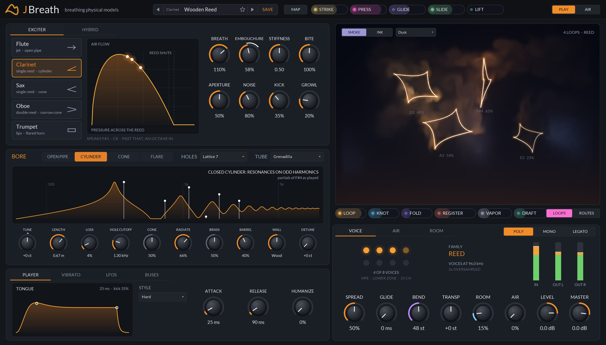

## The instruments

Each voice is a bore (a delay line carrying the sound down the tube and back, with the losses and
reflections of the real one) driven by a nonlinear exciter, the part the player blows into:

| Instrument | Exciter | Bore | What gives it its sound |
|---|---|---|---|
| **Flute** | an air jet crossing the embouchure hole, split in or out of the pipe by the sound in it | open at both ends: every harmonic | the jet takes longer to reach the edge when it's slow, so blowing harder pushes it up a register; edge noise; a 2nd harmonic that grows with the breath |
| **Clarinet** | a single reed: a pressure-controlled valve (Kergomard / Wilson-Beavers), solved each sample with the pressure it makes | a cylinder closed at the reed: odd harmonics | the reed slamming shut at forte; the bell letting the highs out |
| **Sax** | the same kind of reed, softer | a cone, as a split bore: every harmonic, overblowing at the octave | the mouthpiece's honk; growl when it's pushed |
| **Oboe** | a stiff double reed | a narrow cone, darker | formants near 1.1 and 2.9 kHz from the bell and tone holes: nasal, not a soprano sax |
| **Trumpet** | the lips: a mass on a spring blown open by the mouth pressure (outward striking), with the flow through them in closed form | a flared horn: resonances on every harmonic, none at DC | the wave steepening towards a shock at forte: the brassy blare |

Every note plays in tune: the bore length for each model and note was measured offline by playing
it and correcting the length until the pitch was within a cent, at the rates the voices run at, and
baked into [`src/tuning_table.h`](src/tuning_table.h) along with a gain that levels each note's
steady tone. Notes past an instrument's range play an octave (or more) in. The voices run at 88.2 kHz
or more (2x at 44.1 and 48 kHz) and are decimated once.

## A tour of the panel

### The exciter

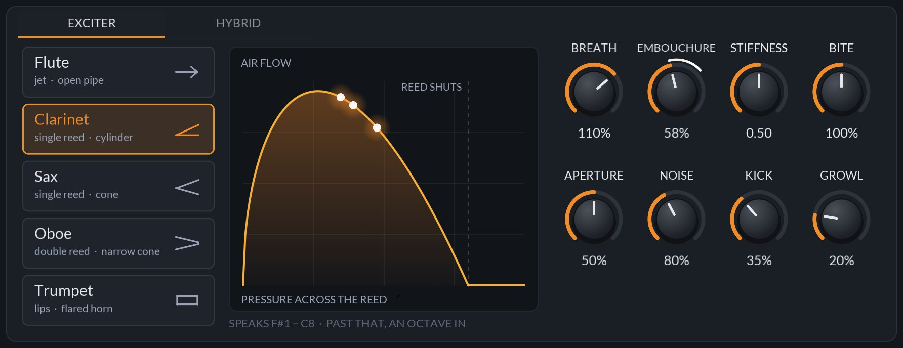

Pick the instrument on the left. The graph is its valve: how the air through it answers the
pressure across it, with a dot where each sounding voice is blowing (a reed's curve turns over and
shuts; the flute's jet overblows). The knobs are how it's blown:

- **BREATH**: how hard the player blows at full pressure (or velocity).
- **EMBOUCHURE**: lip and jaw: the jet's angle on the flute, the bite on a reed, the lips' tension
  on brass. MPE slide moves it.
- **STIFFNESS**: how stiff the reed or lips are (the jet's gain on a flute). Stiff is bright and
  quick to shut, soft is dark and lazy.
- **BITE**: the forte edge: the flute's 2nd harmonic, the reeds' edge, the brass blare.
- **APERTURE**: how far the reed or lips stand open (the jet's width): wide is loud and free,
  narrow thin and focused.
- **NOISE**: breath noise and turbulence. **KICK**: the burst of pressure as the tongue lets the
  air go. **GROWL**: above 20%, a rough flutter of the throat rides on the air, on any instrument.

### Hybrid

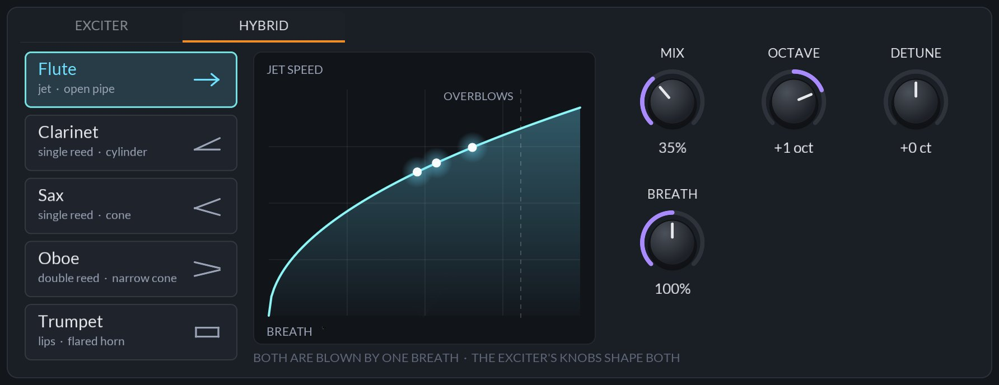

A second instrument blown by the same breath and layered with the first: a flute an octave over an
oboe, a clarinet under a trumpet. **MIX** is how much of it, **OCTAVE** and **DETUNE** where it
plays, **BREATH** how hard it's blown against the first. The exciter's knobs shape both.

### The bore

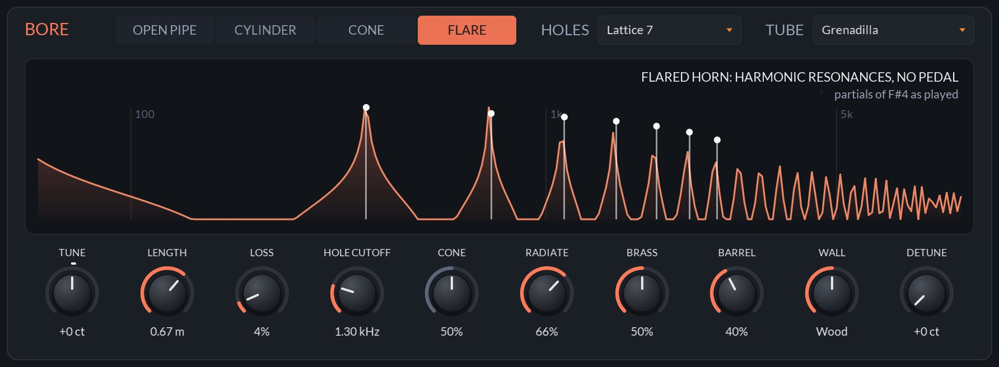

The graph is the bore's input impedance, worked out from the same loop the model runs, with the
partials of the loudest note as it sounds. Every knob changes the curve:

- **TUNE** in cents. **LENGTH**: the tube below the open holes, whose own resonances ring above
  their cutoff; **HOLES** picks how many are open, from Closed to Open.
- **LOSS**: what the bore loses each trip: softer, darker, slower to speak.
- **HOLE CUTOFF**: above it the tone holes let the sound out. The pitch stays put: the filter's delay
  is taken out of the bore.
- **CONE** (sax and oboe): how far the cone is cut short at the reed. **BRASS** (trumpet): how far the
  wave steepens into a blare. Each is dimmed on the instruments it doesn't apply to.
- **RADIATE**, **BARREL** and **WALL**: how the bell sends the highs out, the mouthpiece's cavity,
  and how much the walls soak up (metal to bone). **TUBE** is the material's colour: grenadilla,
  boxwood, maple, bamboo, brass, silver, resin or glass.
- **DETUNE**: each note a little off, by up to 25 cents: a section rather than one player.

### The player

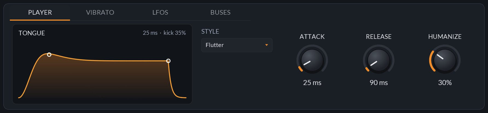

The tongue's breath envelope. **STYLE** is how the note is tongued: Soft (a gentle "da"), Hard
("ta"), Double (every note tongued, even slurred), Flutter (a rolled R through the note) or Breath
(no tongue at all). **ATTACK** and **RELEASE** shape the breath, and **HUMANIZE** makes every note a
little different in pitch, breath, attack and vibrato.

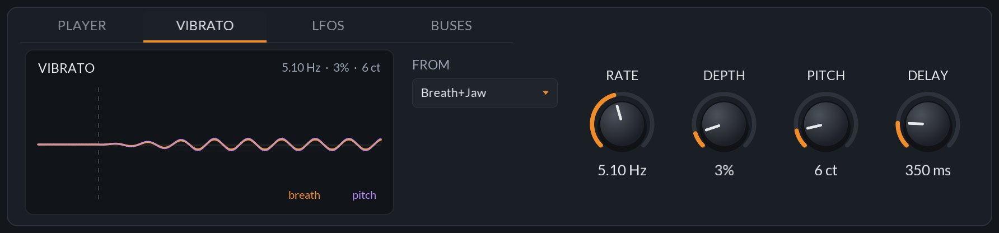

Vibrato grows in after **DELAY**, and its rate and depth wander as a player's do. **FROM** says
where it comes from: the Breath (the diaphragm), the Jaw (the embouchure, so pitch and colour),
both, or the Lip (pitch alone). **PITCH** adds vibrato in cents on top.

### Modulation: MAP, sources and routes

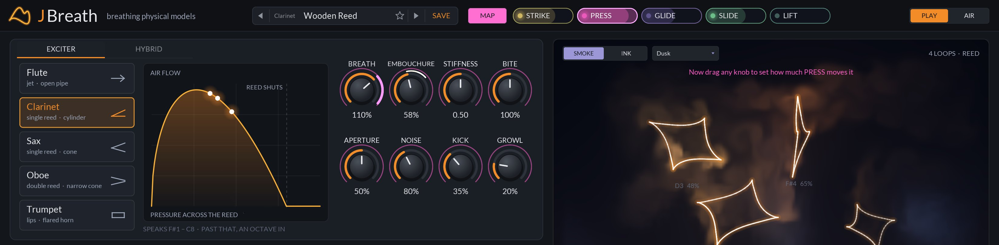

As in JSynth. Touch **MAP** and a source chip, then drag any knob: the ring that appears is how far
that source moves it, per voice. Right-click a knob to unmap it. The sources:

- **The player's hands**, in the header: STRIKE (velocity), PRESS (pressure), GLIDE (pitch bend),
  SLIDE (CC 74), LIFT (release velocity).
- **The breath**, under the loops, read off each voice's own sound: LOOP (how hard it blows), KNOT
  (how bright it is), FOLD (how far past where it overblows), REGISTER (how high in its range),
  VAPOR (how much breath noise rides on it), DRAFT (a slow wandering draught of its own).
- **Generators and buses**: two LFOs and the Swell, Key, Random, and four buses.

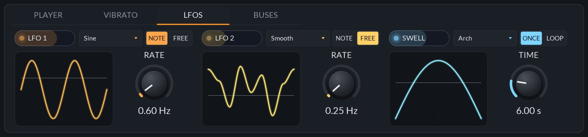

Two LFOs (six shapes, restarting with each note or running free for every voice) and the **Swell**,
one contour over its time from each note's start (Arch, Rise, Fall, Waves, Bloom, Tide, once or
looping).

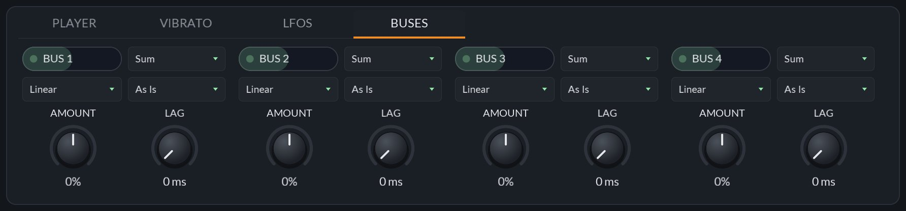

A bus mixes the routes onto it (sum, multiply, min or max), bends the mix (curve and polarity),
lags it, and sends it on as a source of its own.

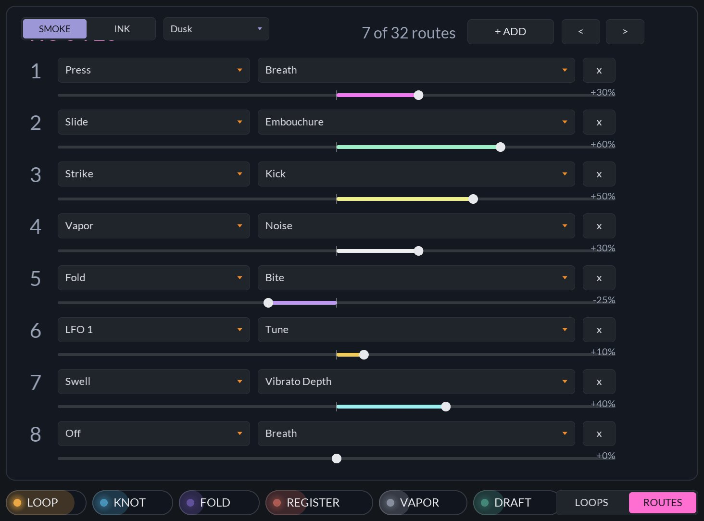

**ROUTES** lists all 32 routes in place of the loops, to add, edit and remove them by hand.

### The breath loops

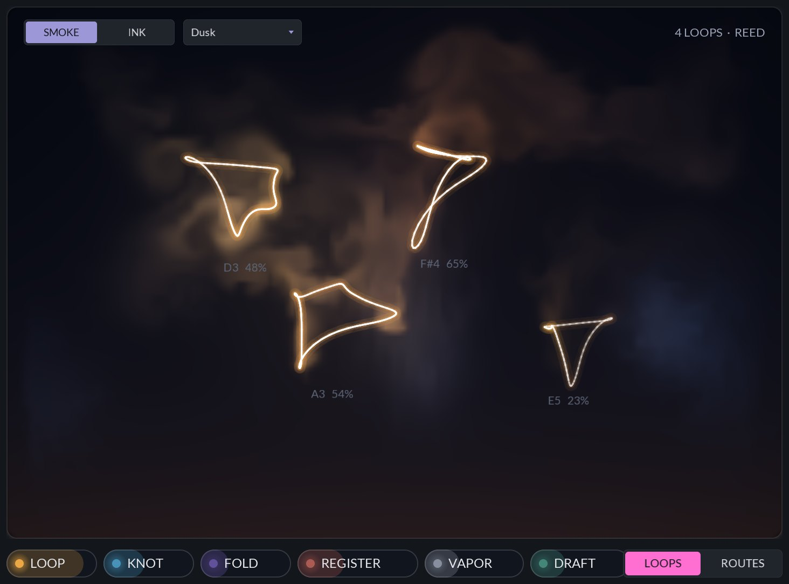

Each voice as a loop in three dimensions (its sound now, a quarter period ago and half a period
ago), slowly turning. A steady tone draws a clean closed loop; growl, a split note or breath noise
fray it. Smoke comes off every loop as it blows, warm in the instrument's colour, cooling as it
rises and curls away. **SMOKE / INK** and the palette set its look.

### The voice card

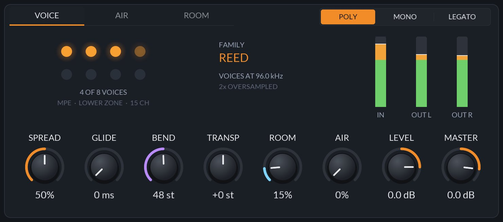

**VOICE** shows the eight voices, the family, and the meters: the breath coming in, and the output
left and right. Along the bottom: **SPREAD** (low notes left, high right, as across a section),
**GLIDE**, **BEND** (the MPE bend range), **TRANSP**, **ROOM**, **AIR** (the breath heard around the
instrument, not through it), **LEVEL** and **MASTER**.

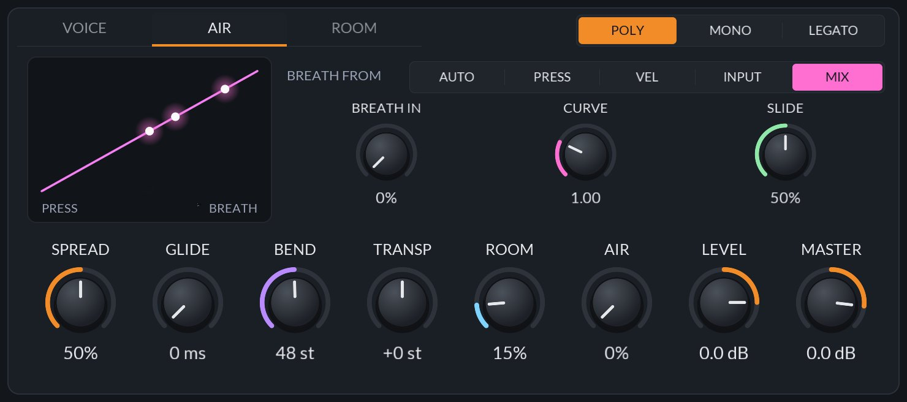

**AIR** is where the breath comes from, and how it's shaped (see [Breath and MPE](#breath-and-mpe)).

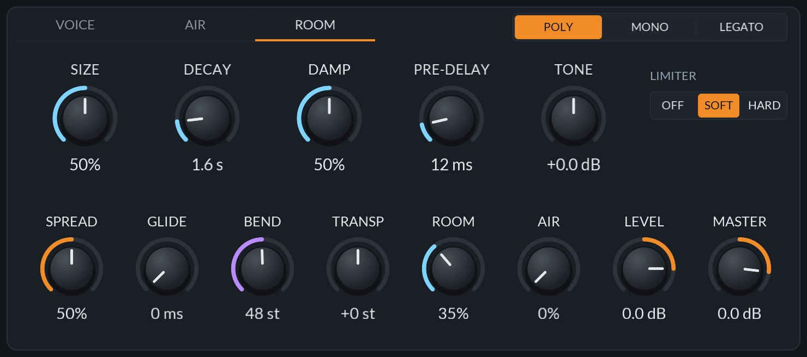

**ROOM**: a small room (SIZE, DECAY, DAMP, PRE-DELAY), the output's TONE, and the **LIMITER**: Off,
Soft (overs saturate) or Hard (a peak limiter holds the output under full scale).

### The AIR view

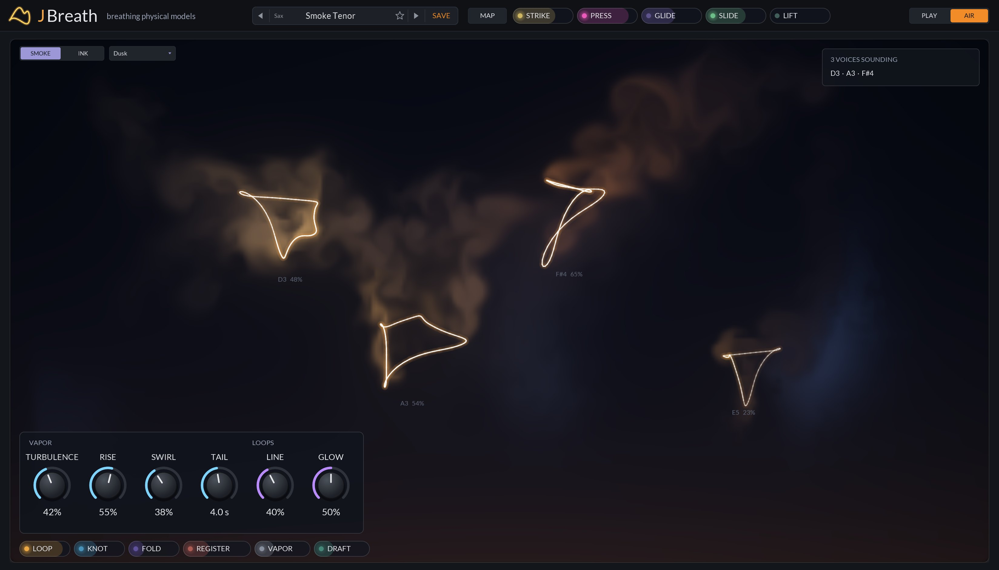

**AIR** in the header gives the loops the whole window. **TURBULENCE** (how hard the air curls the
smoke), **RISE** (how fast it rises), **SWIRL** (how tightly it curls into strands) and **TAIL** (how
long it hangs), then the loops' **LINE** and **GLOW**. The look is kept with the project, not with
presets, so changing preset leaves it alone.

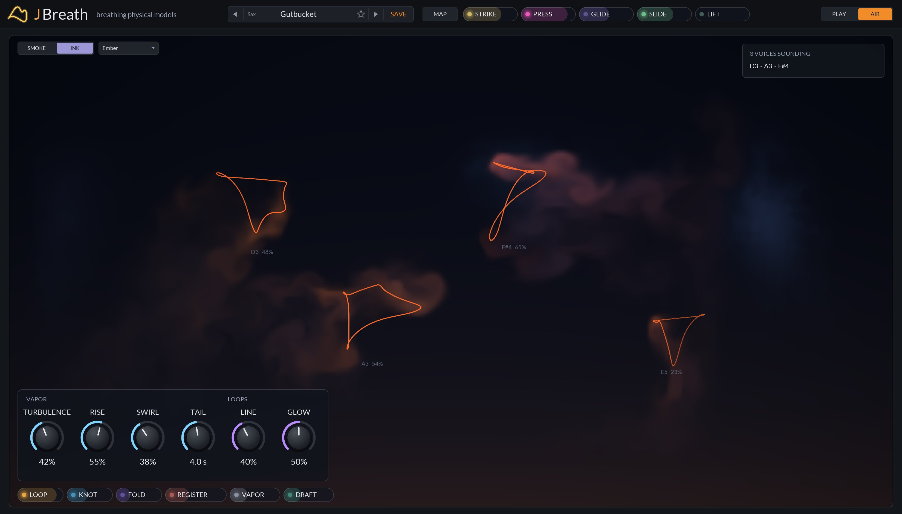

**INK** drops dye from the loops that sinks and spreads instead of glowing smoke. Five palettes: Dusk
(the instrument's own colour), Ember, Frost, Moss and Mono.

## Breath and MPE

- **Breath** comes from MPE pressure, a breath controller (CC 2), velocity, or the BREATH IN
  parameter (modulate it from a CV, an LFO or automation: in Bitwig, route a eurorack CV in to it).
  BREATH FROM picks: **Auto** blows with the velocity until pressure or Breath In arrives and then
  follows it (so it plays from a keyboard and from an MPE controller alike), **Press** only from
  pressure, **Vel** only from velocity, **Input** only from Breath In, and **Mix** from Breath In
  times each note's own pressure (or velocity, until pressure arrives): the CV is the lungs for the
  whole chord, each finger how much of it its note lets through. CURVE shapes how pressure becomes
  breath.
- **Bend** bends the bore: MPE bend per note (BEND sets the note channels' range), CLAP tuning
  expressions, and the manager channel's bend for every note. **Slide** (CC 74) moves the
  embouchure, by SLIDE.

### Voices

POLY plays eight voices; a ninth note takes the quietest released one, or the oldest. MONO and
LEGATO play one: letting go of a note goes back to the newest key still held. In MONO the tongue
stops the air between notes; in LEGATO the fingers change and the air doesn't stop (a slur), with
GLIDE setting how long the pitch takes to get there.

### Presets

Fifty factory presets, about ten for each instrument, from clean to grungy, airy, bass and the
odd ones: Concert Flute to Tin Whistle, Piccolo and Bass Flute; Wooden Reed to Klezmer Cry and Bass
Clarinet; Clean Alto to Gutbucket and Bass Honk; Pastoral to Bassoon, Shawm and Duduk Air; Brass
Plume to Flugel Glow, French Horn, Tuba and Blat. Each plays in tune at a usable level (tested).

## Drawing it smoothly

The panel steps its animation in time with the display: its timer is checked at every screen
refresh and a frame pacer picks which refreshes step it (each one at 60 Hz, every other at 120 or
144 Hz), and every step moves by the time that really passed, so the smoke never jumps. The voices
are read once a frame; the graphs, meters and knobs' modulation rings update at half that, and only
on the tabs that are showing. When frames come late, the smoke is thinned until they're on time
again. `jbreath-screenshot --bench` times the panel's step and drawing a frame, in PLAY and AIR.

## Building

It builds with the rest of JClap (see the [top-level README](../../README.md)). With
`-DJCLAP_BUILD_TOOLS=ON` there are also:

- `jbreath-screenshot out.png [width height [frames [player-tab [routes [armed [exciter-tab
  [voice-tab [air [settings...]]]]]]]]]`: renders the panel, with `preset=Name` or
  `Param_Name=value` settings (the screenshot test's reference is [`docs/panel.png`](docs/panel.png)).
  [`docs/readme/make.sh`](docs/readme/make.sh) renders this README's pictures with it.
- `jbreath-tune > src/tuning_table.h`: bakes the tuning table again, after a change to a model.

`jbreath-voice-tests` checks every instrument across its range (tuning, level, how fast it speaks,
and that nothing blows up with every control at its extremes); `jbreath-tests` drives the whole
plugin the way a host does, at 44.1 to 192 kHz, including every new control at both ends on every
instrument.
