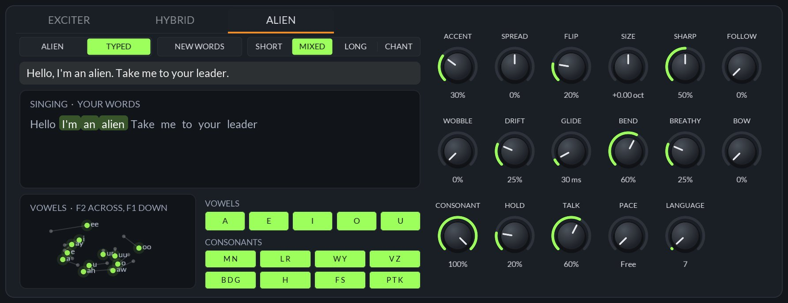
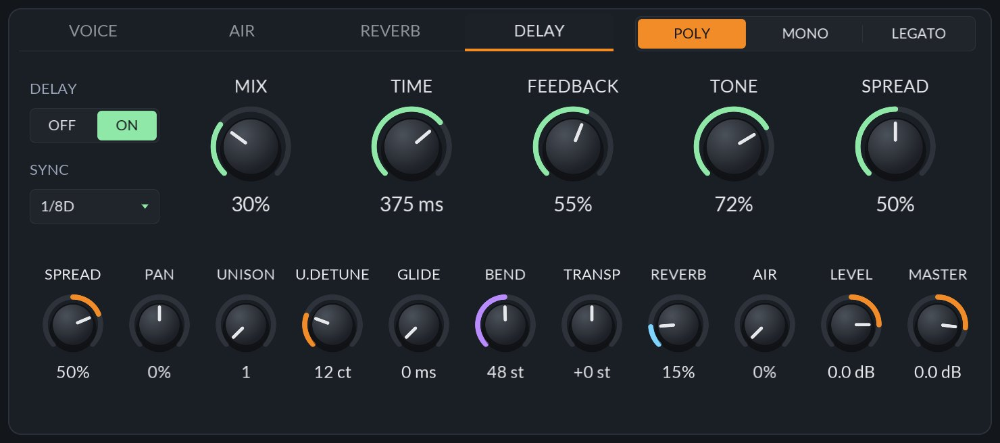
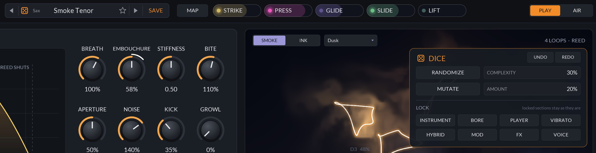

# JBreath

An eight-voice MPE wind instrument built from physical models: flute, clarinet, sax, oboe, trumpet and an alien, each a digital waveguide blown by a model of the player, with every voice drawn live as a glowing loop of its own breath.

       

## The instruments

Each voice is a bore (a delay line carrying the sound down the tube and back, with the losses and
reflections of the real one) driven by a nonlinear exciter, the part the player blows into:

| Instrument | Exciter | Bore | What gives it its sound |
|---|---|---|---|
| **Flute** | an air jet crossing the embouchure hole, split in or out of the pipe by the sound in it | open at both ends: every harmonic | the jet takes longer to reach the edge when it's slow, so blowing harder pushes it up a register; edge noise; nearly pure when soft, a strong 2nd and then 3rd harmonic as it's blown harder |
| **Clarinet** | a single reed: a pressure-controlled valve (Kergomard / Wilson-Beavers), solved each sample with the pressure it makes | a cylinder closed at the reed: odd harmonics | the reed slamming shut at forte; the bell letting the highs out |
| **Sax** | a cane reed: a mass on a spring under the lip, pushed shut by the mouth pressure (inward striking), beating on the lay at forte | a real alto's air column, computed from its shape (mouthpiece chamber and throat, conical body, nineteen tone holes, the octave key's vents) for each fingering; below the alto's range the tenor, baritone or bass, each on its own fingerings (tuned down to the contrabass, it's the bass sax: the contrabass's reed found no note through most of its range) | nearly a pure tone when it's played softly, filling in to a buzzing forte over about 12 dB as the Iowa alto does; low notes voiced to hold their fundamental under rich harmonics, richer on the bigger horns; growl when it's pushed |
| **Oboe** | a small, stiff double reed, quasi-static: its slit closes as the drop across it grows, softly as the blades' tips meet, and the lip closes on it to play softly | a cone as two waveguides meeting at the reed (Benade's "cylindrical saxophone"): the bore out to the open holes, and a short pipe for the cone's missing tip, so every resonance is a harmonic of the note; below the oboe's range the cor anglais, bass oboe, two lower still and the contrabassoon, so the Contra Buzz bottom octave speaks at its pitch down to C1 | fitted to the Philharmonia oboe, Bb3 to F6, piano to fortissimo: a fundamental under its 2nd to 5th harmonics and a formant near 1.8 kHz, nasal and reedy; darker played softly; the low notes given an accent at the tongue so every note speaks in about the same time. About a quarter of the CPU of the 0.11 oboe |
| **Trumpet** | the lips: a mass on a spring blown open by the mouth pressure (outward striking), with the flow through them in closed form | a real Bb trumpet's air column, computed from its shape (mouthpiece, leadpipe, valves, Bessel bell) for each of its seven valve combinations and played as its resonances; each note is a partial of the valves a player would use | the wave steepening on its way down the horn, more the harder it's blown, towards a shock at forte: the brassy blare; mellow when it's played softly; each tongued note scooping up into its pitch as the lips find the horn's resonance |
| **Alien** | vocal folds, a pulse opening and snapping shut each period (or a bowed string) | a throat, nose and mouth: a formant synthesizer | every note a syllable of its words (typed, or its own made-up language), each consonant made at its place in the mouth, the vowel held for the note and closed off when it's let go |

The sax and trumpet are measured against the University of Iowa's recordings of a real alto sax and Bb
trumpet, at pp, mf and ff, and the sax's low register against UNSW's tenor sax: how their tone darkens and how much quieter they get when played softly,
how far a note starts under its pitch, and the slow wander (1 to 3 cents) of a real player's pitch.
The trumpet's tone through its bell is matched, harmonic by harmonic, to the Iowa trumpet's
without any per-note EQ: it brightens as it's blown harder because its lips close for more of each cycle.
The sax's tone is fitted to the Iowa alto's harmonics across its registers and dynamics, its top falling away past 6 kHz.
Every instrument's breath noise is a smaller share of the sound the softer it's blown.

From 0.13.5 the same sound costs about a quarter less CPU across the factory bank: the clarinet's reed
is solved by a few Newton steps from the last sample's answer instead of a 24-step search (a clarinet
voice costs about a third of what it did), the Alien's voice and the trumpet's fingering no longer
work out the same exponentials and logs every sample, and every voice keeps what only moves at the
control rate instead of computing it again each sample. Renders of every factory preset match the
previous version's to float rounding (or, where a reed's motion is sensitive enough to drift in
phase, to within 0.2 dB in level and spectrum).

From 0.13.7 the sax and trumpet cost less again: their horns' resonances and bell are worked in plain
real arithmetic the compiler can vectorise, a sax voice costing about a third less (a baritone or bass
nearly half) and a trumpet voice about a fifth less, and the sax, oboe and flute no longer work out
per sample the powers and exponentials that only change with the note or a knob. An EQ stage left
at 0 dB (most of the Body section's at its defaults, and many of the models' own) is now skipped
outright, giving exactly the same output. The factory bank as a whole runs about a fifth lighter
than 0.13.6, its renders matching to float rounding.

From 0.13.8 each model's output EQ runs in double from end to end, the flute's jet uses a fast,
float-accurate tanh, the sax moves its bore's pitch only at the control rate it's read at, and the
Fray source reads the sound every 4th sample: the flute and sax are about a tenth lighter again, the
oboe and trumpet a little, with every factory preset's level and spectrum unchanged.

### The alien

An alien that sings words, a syllable a note: yours, typed on the ALIEN tab, or words of its own.
Its voice is a formant synthesizer, written for it after Klatt's (a cascade of eight resonances for
the vowels, with a nose and a mouth beside them for the consonants), sung by vocal folds (a
KLGLOTT88 pulse, shutting faster and brighter the harder it's blown, with a little jitter and
shimmer) and checked against espeak-ng with an offline speech recognizer. Each syllable runs as a
plan: the last one's closing consonants, this one's opening ones, then its vowel, held as long as
the note is. A stop shuts the mouth, pops at its place and breathes; a fricative hisses through a
bank shaped for its place (s high and strong, sh lower, f and th faint), buzzing in a voiced one; a
nasal hums through the nose with the mouth's notch where its place puts it; l, r, w and y slide
into the vowel. Every consonant opens onto the vowel from where its place leaves the mouth, as
speech's locus equations put it, so "ba", "da" and "ga" each open differently onto the same vowel.
A p, t or k breathes before its vowel as long as a speaker's does (longest for k), but not after an
s ("spin", "sky"); a b, p or m bursts soft and low, a t high, a k in the middle; a fricative's hiss
swells in where a stop's starts at once; an l lets go of its vowel at once where a w glides.
A quick run of notes still says every consonant: whatever of the last syllable isn't finished is
said first, quicker, rather than cut off, and going straight on, the closing consonants are said
briskly so the next vowel arrives soon after its note. All this was tuned by playing whole
sentences through the plugin to speech recognizers.
A diphthong (ai, ay, oy, ow, o) holds its first vowel and then moves on, as a singer does. Let go,
it says the syllable's closing consonants before it falls silent; a chord's notes sing the same
syllable; a slur (Legato) runs one syllable straight into the next. The breath is how loud and how
hard it sings, the velocity how hard it says the consonants.

Typed words are looked up in the CMU Pronouncing Dictionary (125,000 words, packed into the plugin);
a word it hasn't got is read as an English reader would read it, so made-up names work too. Phones
in ARPAbet between brackets, `[HH AH0 L OW1]`, are sung as written. The words start from the top
whenever the host starts playing, and are kept with the project.

Its own words come from a made-up language: a vocabulary of a dozen words (from the vowels and
consonant families lit on the tab, put together as English would let them), and a run of them, the
commoner words coming back more often, as they do in a real language. **NEW WORDS** (or the
**LANGUAGE** knob) picks another of a thousand languages.

A bowed string can take the voice's place (**BOW**): the breath is the bow's speed, **BITE** its
weight, **EMBOUCHURE** where it crosses the string, **STIFFNESS** the hair's tension, **APERTURE**
how wide it lies, and **CONE** how stiff the string is, from gut to a steel wire whose partials
stretch apart like a bell's. All bow, and the string sings the words.

High notes are sung as a singer sings them: from about E4 up the first resonance rides above the
note, and the upper ones widen and roll off, so the top stays round rather than whistling. On the
ALIEN tab:

- **ALIEN / TYPED**: which words it sings. Typing in the box switches to TYPED; with nothing typed
  it sings its own. **SHORT / MIXED / LONG / CHANT**: how long its own words are (a syllable each,
  one to three, two to four, or one word chanted over and over).
- The box below shows what it's singing, each word lighting up while a voice sings it, and the map
  where its vowels are (a human's hollow, its own lit) as the strange knobs move them.
- **ACCENT**: how far each syllable's vowel is bent from a human's, every resonance somewhere of its
  own, new each syllable.
- **SPREAD**: squeezes the resonances together (every vowel a muffled hum) or pushes them apart
  (glassy and thin).
- **FLIP**: turns the vowels round the middle of the vowel space: half way, the open vowels come out
  at the front and the close ones at the back; all the way, ee is where ah was.
- **SIZE**: every resonance up or down an octave, a tiny throat or a huge one. A little goes a long
  way: a woman's throat is about a fifth smaller than a man's, so a quarter up (with the notes up an
  octave) is a woman's voice, a quarter down a big man's.
- **SHARP**: how narrow the resonances are, from soft to ringing whistles like a throat singer's.
- **WET**: a throat with something moving in it: its resonances shiver and gurgle.
- **ROUGH**: how unsteady the folds are, as a living voice's: the pitch wanders, scoops up into each
  syllable and falls away at its end, every pulse a little off in time and strength, the breath in
  gusts. At none it's a machine.
- **GROWL**: a creature's rasp: every other pulse weaker and later (a growl an octave under the
  note), a rattle, and now and then a creak.
- **FOLLOW**: how far the throat follows the note: none is a singer's, all moves the vowels with the
  pitch, tiny up high and huge down low.
- **WOBBLE**: each resonance swings on a slow wave of its own, from a warble to a swirl.
- **DRIFT**: how far the vowels wander on their own, every note a little different.
- **GLIDE**: how long each vowel takes to arrive, from a snap to a slow slide.
- **BEND**: how far the throat follows a pitch bend (an MPE note's own, or the wheel), the way a
  talk box's mouth would.
- **BREATHY**: how much air goes through the folds, from clear to a whisper.
- **CONSONANT**: how strong the consonants are, from none (only the vowels) to every stop, hiss and
  hum.
- **HOLD**: how long a diphthong holds its first vowel, from speech's quick glide to a singer's hold.
- **TALK** and **PACE**: how soon a held note goes on to the next syllable, chattering while it's
  held: Free (by Talk; under a fifth, never), or a note value from 1/16 to 2 bars at the host's
  tempo. Typed words go on only with a Pace set (on Free they keep to a syllable a note), and the
  next note picks up after the last syllable the held one said.
- **VOWELS** and **CONSONANTS**: which its own words use, each on or off.

The ALIEN tab only shows when the Alien is the instrument.

On the Alien, the exciter's knobs shape its voice:

- **EMBOUCHURE**: the jaw, from nearly shut and muffled to wide open and bright (MPE slide moves
  it, so a slide opens the mouth).
- **STIFFNESS**: the vocal folds, from lax and hooting to pressed and buzzing.
- **BITE**: below the middle it sings more and more through its nose; above it, a brassy twang.
- **APERTURE**: the lips, from rounded and dark to spread in a bright grin.
- **KICK**: how hard each word starts and how hard its consonants hit.
- **LOSS** (on the bore): a damped, muffled throat.

Each of these changes its colour, not how loud it is.

Every note plays in tune: the bore length for each model and note was measured offline by playing
it and correcting the length until the pitch was within a cent, at the rates the voices run at, and
baked into [`src/tuning_table.h`](src/tuning_table.h) along with a gain that levels each note's
steady tone and the softest breath that sounds it (so the lightest pressure plays). A player keeps
the note in tune as they blow softer or harder, and so do the voices: each instrument's drift in
pitch with the breath was measured, and the bore is corrected for it. Notes over an instrument's
range play an octave (or more) down; notes under it keep their pitch, on the bore stretched down (from
0.13.6: before, they jumped up an octave), except the sax's under A1, where no reed finds a note,
which go up an octave. The voices run at 88.2 kHz
or more (2x at 44.1 and 48 kHz) and are decimated once.

## A tour of the panel

### The exciter

Pick the instrument on the left. The graph is its valve: how the air through it answers the
pressure across it, with a dot where each sounding voice is blowing (a reed's curve turns over and
shuts; the flute's jet overblows). The knobs are how it's blown:

- **BREATH**: how hard the player blows at full pressure (or velocity).
- **EMBOUCHURE**: lip and jaw: the jet's angle on the flute, the bite on a reed, the lips' tension
  on brass. MPE slide moves it.
- **STIFFNESS**: how stiff the reed or lips are (the jet's gain on a flute). Stiff is bright and
  quick to shut, soft is dark and lazy.
- **BITE**: the forte edge: the flute's 2nd harmonic, the reeds' edge, the brass blare.
- **APERTURE**: how far the reed or lips stand open (the jet's width): wide is loud and free,
  narrow thin and focused.
- **NOISE**: breath noise and turbulence. **KICK**: the burst of pressure as the tongue lets the
  air go. **GROWL**: a rough flutter of the throat rides on the air, on any instrument, and a hard-blown reed rasps more.

### Hybrid

A plain subtractive voice blown by the same breath and layered with the instrument: a **Sine**,
**Triangle**, **Saw**, **Square** or **Pulse** through a 24 dB lowpass. **MIX** is how much of it,
**OCTAVE** and **DETUNE** where it plays, and **BREATH** how strongly its level follows the breath.
**CUTOFF** and **RESONANCE** set the lowpass (it follows the note half way), and **OPEN** how far
the breath opens it: soft is dark, hard is bright. The graph shows the lowpass and, faint, where the
softest and hardest breath move it, with a dot for each sounding voice. Unison and vibrato shape it
too.

It has an envelope of its own, so it can be a pad under the instrument: **ATTACK**, **DECAY**,
**SUSTAIN** and **RELEASE** (1 ms to 10 s), and **FOLLOW**, how much its level still follows the
breath. At full FOLLOW it is blown like the instrument; turn it down and the envelope plays it at
the note's strike instead, swelling in and ringing on after the breath stops. **F.ENV** is how far
the envelope opens (or, below zero, closes) the lowpass.

### The bore

The graph is the bore's input impedance, worked out from the same loop the model runs, with the
partials of every note as it sounds, each in its own colour (the resonances drawn are the loudest note's). Every knob changes the curve:

- **TUNE** in cents. **LENGTH**: the tube below the open holes, whose own resonances ring above
  their cutoff, which rings most with the holes below it Closed (nothing lets it out on the way) and
  not at all with them Open. **HOLES** picks how many are open, from Closed to Open: more open holes
  move the tone holes' cutoff up and radiate more highs, on every instrument, so Closed is dark and
  veiled and Open bright.
- **LOSS**: what the bore loses each trip: softer, darker, slower to speak.
- **HOLE CUTOFF**: above it the tone holes let the sound out. The pitch stays put: the filter's delay
  is taken out of the bore.
- **CONE** (sax and oboe): how far the cone is cut short at the reed, from towards a cylinder to a
  full cone; on the trumpet, how conical its bore is (towards a flugelhorn: darker, less blare); on
  the alien, how stiff its string is. **BRASS** (trumpet): how far the
  wave steepens into a blare. Each is dimmed on the instruments it doesn't apply to.
- **RADIATE**, **BARREL** and **WALL**: how the bell sends the highs out, the mouthpiece's cavity,
  and how much the walls soak up (metal to bone). **TUBE** is what it's made of: grenadilla,
  boxwood, maple, bamboo, brass, silver, resin or glass. Each has its own body resonance and tilt,
  and soaks up more or less of every trip down the bore (wood warm and soft, metal and glass bright
  and ringing), on every instrument.
- **DETUNE**: each note a little off, by up to 25 cents: a section rather than one player.

### The player

The tongue's breath envelope. **STYLE** is how the note is tongued: Soft (a gentle "da"), Hard
("ta"), Double (every note tongued, even slurred), Flutter (a rolled R through the note) or Breath
(no tongue at all). Whatever the style, the note's velocity is how hard it's tongued: a soft touch
starts gently, with little of the tongue's burst and a slower attack, and a hard one with a crisp
"ta". **FORCE** can take that from the finger instead (**Press**: how hard the pressure arrives in
the note's first few ms), for a controller whose velocity isn't reliable. **ATTACK** and
**RELEASE** shape the breath, and **HUMANIZE** makes every note a little different in pitch,
breath, attack and vibrato. **FLUTTER** rolls the tongue through the note on any style (the Flutter
style rolls it at least half way), and **RATE** is how fast. **RE-TONGUE** tongues a held note
again when its pressure dips quickly and comes back (a fall to under the dip within 150 ms, and half
way back within 300 ms more), as hard as it comes back: repeated notes on one key, as a player
tongues them on one fingering. A slow diminuendo and swell never counts. Turned up, a lighter dip
does it; at none, never.

Vibrato grows in after **DELAY**, and its rate and depth wander as a player's do. **FROM** says
where it comes from: the Breath (the diaphragm), the Jaw (the embouchure, so pitch and colour),
both, or the Lip (pitch alone). **PITCH** adds vibrato in cents on top.

### Modulation: MAP, sources and routes

As in JSynth. Touch a source chip, then drag any knob: the ring that appears is how far that source
moves it, per voice. Touch the chip again to leave MAP. Right-click a knob to unmap it. Hover a chip to see what the source
is. The sources:

- **The player's hands**, in the header: STRIKE (velocity), PRESS (pressure), PUSH (how fast the
  pressure is rising: an accent, falling away once the finger stops pushing), GLIDE (pitch bend,
  all of it at two semitones whatever the bend range), SHAKE (how much the finger is moving the
  pitch: its vibrato, or a bend on its way, all of it at a quarter of a semitone), SLIDE (CC 74),
  LIFT (release velocity, moving only once the note is let go).
- **The breath**, under the loops, read off each voice's own breath and sound: LOOP (how hard it
  blows, from the lightest breath that sounds to the instrument's full breath, with its attack and
  release), KNOT (how bright it is for its note: the share of the sound above its 4th harmonic),
  FOLD (how far into the top of its breath, from a mezzo forte to full), REGISTER (how high in its
  range), FRAY (how far the sound is from a steady tone: breath noise, growl, flutter, the attack or
  a split note, what frays the loop), DRAFT (a slow wandering draught of its own, carried from note
  to note). Each runs 0 to 1 on every instrument. Knot and Fray hold as a note dies away. Loop,
  Fold, Knot and Fray come from the breath, so routed onto Breath they feed back: Fold onto Breath
  holds an overblown note there.
- **Generators and buses**: two LFOs and the Swell, Key, Random, and four buses.

Two LFOs (six shapes, restarting with each note or running free for every voice) and the **Swell**,
one contour over its time from each note's start (Arch, Rise, Fall, Waves, Bloom, Tide, once or
looping).

A bus mixes the routes onto it (sum, multiply, min or max), bends the mix (curve and polarity),
lags it, and sends it on as a source of its own.

**ROUTES** lists all 32 routes in place of the loops, to add, edit and remove them by hand.

### The breath loops

Each voice as a loop in three dimensions (its sound now, a quarter period ago and half a period
ago), slowly turning. A steady tone draws a clean closed loop; growl, a split note or breath noise
fray it. Smoke comes off every loop as it blows, in the loop's own colour, cooling to blue mist as it
rises and curls away. **SMOKE / INK** sets its look, and **Colours** the scheme each voice's loop and
smoke are drawn in.

### The voice card

Each sounding note keeps one colour across the panel, by the voice playing it: its light, its partials on the bore, its dot on the air flow, the tongue, the press curve and the hybrid's filter, its place in the stereo field, and its loop, its smoke and the loop's name. The **Colours** menu above the loops picks the scheme those colours come from: Spectrum (the default), Neon, Sunset, Ocean, Aurora, Pastel, Fire or Mono.

**VOICE** shows the eight voices; where each sounding note sits in the stereo field (Spread fans
them out around Pan, each note in its own colour, with the output's balance under it); and the
meters, glowing as they rise: the breath coming in, and the output left and right, with the peak
held (in dB at the top), red over 0 dB, and a notch at Master. Along the bottom: **SPREAD** (low notes left, high right, as across a section, or
below zero the other way round), **PAN** (where the notes sit before the spread: map Key, Slide or
Random onto it to place each note), **UNISON** (up to four copies of every voice, detuned against
each other) and **U.DETUNE** (how far they spread, in cents), **GLIDE**, **BEND** (the MPE bend
range), **TRANSP**, **ROOM**, **AIR** (the breath heard around the instrument, not through it),
**LEVEL** and **MASTER**.

**AIR** is where the breath comes from, and how it's shaped (see [Breath and MPE](#breath-and-mpe)).

**REVERB**: a switch, then a small room (SIZE, DECAY, DAMP, PRE-DELAY), the output's TONE, and the
**LIMITER**: Off, Clip (overs saturate) or Limit, the default: a soft limiter, the very last thing
after MASTER, that turns a loud chord down smoothly rather than letting it clip. It starts to work
5 dB under full scale and holds the loudest of it at -2 dBFS, with a soft knee, a 1 ms attack and
a release that slows when it has been limiting a while (so a held chord doesn't pump); a soft clip
after it catches the first instant of a loud note, so the output never reaches 0 dBFS. It adds no
latency, and anything quieter than its knee goes through untouched. Projects saved with Hard get
the new limiter.
Switched off, the room's tail rings out rather than stopping.

**DELAY**: a stereo echo before the reverb, off until switched on. **SYNC** sets its time as a note
value at the host's tempo (1/32 to 1/1, with dotted and triplet values), or Free for **TIME** in ms
(10 ms to 2 s). **MIX** is how loud the echoes are, **FEEDBACK** how many there are, **TONE** how
much darker each one gets, and **SPREAD** how far they bounce between left and right.

### The AIR view

**AIR** in the header gives the loops the whole window, with no tooltip over them (the smaller
loops card in PLAY keeps its tip); **CONTROLS** opens the knobs over it.
**SMOKE** (how much smoke the loops puff out, 133% by default), **TURBULENCE** (how hard the air curls the
smoke), **RISE** (how fast it rises), **SWIRL** (how tightly it curls into strands) and **TAIL** (how
long it hangs), then the loops' **LINE** and **GLOW** (how brightly the loops and smoke are lit: 50% is the usual light, full four times it). **PLACE** says what puts each loop where it
is, as JSynth places its creatures: **ACROSS** (Pitch by default), **UP** (Breath) and **SIZE**
(Breath) can each follow the note's Pitch, Strike, Press, Slide, Breath, a Random place of its own,
or stay in the Centre, and **MIN SIZE** is the smallest a loop gets (25% of the largest by
default). The look is kept with the project, not with presets, so changing preset leaves it alone.

**INK** drops dye from the loops that sinks and spreads instead of glowing smoke. Beside it,
**Colours** picks the voices' colour scheme: each note's loop glows, and its smoke or ink comes off it,
in its voice's colour, which also marks that note everywhere else on the panel. Eight schemes:
Spectrum (the default, one of each hue), Neon, Sunset, Ocean, Aurora, Pastel, Fire and Mono. (It
replaces 0.12.0's smoke Palette menu.)

## Breath and MPE

- **Breath** comes from MPE pressure, a breath controller (CC 2), velocity, or the BREATH IN
  parameter (modulate it from a CV, an LFO or automation: in Bitwig, route a eurorack CV in to it).
  BREATH FROM picks: **Auto** blows with the velocity until pressure or Breath In arrives and then
  follows it within a few milliseconds (so it plays from a keyboard and from an MPE controller
  alike; with pressure, velocity is only how hard the note is tongued), **Press** only from
  pressure, **Vel** only from velocity, **Input** only from Breath In, and **Mix** from Breath In
  times each note's own pressure (or velocity, until pressure arrives): the CV is the lungs for the
  whole chord, each finger how much of it its note lets through. CURVE shapes how pressure becomes
  breath.
- **Bend** bends the bore: MPE bend per note (BEND sets the note channels' range), CLAP tuning
  expressions, and the manager channel's bend for every note. The sax and trumpet bend as a player
  lips a note, on the fingering it was played with: the trumpet keeps its valves and the sax its
  whole fingering for up to three semitones of bend either way, so a bend glides smoothly instead
  of stepping at each semitone, dropping an octave or losing the note. Past that they change fingering
  as they go, each change gliding over about 20 ms (the air column and the reed together), so a long
  slide doesn't crackle or break up at every semitone; a sax keeps the horn and register the note
  started on through the whole slide instead of jumping to a bigger horn. Bend messages are smoothed
  over a few ms, so a controller's stepped bend doesn't buzz. Every note costs the same CPU (before 0.13.3 most sax notes, and some trumpet
  notes, cost five to fifteen times the rest). **Slide** (CC 74) moves the
  embouchure, by SLIDE.

### Voices

POLY plays eight voices; a ninth note takes the quietest released one, or the oldest. MONO and
LEGATO play one: letting go of a note goes back to the newest key still held. In MONO the tongue
stops the air between notes; in LEGATO the fingers change and the air doesn't stop (a slur), with
GLIDE setting how long the pitch takes to get there.

### Presets

Eighty-seven factory presets: Init, then eight to twenty for each instrument, each family starting
from its most natural sound (Concert Flute, Wooden Reed, Clean Alto, Dusk Oboe, Brass Plume, First
Contact: the model's own voice, measured against the Iowa recordings, with a player's vibrato and a
little room) and running through darker, breathier, brighter and harder variants, its relatives by
Transpose and its oddities:

- **Flute** (10): Concert Flute, Night Flute, Bamboo Air, Shakuhachi Bend, Tin Whistle, Piccolo, Alto
  Flute, Bass Flute, Overblown Jet (flutter-tongued) and Glass Ocarina.
- **Clarinet** (9): Wooden Reed, Legato Clarinet, Chalumeau, Bass Clarinet, Bright Eb, Klezmer Cry,
  Breathy Reed, Low Rasp Reed and Felt Clarinet (a felt bucket over the bell).
- **Sax** (10): Clean Alto, Smoke Tenor, Growl Alto, Subtone Ballad, Soprano Line, Baritone, Bass
  Honk, Gutbucket, Flutter Tenor and Hat Alto (a hat over the bell).
- **Oboe** (10): Dusk Oboe, Pastoral, Oboe d'Amore, Cor Anglais, Bassoon, Contra Buzz, Shawm, Musette,
  Duduk Air and Snake Charmer (a gourd cup over the reed).
- **Trumpet** (11): Brass Plume, Fanfare, the mutes (Straight Mute, Cup Mute, Muted Night with a
  Harmon, Plunger Wah with the plunger on the slide, Bucket Ballad), Flugel Glow, French Horn,
  Trombone Slide and Piccolo Trumpet.
- **Alien** (27): Alien Speech, First Contact (a plain voice for your words), Talking Bow (the
  string sings the words; the slide bends its accent), Throat Singer, Xeno Choir, Tractor Beam (a
  word a beat), Insect Hymn, Mothership, Signal Lost, Ion Flutter; five strange throats (Inside Out,
  Glass Mouth, Muffled Moan, Warble Choir and Tiny Giant), Swamp Creature (rough, growling and wet); six that speak in different ways (Clear
  Diction, the most intelligible, for typed words; Crisp Diction, Chatterbox, Envoy Unit, Slow Drawl and Whisper Tongue); and five that sing (a syllable a
  note, a late vibrato): Hymn Singer, Ballad Voice, Folk Tenor, Baritone Chant and Lullaby.
- **Pad** (6): the HYBRID voice as a pad under an instrument, at a low FOLLOW with a slow attack and a
  long release: Flute Halo, Hollow Pad, Section Pad, Reed Choir, Brass Swell and Nebula.
- **Space** (6): the DELAY, synced and free, and the REVERB: Echo Flute, Canyon Trumpet, Dub Tenor,
  Night Cathedral, Slapback Bari and Star Signal.

Each plays in tune at a usable level (tested).

### Dice

The die at the left of the preset bar opens the dice card, over the breath loops so nothing it
changes is hidden. **RANDOMIZE** builds a new patch the way a player would pick one up: an
instrument first, then its exciter, bore, tongue and vibrato within the ranges that sound for that
instrument, and a name for it. **COMPLEXITY** says how much it reaches for: at 0 a plain, real
instrument; higher brings growl or flutter, a mute, the HYBRID layer (as a pad, at times), unison,
LFOs and routes, the delay, wider bore settings and the Alien. **MUTATE** nudges the patch there is
by **AMOUNT**: what's off stays off, a choice moves only to a near one (a mute to the next mute, a
tongue to its neighbour), and only a high amount changes the instrument or adds a route. **UNDO**
and **REDO** step back and forward through what the dice replaced.

**LOCK** keeps a section as it is through both: INSTRUMENT (the model and its exciter), BORE (the
bore's knobs, holes, tube and mute), PLAYER (the tongue, attack, release, humanize, growl and
flutter), VIBRATO, HYBRID, MOD (the LFOs, the Swell, the buses and the routes), FX (the reverb, its
tone, the air and the delay) and VOICE (voice mode, glide, unison, spread and pan). Neither ever
touches Level, Master or the Limiter, the breath source and the rest of the MIDI and MPE setup,
Transpose or Tune, or the AIR view's look. The complexity, amount and locks stay with the plugin
while the project is open, not with presets. Every patch the dice make plays in tune at a usable
level (tested over many seeds, complexities and amounts).

## Drawing it smoothly

The panel steps its animation in time with the display: its timer is checked at every screen
refresh and a frame pacer picks which refreshes step it (each one at 60 Hz, every other at 120 or
144 Hz), and every step moves by the time that really passed, so the smoke never jumps. The voices
are read once a frame; the graphs, meters and knobs' modulation rings update at half that, and only
on the tabs that are showing. When frames come late, the smoke is thinned until they're on time
again. `jbreath-screenshot --bench` times the panel's step and drawing a frame, in PLAY and AIR.

## Building

It builds with the rest of JClap (see the [top-level README](../../README.md)). With
`-DJCLAP_BUILD_TOOLS=ON` there are also:

- `jbreath-screenshot out.png [width height [frames [player-tab [routes [armed [exciter-tab
  [voice-tab [air [settings...]]]]]]]]]`: renders the panel, with `preset=Name` or
  `Param_Name=value` settings, or `dice` to open the dice card (the screenshot test's reference is
  [`docs/panel.png`](docs/panel.png)).
  [`docs/readme/make.sh`](docs/readme/make.sh) renders this README's pictures with it.
- `jbreath-tune > src/tuning_table.h`: bakes the tuning table again, after a change to a model.
- `jbreath-render score.txt out.wav`: plays a score of notes, pressures and params (or a preset)
  through the whole plugin to a WAV, for listening; the format is at the top of
  [`tools/render.cpp`](tools/render.cpp).

`jbreath-voice-tests` checks every instrument across its range (tuning, level, how fast it speaks,
and that nothing blows up with every control at its extremes); `jbreath-tests` drives the whole
plugin the way a host does, at 44.1 to 192 kHz, including every new control at both ends on every
instrument. `jbreath-dice-tests` rolls RANDOMIZE and MUTATE over many seeds, complexities and
amounts and plays every patch, and checks that a seed is the same patch every time and that locks
hold.

## Credits

The Alien's typed words are looked up in the CMU Pronouncing Dictionary
([cmusphinx/cmudict](https://github.com/cmusphinx/cmudict)), packed into
[`src/cmudict_data.h`](src/cmudict_data.h) by [`tools/pack_cmudict.py`](tools/pack_cmudict.py).
Copyright (C) 1993-2015 Carnegie Mellon University. All rights reserved. Used under its BSD-style
licence, which is reproduced in full at the top of that file. This work was supported in part by
funding from the Defense Advanced Research Projects Agency, the Office of Naval Research and the
National Science Foundation of the United States of America, and by member companies of the
Carnegie Mellon Sphinx Speech Consortium.
