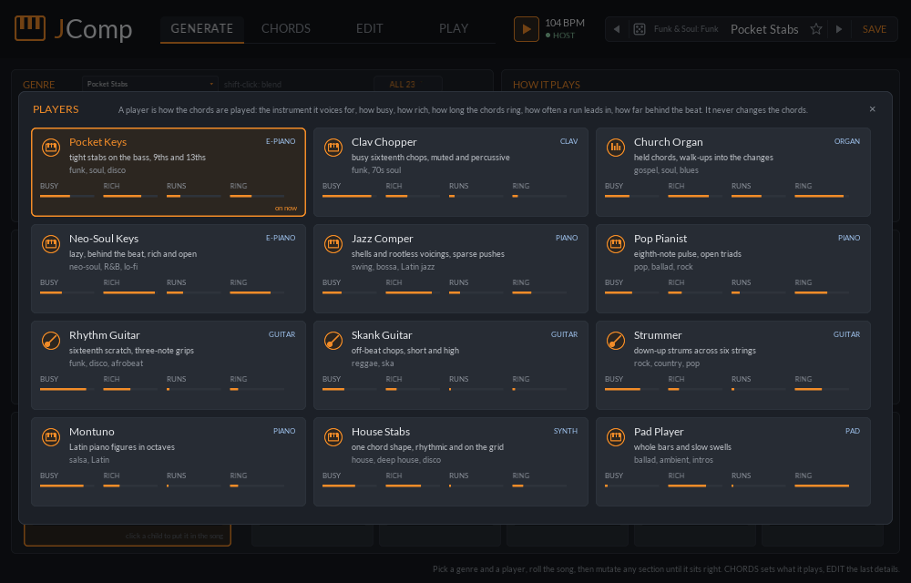
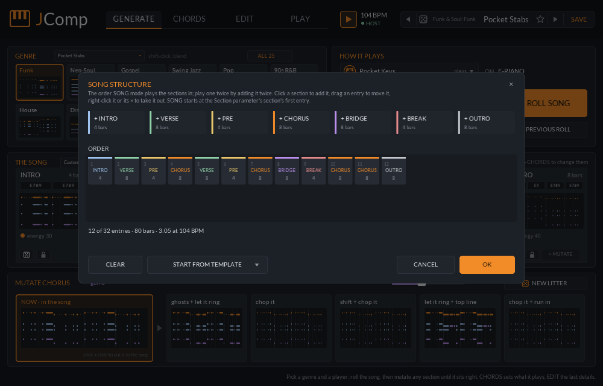
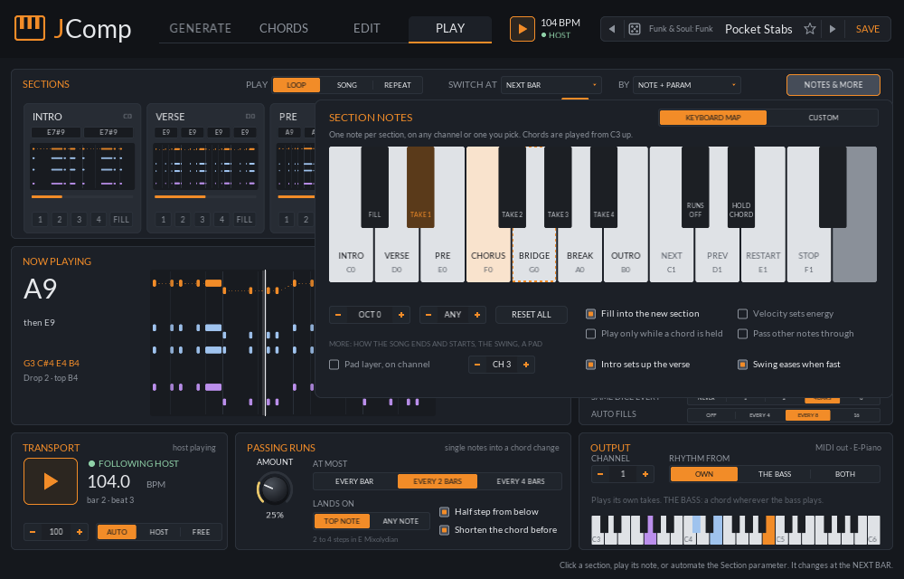

# JComp

An accompaniment generator: JDrummer's way of working, for chords.

   

A CLAP note effect that writes whole keyboard (or guitar, organ, pad) parts and plays them as MIDI to
any polyphonic instrument. Pick a genre and a style, a player, set how hard and how rich it goes, and
roll a song: intro, verse, pre-chorus, chorus, bridge, break and outro, each with its own chord
progression, four takes, a fill and its own energy. Every chord is voiced the way a player would
voice it, led smoothly from the one before, with the top note singing a line and the odd passing run
into a change. Change any chord, play your own chords into it, or let it take its rhythm from a bass
line. Mutate any section until it sits right, edit any hit, then switch sections live by click, by
note or by automation. It plays with the host's transport, or on its own PLAY while the host is
stopped.

Version 0.20.0.

Hover over a control for a one-line tip.

## Wiring it up

Put JComp on a MIDI track before a polyphonic instrument (an electric piano, a piano, an organ, a
clav, a guitar or a pad). It sends its chords on **channel 1** (CHANNEL in OUTPUT). Notes from **C3**
up are chord keys: what you hold there can become the chords it plays (see CHORDS FROM). Notes below
C3 are section notes (C0 to F1 on the keyboard map) or, for RHYTHM FROM THE BASS, the bass line on its
own channel. Other notes are dropped unless *Pass other notes through* is ticked.

JComp counts in 4/4 from the host's beat 0: its bars are the host's bars when the host is in 4/4. A
three-beat style (Jazz Waltz, Country Waltz, 6/8 Ballad) counts in bars of three beats instead: set the
host to 3/4 (or 6/8) from its bar 1. Where the host says where its bars start, a bar of another meter
(a 2/4 bar in a 4/4 song, a pickup) moves JComp's bar lines with the host's from the next bar in the
song's meter. A pickup at the project's start (a short bar followed by one in the song's meter) rests, as a count-in does, and the song's bar 1 is the
bar after it; a short bar later in the song leaves the bar lines where they were; a host meter the style doesn't have (a waltz in a 4/4 project) leaves them on beat 0's, and a project whose every bar is shorter than the style's (2/4 under a 4/4 style)
counts from beat 0 as if it had none, wherever playback starts (once JComp has seen the short bar
followed by another, from the second playback on; the first playback rests the first bar as a pickup
and keeps the song's bar 1 on the host's bar 2 until playback stops, rather than jumping mid-play).
A host bar of another meter moves the bar lines without striking the next chord twice, and a
count-in into a short first bar strikes nothing on beat 0. The 12/8 styles (12/8 Ballad, the
shuffles) count 4/4 with triplets. In a 12/8 project they follow the host: a beat is a dotted
quarter and the bar is the host's bar (a 4/4 host at the dotted-quarter tempo works too).
While the host counts in (pre-roll, in AUTO with PLAY on too), or plays before its bar 1, it waits for the first bar, in LOOP as in SONG (a bass
played in the count-in brings nothing in). A host loop plays the same notes on
every pass, the first included when playback starts at the loop's start: the song follows the host's
bars, so a loop or a seek lands where the song is at that bar, and the player starts afresh there (its
voicing, runs and left hand). A first pass that comes in from bars before the loop arrives with the
player's voicing (and a push or a run) from those bars, so it can differ a little from the passes after
it; a run or a push at the loop's end still leads into the bar after the loop. A start or a loop that lands a little past a bar line
(up to about 80 ms, a host's block) still plays that bar's first chord, a little late. One that lands inside a held
style's long chord (a pad, an ambient drift) strikes that chord, softly, rather than waiting for the next.
A line take (an arpeggio, a tenor line) doesn't add a block chord on a change its line brings in, however
playback started. DENSITY's fills, VARY and the chance hits roll the same way on every playback, so
a render is the same every time.

To play with JDrummer, put both on the same transport: JDrummer's section notes and JComp's are laid
out the same way (the seven sections on the white keys from C0), so one MIDI clip can switch both.

## GENERATE

### GENRE

25 genres in seven families, 87 named styles among them, and every style is also a factory preset. The
twelve tiles are the common ones, each drawn as its style plays; **ALL 25** opens the browser with
every genre, its styles, their tempos and progressions, and the sources each genre was written from.

| Family | Genres |
|---|---|
| Funk & Soul | Funk, Soul, Motown, Disco, Neo-Soul, 90s R&B, Lo-fi |
| Church & Blues | Gospel, Blues (12-bar, in triplets) |
| Jazz & Latin | Swing Jazz, Bossa Nova, Salsa (two-bar clave rhythms), Latin Jazz |
| Pop & Rock | Pop, Rock, Piano Ballad, Country |
| Dance | House, Deep House |
| Caribbean & Africa | Reggae, Ska, Afrobeat, Highlife, Calypso |
| Ambient | Ambient (long held chords) |

The **STYLE** box picks the genre's style: a rhythm family, a set of progressions (one per kind of
section), a tempo, a scale and its own twists (pushes, a busier hand, runs in, a left hand, held or
choked chords, richer or plainer chords, triplets). Shift-click another tile
to **blend** its rhythms in; the small purple slider sets how much. A rhythm on the other grid comes
across beat by beat (a straight eighth onto the shuffle's third triplet). A fixed figure (Freddie
Green's four, the batida, the montunos and guajeos, the cha-cha) is the style itself and takes no
blend, and a three-beat style blends only another genre's three-beat rhythms.

Some rhythms are four-bar phrases whose last bar turns the phrase round (MMA's 8-beat, doo-wop,
spiritual and blues grooves, its samba and bolero), so bar 4 differs from bars 1 to 3.

New in 0.6.0, from comparing JComp with three open-source accompaniment programs (MMA, Impro-Visor
and JJazzLab):

| Genre | New styles and rhythms |
|---|---|
| Swing Jazz | **Jazz Waltz** (3/4: MMA's piano, Impro-Visor's half and quarter, the "2 and 3" comp, MMA's guitar); **Held Comp** (a chord held from 1 and the and of 3, as MMA's basic swing piano); Freddie Green's four is four to the bar at every energy (the guitar keeps the four under the head too); Garland lifts its chorus to every and, the ands of 2 and 4 pushing |
| Piano Ballad | **Ballad Block** (quarters, the 1, and-of-2, 3 ballad figure and a four-bar phrase in the verse, whose third bar leaves its one to the bass and brings the change in on beat 2; the chorus lifts to the quarters); **Right-Hand Arpeggio** (the chord broken up and back); **6/8 Ballad** (six eighths leaning on 1 and 4, dotted quarters, the left hand rocking); Half Notes lifts its chorus with quarters on 3 and 4 |
| Country | **Country Waltz** (oom-pah-pah, the bass on 1 alternating root and fifth); **Western Swing** (four on the guitar, pickups in the fourth bar); Boom-Chick's chorus goes to the two-step strum |
| Bossa Nova | **Samba** (MMA's four bars of piano, Impro-Visor's offbeat eighths) |
| Latin Jazz | **Bolero** (the tresillo ballad); **Mambo** (the 2-3 guajeo, always at its climax, and in its quieter sections the broken chord: the chord, then single chord notes, on the Montuno player, its octave line moving; its ending the broken chord's last bar, then its last chord anticipated on the and of 4); **Cha-Cha** (the quarters and the cha-cha-chá cell on the Montuno player, and at its climax mostly the 2-3 guajeo in octaves, its and of 4 bringing the next chord in untied) |
| Rock | **Rock'n'Roll Triplets** (pounding triplets, quarters in the fourth bar); **Fifties Pump** (the dotted pickups) |
| Soul | **Sixties R&B** (the pushed piano offbeats and the organ's answer) |
| 90s R&B | **New Jack Swing** (stabs on swung sixteenths, in the chorus too) |
| Calypso | **Calypso Strum** and **Calypso Piano** (1, the and of 2, 4; busier in the chorus, the one and the and of 2 alone when quiet, as an intro mostly is) |
| Pop, Rock, Gospel, Blues | four-bar phrases in Dotted Pulse, Quarter Pound, Praise Walk-Up and Chicago Shuffle; Slow Blues gains its quarters with a pickup into 4 |

### HOW IT PLAYS

The **player** is how the chords are played, never which chords: the instrument it voices for, how
busy, how rich, how long the chords ring, how often a run leads in, and how far behind the beat it
sits. Picking a player sets the voicing and feel to suit (shape, how many voices, range, where the
voicings sit, onsets, timing, runs).

| Player | Instrument | Plays |
|---|---|---|
| Pocket Keys | E-piano | tight stabs on the bass, 9ths and 13ths |
| Clav Chopper | Clav | busy sixteenth chops, muted and percussive |
| Church Organ | Organ | held chords, walk-ups into the changes |
| Neo-Soul Keys | E-piano | lazy, behind the beat, rich and open |
| Jazz Comper | Piano | rootless voicings (Levine's A and B: 3-5-7-9 and 7-9-3-5, the 13th for a dominant's 5th), sparse pushes |
| Pop Pianist | Piano | eighth-note pulse, open triads |
| Rhythm Guitar | Guitar | sixteenth scratch, strummed both ways, three-note grips |
| Skank Guitar | Guitar | off-beat chops, short and high, the off-beats strummed up |
| Strummer | Guitar | down-up strums of a guitar grip (the bass, its fifth and octave, the chord above) |
| Montuno | Piano | Latin piano figures in octaves (a close chord with its bottom note doubled on top) |
| House Stabs | Synth | one chord shape, rhythmic and on the grid |
| Pad Player | Pad | whole bars and slow swells |
| Ambient Drifter | Pad | long held chords, wide (quartal), open and barely moving, rolled in |

- **ENERGY** (laid back to driving): how hard the whole song goes. Each section's own energy rides on
  it. A quiet section thins as its groove does: a backbeat near silence to its 2 and 4 alone (its 1
  left out, never 1, 2 and 4); an even pulse as a pulse, its beats kept (near silence, the one
  alone); a boom-chick keeps its
  alternating bass, the root on 1 and the fifth on 3; a sparse figure (three chords a bar or fewer:
  the Charleston, Calypso's one and and of 2, the waltz's oom-pah-pah) keeps every stroke, softly. A
  syncopated or dotted (3+3+2) figure gains no fill-ins when loud (Quiet Storm's x..x..x.....x...
  stays a 3+3+2), and no fill-in lands in a phrase's rest (a bolero's or a samba's fourth bar). A
  pre-chorus builds from the verse: never below it, and the busiest groove only when the verse has it.
- **WEIRD** (triads, as written to extended, reharmonised): richer chords (a 7th becomes a 9th or a
  13th; into a minor chord a 7b9, and a V over its third is never made a sus), substitutions (a tritone sub for a dominant, a dominant approach chord in the second half of
  a bar), and hits left to chance or pushed off the grid.
- **ROLL SONG**: a new seed for every section that isn't locked. New rhythms and new colour, the same
  progressions. Rolling the verse alone remakes the chorus's and the pre-chorus's rhythm (their
  chords kept) where either would sit below the new verse. **PREVIOUS ROLL** goes back (up to 16).

### THE SONG

The seven sections side by side, each as wide as its bars, with its chords, its take as it will be
voiced, and its energy (drag it up or down; low energy plays the take softly and lets its chords
ring, and dragging keeps the section's chords; so do the blend slider and a shift-clicked blend tile,
which remake only the rhythms, while WEIRD remakes the chords too). The
die rolls just that section; the lock keeps it from ROLL SONG. Click a section to mutate it below.

The dropdown beside THE SONG's title is the song's **structure**: the order SONG mode plays the
sections in, a repeat being one more entry. Next to it the structure is spelled out a letter an entry
(Intro, Verse, Pre, Chorus, Bridge, breaK, Outro), the entry playing lit while SONG plays. The
templates:

| Structure | Order |
| --- | --- |
| Once through | I V P C B K O (every song from before 0.11.0) |
| Verse-Chorus | I V C V C B C O (a new song's) |
| Pop | I V P C V P C B C C O |
| Short | I V C V C O |
| AABA | I V V B V O |
| Extended | I V P C V P C K B C C O |

**Custom…** (or a click on the letters) opens **SONG STRUCTURE** on the structure as it is: click a
section to add an entry, drag an entry to move it, right-click it or its × to take it out, up to 32.
A readout under the order gives its entries, bars and length at the tempo. **CLEAR** empties it,
**START FROM TEMPLATE** puts in a template to edit, **CANCEL** leaves the song as it was, and **OK**
puts it in the song (named as a template when it is one; an empty one plays every section once, and its
readout says so). The structure is saved with the song and with a preset's song, and a factory preset
keeps the song's structure. The entry SONG starts from (the Section parameter's section, its first
entry) is marked on the letters with an orange edge. In SONG, **NEXT** and **PREV** step an entry at a
time, a section that comes twice running included (Pop's C C). A structure that ends on a section
with no ending of its own ends on the outro's (the tile and NOW PLAYING show it so). Following
the host, a count-in before bar 1 waits on the first entry, and a change to the structure or to a
section's bars while playing puts the song where the host is again. A section that comes back plays a
little harder each time (5% a time, up to the fourth), with its own dice, every hit in proportion, so
a ghost stays a ghost and the accents stay accents. A section that closes a phrase of the song ends at
home, on the outro's last chord: AABA's second A before the bridge, and the last entry of a song that
ends without the outro (I V C ends on I, not on the turnaround's V7). Where its last bar is a dominant
(a ii-V, a V7) that cadence moves a bar earlier to lead there; otherwise only the last bar goes home
(a blues keeps its bar 11 I, a pop chorus its V). Stopped, NEXT, PREV, a section note or a tile click
cues the entry play starts from (and stopped, the tiles show where it starts: the song's first
entry, or the cue). A NEXT or PREV queued when the transport stops is where play starts again running
free; following the host, the host's bar places the song and the cue is dropped. Following the host
in AUTO, a cue made while stopped is for PLAY: the host's start places the song where its bar is. In
a song that ends, NEXT in the last entry stays there (the song ends as it would), and NEXT never makes
an entry shorter than SWITCH AT play longer. NEXT twice onto another entry of the section playing goes there; PREV from the first entry stays
on it. A section played by hand that the structure leaves out plays at its own level. HOLD CHORD
holds the chord you hear when you press it, a line's or a top note's chord included, and keeps it through a host loop's wrap or a jump, and in SONG the song stays where it is while
held (following the host, the held section doesn't start its bar 1 again at a wrap). Letting go of HOLD CHORD in SONG
picks the song up where the host is (or, running on its own, at the pass's next boundary); following the host, the
chord is held to the next bar line, where the song comes in at its place. Pressed while stopped, HOLD CHORD holds the
first chord the next start plays. While a let-go waits for the bar line the button shows it let go,
and pressing it again keeps the chord. Pressed in the song's ending, HOLD CHORD holds its last chord
as a fermata, ringing on past the end until you let go, and the song ends at the next bar line;
pressed during a run it stops the run, even in the moment before the run lands, the chord it was
landing on struck as the chord held (not the next chord, then the held one); pressed on a downbeat
just struck it holds that chord; and a
HOLD lit over a stop places the song where the host starts. A push into a section you ask for (a
tile, NEXT, a section note) ties over its downbeat, as one into the song's next entry does, and a
tile, NEXT, PREV, RESTART or a take pressed a moment before any switch point (LOOP's next bar or
four, SONG's next bar) switches there, not a period later. A take pressed so at a bar line where the
song places itself on the host's timeline, or where HOLD's let-go comes in, keeps that placement and
that let-go, so the song doesn't drift off the host's bars. Stopped after the song's end, nothing
stays cued for the next start. PREV, RESTART or a tile pressed in an entry's last moment (the song's last one included) act as
if pressed at its bar line, on the entry you hear (a tile for the entry playing does nothing; just
after a bar line, the new entry, from the moment its downbeat sounds), and a
second NEXT after a cued switch arrives counts. NEXT in the last bar of an entry with a two-bar clave
figure and an odd number of bars switches at the entry's end.

### MUTATE

The section's take now, and five children, each tagged with how it differs: *busier*, *sparser*,
*push it*, *chop it*, *let it ring*, *shift*, *ghosts*, *top line*, *accents*, *run in*, *answer* or
*left hand*, *voicing* (a chord or two in another voicing close by, the same notes' count and
register, never an octave copy, never clashing or rubbing more than JComp's own, a note fewer only
where no full one is close; offered only where it brings other notes, the strokes unchanged; a stroke
already re-voiced can be re-voiced again, or go back to its own voicing), *lean* (one stroke of a
fixed figure's bar a touch lighter, or a leaned one back to full: its phrasing, never its notes; the
figure's level never drifts, however many children are adopted), *turn* (a
broken-chord line swapping two neighbouring notes, only where that makes no repeated note and never
a rung top note), *come round* (an ambient drift's held chord struck again, softly, late in the bar,
once a hold and never louder than four fifths of the chord), or for a
held take *restrike* (the chord struck again, softer, at its half bar or the next bar's one, once,
with a beat of the chord held on either side; never in Ambient). *sparser* never takes out an accent, a bar's first chord, a 2-and-4 skank or a
chop on the ands (a ska skank, an offbeat stab: a missing "and" breaks the motor), and *top line* and
*answer* leave a skank's chops whole (a single note on the and is no skank); *shift* moves
only an offbeat chord; *chop it*, *let it ring* and *accents* leave the left hand as written and treat
a quarter pulse's beats as one, and *chop it* isn't offered to a choked style; *accents* never moves a
backbeat's accent or lightens a backbeat's 2 or 4, and in a four to the bar lightens 1 and 3; a
fixed figure varies only by *lean* and *voicing*; a one drop gains only the stroke after its skank;
Clav Riff varies by ghosts, its stabs and phrased note levels. The four takes always differ, and
audibly where the style allows (the Afrobeat tenor line, the style, varies only its dynamics,
phrased: its four takes, and so VARY, differ only in a note or two a bar a touch louder or softer);
the five children never repeat each other or a take, and a child the engine would play
the same as another isn't offered. A chorus never gets a style's sparsest groove, nor one sparser
than its verse's, and a blend with a clave genre keeps one clave and never fills a phrase's
written rests. No mutation fills a phrase's written rests; *chop it*, *ghosts* and *answer* treat a
quarter pulse's beats as struck, not held; *let it ring* leaves a push tied to its beat; a nudge under
5 ms isn't a change; runs, those over several chords included, are heard as the engine plays them;
and a fill's or an ending's mutation is heard only where it plays (a fixed figure's two-bar fill's in
the one bar of it that plays, the section's last). A child that would sound like a take or a sibling
is dropped, and one whose loudest chord came out lighter is brought back up to its parent's, so
children adopted again and again keep the section's level.
Click a child to put it in the song (the generation counts up); *back* takes the one
before, the section as it was (its other takes, fills and ending too). A tag names each mutation
once, and only the ones still heard in the child (not *sparser* in a bar an *answer* then copied
over); *run in* is offered wherever RUNS is up and the player runs into a change, never to a held
style or a fixed figure, and is heard now and then, as the RUNS dice fall; a take that is
only its line (the Afrobeat tenor's) varies its line's dynamics, not its notes. **MUTATION** sets how
far the children stray, **NEW LITTER** asks for up to five more: fewer where the style has less to vary
(Quiet Bossa its lean and voicing, Organ Bubble its chops' voicings, Tenor Line its accents, Quarter
Pound and Minor Rock where they hold whole-bar grips), and
*nothing to vary here* where nothing would sound new.

## CHORDS

### KEY

The **KEY** moves every progression with it. The **SCALE** (Major, Minor, Dorian, Mixolydian, Blues)
is what passing runs walk, and the home the Roman numerals are named from. A chord can leave the key;
JComp voices whatever is written.

### CHORDS FROM

- **PROGRESSION**: each section plays its own progression.
- **HELD NOTES**: hold a chord on the chord keys (C3 up, set by the note box) and JComp comps it in the
  section's rhythm. It names what you hold (E G# B D is E7; add F# and it is E9), so it voices it its
  own way. A tritone is a dominant's shell (B F is G7), a dominant's rootless voicing is that
  dominant (F A B E is G13), and a triad over a bass outside it is a slash chord (G F A C is F/G).
- **BOTH** (the default): the progression plays; a held chord takes over until you let go, and the
  progression picks up where it is (with *Latch*, at the progression's next change).

**A NEW CHORD STARTS** at once, or on the next sixteenth, beat (the default) or bar. A chord played a
moment early still takes the beat it was meant for (At Once included), and one played up to about
80 ms late takes it too: if that beat's chord has already sounded, the new chord comes in where it
was played. A new chord is struck at its moment even when the take has no hit there (a pad holding
the bar), and a hit the take had while no chord was held yet plays when the first chord comes in. A
chord is named when a key goes down: played legato, the keys pressed together (within about 60 ms)
are the new chord, not the old keys still held with them; letting keys go never changes it. *Latch*
keeps the last chord after you let go (a quick tap included); a start or a jump lets go of it, and a
chord tapped while stopped plays only to the progression's next change. A host's note-off for every key, a choke, or All Notes Off lets go of
what's held. *Lowest held note is the bass* makes slash chords (C/E); a seventh in the bass names the inverted
seventh chord (Bb C E G is C7/Bb), and a root, b5 and b7 is a m7b5 when its root is doubled or the key
has it as its ii (Bb minor's C Gb Bb is Cm7b5); otherwise it is the rootless 9 a major third under it,
and always where that 9th is the key's own dominant on its I, IV or V (E Bb D is C9 in a C blues or C
Mixolydian, A Eb G is F9 in C Dorian). **VOICE WHAT I
HOLD**: voice it JComp's way, play it as you hold it, or voice it under your top note.

### PROGRESSION

A row per section, a box per bar (two chords in a split bar), with the Roman numerals under each.
A progression is a loop: a four-bar progression in an eight-bar section plays twice. A split bar's
second chord comes half way through the bar, on beat 3 in a 3/4 bar (2 + 1 beats) and on the second
dotted quarter in 6/8. Click a chord to change it on the right; **...** sets the row's length (1, 2,
4, 8 or 12 bars, the band hits copied with the chords into the new bars), copies another section's
chords (and their band hits), or goes back to the style's progression (its band hits cleared).
Every song ends on its home chord: the outro's progression comes back to the tonic in its last
bar.

### The chord picked

Its **ROOT** and **CHORD** (major, minor, 7, 9, 13, 7#9, 7b9, 7#5, m7, m9, maj7, maj9, 6/9, 7sus, dim7),
its **BASS** (the root, or any note for a slash chord), and whether it **LASTS** the bar or half of it
(a split bar has a chord in each half). Under them, the chord on a keyboard as JComp will voice it, led
from the chord before it, and **TRY INSTEAD**: chords that could stand in (for a dominant its tritone sub,
a sus (a 7sus before a minor chord), a 7#9 or the ii before it, a m7b5 before a V into minor; for a major chord the relative minor or the iii; for a minor one
the relative major or the IV7; the V of the next chord, the dominant a half step above it (where that isn't the tritone sub already
listed), or a passing
diminished; or the chord richer or plainer), each offered only where its notes fit the key and the
scale (in a Mixolydian song no Em7 or Cmaj7#11 on the I, nor a lydian IV in Mixolydian or a blues) and the chord after it (the backdoor only
before a major chord, a tritone sub only where it resolves), the ones that lead to the next chord
first (G7b9 into Cm), and never the next chord itself. Over a slash chord it never offers the same
chord without its bass, and keeps the bass on its own alterations (G7#9/B); a tritone sub's ii is a
minor seventh before a major target (Abm7 before Db7 into C). Click one to use it. RICHER makes a V7 into a minor chord a 7b9, sometimes a
7#9 or 7#5.

**BAND HIT** writes a hit over the chord, as a chart does (JJazzLab's chord interpretations): **COMP**
plays the take as it is; **ACC** strikes the chord's first stroke above the bar's own accents and the take plays on;
**HOLD** strikes it once and holds it to the next chord, the take resting meanwhile; **SHOT** strikes it
once, short, and rests to the next chord. A band hit plays only over the section's own progression,
not over a chord held on the keys, nor in the song's ending; a section queued to come in leaves this
one's band hits playing up to the switch. A band hit on a chord the take pushes into (a chord struck
on the and of 4 into it) goes on that push: HOLD rings it on, SHOT cuts it short, and the beat isn't
struck again (in SONG, not over the section's last bar line into the next). ACC keeps the stroke's own
length. Under a HOLD or SHOT the take still plays a chord that leads into the next change (a push, or
the offbeat half a beat before it). The rolls on GENERATE and PLAY draw the band hits as they play; EDIT draws the take as
written, its hits under a HOLD or SHOT included.

## EDIT

One section's take (1 to 4), its FILL, its fill DOWN (the intro's: the held chord setting up the
verse) or the song's ENDING (the outro's; only the outro's plays) on a piano roll, voiced as it will play over the section's
chords (the chord lane is on top): the top voice orange with the line it sings dotted, the inner
voices blue, the bottom purple, a passing run yellow. Click an empty step to add a hit, click a hit to
pick it, drag it sideways to move it (its chord follows the bar), double-click to take it away. Under
the roll, each hit's **VELOCITY**, **LENGTH** (down to a chop, up to ring), **CHANCE** and **NUDGE**:
drag a bar, double-click for its default. Stopped, or while the take plays the bars before it, the
FILL and DOWN pages draw the fill over the bar it plays: the next bar AUTO FILLS fills (FILL), else
the section's last, where SONG plays it into the next entry (a fixed figure's two-bar fill from the
section's first bar, as it is written). **MUTATE THIS TAKE** mutates it once, never into a copy of
the section's other takes, heard as it plays: a fill led on from the take playing, its lengths as
LENGTHS varies them. On the fill it keeps the lead-in and adds nothing after it; on the fill
down and the ending only accents, let it ring, top line, a voicing, lean (fixed figures) or turn
(broken chords): the onsets and pushes stay, and
the ending's last chord stays rung and loudest, with nothing after it. Where nothing can vary (the
Afrobeat tenor line, a one-chord drift's fill) it says *nothing to vary here*.

### VOICING

How every chord is voiced, for all sections:

- **Shape**: CLOSE, DROP 2 (the second voice from the top down an octave), DROP 2+4, SHELL (3rd and
  7th, the root below), 4THS (quartal: fourths, one of them perhaps a tritone or a third, holding the
  chord's third and seventh so the changes are heard, every voicing with a perfect fourth in it; at
  three and four voices the root is left to the bass before the fourths are given up, as a left hand
  plays them (C9 is Bb E A D), and a triad is D G C E; the stacks with the most perfect fourths come
  first, Dm7 D G C F and Fmaj7 E A D G, though not at the cost of a leap past TOP MOVE: the stack
  within reach with the most fourths stays a choice beside a far one with more, so Ab7's Ab Gb C F
  goes to Dbmaj7's Db Ab C F, not up a leap),
  SPREAD (two hands: on keys the left hand's low note sounds with the chords on beats 1 and 3 and on
  a change of chord, and the chops and backbeats between are the right hand alone), ROOTLESS
  (Levine's A and B forms, the root left to the bass), OCTAVES (a close chord with its bottom note
  doubled on top, the montuno's right hand: hit by hit its octave line moves through the chord, 5, 3,
  1, 3, by a step or a third, rather than repeating one block; a seventh chord's line plays its fifth
  or third as a stroke of its own, never an octave copy of the stroke before; the line stays in the
  window, dipping under LOWEST only as a passing step, and comes back to its root; a dominant whose
  seventh is in reach only under the window strokes its third instead, the leading tone: Fm to G7 is
  B D G B, not F G F G) or GRIP (a guitar's: the bass string, its fifth and octave,
  then the chord's third and colour close above; with three notes, the power chord; in a take with a
  bass of its own, a boom-chick or the palm-wine thumb, the strum leaves the bass strings to the
  thumb's two strings, the root's and the fifth's). A grip is one a hand can make on six strings in
  standard tuning, low on the neck, so a chord that comes round again is the same grip; where a chord
  has an open-position shape (G 320003, D xx0232, E 022100, C7 x32310, B7 x21202, Dm7 xx0211, C6
  x32210, G6 320000, Dm6 xx0201, D6 xx0202, E9 020102, Gmaj7 320002, Bm7 x20202), that's the one.
  A grip of fewer strings takes neighbouring ones, the lowest, or the top ones where the low cut
  would lose a naming tone (G7 at four strings is xx0001), and never needs more than four fingers;
  at four strings it keeps the third, the seventh and the colour (a 7#9's #9, a 13's 13th) before the
  fifth. At five strings a 13th or 13sus grip holds its 13th (C13 x32335, F13 131233), and VOICES 4 or
  5 plays that many strings wherever a full grip fits in five frets (Fm7 1311xx), open chords aside:
  at five a six-string open shape rings all six (G 320003, E 022100, G7 320001, E9 020102, Emaj7
  021100).
  A slash chord
  (C/E) keeps its bass at the bottom in CLOSE, DROP 2, DROP 2+4, SHELL, SPREAD, 4THS and GRIP, and
  its root above it (C/G is never an E minor over G), with VOICES notes in all in CLOSE and the drops
  and on VOICES strings in GRIP, with the open slash shapes C/G 332010, G/B x20003, C/E 032010, D/F#
  2x0232, Am/G 302210, A/E 002220, Am/E 002210, D/A x00232, F/A x03211 and E/B x22100, and the
  first-position sevenths over a bass C7/E 032310, Fmaj7/A x03210, Fmaj7/G 3x3210 and E7/G# 4x0100
  (not up the neck; a window too narrow at five gets a voice fewer). In CLOSE and the drops the bass
  may also go under any good voicing of the chord over it, as an arranger voices a slash chord, so
  the top moves into a slash chord by step as into any other rather than leaping to the one inversion
  with the bass at the bottom (C/G after F#dim7 is G3 C4 E4 G4); a six-four may double
  its bass (C/G at five is G C E G C); SPREAD never doubles a
  seventh chord's slash bass in the right hand, and at five voices doubles its root or fifth in the
  middle instead (D7/F# is F# A D A C); a major triad over its third never doubles it, the leading
  tone, only its root and fifth (G/B is B G D G, and at five B G D G D), and a minor one doubles its
  root or fifth in the middle (Am/C is C E C E A); OCTAVES leaves the bass to the bass player,
  keeping a major seventh's root over it (Cmaj7/E at five is C E G B C, not an E minor), and ROOTLESS
  voices a slash chord as CLOSE does, the bass under it (Dm7/C keeps its D, not an Fmaj7 over C). ROOTLESS adds the 9th to every minor seventh, the
  iii chord's included, as most pianists play it, though the 9th is outside the key there. OCTAVES and SPREAD start at four notes: VOICES 3 plays
  them as at four (an octave pair or a spread chord of three would lose the shape). A slash chord puts no
  major seventh under its root where a clean voicing exists (Cmaj7/E is E C G B), and a maj7 over its
  9th doubles no note the bass already sounds (Fmaj7/G is G C F A E). On an organ or a pad the low note of SPREAD stays
  in every chord; on keys it is held from one 1 or 3 to the next. 4THS stacks fewer fourths for a
  chord with fewer tones (a triad, a sus, an add9) rather than leaving the shape, a sus or a triad
  taking its 9th, and it keeps a chord's altered tone (a 7b9's b9, a 7#11's #11), an altered dominant
  taking its b13 (or its 13th) to stay in fourths (C7b9: C Bb E Ab Db); a chord no stack of fourths
  holds it in, a minor add9 among them, is voiced SPREAD. 4THS always keeps a chord's third and seventh (the So What
  stack, E A D G B, has its minor third); a colour tone comes after them, and a chord no stack holds
  that way, a slash chord included, is voiced SPREAD. A secondary dominant takes the key's b9 and b13 (G#7 in E: A and E). ROOTLESS at five
  voices adds the 11th of a minor chord or the 13th of a major one, never the root over a major
  seventh, and gives a 7#11 its 13th; at three voices a 13 chord is 7, 3 and 13. SHELL keeps an add9's
  9th, and at three voices every dominant is its root, 3rd and 7th (C7#9 C E Bb, C7/G G C Bb), m7b5
  keeping its b5 (C Gb Bb). DROP 2 and DROP 2+4 drop a triad at four from C E G C (G3 C4 E4 C5, C3 G3
  E4 C5), a diminished or augmented triad in four notes too, a diminished one doubling its minor third (Cdim C
  Eb Gb Eb), else its root, never its b5; an augmented one doubles its root, then its third, not its
  #5, the tone that leads up (Caug at five is C E G# C E), only DROP 2 at four doubling the #5 where
  nothing else fits; and a DROP 2+4 too
  wide for the window plays DROP 2. SPREAD and GRIP never double an augmented chord's #5 or a
  diminished one's b5: the third or the root goes on top instead (Caug in SPREAD is C G# C E E, Faug's
  grip F C# F A F). OCTAVES doubles a 7#9's #9 in octaves (Eb E Bb Eb) rather than
  putting it a half step under a doubled third. A chord whose every voicing clashes looks a little
  lower for a clean one (DROP 2+4 first among DROP 2's: Dbmaj7 Ab Db F C). CLOSE at five voices
  doubles a minor triad's third rather than leap. A minor chord no stack of fourths holds with its 9th
  takes no 13th in 4THS (Am9 at three is D G C). Three voices (a guitar's chop) avoid a half-step cluster when a plainer three will do.
- **CENTER**: where the voicings sit. **LEAD**: how much each chord is led from the one before (the
  least total movement) rather than placed at the center. **TOP MOVE**: the most the top voice should
  move, in semitones. **SPREAD**: the widest the upper part may be (a left hand's low note in SHELL,
  SPREAD and GRIP sits under it, best within a tenth; 4THS and DROP 2+4 are as wide as their
  shapes).
- **LOWEST** and **HIGHEST**: the window every voicing stays inside (at least an octave), so how wide
  the chords can spread. **OFFSET** slides the whole window, and CENTER with it, up to an octave either
  way. Voice leading stays bounded by the window wherever it is: each chord is still led from the one
  before by the least movement that fits, so automating OFFSET moves the voicings smoothly rather than
  in jumps. A window too narrow for a chord gets a voice fewer, and only then a wider window. Only a low bass
  note goes under the window (SHELL's, SPREAD's and GRIP's root, 4THS' root under the fourths, a slash
  chord's bass), and never under FLOOR. **FLOOR**: nothing goes under this note, the bass part included. The keyboard under the knobs
  shows the window as it sounds (click near either end to move it), the floor in green.
- *Double a note in the middle, not on top* (in the middle where the line allows: a voicing with its
  top note doubled below is still a choice, at a little cost, so smooth voice leading can win over it), *No half-step rubs below C4*, *Same shape for repeated chords* (while the shape, voices
  and window still allow it). A chord that only changes colour (C7 to C9) stays where it is.

Every voicing but a guitar's shells and grips (whose low strings ring as they do on the instrument)
keeps to **low interval limits**: the lowest note an interval can sit on before it turns
to mud (a minor second no lower than E3, a minor third no lower than C3, a major third, fourth or
tritone no lower than Bb2, a fifth no lower than Bb1, and so on), after Hoffmann's chart and Pease and Pullig's *Modern Jazz Voicings* (see
the sources below).

### The hit picked

Its chord, the notes it plays and how far its top moved from the hit before, and:

- **LENGTH**: AS IS, CHOP, HALF, RING (to the next chord) or TOP (only the top note rings).
- *Run into it*: a three-step passing run in the key and scale (bent to the chord it leads into)
  leads into this hit when the chord changes here.
- *Anticipate*: the hit plays the next chord early (a push, an eighth ahead). A hit an eighth before
  a change of chord, with nothing after it until the change, anticipates it anyway (the and of 2
  into a ii-V's V), except in an offbeat take, where an upbeat chop is the old chord's.

Nothing rings over a change of chord: RING, LENGTH, a left-hand note and a top note ringing all stop
at the next change. A change the take has no hit for (two chords in a bar, the second between hits)
is struck where it comes, as the bar's first chord is played.
- What of the chord it plays: CHORD, TOP (the top note alone), TOP 2 (Palm-Wine's pinch is the two
  top strings plucked, not the grip strummed), BASS (the left hand's root),
  5TH (never under a slash chord's bass; the fifth the bass alternates with: boom-chick's beat 3, the bossa thumb's second note, a
  fifth below the root as a guitarist's thumb plays it; on keys
  the fifth below the root when the one above would crowd the chord, boom-chick's E3 then B2), or LINE
  (one note of a line: the degree of the chord the style wrote, as in the Superstition clav riff, the
  Afrobeat tenor line and the palm-wine finger; the root for a hit set to LINE here). A left hand's
  notes are held to its next note and don't cut the chord above them, nor the chord them; a key both
  hands play is let go only by the note that struck it last.
- **RE-VOICE**: another voicing for this hit close by (the same notes' count and register, never an
  octave copy, never clashing or rubbing more than JComp's own), round to JComp's own again. **+ MUTATE HIT** changes
  one thing about it.

## PLAY

### SECTIONS

A tile per section: its note, its chords, its take with the playhead, its energy, and its four takes
and fill. Click a tile to switch to it, a number for that take, FILL for a fill. The section coming
next is outlined with **NEXT**. **LOOP** stays in a section; **SONG** plays the song's structure (see
THE SONG), each entry for its section's bars, then the next, with the fill into the next entry's section
(the fill down when that one's quieter), through to the last entry, and ends: the last entry's last bar
or two are its section's **ending** (only the last entry's: a chorus that comes back plays its fill until
its last time) (four, then
the last chord rung out, as MMA's endings; the style's own where it has one: SwingEnd's four then 1
and 3, the cha-cha cell ending on the 1 (a montuno's last chord comes on the and of 4, anticipated), a
house riff's own last bar, the R&B ending's 1, 3 and 4; a skank, an upstroke or an offbeat stab ends on
its offbeats, then the held chord; a line style (the tenor line, a right-hand arpeggio, the palm-wine
thumb and finger) ends on its own last bar, then the held chord, and a left hand keeps its notes where
the ending's chords would land on them, then stops at the last chord, which sounds the left hand's
root under it (no six-four), and an OCTAVES montuno lands on the root; a fixed figure (a montuno, a
chop, a bell or clave figure) plays its own bar into the ending; a held style (a pad, a slow jam)
strikes the song's last chord on the ending's last bar, after the chord held from the bar before;
the last chord is the ending's loudest), and then JComp rests until you pick a section or
start again (picking the outro plays it again; switching to LOOP or REPEAT plays on from the next
switch point). An outro shorter than its ending plays the ending's last bars, so the last chord still
rings. **REPEAT** plays the structure round and round, its last entry's fill leading back into its
first (SONG's behaviour before 0.6.0). Running free, SONG starts from the Section parameter's
section's first entry in the structure (or the structure's first entry, if it leaves that section
out). A section switched to by hand goes on from its next entry in the structure (the chorus asked
for in the first verse of Pop goes on to the second verse), and a structure changed while playing
keeps its place (following the host, the song is placed again at the next bar line). Following the
host, the song starts at the host's bar 1 with the Section parameter's section's first entry, so starting the host again, or jumping, finds the section that bar is
in, its ending included (past the song's end, in SONG, nothing plays). In SONG and REPEAT, clicking a
tile doesn't move where the song starts: it does that only with BY set to the Section parameter
(by note, the section's note switches as it always does). A style picked while playing, a waltz for a
four-beat one, finds its bars again on the host's.

A fill into a quieter section (the next section's energy lower than this one's, a chorus into a
break or the outro) is the **fill down**: a held stab with the next downbeat left clear and nothing
anticipated (MMA's SwingFill and SonFill, a Yamaha arranger's fill from B down to A). A fill into a
louder or equal one is the build-up fill. An offbeat take's fill (Garland's) is built from the take's
own last bar where the genre's fill, kept off the beats the take leaves empty, would come out sparser
than the groove it leads out of. With *Intro sets up the verse* (on by default) the intro's
last bar going into the verse is a held chord setting up the band, not a fill (it takes the fill's
place, so it needs *Fill into the new section* on). A fill down plays no louder than the groove it
leaves, and a fill up no softer than the groove's accents, its last chord always anticipating the
next section (a backbeat fill pushes its last and of 4; a 12/8 fill rests on beat 4's first two
triplets and pushes the third). **SWITCH AT** the
next beat, bar (the default), 2 bars, 4 bars or the section's end. At the next beat the new section
comes in mid-bar, its bars still on the host's bar lines. A clave figure (a montuno, a guajeo) keeps
its phase to the host's bars, so a section starting on an odd bar, a jump or a loop never turns the
clave round; every other phrase (a four-bar phrase, an answer bar) starts from the section's first
bar, so its turnaround falls where the progression's does. **BY** a note, the Section parameter, or
both.

### NOW PLAYING

The chord sounding (in a line take, the chord its line plays), big, the chord after it, its notes and its shape, and the take on a roll with the
playhead. Beside it, two knobs that change the whole part as it plays:

- **DENSITY**: fewer or more chords. Below the middle the weakest hits drop out first (soft off-beats,
  then off-beats, then the lesser beats, each take's weakest strokes first, spread evenly over the
  knob's whole travel so it thins steadily from just below the middle; each bar's first chord
  always stays, and so does the first chord after a change half way through the bar, and a line
  style's line). Above it, softer repeats of
  the chord sounding fill the gaps, eighths first, then sixteenths (only in a rhythm that already
  plays sixteenths, so a montuno, a bossa or a Charleston stays on eighths), never under a chord still
  held or rung to the next, softer than the take's own chords (so a quiet section's fill-ins are
  quieter still), chopped in a choked style, only a held chord swelled again on 1 or 3 (rung half a
  bar or more) in a held style or on a pad, seldom in a rest a two-bar figure writes for its phrase
  (Chic's second bar), never between a push and the beat it ties over, never in a fill down's rest,
  and never on a beat in an offbeat style (a skank, an offbeat stab) or a swung one (a swing
  comper adds offbeat stabs, not a pulse of chords). A figure played as written
  (the batida, the montunos and guajeos, Freddie Green's four, the cha-cha) gets nothing added and
  loses nothing below the middle: it is the style. A fill's push into the next section stays at any
  DENSITY. The
  middle plays the take as written, and the same setting always gives the same pattern.
- **LENGTH**: every chord shorter, down to a staccato chop, or longer, up to legato (held to the next
  chord). The middle plays the lengths as written (Freddie Green's four its own: 1 and 3 an eighth or
  so, 2 and 4 a shorter chit, but the song's last chord rings where its ending writes it to ring, so
  HOLD's fermata has a chord to hold). LENGTH never adds a strike: a push tied over its beat stays tied below
  the middle, the whole tie shortening smoothly with the knob, the same at any tempo.

The rolls on GENERATE and PLAY draw the part with DENSITY, LENGTH, RUNS and the band hits as set, with the engine's
own dice: the hits, fills and runs the first pass plays (SAME DICE off, later bars differ), and the
chords as the engine plays them: a chord an eighth before a change is the new chord, a push rings on
through the beat it anticipates, and a change the take has no hit for is struck where it comes. The
playhead goes through the progression's bars with the take played round under them (a progression
longer than four bars shown four at a time, the four the music is in), a fill or fill down is drawn
over the one bar it plays (a two-bar fixed figure's fill on the side the host's bar plays; in LOOP from
its section's bar), and the ENDING's roll over the outro's last bars, where it plays. A run, a push's
voicing and a tied push into a fill bar (AUTO FILL, FILL INTO, a fill down, the ending) land on the
fill's own first hit, and a push into an ACC is drawn at its played length. The left
hand's rules are drawn as played (SPREAD's low note on 1 and 3 only, GRIP's strum without the thumb's
strings, the root before the fifth on a change, a chopped style's short bass), and a run is drawn only
where it plays (not under a band hit held or shot), cutting the chord before it with *Shorten the
chord before*. A chord rings to the next hit that plays this time (not one its chance or VARY leaves
out) and lets go at the next chord of its hand; a fill or an ending is voiced on from the bar before
it, as played; a chord tied over a page's downbeat is drawn from it; and in SONG, NOW PLAYING and the
tile playing draw the entry's own dice and its closing chord. The rolls draw a section's first take,
and VARY's bars that borrow another take are drawn in it as that take plays them; NOW PLAYING, the
tile and the transport show the take that is set. A run into an entry's downbeat lands on that entry's own first
hit and voicing, and is drawn so. EDIT
shows the take as written, the hits you edit. In a take that holds its chords (and a held style),
thinned hits don't cut a long chord short: at full LENGTH a chord holds to the next chord actually
played; in a choked take, a chord rung on to its neighbour still lets go where a thinned neighbour was.

### FEEL

- **TIMING**: how far behind (or ahead of) the beat the chords sit, in ms.
- *Swing eases when fast* (in NOTES & MORE, on by default): above 160 BPM the swing relaxes toward
  straight, to a quarter of SWING at 280 BPM and over, as players' long-short ratio falls with the tempo
  (JJazzLab's swing follows the tempo too). At 160 BPM and below SWING plays as set.
- **VELOCITY**: how much each chord's loudness varies. **TOP VOICE**: the top note this much louder, so
  the line sings. **LENGTHS**: how much lengths vary. **SWING**: every second sixteenth (or eighth)
  late.
- **CHORD NOTES START** TOGETHER (within 2 ms; the chord as a whole wanders off the grid), ROLLED
  (bottom to top, about 14 ms a note), STRUM DOWN (9 ms apart), or STRUM BOTH (down on the beat, up
  on the off-beats).
- **SAME DICE EVERY** 1, 2, 4 or 8 bars: the chance hits repeat, so they make a pattern of their own.
  Each section throws its own dice (from its seed), so the pattern differs from section to section
  and song to song, and VARY's take swaps come in with any setting (with SAME DICE 1 or 2 bars VARY
  throws its die per eight bars, so a section isn't swapped on every bar).
  Following the host, every pass of a host loop plays as the first did (with SAME DICE Never the dice
  count bars from the host's bar 1, so a bar throws the same dice wherever playback started; running
  free they count from the start). A start
  or a jump into the middle of a bar throws that bar's own dice and plays the take picked, or the
  bar's fill or ending where it has one.
  **AUTO FILLS** every 4, 8 or 16 bars, by the host's bars in a section shorter than that (a 4-bar
  intro still gets its fill at Every 8).

### TRANSPORT

The big button is PLAY: it runs JComp on its own at **TEMPO** while the host is stopped. **AUTO**
follows the host while it plays and runs free on PLAY while it's stopped; **HOST** only follows the
host; **FREE** only runs on its own.

### PASSING RUNS

Single notes into a chord change, 2 to 4 steps of a scale landing on the new chord. The scale is the
key's while the chord is in it; a chord from outside the key (a borrowed Abmaj7, a D7, a chord of the
last chorus's key change) brings its own scale (Ab major's for the Abmaj7, D Mixolydian's for the
D7), a sus chord's run passes through the third it suspends, and a run off an augmented chord walks
its whole-tone scale. A run walks from the top note
sounding to the new chord's, never striking the note already sounding; with no room between them it
starts further off, a sixth at most. It never takes the place of a written chord (only rests and
soft hits lie under it; in a style that walks into its changes, the gospel push and Sunday Ballad, it
takes an offbeat chord's place), never runs over another change, never runs in a figure played as written,
nor into a hit that doesn't play this time (its chance, VARY or DENSITY leaving it out, so RUNS
never changes which hits sound), and AT MOST counts the host's bars, so a new section doesn't wait
on the last one's run.
**AMOUNT** is how many of the chances are taken; **AT MOST** every bar, every 2 bars or every 4.
**LANDS ON** the new chord's top note, or any note of it. *Half step from below* ends the run a
semitone under its target; *Shorten the chord before* cuts the chord before the run so it doesn't
blur.

### OUTPUT

**CHANNEL** (default 1), and **RHYTHM FROM**:

- **OWN**: the takes, as written.
- **THE BASS**: a chord wherever the bass line coming in on **BASS** (channel 2 by default) plays,
  **FOLLOW**ing all its notes, the strong ones (accented, on the beat, or a leap), or one a bar. Put a
  bass line (or JDrummer's kick, or your own left hand) on that channel and JComp comps with it.
  After the song's end the bass brings in no chords, even while a section you asked for waits for
  its switch point: they come in with that section.
- **BOTH**: the takes, and a chord on the bass notes FOLLOW picks where the take isn't already
  playing one (struck once, the first beat after a start included).

*Play only while a chord is held* holds for the bass coming in too.

*Pad layer, on channel* (in NOTES & MORE, off by default, channel 3): the chord sounding held as a pad
on its own channel under the comp, a four-note close voicing round middle C struck at each change of
chord and held to the next (MMA's "Sus" grooves), however long that is. Route that channel to a pad
or strings. It follows the chords wherever they come from, takes a pushed chord with the comp (a
start, a jump or HOLD let go onto a push starts it on the pushed chord, never two pads at once or a
blip of the one before), moves to a chord struck again (HOLD pressed near a change or a push, a
chord key played a moment late) with the comp, rests
while the comp rests (PLAY ONLY WHILE HELD, the song's end), lets go at once when it's switched off,
and holds through a change of colour only (C7 to C9); each start voices it afresh, and moving its
channel moves the chord held at once (just before a change, the new chord sounds once, on the new
channel). No cut, stop, jump or loop wrap leaves a note shorter than 20 ms, at any tempo, nor does
letting go of the chord keys: a strum's strings still to come aren't started. Give it its own
channel: on JComp's own a key both play is shared, and the pad takes it back when the comp's note ends.

The keyboard shows the notes going out (top orange, bottom purple, inner blue) and what you hold
(green).

## Section notes and more

**NOTES & MORE** on PLAY. Play a note to switch section. With the **KEYBOARD MAP** the white keys from C are the seven sections
then NEXT, PREV, RESTART and STOP, and the black keys FILL, TAKE 1 to 4, RUNS OFF and HOLD CHORD.
**OCT** sets the octave (C0 by default, well below the chord keys) and the channel box which channel
they come on (ANY by default). **CUSTOM** gives each of the 18 jobs its own note: press **LEARN** and
play any note. **RESET ALL** puts them back as the keyboard map has them.

- *Fill into the new section*: a switch plays a fill in the bar before it.
- *Velocity sets energy*: how hard you play a section's note sets how hard it plays.
- *Play only while a chord is held*: JComp plays while you hold a chord (on the chord keys, whatever
  CHORDS FROM is), and stops when you let go: what's sounding ends there.
- *Pass other notes through*: notes JComp doesn't use go on to the instrument. Send them on another
  channel than JComp's: on its own channel a passed note and a chord's note on the same key would
  share one voice.

RUNS OFF and HOLD CHORD (stay on this chord) last as long as you hold the note.

Below them: *Intro sets up the verse* and *Swing eases when fast* (see PLAY), and the *Pad layer* with
its channel (see OUTPUT).

## Presets

Every style is a factory preset, filed by family and genre in the preset menu, so loading one makes
its song from the style's own seed. A saved preset keeps the song itself (in a `.jcompsong` file
beside the preset), with every chord change, mutation and edit. The die in the preset bar rolls the
song again. A preset is the sound and the song: loading one leaves how JComp is wired into the project
as it is (CHANNEL, RHYTHM FROM, BASS and FOLLOW, the section notes' map, octave, channel and learned
notes, the chord keys and CHORDS FROM, *Play only while held*, *Pass other notes through*, the
transport, and the section and take playing). A factory preset, which is a style, also leaves how the
song is played through: SONG MODE, SWITCH AT, *Intro sets up the verse* and *Fill into the new
section*. Its tempo for playing on its own PLAY comes with it, as
picking the style on GENERATE sets it. A new JComp starts as the Pocket Stabs preset.

Genre, Style, Seed, Energy, Weird and the other recipe parameters aren't automatable, but if the host
sets one (a generic parameter view, a host preset) the song is made again from it.

Parameters for the host only (not on the panel): **Voices** (3 to 5 notes a chord), **Vary** (how
often a bar swaps to another take, a soft off-beat hit drops out, or a hit's velocity wanders), **Section**, **Take** and **Play**.

## Where the content comes from

The library was written from a research pass over published sources: corpus studies, method books,
dissertations, transcriptions and interviews. The full notes, with every rhythm grid, voicing rule
and progression, the honesty marker on each claim and the full bibliography, are in
[docs/sources.md](docs/sources.md). Each genre in the browser lists the source numbers it was written
from.

| Genre | Sources (numbers from [docs/sources.md](docs/sources.md)) |
|---|---|
| Funk | Hein on "Superstition" [5]; the Funkscribe multitracks [6]; Stewart, "Make It Funky" [13] |
| Soul | de Clercq & Temperley's rock corpus [1]; the Funk Brothers [23] |
| Motown | the Funk Brothers (Hunter and Van Dyke, the backbeat piano) [23]; Benjamin's quarter-note snare [52] |
| Disco | Nile Rodgers interviews (chucking, three-string inversions) [40] |
| Neo-Soul | Danielsen on D'Angelo's "Left and Right" [15] |
| 90s R&B | none found: written from the idiom |
| Lo-fi | Danielsen [15]; Winston & Saywood, *IASPM Journal* [17] |
| Gospel | Hal Leonard's gospel keyboard guides [31][32]; Smallwood's vamps [44]; shout music's tempo and upbeats [53] |
| Blues | none found: the standard 12-bar form, from the idiom |
| Swing Jazz | Levine, *The Jazz Piano Book* [2] and his rootless A and B forms [57]; Freddie Green [19][20][55]; Red Garland [21]; the reverse Charleston [54] |
| Bossa Nova | the batida, after Garcia and others [11][12], written in eighths (Brazil's 2/4 read at a 4/4 tempo); the thumb's root and fifth [60] |
| Salsa | Levine [2]; the guajeo after Peñalosa, Moore and Mauleón [7][8][9][10], read note by note from Moore's examples; montunos in octaves and in clave [56][58] |
| Latin Jazz | Levine [2]; guajeo [7]; Moore [10]; one clave direction [56] |
| Pop | de Clercq & Temperley [1] (the progressions' frequencies) |
| Rock | de Clercq & Temperley [1] |
| Piano Ballad | de Clercq & Temperley [1] |
| Country | Floyd Cramer's slip-note [18]; Hal Leonard's country piano guide [33]; the alternating bass [59] |
| House | MusicRadar on 90s house piano [36]; the Korg M1 [37] |
| Deep House | Roland and Hooktheory on Mr. Fingers' "Can You Feel It" [24][25] |
| Reggae | Berklee's reggae keyboard guide [35]; Dubmatix on the organ bubble [42]; Jenson's "Bubblin'" [51] |
| Ska | Britannica [22] |
| Afrobeat | Stewart's interlock tables [13]; Veal [14] |
| Highlife | guajeo [7]; Braddock [26]; Koo Nimo [27]; Music in Africa [28] |
| Ambient | Eno's *Music for Airports* liner notes [47]; analyses of its "1/2" and its tape loops [48][49]; Harold Budd's "soft pedal" playing [50] |

The voicing rules draw on low interval limits (Hoffmann [3]; Pease & Pullig [4]), Levine's rootless
and shell voicings [2], and big-band voicing practice (Rogers [41]). Voice leading follows the least
total movement between chords, the idea behind Huron [43] and Tymoczko [45]. Naming a held chord
matches the notes against chord templates, after Pardo & Birmingham [29].

**What is solid and what is thin.** The strongest sources, read in full, are the rock and pop
harmony statistics [1], the low interval limits [3], Stewart's Afrobeat interlock [13], the salsa
guajeo theory [7], Levine's book plan [2], Hein on "Superstition" [5] and the Freddie Green work [19].
The 90s R&B, Lo-fi, Gospel, Disco keys, House piano, Country, Motown keyboard rhythms, the reggae
bubble's exact grid and Highlife transcriptions are thin: many of their rhythm grids are marked
*unverified* in the notes, a well-informed default from the idiom that should be checked by ear
against the named recordings. Several books were cited through secondary pages only (Mauleón, Garcia,
Veal, Braddock, the Hal Leonard guides). Ambient rests on search snippets about Eno's and Budd's records; its
progressions are derived from what those describe (open, ambiguous, sus and add9) rather than taken
from any recording. The styles are original patterns in each idiom's manner, not
transcriptions of any recording.

**The independent review (0.2.1).** A second pass checked every genre, style and player against
sources read directly ([docs/sources.md](docs/sources.md), Part E). It rewrote the salsa and Latin
jazz montunos in eighths from Moore's guajeo examples (they had been in sixteenths), wrote the bossa
batida in eighths (it had been playing twice as fast), put the reverse Charleston on the and of 1 and
beat 3, voiced Four To The Bar in Freddie Green's low shells, moved the gospel Shout to 160 BPM on the
swung triplet grid, put the organ bubble's left hand on the upbeats, leaned Motown's quarter notes on 2
and 4, and gave bossa and highlife players that don't scratch. 90s R&B, House, Country's slip note
and the palm-wine interlock remain unconfirmed.

**The second review (0.2.2).** Another cold pass generated every style and checked what it really
plays against sources ([docs/sources.md](docs/sources.md), Part F). Busy players, mutations, WEIRD
and DENSITY had been adding sixteenths to eighth-note idioms (montunos, the batida, Freddie Green's
four): anything added now stays on the rhythm's own grid. The Latin Jazz guajeo had been flipping
between 2-3 and 3-2 from one section to the next (crossed clave), and the "answer" mutation could
copy a clave rhythm's first bar over its second: both fixed. The montuno styles now play the guajeo
in the verse, Pocket Stabs plays its stabs on the one, and Charleston and the bossa cycle keep every
hit under SPARSE. Jazz Comper voices rootless (it had been playing root-position triads and
sevenths), Montuno plays octaves, fourths keep the root (Ambient had sounded one stack of fourths for
every chord), and a two-handed voicing no longer doubles the bass on every chop. The left hand gets a
fifth: boom-chick's bass alternates root and fifth, the bossa thumb plays root then fifth under the
guitar's voicing, and the ballad's broken chords are root-fifth eighths under a held chord. Strum
both now strums up on the triplet grid's offbeats, an offbeat style at low energy keeps its first
offbeat rather than gaining a chord on the one, chords are spelled by degree (Ab, Bb, Eb in C, not
G#, A#, D#), and passing runs bend to chromatic chords.

**The third review (0.3.0).** A third cold pass played every style through the engine and probed the
plugin through CLAP ([docs/sources.md](docs/sources.md), Part G). The engine now plays every change of
chord (a chord between two hits used to be skipped, and the one before rang over it), keeps two-bar
takes and the clave in phase with the host's bars, pairs every note's on and off so the hands don't
cut each other, keeps DENSITY off fixed figures and off the beats of offbeat styles, and allocates
nothing on the audio thread. The Superstition riff, the Afrobeat tenor line and the palm-wine finger
now move (a new LINE part), the Strummer plays guitar grips and Rock power chords (a new GRIP shape),
Nashville Slip plays Cramer's slip note, the 12/8 ballad plays ballad triplets, the Two-Step is a
two-step, Gospel's Shout plays its vamp, Slow Blues has a chord on the one in most sections, and runs move by step on the take's
grid. Motown's "Gorilla Piano" is now **Straight Eighths**. Host loops, keyboard chords played on the
beat, LATCH, channel changes, presets and the pre-roll behave.

**The fourth review (0.4.0).** A fourth cold pass reproduced every finding with `jcomp-dump` or a
probe ([docs/sources.md](docs/sources.md), Part H). A push or run into a new section, or into a chord
played on the keys, now plays the chord coming; DENSITY thins across its whole travel and always keeps
each bar's first chord, a change's chord and a line style's line; a section's low energy plays softly
rather than loudest; held-chord styles hold through their fills and mutations; WEIRD leaves the tonic
alone; 4THS gives each chord its own stack with its seventh; chords are spelled in the right key, minor
keys included. On the plugin side the first chord played on the keys takes its beat, host loops repeat
exactly, PLAY ONLY WHILE HELD stops when you let go, renders are reproducible, and a preset brings its
tempo.

**The fifth review (0.5.0).** Six cold passes (funk, soul, church and blues; jazz and Latin; pop,
dance, world and ambient; the generator and voicing; the plugin in real time; and a comparison with
MMA, Impro-Visor and JJazzLab) reproduced every finding with `jcomp-dump` or a probe
([docs/sources.md](docs/sources.md), Part I). Passing runs are now 2 to 4 notes that walk from the
note sounding, never over a written chord or a fixed figure, and keep coming after the first
section. A chord played on the keys is struck at its moment, a legato change names the new chord,
LATCH works in BOTH, and releasing a key never renames. The alternating bass plays the new chord's
root at a mid-bar change; Freddie Green's four accents 2 and 4; the bossa thumb and the montuno keep
their figures through DENSITY and WEIRD; a plain dominant into a minor chord takes its b9; tritone
subs are spelled flat. The voicing: a colour change doesn't jump, SAME SHAPE follows the knobs, GRIP
is never silent and makes real guitar grips, 4THS barely moves, slash chords keep their bass at the
bottom, and the held-note naming reads shells and rootless voicings. Fills are the style's own
instrument, the held-chord styles hold whole bars, the one drop gains no chops, the organ bubble's
left hand is short, the pumps lean on the backbeat, Cramer's slip is an ornament again, and Ambient's
WEIRD borrows a sus rather than a dominant. On the plugin side host loops play identically from the
first pass, a late start keeps its downbeat, FOLLOW ONE survives a one-bar loop, the rolls show what
plays, and PARAM_MOD reaches only the modulatable controls.

**The comparison (0.6.0).** Set beside MMA, Impro-Visor and JJazzLab
([docs/sources.md](docs/sources.md), Part I, review F), JComp gained what they have and it lacked: the
song now ends (an ending in the outro's last bars, its last chord rung, no push into an intro that
never comes), fills go down as well as up, the intro sets up the verse with a held chord, swing eases
at fast tempos, chords can carry band hits (accent, hold, shot), a pad layer can hold the chords on a
second channel, rhythms can be four-bar phrases, and there is 3/4 and 6/8 (Jazz Waltz, Country Waltz,
6/8 Ballad), with fifteen new styles in all, a Calypso genre among them.

**The sixth review (0.7.0).** Five cold passes (the groove styles; jazz, Latin and the three-beat
styles; pop, dance, world and ambient; the generator and voicing; the engine and plugin in real time)
reproduced every finding with `jcomp-dump` or a probe ([docs/sources.md](docs/sources.md), Part J).
Every song now ends on its home chord (eleven genres' outros had stopped on a IV or a ii-V), and the
ending's last bar never splits. 6/8 has its own grid on dotted-quarter beats (its own ending, fill down
and set-up, and no eighth-note swing), and a 3/4 bar's second chord comes on beat 3. Phrases count from
the section's start, the pad holds to the next change however far and takes a push with the comp, a
pushed chord ties over the beat it anticipates, and a fixed figure or a waltz's bar line is no longer
struck again at a change. Auto fills follow a 12-bar section's form, fills keep their anticipation
at low energy and their level next to the groove, a fill down settles, the boom-chick ending keeps its
bass, and the bossa carries its batida into the last chord. The new 7#5 chord gives the jazz waltz its
"Someday My Prince Will Come" changes; Bolero has its own minor progressions, Rock its I-vi-IV-V and
fifties set, Samba is at 200 BPM, Mambo is a fixed figure, Western Swing accents 2 and 4, and Freddie
Green's four sustains through the verse. On the plugin side a song that has ended stays silent (the
bass coming in too) until a section is picked or SONG stops ending it, band hits survive a queued
section, CHORDS edits carry their band hits, ENERGY and BLEND keep the chords, Cb is spelled in Gb,
and a damaged song is refused. Projects and presets saved before 0.6.0 open as they played (Song Mode
LOOP or REPEAT, swing not easing), and songs saved before 0.6.0 gain their fills down and ending.

**The seventh review (0.8.0).** Five more cold passes, the same split as the sixth
([docs/sources.md](docs/sources.md), Part K). A rootless 7#5 keeps its #5 (it had a natural fifth
against it), a jump out of a fill plays the take where it lands, and a new key moves the
chords that ENERGY or BLEND keep. Thinning keeps a bar's sounding chord rather than its ghost, a fixed
figure takes no pushes or ties, a run clears no accented or beat hit, the offbeat styles end on their
offbeats (ska, the one drop, house's offbeat stabs) and their fills lead into the next section. SONG
running free starts from the Section parameter. SPREAD has more voicings to lead with (the top line
no longer jumps a fourth in Motown), OCTAVES keeps a m7b5's b5 and a 7b9's b9, 4THS and the triads have
more stacks to choose from, a band hit on a pushed chord goes on the push, a quiet take's added hits
stay quiet, and the answer bar leaves a tenor line and a thumb's bass as written. The rolls now play
what the engine plays: anticipations, ties over pushes, a change struck where the take has none, the
hits' chances, the playhead's bar, and the ending over its own bars. Freddie Green's four is four at
every energy, the 60s R&B piano plays both its bars, Rock's bridge leaves the pre's chords, the blues
gets no ambient sus chords, a tritone sub of a 7#5 is a 9th and is spelled flat, bossa's swing is on
its eighths, funk's fills land on the One, ambient's fills don't push, Western Swing's four gets no
fill-in chops, and salsa's ending comes on the and of 4. From the host, ENERGY and BLEND keep chord
edits as on the panel, a loop's dice repeat, and 6/8 songs saved by 0.6.0 load on the 6/8 grid.

**The eighth review (0.9.0).** Five more cold passes ([docs/sources.md](docs/sources.md), Part L).
Band hits keep a stroke's own length under ACC, let a chord leading into the change through a HOLD or
SHOT, and stay inside a section in SONG. On keys the alternating bass's fifth goes below the root when
the one above would crowd the chord; DOUBLE can double the top again at a little cost; a three-note
13th keeps its 13th; 4THS keeps every altered tone, gives a sus its 9th and leads without thinning;
minor-ninth rubs give way to clean voicings; a dim triad's or a m7b5's inversions are named as
themselves; a guitar's 9th grip has five strings; OCTAVES moves by steps and thirds; WEIRD's approach
aims at a slash chord's bass and leaves a son montuno alone. Chic's chucking strikes its downbeat,
the Dorian Groove stays on keys, the chicken scratch's accents ring, the Highlife bell is a timeline,
the Quiet Bossa keeps its thumb, the gospel push walks into its changes, Freddie Green's four is
even, and a swing comp or a jazz waltz fills in as it should at high energy. Fills compare the take's
last bar, ambient's hold on, the left hand plays on through fills and fills down, a fixed figure's fill
down is the figure, the cha-cha and bolero end on the 1, and endings end on their loudest chord. An
organ's SPREAD bass stays in every chord, a locked section follows a change between 3/4 and 6/8, a
mid-bar start throws its own dice, and the rolls page through long progressions, draw fills over the
bar they fill and draw the left hand as it plays.

**The ninth review (0.10.0).** Five more cold passes ([docs/sources.md](docs/sources.md), Part M).
The stock rootless left-hand forms (3-7-9, 7-3-13) are named as the dominant they are, a shape is named
the same in every key, and a whole chord over its own third keeps its quality (C7#9/E, not Cm7/E).
FLOOR holds for the keys' fifth below. 4THS gives a ninth chord its 9th and keeps a m7b5's b5 and a
minor-major's 7th; OCTAVES and SHELL put no major seventh under a doubled root; ROOTLESS at three notes
keeps a #11 or #5; SPREAD fills its fifth voice on a triad; a guitar's grip on a 13th or an m11 is one a
hand can fret; a voicing a voice short of what fits costs a little; a fresh voicing for a new chord is
never one with a rub the best lacks. DENSITY below the middle no longer thins a figure that is the
style (it gets nothing added and loses nothing). A montuno's fill down keeps its pushes, held styles'
endings ring, and a choked style stays choked at every energy, in its fills and in its takes. The son
montuno changes chord twice a bar, its octave line no longer leaps a sixth, the Dorian Groove is on the
One, Freddie Green's four holds 1 and 3 a little longer over a lighter low string, the gospel shout's
chords leave the bass key to the left hand and its fill drives into the next section, the organ
bubble's left hand stays off the beats, the Quiet Bossa is a quieter figure, Chic's chucking answers
in a second bar, the Bell Twelve plays three strings with an accent on its first stroke, the clav riff
stays in its window, the bolero broadens into its last chord, and some section joins resolve as they
should (the swing chorus, the salsa bridge, the bolero's pre-chorus, the jazz waltz's chorus).
Fills: a fixed figure's fill comes up from the take's own level and pushes only where the style
does, a riff's last note isn't pushed, an organ's fill holds its chords, a fill made from the take's
last bar is scaled once and leads into the change, a drift that only holds its chord has no fill, and
the left hand in a fill is the bar's it replaces. Mutations keep a held take held (no chops, ghosts or
answers), a choked one choked, the bubble's left hand off the beats, and blending brings in onsets,
not another style's mutes. A locked section follows a change between 4/4 and 12/8. In the engine: a
push below the middle of LENGTH isn't tied over (the beat it leads to is struck), a tied push follows
LENGTH toward legato, a chopped push isn't tied, a looping section with a switch queued no longer cuts
long chords at each half bar, VARY's take swaps happen, a late switch drops a band hit pushed from the
old section, ACC keeps a pushed stroke's tie and its nudge, a start inside a fill bar plays the fill,
RUNS SHORTEN cuts a chord struck where a late run starts, SONG turned on mid-play waits for the
section's end (or, following the host, lands where the song is), and the panel's tile shows the fill,
section and take of the bar heard. The rolls draw a page of a long progression and the turnaround run
at the view's end as they play, drop VARY's soft hits, keep a run into a band hit, and follow HALF STEP
FROM BELOW and LANDS ON. Copying chords from another section rounds the section's bars to the progression.

**Song structure (0.11.0).** SONG mode plays a structure of the song's own: a template (Verse-Chorus,
Pop, Short, AABA, Extended) or one written by hand in SONG STRUCTURE, a section repeated by adding
it again. Fills lead into the next entry, the ending is the last entry's, REPEAT goes round the
structure, and a section switched to by hand carries on from its next entry. Songs save version 5
(older songs play once through, as before).

**The tenth review (0.12.0).** Five more cold passes ([docs/sources.md](docs/sources.md), Part N).
In SONG: the count-in, the ending of a structure that ends on a section other than the outro, NEXT
and PREV through repeated sections, and following the host after a structure change all play as the
structure says (see THE SONG); new songs are Verse-Chorus. Harmony: the octave line no longer leaps an
octave between chords, E Bb C is C7/E, C E A D is C6/9, a tritone pair is named by the key, three-note
maj7s keep the 7th, a guitar's open C and G grips are the open shapes (and every grip is one a hand
can fret), ROOTLESS keeps a minor or sus chord's extension, and a slash chord's bass on keys sits under
the chord. Styles: the Bell Twelve plays close triads, Freddie Green's four holds 1 and 3 and leans on
2 and 4, the shout's organ bounces its upbeats at tempo, Chic's second bar keeps its rests, and WEIRD's
reharm is the family's (no tritone subs outside jazz, none in the Caribbean and Africa). Fills: a
boom-chick's, the two-step's and the broken-chord ballad's fill now leads into the change, a fill
plays at its section's level (no raw accent in a quiet verse), a line is never accented or pushed,
the 6/8 lead-in is the last eighth, a backbeat's held fill gets no downbeat, and a lead-in is never a
WEIRD chance hit. An ambient drift has no fill down: the drift plays on into the change. Takes: a
boom-chick's bass stays on its strong beats, nothing is struck inside a held chord, an organ's added
chords are held, an even four's takes vary, and a take that came out the same as its parent is tried
again. BLEND keeps this style's lengths (no held skank, no stabbed whole note). DENSITY above the
middle adds only rung chords on the beats to a held style or a pad. The rolls cut a ringing chord at
the next change and a held low note at the next one, count a line as its own hand, and draw an ending
with its section's offbeat feel. A style whose take is a line (Tenor Line, Palm-Wine, Right-Hand
Arpeggio) fills with its groove: a riff plays as written. The rolls leave out the slip note's grace
notes.

**The eleventh review (0.13.0).** Five more cold passes ([docs/sources.md](docs/sources.md), Part O).
In SONG: NEXT twice onto another entry of the section playing goes there, PREV from the first entry
stays, a cue made while stopped is where play starts, a section that closes a phrase (AABA's second A,
the last entry of a song that ends without the outro) ends at home with its cadence before it, a
repeat's lift keeps the accents, and HOLD CHORD let go picks the song up where the host is; a count-in
rests in LOOP too. Styles: Chic's rests stay rests, Afrobeat's Chord Chop and Interlock play as
written, Memphis's organ backbeat is half held, a bossa's fixed figure and a four-to-the-bar guitar no
longer ring, Motown's WEIRD takes the V of the next chord rather than a jazz approach, and Freddie
Green's four takes LENGTH above the middle. Takes: a mutation that changes nothing is tried again and
never named, "accents" keeps the One and leaves lines and ghosts alone, "sparser" keeps a left hand,
and a held take keeps its holds through WEIRD, "push it" and "ghosts". DENSITY's fill-ins sit under the
take's level and never under a rung chord. Fills: a quiet section's fill stays quiet, an eighth-note
take's fill leads in, a riff style ends its fill on a lead, and 6/8 keeps its fourth eighth. Harmony:
the montuno's octave line stays in its window, a guitar's open chords are the open shapes, quartal
colours stay in the key, Cmaj7/E keeps its C, a minor key's V7 runs the b9 and b13, 4THS keeps a
dominant's 7th, SPREAD puts a 7#9's #9 on top, SHELL doesn't double the root, three-note ROOTLESS
keeps the m11's 11th and the 13sus's 13th, a power chord in a minor key is minor, a bass a fifth under
the rest is the root (Cmaj7#11, not D13), tritone pairs follow the key's scale, and B major spells
its raised fourth E#. The engine: a chord played a moment late with a strum no longer lets the old
chord's last strings sound. The rolls now match the engine's first pass in all but a handful of the 609
sections at the defaults (chance and VARY in the ring gap, the next chord cutting the one before,
fills and endings led from the bar before, Freddie's lengths, the 50 ms floor, the run's held low
note, the change struck over a bass note), and NOW PLAYING's chord changes with what's heard. A
factory preset never loads a user song file of the same name.

**The twelfth review (0.14.0).** Five more cold passes ([docs/sources.md](docs/sources.md), Part P).
Takes: the even-four rule that keeps chords from ringing is a guitar's only (Ballad Block and a pad
ring again), "let it ring" never rings a fixed figure, a line or a ghost and keeps a piano's TOP RINGS
for the pedal, "accents" never lightens the One, a tag names each mutation once, "run in" needs a
player that runs, the tenor line's takes vary, and *back* restores the whole section. DENSITY thins
evenly over its travel (no longer half the hits in its first notch), keeps a fill's push, and its
fill-ins leave a tied push, a held style's chords (but for a swell on 1 or 3) and Chic's phrase rests
alone. Fills: a fixed figure's fill accents its chord, not the tenor's note, Palm-Wine's fill is its
own genre's, a build-up keeps the groove's backbeat, the lead-in's rest stays a rest, and a near-silent
section's fill still leads in; the song's ending sits at the outro's level. Styles: Interlock's chops
are choked as Chord Chop's, Mambo plays the Montuno player, and Clav Riff's stab stays a chord. Song:
a NEXT queued before a stop no longer skips ahead after the restart, a stale queue no longer sends NEXT
backwards after a seek, stopped tiles show where play starts, a phrase-closing blues keeps its bar 11
I, the repeat lift keeps ghosts ghosts, a factory preset keeps SONG, the panel's HOLD CHORD lets go as
the note does, NEXT can't lengthen a short entry or wrap a song that ends, and PREV twice at the start
restarts it. The host's bar lines are followed across a change of meter. Harmony: GRIP's open chords
keep their colour tones (add9, sus, 9) and only win where they hold the chord, SHELL, GRIP and CLOSE
keep a slash chord's root, 4THS keeps an m9's 9th, plays five notes at five voices and gives a
secondary dominant the key's b9 and b13, OCTAVES' line no longer leaps a sixth, a 7#9 stays under
HIGHEST, the Blues scale names a power chord and the I7's shell right, Db under D F Ab is Db7b9, and
C# minor spells its major third E#. Runs sit at the take's level. The rolls follow the engine into
the next entry (its chord, the push tied over, the voicing led on), decide runs where they start, draw
fills from the take playing, keep OCTAVES' line in phase, draw one key once, and count SAME DICE
Never's bars through the song.

**The thirteenth review (0.15.0).** Five more cold passes ([docs/sources.md](docs/sources.md), Part Q).
Styles: Clav Riff's stab stays a chord in every take, Interlock lays its line and its chop the same way
in every section, the batida's thumb plays its fifth below the root, the montunos and guajeos play
eighths and tie their push into the three side, Calypso Piano's chorus is busier than its verse, and a
quarter pulse rings or doesn't for the whole take. Song: HOLD CHORD holds over a host loop and a jump,
a pickup bar rests, a queued NEXT keeps the phrase-closing chords, SAME DICE Never counts from the
host's bar 1, a host stop drops a cue it won't play, NEXT in an entry's last moment no longer skips
one, and LOOP picks up the host's bars at once. Takes: DENSITY's swell on a held chord plays, it thins
by a little at every notch, keeps an arpeggio's bass on the One, leaves a fill's lead-in and a skank
alone, and no longer strikes a change twice; held and fixed styles get takes of their own (the new
*restrike*), and only a piano gets TOP RINGS. Harmony: 4THS gives a V7 four notes at five voices and
keeps a 9th chord's third, ROOTLESS keeps the 5th off the b13, a slash bass and a passing diminished
chord are spelt by their letter (E7/G#, C#dim7), GRIP plays the open G7 and four strings on a seventh,
a fifth alone in Dorian is the mode's minor v, OCTAVES keeps C11's 11th and doubles a 7#9's chord
tone, and slash triads and altered slash chords keep their notes. The rolls: SONG's roll is led from
the song's start in the take playing, its fills drawn over the right bar, runs walk over the chord
heard and follow the repeat's dice, NOW PLAYING draws the chord held, and a band hit's length is the
engine's.

**The fourteenth review (0.16.0).** Five more cold passes ([docs/sources.md](docs/sources.md), Part R).
Song: with CHORDS FROM BOTH and *Latch* a tapped chord no longer comes back on later playbacks, a 2/4
project under a 4/4 style is no longer read as a pickup, HOLD CHORD following the host no longer
restarts its section at each wrap and lets go at the bar line, a late PREV, RESTART or tile acts on
the entry heard, a mid-bar start plays VARY's take, and HOLD pressed while stopped holds the next
start's chord. Takes: *shift* and *sparser* keep the backbeat accents, a bar's first chord and the
skank, *restrike* strikes once and never in Ambient, the four takes always differ (the new *voicing*
mutation where nothing else varies), *accents*, *chop it* and *let it ring* leave the left hand and a
quarter pulse alone, LENGTH below the middle adds no strike, DENSITY leaves a fill down's rest and
thins little at its first notch, MUTATE THIS TAKE keeps a fill a fill and an ending an ending, a line
style keeps its line near silence and ends on it, and Mambo always plays its guajeo at its climax
(the Cha-Cha now plays one). Harmony: 4THS keeps the third and seventh of m9, m11, 7b9 and maj9 and
voices slash chords over their bass with the root, GRIP keeps a seventh chord's colour at four strings,
needs four fingers at most and takes neighbouring strings, SHELL keeps an add9's 9th, ROOTLESS 13 at
three voices keeps its 13th, OCTAVES' 7#9 doesn't rub, chords are spelt by the key's scale (C#m7 in G,
C#7/E#, Cdim7 in A minor, the So What stack Em11), and TRY INSTEAD offers only what fits the key.
The rolls: SONG and fill rolls draw the runs into the next entry, the change strike on an entry's
downbeat, a HOLD's low note to the slot's end, OCTAVES' line after a run, and a voicing of a take's
own under a band hit as the engine plays it; the engine no longer treats an entry boundary on the
same harmony as a change, a note placed in the past keeps its length, and a fast strum stays inside
its gap.

**The fifteenth review (0.17.0).** Five more cold passes ([docs/sources.md](docs/sources.md), Part S).
Takes: the *voicing* variation stays close by (no octave leaps; Ambient varies by *come round*
instead), fixed figures vary by *lean*, broken chords by *turn*, *accents* keeps backbeats and
Freddie Green's 2 and 4, *restrike* needs a held chord, takes differ audibly, the MUTATE litter never
repeats, MUTATE THIS TAKE finds a change on a fill down or an ending or says there is none, and a
chorus never gets the sparsest groove. Styles: the Cha-Cha's guajeo is played in octaves, Calypso
Strum goes quiet, Boom-Chick and Half Notes lift their choruses, fixed figures carry into their
endings, and left-hand styles end on their bass. Song: AUTO FILLS fills short sections, a line take
no longer gains block chords once a chord has sounded, late PREV, RESTART and tiles act at the bar
line, Latch lets go at a cued switch, the pad starts afresh, VARY under SAME DICE 1 or 2 stays
musical, HOLD can be pressed again while it lets go, a pre-roll waits, and a start inside a held
chord strikes it. LENGTH's push tie shortens smoothly and the same at any tempo. Harmony: 4THS is
built of fourths at every VOICES (C9 Bb E A D), triads and 7b9 included; SHELL at three keeps every
dominant's 3rd and 7th; GRIP plays 13ths at five strings and full grips at four; SPREAD doesn't double
a slash bass; drops differ on triads; held Bb C E G is C7/Bb; and TRY INSTEAD puts what leads to the
next chord first. The rolls: runs into the next entry, under band hits and from fills, OCTAVES after
runs, and the left-hand ending all match the engine (fills, band hits and OCTAVES: no differing
cases), and a note struck just before a cut keeps its length.

**The sixteenth review (0.18.0).** Five more cold passes ([docs/sources.md](docs/sources.md), Part T).
Notes: a short bass note under a rolled chord with RHYTHM FROM BASS no longer leaves keys stuck on,
and late keys and cuts leave no blips. HOLD CHORD holds the chord heard, a line take's too. Song: HOLD
pressed while stopped starts the song where the host is, a stop or seek after a push keeps the next
downbeat, a 2/4 or 3/4 project's first playback keeps its pickup footing, late presses at the song's
end act at the bar line, a start inside a Half chord sounds it, and a free cue doesn't survive AUTO's
handover. Takes: *accents* keeps a backbeat's 2 and 4, children and takes are heard apart as the
engine plays them, *push it*, *busier* and *ghosts* work in every bar, *turn* makes no repeated notes
and leaves fixed figures alone, *come round* stays soft and single, DENSITY thins steadily from just
below the middle, and a choked take's rung chord lets go. Styles: a chorus never drops below its
verse's groove, Calypso's quiet figure keeps the and of 2, New Jack Swing's chorus swings, the
energies of Sixties R&B, Garland Pushes and Ballad Block run the right way, a blend keeps a phrase's
rests, and backbeat and 12/8 fills push into the next bar. Harmony: 4THS prefers the stacks with the
most fourths, the voicing pick never clashes more than JComp's own, OCTAVES' line on a seventh chord
moves through its fifth instead of jumping octaves, slash chords keep VOICES notes in the drops and in
GRIP (with open slash grips), more open grips, SPREAD fills a seventh over its third, dim triads drop
in four notes, a chord whose voicings all clash looks lower, and TRY INSTEAD never offers the next chord.
The rolls: runs into the next entry read that entry's take, band hits end with their entry, and every
comparator run, SONG forms with four takes included, has no differing cases.

**The seventeenth review (0.19.0).** Five more cold passes ([docs/sources.md](docs/sources.md), Part U).
Song: a push into a section you ask for ties over its downbeat, a late press switches at the switch
point it just missed, HOLD in the song's ending is a fermata and HOLD during a run stops it, a stop
clears the song's end and its cue, the pad returns after a take-back, a 2/4 bar mid-song or a
count-in into a short bar strikes nothing twice, and no note is ever shorter than 20 ms. Styles: a
quiet section keeps a backbeat's 2 and 4 and every stroke of a sparse figure, Charleston Comp plays
the Charleston in its verse, Ballad Block's verse its ballad figure and its four-bar phrase (the third
bar leaving its one to the bass), Garland's chorus pushes, a pre-chorus builds below the chorus,
Boom-Chick's chorus fill leads in, and New Jack Swing's chorus keeps its figure clear. Takes: Quarter
Pound and Minor Rock vary audibly, children never repeat (a style with little room breeds fewer), runs
over several chords are heard as played, and no mutation fills a written rest. Harmony: regressions
from 0.18.0 undone (DROP 2+4's maj7 under its root, six-fours, OCTAVES sinking under LOWEST), the open
six-string grips ring all six strings, open slash grips on an open bass string, Cmaj7/E without the 7
under the root, the m7b5 shell named so, and TRY INSTEAD's sus before a minor chord a 7sus. The rolls:
runs and pushes into a fill read the fill, a fill is drawn over the bar it plays, and every comparator
run, the new fill runs with four takes included, has no differing cases.

**The eighteenth review (0.20.0).** Five more cold passes ([docs/sources.md](docs/sources.md), Part V).
Song: a held style's ending strikes the song's last chord again (0.19.0 left its last bar silent),
bar 1 after a pickup comes in on time, HOLD in the moment before a run lands holds the chord without
striking the next one first, the pad follows a chord struck again and never doubles or blips at a
push, a take pressed just before a bar line keeps the song's place on the host's bars and HOLD's
let-go, RESTART and tiles act on the entry heard from its downbeat, Freddie Green's last chord rings
for the fermata, letting go of the keys leaves no blips, and after the song's end the bass brings no
chords. Styles: a quiet backbeat no longer plays 1, 2 and 4 and an even pulse keeps its beats, the
sparse figures keep every stroke near silence and a boom-chick its fifth on 3, a 3+3+2 gains no
fill-ins and no fill-in lands in a phrase's rest, a pre-chorus builds from the verse, Garland's fill
is as busy as its chorus, Palm-Wine's pinch is plucked, and the 12/8 styles follow a 12/8 host.
Takes: *lean* and *accents* no longer fade a figure to ghosts over generations, *voicing* can move
again or come back, *run in* is offered at last, *top line*, *sparser* and *answer* keep a skank's
chops, a two-bar fill's mutation is heard in the bar that plays, a chance or a length cut at the
change is heard as the engine plays it, a tag names only what is still there, and MUTATE THIS TAKE
hears the take playing, RUNS and LENGTHS. Harmony: a mode's own dominant held as its 3, 7 and 9 is
that 9th (C Dorian's A Eb G is F9), slash chords in CLOSE and the drops take the bass under any
voicing so the top no longer leaps into them, OCTAVES' minor-key V7 strokes its leading tone and keeps
a slash maj7's root, 4THS keeps a near stack over a far one, augmented and diminished chords don't
double their altered fifth, G/B doubles no B, ROOTLESS keeps a slash bass, three more open slash grips
and E7/G# as 4x0100, and TRY INSTEAD keeps a slash chord's bass and spells a sub's ii Abm7. The rolls:
VARY's borrowed bars and the fill bars of SONG and AUTO FILLS are drawn as played, the FILL page over
the bar it plays, runs go only into hits that play, and every comparator run, VARY's included, has no
differing cases but four swung lengths the comparator itself measures differently.

**Left out for now.** A "+ GUITAR" second player layered over the first, and recording a part played
in to a take.

## Building

Built with the rest of JClap (see the [root README](../../README.md)). `jcomp-engine-tests` checks the
harmony, voicings (every quality, root and shape inside the window and the low interval limits), the
library, the generator and the engine; `jcomp-tests` drives the plugin through CLAP (and checks that
`process()` allocates nothing); `jcomp-dump` prints any style's song and the MIDI the engine plays for
it, bar by bar, for review (`jcomp-dump [genre] [style] [seed] [weird] [energy] [density] [length]
[sections] [takes] [human]`); `jcomp-screenshot` renders these pictures:

    jcomp-screenshot out.png [generate|chords|edit|play] [width height] [players] [browser] [notes] [custom]
                     [form] [density=0..1] [length=0..1]
