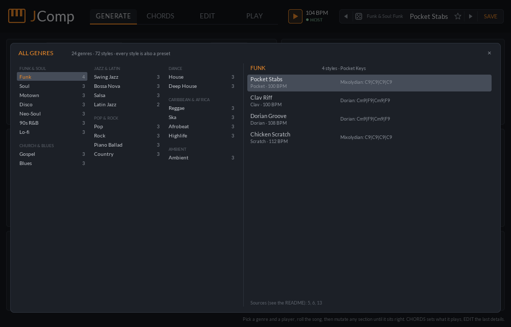
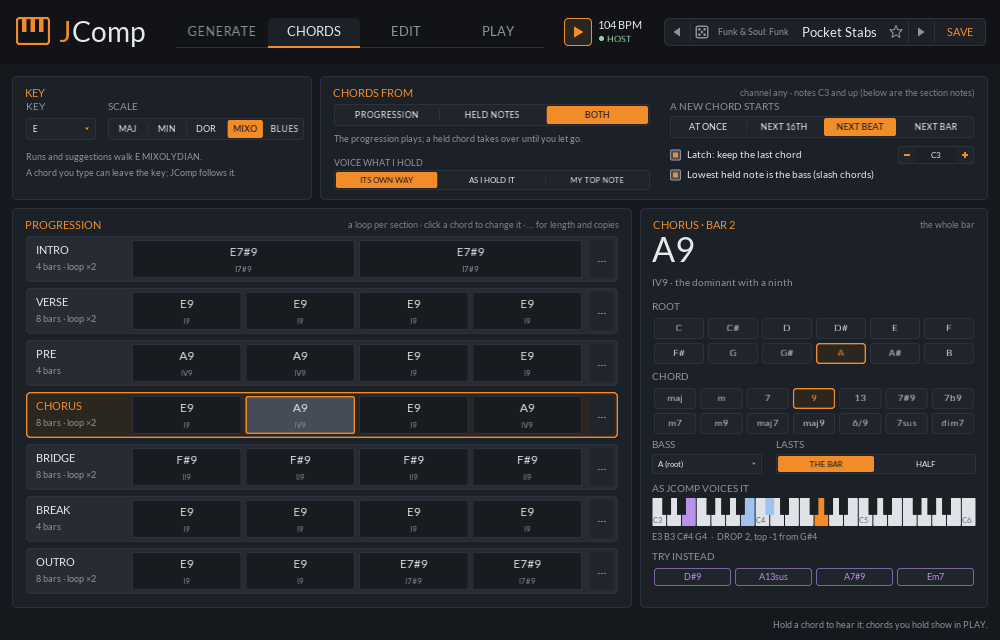
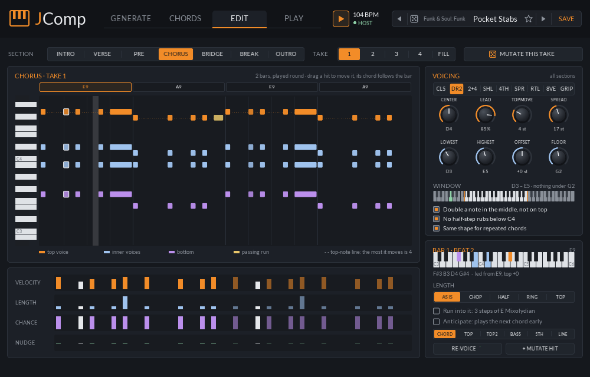

# JComp

An accompaniment generator: JDrummer's way of working, for chords.

   

A CLAP note effect that writes whole keyboard (or guitar, organ, pad) parts and plays them as MIDI to
any polyphonic instrument. Pick a genre and a style, a player, set how hard and how rich it goes, and
roll a song: intro, verse, pre-chorus, chorus, bridge, break and outro, each with its own chord
progression, four takes, a fill and its own energy. Every chord is voiced the way a player would
voice it, led smoothly from the one before, with the top note singing a line and the odd passing run
into a change. Change any chord, play your own chords into it, or let it take its rhythm from a bass
line. Mutate any section until it sits right, edit any hit, then switch sections live by click, by
note or by automation. It plays with the host's transport, or on its own PLAY while the host is
stopped.

Version 0.4.0.

Hover over a control for a one-line tip.

## Wiring it up

Put JComp on a MIDI track before a polyphonic instrument (an electric piano, a piano, an organ, a
clav, a guitar or a pad). It sends its chords on **channel 1** (CHANNEL in OUTPUT). Notes from **C3**
up are chord keys: what you hold there can become the chords it plays (see CHORDS FROM). Notes below
C3 are section notes (C0 to F1 on the keyboard map) or, for RHYTHM FROM THE BASS, the bass line on its
own channel. Other notes are dropped unless *Pass other notes through* is ticked.

JComp counts in 4/4 from the host's beat 0: its bars are the host's bars when the host is in 4/4.
While the host counts in (pre-roll) it waits for the first bar. A host loop plays the same chords on
every pass, the first included: the song follows the host's bars, so a loop or a seek lands where the
song is at that bar. DENSITY's fills, VARY and the chance hits roll the same way on every playback, so
a render is the same every time.

To play with JDrummer, put both on the same transport: JDrummer's section notes and JComp's are laid
out the same way (the seven sections on the white keys from C0), so one MIDI clip can switch both.

## GENERATE

### GENRE

24 genres in seven families, 72 named styles among them, and every style is also a factory preset. The
twelve tiles are the common ones, each drawn as its style plays; **ALL 24** opens the browser with
every genre, its styles, their tempos and progressions, and the sources each genre was written from.

| Family | Genres |
|---|---|
| Funk & Soul | Funk, Soul, Motown, Disco, Neo-Soul, 90s R&B, Lo-fi |
| Church & Blues | Gospel, Blues (12-bar, in triplets) |
| Jazz & Latin | Swing Jazz, Bossa Nova, Salsa (two-bar clave rhythms), Latin Jazz |
| Pop & Rock | Pop, Rock, Piano Ballad, Country |
| Dance | House, Deep House |
| Caribbean & Africa | Reggae, Ska, Afrobeat, Highlife |
| Ambient | Ambient (long held chords) |

The **STYLE** box picks the genre's style: a rhythm family, a set of progressions (one per kind of
section), a tempo, a scale and its own twists (pushes, a busier or sparser hand, runs in, the top note
alone, a left hand, richer or plainer chords, shuffle, half time, triplets). Shift-click another tile
to **blend** its rhythms in; the small purple slider sets how much.

### HOW IT PLAYS

The **player** is how the chords are played, never which chords: the instrument it voices for, how
busy, how rich, how long the chords ring, how often a run leads in, and how far behind the beat it
sits. Picking a player sets the voicing and feel to suit (shape, how many voices, range, where the
voicings sit, onsets, timing, runs).

| Player | Instrument | Plays |
|---|---|---|
| Pocket Keys | E-piano | tight stabs on the bass, 9ths and 13ths |
| Clav Chopper | Clav | busy sixteenth chops, muted and percussive |
| Church Organ | Organ | held chords, walk-ups into the changes |
| Neo-Soul Keys | E-piano | lazy, behind the beat, rich and open |
| Jazz Comper | Piano | rootless voicings (Levine's A and B: 3-5-7-9 and 7-9-3-5, the 13th for a dominant's 5th), sparse pushes |
| Pop Pianist | Piano | eighth-note pulse, open triads |
| Rhythm Guitar | Guitar | sixteenth scratch, three-note grips |
| Skank Guitar | Guitar | off-beat chops, short and high, the off-beats strummed up |
| Strummer | Guitar | down-up strums of a guitar grip (the bass, its fifth and octave, the chord above) |
| Montuno | Piano | Latin piano figures in octaves (a close chord with its bottom note doubled on top) |
| House Stabs | Synth | one chord shape, rhythmic and on the grid |
| Pad Player | Pad | whole bars and slow swells |
| Ambient Drifter | Pad | long held chords, wide (quartal), open and barely moving, rolled in |

- **ENERGY** (laid back to driving): how hard the whole song goes. Each section's own energy rides on
  it.
- **WEIRD** (triads, as written to extended, reharmonised): richer chords (a 7th becomes a 9th or a
  13th), substitutions (a tritone sub for a dominant, a dominant approach chord in the second half of
  a bar), and hits left to chance or pushed off the grid.
- **ROLL SONG**: a new seed for every section that isn't locked. New rhythms and new colour, the same
  progressions. **PREVIOUS ROLL** goes back (up to 16).

### THE SONG

The seven sections side by side, each as wide as its bars, with its chords, its take as it will be
voiced, and its energy (drag it up or down; low energy plays the take softly and lets its chords
ring, and dragging keeps the section's chords). The
die rolls just that section; the lock keeps it from ROLL SONG. Click a section to mutate it below.

### MUTATE

The section's take now, and five children, each tagged with how it differs: *busier*, *sparser*,
*push it*, *chop it*, *let it ring*, *shift*, *ghosts*, *top line*, *accents*, *run in*, *answer* or
*left hand*. Click a child to put it in the song (the generation counts up); *back* takes the one
before. **MUTATION** sets how far the children stray, **NEW LITTER** asks for five more.

## CHORDS

### KEY

The **KEY** moves every progression with it. The **SCALE** (Major, Minor, Dorian, Mixolydian, Blues)
is what passing runs walk, and the home the Roman numerals are named from. A chord can leave the key;
JComp voices whatever is written.

### CHORDS FROM

- **PROGRESSION**: each section plays its own progression.
- **HELD NOTES**: hold a chord on the chord keys (C3 up, set by the note box) and JComp comps it in the
  section's rhythm. It names what you hold (E G# B D is E7; add F# and it is E9), so it voices it its
  own way.
- **BOTH** (the default): the progression plays; a held chord takes over until you let go, and the
  progression picks up where it is.

**A NEW CHORD STARTS** at once, or on the next sixteenth, beat (the default) or bar. A chord played a
moment early still takes the beat it was meant for (At Once included), and one played up to about
80 ms late takes it too: if that beat's chord has already sounded, the new chord comes in where it
was played. A hit the take had while no chord was held yet plays when the first chord comes in. A chord is
named when a key goes down; letting keys go doesn't change it. *Latch* keeps the last chord after you
let go (a quick tap included). A host's note-off for every key, a choke, or All Notes Off lets go of
what's held. *Lowest held note is the bass* makes slash chords (C/E). **VOICE WHAT I
HOLD**: voice it JComp's way, play it as you hold it, or voice it under your top note.

### PROGRESSION

A row per section, a box per bar (two chords in a split bar), with the Roman numerals under each.
A progression is a loop: a four-bar progression in an eight-bar section plays twice. Click a chord to
change it on the right; **...** sets the row's length (1, 2, 4, 8 or 12 bars), copies another
section's chords, or goes back to the style's progression.

### The chord picked

Its **ROOT** and **CHORD** (major, minor, 7, 9, 13, 7#9, 7b9, m7, m9, maj7, maj9, 6/9, 7sus, dim7),
its **BASS** (the root, or any note for a slash chord), and whether it **LASTS** the bar or half of it
(a split bar has a chord in each half). Under them, the chord on a keyboard as JComp will voice it, led
from the chord before it, and **TRY INSTEAD**: chords that could stand in (for a dominant its tritone sub,
a sus, a 7#9 or the ii before it; for a major chord the relative minor or the iii; for a minor one
the relative major or the IV7; the V of the next chord, the dominant a half step above it, or a passing
diminished; or the chord richer or plainer). Click one to use it.

## EDIT

One section's take (1 to 4) or its fill on a piano roll, voiced as it will play over the section's
chords (the chord lane is on top): the top voice orange with the line it sings dotted, the inner
voices blue, the bottom purple, a passing run yellow. Click an empty step to add a hit, click a hit to
pick it, drag it sideways to move it (its chord follows the bar), double-click to take it away. Under
the roll, each hit's **VELOCITY**, **LENGTH** (down to a chop, up to ring), **CHANCE** and **NUDGE**:
drag a bar, double-click for its default. **MUTATE THIS TAKE** mutates it once.

### VOICING

How every chord is voiced, for all sections:

- **Shape**: CLOSE, DROP 2 (the second voice from the top down an octave), DROP 2+4, SHELL (3rd and
  7th, the root below), 4THS (quartal: fourths, one of them perhaps a tritone or a third, holding the
  chord's root, third and seventh so the changes are heard; where no stack can, the root goes under
  the fourths as a left hand's would),
  SPREAD (two hands: on keys the left hand's low note sounds with the chords on beats 1 and 3 and on
  a change of chord, and the chops and backbeats between are the right hand alone), ROOTLESS
  (Levine's A and B forms, the root left to the bass), OCTAVES (a close chord with its bottom note
  doubled on top, the montuno's right hand: hit by hit its octave line moves through the chord, 5, 3,
  1, 3, rather than repeating one block) or GRIP (a guitar's: the bass string, its fifth and octave,
  then the chord's third and colour close above; with three notes, the power chord). A slash chord
  (C/E) keeps its bass at the bottom in CLOSE, DROP 2, DROP 2+4, SHELL, SPREAD and GRIP; ROOTLESS,
  4THS and OCTAVES leave it to the bass player. On an organ or a pad the low note of
  SPREAD stays in every chord; on keys it is held from one 1 or 3 to the next.
- **CENTER**: where the voicings sit. **LEAD**: how much each chord is led from the one before (the
  least total movement) rather than placed at the center. **TOP MOVE**: the most the top voice should
  move, in semitones. **SPREAD**: the widest a voicing may be.
- **LOWEST** and **HIGHEST**: the window every voicing stays inside (at least an octave), so how wide
  the chords can spread. **OFFSET** slides the whole window, and CENTER with it, up to an octave either
  way. Voice leading stays bounded by the window wherever it is: each chord is still led from the one
  before by the least movement that fits, so automating OFFSET moves the voicings smoothly rather than
  in jumps. A window too narrow for a chord gets fewer voices or a tighter shape. Only a low bass
  note goes under the window (SHELL's, SPREAD's and GRIP's root, 4THS' root under the fourths, a slash
  chord's bass), and never under FLOOR. **FLOOR**: nothing goes under this note, the bass part included. The keyboard under the knobs
  shows the window as it sounds (click near either end to move it), the floor in green.
- *Double a note in the middle, not on top*, *No half-step rubs below C4*, *Same shape for repeated
  chords*.

Every voicing keeps to **low interval limits**: the lowest note an interval can sit on before it turns
to mud (a minor second no lower than E3, a minor third no lower than C3, a major third, fourth or
tritone no lower than Bb2, a fifth no lower than Bb1, and so on), after Hoffmann's chart and Pease and Pullig's *Modern Jazz Voicings* (see
the sources below).

### The hit picked

Its chord, the notes it plays and how far its top moved from the hit before, and:

- **LENGTH**: AS IS, CHOP, HALF, RING (to the next chord) or TOP (only the top note rings).
- *Run into it*: a three-step passing run in the key and scale (bent to the chord it leads into)
  leads into this hit when the chord changes here.
- *Anticipate*: the hit plays the next chord early (a push, an eighth ahead). A hit an eighth before
  a change of chord, with nothing after it until the change, anticipates it anyway (the and of 2
  into a ii-V's V), except in an offbeat take, where an upbeat chop is the old chord's.

Nothing rings over a change of chord: RING, LENGTH, a left-hand note and a top note ringing all stop
at the next change. A change the take has no hit for (two chords in a bar, the second between hits)
is struck where it comes, as the bar's first chord is played.
- What of the chord it plays: CHORD, TOP (the top note alone), TOP 2, BASS (the left hand's root),
  5TH (the fifth the bass alternates with: boom-chick's beat 3, the bossa thumb's second note), or LINE
  (one note of a line: the degree of the chord the style wrote, as in the Superstition clav riff, the
  Afrobeat tenor line and the palm-wine finger; the root for a hit set to LINE here). A left hand's
  notes are held to its next note and don't cut the chord above them, nor the chord them; a key both
  hands play is let go only by the note that struck it last.
- **RE-VOICE**: the next best voicing for this hit, round to JComp's own again. **+ MUTATE HIT** changes
  one thing about it.

## PLAY

### SECTIONS

A tile per section: its note, its chords, its take with the playhead, its energy, and its four takes
and fill. Click a tile to switch to it, a number for that take, FILL for a fill. The section coming
next is outlined with **NEXT**. **LOOP** stays in a section; **SONG** plays each for its bars, then
the next (following the host, the song starts at the host's bar 1 with the Section parameter's
section, so starting the host again, or jumping, finds the section that bar is in). **SWITCH AT** the
next beat, bar (the default), 2 bars, 4 bars or the section's end. At the next beat the new section
comes in mid-bar, its bars still on the host's bar lines. A two-bar take (a clave rhythm, a two-bar
riff) keeps its phase to the host's bars, so a section starting on an odd bar, a jump or a loop never
turns the clave round. **BY** a note, the Section parameter, or both.

### NOW PLAYING

The chord sounding, big, the chord after it, its notes and its shape, and the take on a roll with the
playhead. Beside it, two knobs that change the whole part as it plays:

- **DENSITY**: fewer or more chords. Below the middle the weakest hits drop out first (soft off-beats,
  then off-beats, then the lesser beats, spread over the knob's whole travel; each bar's first chord
  always stays, and so does the first chord after a change half way through the bar, and a line
  style's line). Above it, softer repeats of
  the chord sounding fill the gaps, eighths first, then sixteenths (only in a rhythm that already
  plays sixteenths, so a montuno, a bossa or a Charleston stays on eighths), never under a chord still
  held, and never on a beat in an offbeat style (a skank, an offbeat stab). A figure played as written
  (the batida, the montunos and guajeos, Freddie Green's four, the cha-cha) gets nothing added. The
  middle plays the take as written, and the same setting always gives the same pattern.
- **LENGTH**: every chord shorter, down to a staccato chop, or longer, up to legato (held to the next
  chord). The middle plays the lengths as written.

The rolls on GENERATE and PLAY draw the part with DENSITY and LENGTH as set; EDIT shows the take as
written, the hits you edit. Thinned hits don't cut a long chord short: at full LENGTH a chord holds
to the next chord actually played.

### FEEL

- **TIMING**: how far behind (or ahead of) the beat the chords sit, in ms.
- **VELOCITY**: how much each chord's loudness varies. **TOP VOICE**: the top note this much louder, so
  the line sings. **LENGTHS**: how much lengths vary. **SWING**: every second sixteenth (or eighth)
  late.
- **CHORD NOTES START** TOGETHER (within 2 ms; the chord as a whole wanders off the grid), ROLLED
  (bottom to top, about 14 ms a note), STRUM DOWN (9 ms apart), or STRUM BOTH (down on the beat, up
  on the off-beats).
- **SAME DICE EVERY** 1, 2, 4 or 8 bars: the chance hits repeat, so they make a pattern of their own.
  **AUTO FILLS** every 4, 8 or 16 bars.

### TRANSPORT

The big button is PLAY: it runs JComp on its own at **TEMPO** while the host is stopped. **AUTO**
follows the host while it plays and runs free on PLAY while it's stopped; **HOST** only follows the
host; **FREE** only runs on its own.

### PASSING RUNS

Single notes into a chord change, 2 to 4 steps of the key's scale landing on the new chord. The scale
bends to the chord it leads into: a note of that chord from outside the key (a borrowed Abmaj7's Ab,
a D7's F#, a chord of the last chorus's key change) joins it, and the scale notes a half step either
side that the chord doesn't hold drop out.
**AMOUNT** is how many of the chances are taken; **AT MOST** every bar, every 2 bars or every 4.
**LANDS ON** the new chord's top note, or any note of it. *Half step from below* ends the run a
semitone under its target; *Shorten the chord before* cuts the chord before the run so it doesn't
blur.

### OUTPUT

**CHANNEL** (default 1), and **RHYTHM FROM**:

- **OWN**: the takes, as written.
- **THE BASS**: a chord wherever the bass line coming in on **BASS** (channel 2 by default) plays,
  **FOLLOW**ing all its notes, the strong ones (accented, on the beat, or a leap), or one a bar. Put a
  bass line (or JDrummer's kick, or your own left hand) on that channel and JComp comps with it.
- **BOTH**: the takes, and a chord on the bass notes FOLLOW picks where the take isn't already
  playing one.

The keyboard shows the notes going out (top orange, bottom purple, inner blue) and what you hold
(green).

## Section notes

Play a note to switch section. With the **KEYBOARD MAP** the white keys from C are the seven sections
then NEXT, PREV, RESTART and STOP, and the black keys FILL, TAKE 1 to 4, RUNS OFF and HOLD CHORD.
**OCT** sets the octave (C0 by default, well below the chord keys) and the channel box which channel
they come on (ANY by default). **CUSTOM** gives each of the 18 jobs its own note: press **LEARN** and
play any note. **RESET ALL** puts them back as the keyboard map has them.

- *Fill into the new section*: a switch plays a fill in the bar before it.
- *Velocity sets energy*: how hard you play a section's note sets how hard it plays.
- *Play only while a chord is held*: JComp plays while you hold a chord (on the chord keys, whatever
  CHORDS FROM is), and stops when you let go: what's sounding ends there.
- *Pass other notes through*: notes JComp doesn't use go on to the instrument. Send them on another
  channel than JComp's: on its own channel a passed note and a chord's note on the same key would
  share one voice.

RUNS OFF and HOLD CHORD (stay on this chord) last as long as you hold the note.

## Presets

Every style is a factory preset, filed by family and genre in the preset menu, so loading one makes
its song from the style's own seed. A saved preset keeps the song itself (in a `.jcompsong` file
beside the preset), with every chord change, mutation and edit. The die in the preset bar rolls the
song again. A preset is the sound and the song: loading one leaves how JComp is wired into the project
as it is (CHANNEL, RHYTHM FROM, BASS and FOLLOW, the section notes' map, octave, channel and learned
notes, the chord keys and CHORDS FROM, *Play only while held*, *Pass other notes through*, the
transport, and the section and take playing). Its tempo for playing on its own PLAY comes with it, as
picking the style on GENERATE sets it. A new JComp starts as the Pocket Stabs preset.

Genre, Style, Seed, Energy, Weird and the other recipe parameters aren't automatable, but if the host
sets one (a generic parameter view, a host preset) the song is made again from it.

Parameters for the host only (not on the panel): **Voices** (3 to 5 notes a chord), **Vary** (how
often a bar swaps to another take, a soft off-beat hit drops out, or a hit's velocity wanders), **Section**, **Take** and **Play**.

## Where the content comes from

The library was written from a research pass over published sources: corpus studies, method books,
dissertations, transcriptions and interviews. The full notes, with every rhythm grid, voicing rule
and progression, the honesty marker on each claim and the full bibliography, are in
[docs/sources.md](docs/sources.md). Each genre in the browser lists the source numbers it was written
from.

| Genre | Sources (numbers from [docs/sources.md](docs/sources.md)) |
|---|---|
| Funk | Hein on "Superstition" [5]; the Funkscribe multitracks [6]; Stewart, "Make It Funky" [13] |
| Soul | de Clercq & Temperley's rock corpus [1]; the Funk Brothers [23] |
| Motown | the Funk Brothers (Hunter and Van Dyke, the backbeat piano) [23]; Benjamin's quarter-note snare [52] |
| Disco | Nile Rodgers interviews (chucking, three-string inversions) [40] |
| Neo-Soul | Danielsen on D'Angelo's "Left and Right" [15] |
| 90s R&B | none found: written from the idiom |
| Lo-fi | Danielsen [15]; Winston & Saywood, *IASPM Journal* [17] |
| Gospel | Hal Leonard's gospel keyboard guides [31][32]; Smallwood's vamps [44]; shout music's tempo and upbeats [53] |
| Blues | none found: the standard 12-bar form, from the idiom |
| Swing Jazz | Levine, *The Jazz Piano Book* [2] and his rootless A and B forms [57]; Freddie Green [19][20][55]; Red Garland [21]; the reverse Charleston [54] |
| Bossa Nova | the batida, after Garcia and others [11][12], written in eighths (Brazil's 2/4 read at a 4/4 tempo); the thumb's root and fifth [60] |
| Salsa | Levine [2]; the guajeo after Peñalosa, Moore and Mauleón [7][8][9][10], read note by note from Moore's examples; montunos in octaves and in clave [56][58] |
| Latin Jazz | Levine [2]; guajeo [7]; Moore [10]; one clave direction [56] |
| Pop | de Clercq & Temperley [1] (the progressions' frequencies) |
| Rock | de Clercq & Temperley [1] |
| Piano Ballad | de Clercq & Temperley [1] |
| Country | Floyd Cramer's slip-note [18]; Hal Leonard's country piano guide [33]; the alternating bass [59] |
| House | MusicRadar on 90s house piano [36]; the Korg M1 [37] |
| Deep House | Roland and Hooktheory on Mr. Fingers' "Can You Feel It" [24][25] |
| Reggae | Berklee's reggae keyboard guide [35]; Dubmatix on the organ bubble [42]; Jenson's "Bubblin'" [51] |
| Ska | Britannica [22] |
| Afrobeat | Stewart's interlock tables [13]; Veal [14] |
| Highlife | guajeo [7]; Braddock [26]; Koo Nimo [27]; Music in Africa [28] |
| Ambient | Eno's *Music for Airports* liner notes [47]; analyses of its "1/2" and its tape loops [48][49]; Harold Budd's "soft pedal" playing [50] |

The voicing rules draw on low interval limits (Hoffmann [3]; Pease & Pullig [4]), Levine's rootless
and shell voicings [2], and big-band voicing practice (Rogers [41]). Voice leading follows the least
total movement between chords, the idea behind Huron [43] and Tymoczko [45]. Naming a held chord
matches the notes against chord templates, after Pardo & Birmingham [29].

**What is solid and what is thin.** The strongest sources, read in full, are the rock and pop
harmony statistics [1], the low interval limits [3], Stewart's Afrobeat interlock [13], the salsa
guajeo theory [7], Levine's book plan [2], Hein on "Superstition" [5] and the Freddie Green work [19].
The 90s R&B, Lo-fi, Gospel, Disco keys, House piano, Country, Motown keyboard rhythms, the reggae
bubble's exact grid and Highlife transcriptions are thin: many of their rhythm grids are marked
*unverified* in the notes, a well-informed default from the idiom that should be checked by ear
against the named recordings. Several books were cited through secondary pages only (Mauleón, Garcia,
Veal, Braddock, the Hal Leonard guides). Ambient rests on search snippets about Eno's and Budd's records; its
progressions are derived from what those describe (open, ambiguous, sus and add9) rather than taken
from any recording. The styles are original patterns in each idiom's manner, not
transcriptions of any recording.

**The independent review (0.2.1).** A second pass checked every genre, style and player against
sources read directly ([docs/sources.md](docs/sources.md), Part E). It rewrote the salsa and Latin
jazz montunos in eighths from Moore's guajeo examples (they had been in sixteenths), wrote the bossa
batida in eighths (it had been playing twice as fast), put the reverse Charleston on the and of 1 and
beat 3, voiced Four To The Bar in Freddie Green's low shells, moved the gospel Shout to 160 BPM on the
swung triplet grid, put the organ bubble's left hand on the upbeats, leaned Motown's quarter notes on 2
and 4, and gave bossa and highlife players that don't scratch. 90s R&B, House, Country's slip note
and the palm-wine interlock remain unconfirmed.

**The second review (0.2.2).** Another cold pass generated every style and checked what it really
plays against sources ([docs/sources.md](docs/sources.md), Part F). Busy players, mutations, WEIRD
and DENSITY had been adding sixteenths to eighth-note idioms (montunos, the batida, Freddie Green's
four): anything added now stays on the rhythm's own grid. The Latin Jazz guajeo had been flipping
between 2-3 and 3-2 from one section to the next (crossed clave), and the "answer" mutation could
copy a clave rhythm's first bar over its second: both fixed. The montuno styles now play the guajeo
in the verse, Pocket Stabs plays its stabs on the one, and Charleston and the bossa cycle keep every
hit under SPARSE. Jazz Comper voices rootless (it had been playing root-position triads and
sevenths), Montuno plays octaves, fourths keep the root (Ambient had sounded one stack of fourths for
every chord), and a two-handed voicing no longer doubles the bass on every chop. The left hand gets a
fifth: boom-chick's bass alternates root and fifth, the bossa thumb plays root then fifth under the
guitar's voicing, and the ballad's broken chords are root-fifth eighths under a held chord. Strum
both now strums up on the triplet grid's offbeats, an offbeat style at low energy keeps its first
offbeat rather than gaining a chord on the one, chords are spelled by degree (Ab, Bb, Eb in C, not
G#, A#, D#), and passing runs bend to chromatic chords.

**The third review (0.3.0).** A third cold pass played every style through the engine and probed the
plugin through CLAP ([docs/sources.md](docs/sources.md), Part G). The engine now plays every change of
chord (a chord between two hits used to be skipped, and the one before rang over it), keeps two-bar
takes and the clave in phase with the host's bars, pairs every note's on and off so the hands don't
cut each other, keeps DENSITY off fixed figures and off the beats of offbeat styles, and allocates
nothing on the audio thread. The Superstition riff, the Afrobeat tenor line and the palm-wine finger
now move (a new LINE part), the Strummer plays guitar grips and Rock power chords (a new GRIP shape),
Nashville Slip plays Cramer's slip note, the 12/8 ballad plays ballad triplets, the Two-Step is a
two-step, Gospel's Shout plays its vamp, Slow Blues has a chord on the one in most sections, and runs move by step on the take's
grid. Motown's "Gorilla Piano" is now **Straight Eighths**. Host loops, keyboard chords played on the
beat, LATCH, channel changes, presets and the pre-roll behave.

**The fourth review (0.4.0).** A fourth cold pass reproduced every finding with `jcomp-dump` or a
probe ([docs/sources.md](docs/sources.md), Part H). A push or run into a new section, or into a chord
played on the keys, now plays the chord coming; DENSITY thins across its whole travel and always keeps
each bar's first chord, a change's chord and a line style's line; a section's low energy plays softly
rather than loudest; held-chord styles hold through their fills and mutations; WEIRD leaves the tonic
alone; 4THS gives each chord its own stack with its seventh; chords are spelled in the right key, minor
keys included. On the plugin side the first chord played on the keys takes its beat, host loops repeat
exactly, PLAY ONLY WHILE HELD stops when you let go, renders are reproducible, and a preset brings its
tempo.

**Left out for now.** Jazz Waltz (it needs 3/4, which JComp's 4/4 grid can't play), a "+ GUITAR"
second player layered over the first, and recording a part played in to a take.

## Building

Built with the rest of JClap (see the [root README](../../README.md)). `jcomp-engine-tests` checks the
harmony, voicings (every quality, root and shape inside the window and the low interval limits), the
library, the generator and the engine; `jcomp-tests` drives the plugin through CLAP (and checks that
`process()` allocates nothing); `jcomp-dump` prints any style's song and the MIDI the engine plays for
it, bar by bar, for review (`jcomp-dump [genre] [style] [seed] [weird] [energy] [density] [length]
[sections] [takes] [human]`); `jcomp-screenshot` renders these pictures:

    jcomp-screenshot out.png [generate|chords|edit|play] [width height] [players] [browser] [notes] [custom]
                     [density=0..1] [length=0..1]
