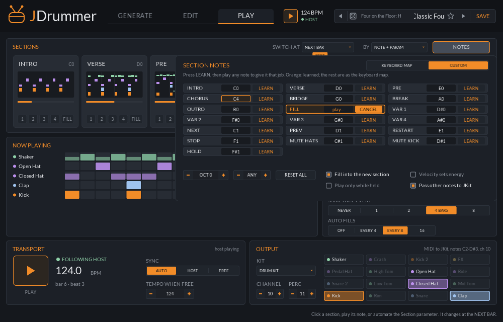

# JDrummer

A drum pattern generator and sequencer that plays JKit.

   

A CLAP note effect that writes whole drum parts and plays them as MIDI for [JKit](../jkit)'s 16 pads.
Pick a genre and a style, a drummer (and a percussionist if you like), set how hard and how strange it
goes, and roll a song: intro, verse, pre-chorus, chorus, bridge, break and outro, each with four
variations, a fill and its own energy. Mutate any section until it sits right, edit any hit, then
switch sections live by click, by note or by automation. It plays with the host's transport, or on
its own PLAY while the host is stopped.

Version 0.2.0.

Hover over a control for a one-line tip.

## Wiring it to JKit

Put JDrummer on a MIDI track (or before JKit in the same chain) and send its output to JKit. It sends
notes C2 to D#3 (36 to 51), JKit's pads 1 to 16, on **channel 10** by default (CHANNEL in OUTPUT).
Set JDrummer's KIT to the kit JKit has loaded (Drum Kit, Percussion, FX, Animals or Afro-Latin) so the
lanes are named and coloured as the sounds you hear. Picking a style sets KIT to the kit its genre
plays: the hand percussion genres play JKit's Afro-Latin kit (Afro-Cuban, West African) or its
Percussion kit (Middle Eastern, Indian), so set JKit's KIT to match.

A percussionist plays a second part on its own channel (**11** by default, PERC in OUTPUT): send that
to a second JKit set to the percussionist's kit, AFRO-LATIN for the Conguero and the Djembe Circle,
PERCUSSION for the others. The song remembers which kit its percussion was written for, so a song
saved by 0.1.0 keeps playing the Percussion kit until you roll it again. Notes JDrummer doesn't use as section notes pass straight through
to JKit, so you can still play pads by hand (untick *Pass other notes to JKit* to stop that).

## GENERATE

### GENRE

34 genres in eight families, 233 named styles among them (4 to 12 a genre), and every style is also a
factory preset.

| Family | Genres |
|---|---|
| Four on the Floor | House, Techno, Disco, Trance, Minimal |
| Breaks | Breakbeat, Drum & Bass, Jungle, UK Garage, Electro |
| Hip-Hop | Boom Bap, Trap, Lo-fi, Drill |
| Live Kit | Rock, Funk, Soul & R&B, Metal, Jazz |
| Latin & Afro | Afrobeat, Amapiano, Samba, Bossa Nova, Reggaeton |
| Reggae & Dub | Reggae, Dub |
| Hand Percussion | Afro-Cuban, West African (on JKit's Afro-Latin kit), Middle Eastern, Indian (on its Percussion kit) |
| FX & Odd | Glitch (FX kit), Animal Grooves (Animals kit), Odd Meters (7/8, 5/4, 6/8, 9/8), Halftime |

The hand percussion genres are written as their traditions play them: the Afro-Cuban grooves in
two-bar clave (son and rumba clave, 3-2 and 2-3) with the conga's tumbao, the bongo's martillo, the
campana, the guiro and the mambo bell; the West African ones on djembe and the three dunun with
their bell, Kuku and Djole in 4/4 and Soli, Dununba and Lamban in 12/8; the Middle Eastern rhythms
as doum and tek (Maqsum, Saidi, Baladi, Malfuf, Ayoub, and the eight-beat Chiftetelli and Masmoudi);
the Indian thekas on tabla (Teentaal's sixteen matras with its khali, Keherwa, Dadra in six) and the
dhol's Bhangra chaal. Their twists, stray hits and mutations stay on that tradition's own drums.

- **The twelve tiles** are common genres, each with its groove in miniature. Click one to use it (its
  first style). The genre playing always has a lit tile: if it isn't one of the twelve, it takes the
  last tile's place.
- **Shift-click** another tile to blend it in: the song takes hits from both. The small purple slider
  beside ALL 34 GENRES sets how much of the second genre comes in. Shift-click it again to drop it.
- **The style menu** lists the genre's styles. A style is a groove, a tempo and its twists (shuffled,
  swung in eighths, busy hats, half-time, rolling percussion, toms, a clap stack, ratcheted hats and
  so on); every twist a style names changes its groove. Picking one sets the free tempo, the swing
  and what it swings, and the kit, player and percussionist its genre likes.
- **ALL 34 GENRES** opens the browser: every genre by family with its count of styles, and the styles
  of the genre you pick, each with its tag, tempo and groove. Click a style to use it.

### HOW IT PLAYS

- **The drummer** button opens PLAYERS. A player is how a pattern is played: how loose the timing is,
  how busy, how many ghost notes, how often and how big the fills, and how far behind the beat the
  backbeat and hats sit. Six drummers: Session Pro, Pocket Funk, Stadium Rock, Brushes Jazz, Break
  Chopper and Machine (on the grid, no humanize).
- **The percussionist** chip adds a second part on its own channel: Conguero, Djembe Circle, Bateria,
  Hand Drummer, Tabla & Darbuka, or Shaker & Tamb. Click it to pick one; × drops it. The
  percussionist plays a groove in the drummer's meter (in 3/4, 5/4, 7/8, 9/8 or 12/8 when the drummer
  is) and in the genre's own tradition (the tabla over a taal, the darbuka over a maqsum), to
  the section's energy (a shaker player keeps the shaker even in a quiet intro), with three variations that come in with the drummer's and a fill of its own
  (the conguero's congas, the djembe call, a darbuka roll, a cajon break) when the drummer fills.
- **ENERGY** (chill to peak time) is how hard the whole song goes: which instruments play, how many
  hits, how loud. Each section's own energy rides on it: a quiet verse thins its soft hits and drops
  the open hats and percussion; a chorus plays louder, leans on the beats, fills its hats in and opens
  the hat into the next bar (a live drummer may move to the ride, unless the groove opens its hat, as
  funk and disco do). A quiet section's hats play their eighths; the hat line never gets holes. Hand drums fill in their soft
  strokes instead. Above 50 ENERGY lifts every section towards full, the chorus still above the pre.
  On the hand kits the timeline (the clave and the bells, the tabla's theka, the darbuka's doum and
  tek) stays whole at any energy, through WEIRD, the twists and VARY. A Cuban song keeps its clave:
  a section that borrows another groove only takes one with the same clave (3-2 or 2-3, son or rumba).
- **WEIRD** (by the book to out there) moves hits off the grid (in 12/8, off the eighths only by
  whole eighths), leaves some to chance, and from about a third of the way rolls the hats and brings in
  FX hits; further out, stray sounds and odd lengths.

Each section's **fill** is its genre's: round the toms, a snare roll, a hat roll, a chopped break
(hip-hop and lo-fi), a build or the band dropping out (the drummer adds nothing in the silence), congas from the highest down (toms on a kit), an FX sweep, the djembe call, a darbuka
roll landing on a doum, a tihai (a phrase three times, landing on the next bar's one) or a cajon break,
in one of a few shapes, one to four beats long by the drummer and the energy. A fill plays the last
bar of its pattern, so a two-bar groove's fill comes in whichever bar it falls on. Odd meters keep
their own bar: a 7/8 section's bars are 7/8 long, and its fills, crashes and switches land on them. Drummers play with a
slow push and pull across the bar and a lighter hand on the sixteenths between eighths; the Machine
stays on the grid.
- **ROLL SONG** makes the song again from a new seed. Locked sections stay as they are.
  **PREVIOUS ROLL** goes back to the song before, up to 16 times.

### THE SONG

The seven sections, each as wide as its bars, with its groove. For each:

- **Click it** to mutate it in the card below.
- **Drag its energy** (the dot and number under its groove) up or down. Energy runs from 100
  down to 0. Under 20 a section keeps only its anchors (what's left of the groove on the beats; the
  snare comes in from 28, so below that the kick and hats keep time; no ghosts, no stray hits, no
  crash); under 10 only the kick (or the hand drum's bass) on the half notes; at 0 it is silent. So a
  section can be as sparse as you want, down to a single kick or a bar of nothing before the drop.
- **The die** rolls just that section again.
- **The lock** keeps it from ROLL SONG.

### MUTATE

The selected section's groove now, and five children made from it, each tagged with what changed
("more ghost snares", "a kick moves", "lays back further", "half-time feel", "toms come in",
"hats left to chance", "perc answers", "flams on the backbeat" and ten more; on hand drums "open tones
move", "slap answers", "bass on the beats only", "roll into the one" and the ones that suit them). Click a child to put it
in the song: the section's other variations and fill are made again from it, and its generation goes
up. **< back to gen N** goes back one. **MUTATION** sets how far the children stray; **NEW LITTER**
makes five more.

## EDIT

One section's pattern: pick the **SECTION**, then **VAR** 1 to 4, its **FILL**, or **PERC** (the
percussionist's part; once you edit it, it plays as edited, its own variations and fill set aside). **STEPS** sets the pattern's length (1 to 32) and **RATE** its step (1/16,
1/8, 1/16T, 1/32). **DICE** mutates the pattern once, by MUTATION.

Only the pads the pattern plays get a lane, highest pad at the top. **+ ADD A PAD** adds a lane for
another pad. Each lane shows its pad's name and note, with **M** (mute) and **S** (solo) for
listening.

- **Click a cell** to add a hit; click a hit to take it away.
- **Drag up or down on a hit** for its velocity. Accents have a white top; ghost notes are half
  height.
- **Right-click a hit** for accent, normal or ghost, a ratchet (2 to 4 hits in the step) and a chance
  (100, 75, 50 or 25%). A hit left to chance is dashed with its percent.
- **Click a lane's name** to show its **VELOCITY**, **CHANCE** and **NUDGE** (up to 40 ms early or
  late) for each step below the grid. Drag a value up or down; double-click to reset it.

## PLAY

### SECTIONS

A tile for each section with its note, its groove and its energy. The section playing is lit, and the
one queued to come in has a dashed edge and NEXT. Click a tile to switch to it, a number for that
variation, FILL for a fill.

- **SWITCH AT**: when a switch happens: the next beat, the next bar (default), the next 2 or 4 bars,
  or the end of the section.
- **BY**: what switches sections: a note or the Section parameter (default), only a note, or only the
  parameter. The Section and Variation parameters can be automated.
- **NOTES** opens SECTION NOTES (below).

### NOW PLAYING

The pattern playing, lane by lane, with the playhead.

### LIFE

What makes each pass a little different:

- **VARY**: each bar may take another variation, and hits come and go (never the kick and backbeat
  on the beats, nor a hand kit's timeline).
- **GHOSTS**: soft snare hits around the beat (on the drum kit, in sixteenths).
- **SWING**: how late the swung notes are (50% is straight).
- **SWING IN**: 16THS swings every second sixteenth; 8THS swings the off-beat eighths, the sixteenths
  either side moving with them, for a shuffle or a jazz ride (at 67% the eighths are triplets).
- **SAME DICE EVERY** never, 1, 2, 4 (default) or 8 bars: the chance hits and VARY repeat every so
  many bars, so the randomness makes a pattern of its own.
- **AUTO FILLS** off, or a fill every 4, 8 (default) or 16 bars.
- **PLAY** LOOP stays in a section; SONG plays each section for its bars, then the next.

### TRANSPORT

- **PLAY** runs JDrummer on its own.
- **SYNC**: AUTO (default) follows the host while it plays and runs free on PLAY while it's stopped;
  HOST only follows the host; FREE ignores the host.
- **TEMPO WHEN FREE**: 40 to 300 BPM.

The readout shows whether it's following the host or running free, the tempo, and the bar and beat in
the section.

### OUTPUT

**KIT** (the kit JKit has loaded), **CHANNEL** (default 10) and **PERC** (the percussionist's channel,
default 11), and JKit's 16 pads as JKit lays them out (pad 1 bottom left), each lighting as it plays.
On the drum kit a crash (pad 14) comes in on the one when a big section starts and after a fill
(not in hip-hop, which comes out of a fill without one), as hard as the section is.

## Section notes

Play a note to switch section, much as you'd cue clips. With the **KEYBOARD MAP** the white keys from
C are the seven sections then NEXT, PREV, RESTART and STOP, and the black keys FILL, VAR 1 to 4, MUTE
HATS, MUTE KICK and HOLD. **OCT** sets the octave (C0 by default, well below JKit's pads) and the
channel box which channel they come on (ANY by default).

**CUSTOM** gives each of the 19 jobs its own note: press **LEARN** and play any note. **RESET ALL**
puts them back as the keyboard map has them.

- *Fill into the new section*: a switch plays a fill in the bar before it.
- *Velocity sets energy*: how hard you play a section's note sets how hard it plays.
- *Play only while held*: JDrummer plays while a section's note is held, and stops when you let go.
- *Pass other notes to JKit*: notes that aren't section notes go on to JKit.

MUTE HATS, MUTE KICK and HOLD (stay in this section) last as long as you hold the note.

## Presets

Every style is a factory preset, filed by family and genre in the preset menu, so loading one makes
its song from the style's own seed. A saved preset keeps the song itself (in a `.jdrummersong` file
beside the preset), with every mutation and edit. The die in the preset bar rolls the song again.

## Building

Built with the rest of JClap (see the [root README](../../README.md)). `jdrummer-engine-tests` checks
the generator and engine; `jdrummer-tests` drives the plugin through CLAP; `jdrummer-screenshot`
renders these pictures:

    jdrummer-screenshot out.png [generate|edit|play] [width height] [players] [browser] [notes] [custom] [addpad]
