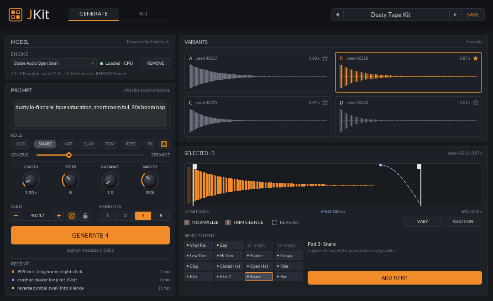
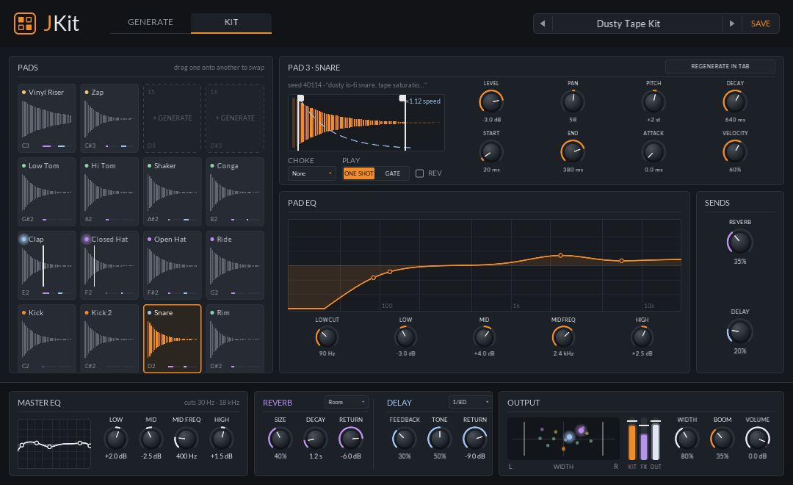
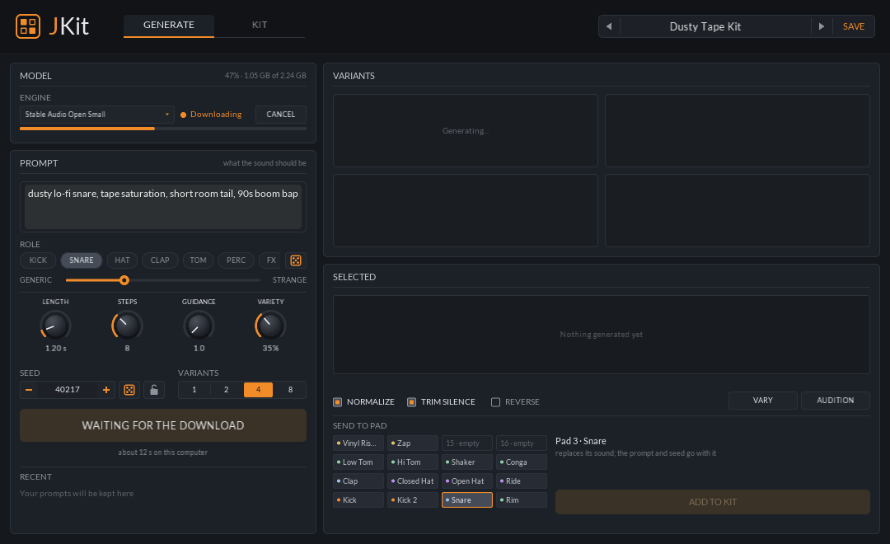

# JKit

A 16-pad drum kit whose sounds an AI model makes from your words, inside the plugin. Type what you want (or roll the dice for a prompt, from plain studio drums to things no drum machine has), pick from the variants, trim and fade the one you like, and put it on a pad. Then play the kit: each pad with its own pitch, start and end, envelope, EQ and sends, into a shared reverb and delay and a master EQ, width and BOOM.

      

Version 0.1.0 · Powered by Stability AI

## The model

JKit makes its sounds with **Stable Audio Open Small**, a text-to-audio model from Stability AI, run
by Microsoft's **ONNX Runtime** on your computer's CPU. Nothing is sent anywhere: the prompt, the
model and the sounds all stay on your machine. There's no helper app and no Python.

Neither comes with the plugin. The first time you press GENERATE (or DOWNLOAD on the MODEL card),
JKit downloads them into your JClap folder:

| | Download | On disk |
|---|---|---|
| ONNX Runtime 1.22.0, from Microsoft's NuGet package (only your system's library is kept) | 121 MB | 12 to 38 MB, by system |
| Stable Audio Open Small (tokenizer, text encoder, diffusion model, decoder, licence) | 2.12 GB | 2.12 GB |
| **In all** | **2.24 GB** | **about 2.15 GB** |

They go in:

- macOS: `~/Library/Application Support/JClap/` (`runtime/` and `models/stable-audio-open-small/`)
- Windows: `%APPDATA%\JClap\`
- Linux: `~/.config/JClap/`

Every file is checked against its SHA-256 as it arrives, and only moved into place once it matches,
so a broken or cancelled download never leaves a file that looks finished. CANCEL stops a download;
the next one starts the unfinished file again.

The MODEL card always says what the model takes: its download size before it's downloaded, how far
the download has got while it runs, and its size on disk once it's there. **REMOVE** (click it
twice: the first click asks SURE?) unloads the model and deletes its files and the runtime, freeing
the space; GENERATE or DOWNLOAD fetches them again.

Generating needs macOS 13.3 or later (ONNX Runtime's minimum), Windows 10 or later, or a 64-bit
Linux with libcurl; on an older Mac the kit still plays, and the MODEL card says why it can't load.

Every open JKit shares one copy of the model in memory (about 2 GB once loaded), loaded the first
time one generates and freed when the last JKit closes.

How fast it is depends on your CPU: on a recent laptop, one 1-second sound takes a few seconds, and
the variants of one GENERATE come out together. The first GENERATE after opening also loads the
model, which takes a few seconds more.

More engines are on the way: ORB (a small model that plans a drum hit's parts and renders them
with DSP) and Stable Audio Open 1.0 (larger, slower, longer sounds). Each will be listed in the
ENGINE menu with its own download and its own REMOVE.

## The Generate tab

**MODEL**: the engine, whether it's downloaded, downloading, loading or loaded, and its size on
disk, with DOWNLOAD, CANCEL or REMOVE.

**PROMPT**: what the sound should be, in plain words: "dusty lo-fi snare, tape saturation, short
room tail". Under it:

- **ROLE**: Kick, Snare, Hat, Clap, Tom, Perc or FX. It picks the random prompt's words, the pad's
  colour and the sound's name on the pad.
- **The dice** beside the roles writes a random prompt for the role, from a bank of several hundred
  sounds, characters, treatments, spaces and styles per role.
- **GENERIC - STRANGE**: how strange the random prompts get. At the left they're studio drum
  sounds ("tight 909 kick, light compression, Detroit techno"); halfway, a familiar sound with an odd
  twist ("snare made of a filing cabinet slammed shut, plate reverb"); at the right, objects, places
  and processes ("a glass of ice dropped on marble, granular smear, played backwards").
- **LENGTH**: how long the sound is, 0.1 to 11.8 s.
- **STEPS**: diffusion steps, 4 to 16. The model is tuned for 8.
- **GUIDANCE**: how hard it follows the words, 1 to 7. The model is tuned for 1; above 1 each step
  runs twice, so it takes twice as long.
- **VARIETY**: how different the variants are from each other. Low makes takes of one sound; high
  makes each its own.
- **SEED**: where the randomness starts. The same prompt, seed and settings make the same sound on
  every computer. The die picks a new seed; the lock keeps it (unlocked, each GENERATE picks a new one).
- **VARIANTS**: how many sounds each GENERATE makes: 1, 2, 4 or 8.
- **GENERATE** shows its progress, and how long the last run took.
- **RECENT**: your last prompts. Click one to load it with its role and seed.

**VARIANTS**: what came back, each with its seed and length. Click one to select and hear it. Its
star keeps it through the next GENERATE (unstarred ones make way for the new ones).

**SELECTED**: the selected variant. Drag the white handles to trim its start and end, and pull the
top of the region down from the end handle for a fade out. **NORMALIZE** brings its peak to just
under full scale, **TRIM SILENCE** cuts the silence before it starts and after it dies away,
**REVERSE** turns it round. **VARY** makes more sounds like it (the same prompt, from noise close
to its seed). **AUDITION** plays it as it will go on the pad.

**SEND TO PAD** picks the pad (laid out as on the Kit tab), and **ADD TO KIT** puts the treated
sound on it, with its prompt, role and seed. The next empty pad becomes the next target.

## The Kit tab

**PADS**: sixteen pads, pad 1 bottom left on MIDI note 36 (C2), up to pad 16 on 51. Each shows its
name, role, waveform with a playhead while it sounds, note, and its reverb (purple) and delay (blue)
sends. Click a pad to play and select it (higher on the pad is louder), drag one onto another to
swap them (sound and settings), right-click to play, regenerate or clear it. An empty pad's
+ GENERATE opens the Generate tab aimed at it.

**PAD n**: the selected pad. Its waveform has the START and END handles, the decay drawn as a blue
curve, and the speed its pitch plays it at. **REGENERATE IN TAB** opens the Generate tab with its
prompt, role and seed.

| Control | Range | What it does |
|---|---|---|
| Level | -inf to +12 dB | the pad's volume |
| Pan | 100L to 100R | where it sits |
| Pitch | -24 to +24 semitones | plays it faster and higher, or slower and lower |
| Decay | 10 ms to 10 s, or Full | fades it out from the start; Full lets it play out |
| Start, End | 0 to 100% | the part of the sound that plays (shown as times into it) |
| Attack | 0 to 200 ms | fades it in |
| Velocity | 0 to 100% | how much the note's velocity changes its level |
| Choke | None, 1 to 4 | pads in one group cut each other off, like a closed hat stopping an open one |
| Play | One shot, Gate | one shot plays the whole sound; Gate stops it (over 30 ms) when the note ends |
| Rev | on, off | plays it backwards |

**PAD EQ**: LOW CUT (off, or 20 Hz to 2 kHz), LOW (a shelf at 120 Hz), MID (a bell from 200 Hz to
8 kHz, at MID FREQ) and HIGH (a shelf at 7 kHz), each ±15 dB, drawn as a curve.

**SENDS**: how much of the pad goes to the reverb and the delay, after its level and pan.

### The master band

Everything under the darker band acts on the whole kit.

- **MASTER EQ**: LOW, MID (at MID FREQ) and HIGH, ±15 dB, with fixed cuts at 30 Hz and 18 kHz.
- **REVERB**: Room, Hall, Plate (bright) or Dark; SIZE, DECAY (0.2 to 8 s) and RETURN (its level).
- **DELAY**: a note value at the host's tempo (1/32 to 1/1, with dotted and triplet), FEEDBACK, TONE
  (darker repeats to the left) and RETURN.
- **OUTPUT**: the stereo field, with every pad where its pan puts it, glowing while it plays, between
  the WIDTH brackets; the levels of the dry kit, the effects and the output; and **WIDTH** (0 to
  200%), **BOOM** (low-end punch: the lows under 110 Hz driven into a soft clip and added back, so
  the hit thumps without the tail booming) and **VOLUME**.

## Kits and projects

A project keeps everything: the sounds on the pads (as 16-bit, 44.1 kHz stereo), every setting, and
the Generate tab's prompt, settings and recent prompts. The variants aren't kept: put the ones you
want on a pad.

The kit browser at the top right saves a kit, with its sounds, to your JClap presets folder
(`JKit/Presets`, a `.jkit` file with a `.jkitsounds` file beside it) and loads it back. JKit has no
factory kits: every kit is yours.

## Licences

- Stable Audio Open Small is © Stability AI, under the
  [Stability AI Community License](https://huggingface.co/stabilityai/stable-audio-open-small/blob/main/LICENSE.md):
  free for individuals and organizations with under $1M a year in revenue. Powered by Stability AI.
  The files come from an ONNX export of it, pinned to one revision and checked by hash.
- ONNX Runtime is © Microsoft, MIT licensed; JKit compiles against its C header
  ([third_party/onnxruntime](third_party/onnxruntime)) and loads the library at run time.
- The T5 tokenizer file is from google-t5/t5-base, Apache 2.0.
- miniz (unpacking the runtime) is MIT licensed.

## Building

JKit builds with the rest of JClap (see the [top-level README](../../README.md)). Its tests:

- `jkit-tests`: the kit through a test host (playing, pitch, start and end, decay, velocity, gate,
  reverse, choke, sends, volume, boom, state, swapping pads, trimming and fading).
- `jkit-gen-tests`: the generator without the model (hashing, the tokenizer, the sampler's schedule
  and noise, the random prompts, the studio's download folder and REMOVE). With `JKIT_TEST_MODEL`
  set to a folder of the model's files and `JKIT_TEST_ORT` to an ONNX Runtime library, it also
  generates two sounds.
- `jkit-screenshot-test`, `jkit-screenshot-kit-test`, `jkit-screenshot-first-run-test`: the panel
  pictures above.
