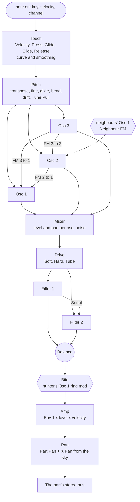
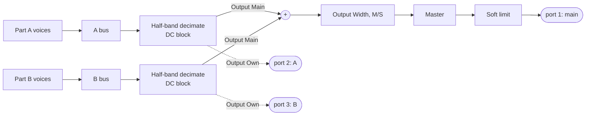

# How JSynth works

This is the whole of JSynth, from the note that comes in to the samples that go out, written from
the code in [`src/`](src). The [README](README.md) says what the plugin does; this says how. Where
it gives a number, the number is the one in the code.

- [The pieces](#the-pieces)
- [Signal flow](#signal-flow)
- [Timing](#timing)
- [Notes, parts and voices](#notes-parts-and-voices)
- [Touch and MPE](#touch-and-mpe)
- [Pitch](#pitch)
- [The oscillators](#the-oscillators)
- [The FM grid](#the-fm-grid)
- [Mixer and drive](#mixer-and-drive)
- [The filters](#the-filters)
- [Amp and pan](#amp-and-pan)
- [Envelopes and LFOs](#envelopes-and-lfos)
- [Routes and MAP](#routes-and-map)
- [The flock](#the-flock)
- [Between creatures](#between-creatures)
- [The output stage](#the-output-stage)
- [Every parameter](#every-parameter)
- [Presets](#presets)
- [Threads, timing and state](#threads-timing-and-state)

## The pieces

| File | What it holds |
| --- | --- |
| [`src/params.h`](src/params.h) | Every parameter: id, range, default, how it prints and parses, and the list of route destinations. |
| [`src/engine.h`](src/engine.h) | All the audio: notes and voices, touch, routes, the voice's oscillators, FM, filters and amp, the couplings between creatures, decimation and output. |
| [`src/dsp.h`](src/dsp.h) | The voice's building blocks: table sine, waves, noise, SVF, ladder, comb, envelope, LFO and the half-band decimator. |
| [`src/flock.h`](src/flock.h) | The boids: every creature's flight, who hears whom, the ink field and the eight flock sources. |
| [`src/plugin.cpp`](src/plugin.cpp) | The CLAP plugin: params, state, note and MIDI events, ports, NOTE_END, and what the panel reads back. |
| [`src/presets.h`](src/presets.h) | The factory bank and user preset files. |
| [`src/editor.cpp`](src/editor.cpp) | The panel: the sky, its two views (SYNTH with big drawn panels beside the sky, SKY alone), MAP and the route list. |

A part's params are written once, as offsets, and `partId(part, offset)` gives the host's id: part
A's start at 64 and part B's at 1088. Each module (oscillator, filter, envelope, LFO, route) is a
block of ids with room to grow, so ids can stay put once released.

## Signal flow

One voice, as it runs at the oversampled rate:



And the two parts out to the host:



The hexagons are the couplings between creatures: Neighbour FM reads the Osc 1 of up to three
nearby creatures of the same species, and Bite reads the Osc 1 of the hunter holding this one. Both
take the other voice's sample from one sample ago (see [Between creatures](#between-creatures)).

Two things about the shape matter more than anything else:

1. **Each part is a whole synth.** Both parts have the same voice, the same 64 routes and the same
   flock params; only the play mode and the sky are shared.
2. **The flock is in the audio path.** The engine flies the flock on the audio thread, so a
   creature's speed or turning is a modulation source as exact as an envelope, and what the panel
   draws is what you hear.

## Timing

Everything runs on a **control tick** of 32 samples at the host's rate, counted across `process()`
calls, so a render comes out the same at any host block size (a test checks this).

- **Notes** start and stop on their exact sample: the plugin splits the host block at each event.
- **Param and expression changes** only set targets; the next tick reads them.
- **Per tick**, the engine reads every part param (continuous ones through a 10 ms one-pole, choices
  as they are), recompiles the routes if any changed, runs the part-wide LFOs, and then for each
  voice: its touch, its routes, envelopes 2 and 3, its LFOs, its pitch, and a linear ramp across the
  tick for every value the sample loop reads.
- **Env 1** (the amp) runs every sample at the base rate.
- **The flock** steps at a fixed 500 Hz, counted with an integer accumulator (samples × 500 against
  the sample rate), so it flies the same at any rate. A voice reads its creature's sources
  interpolated between the last two steps, then through a 2 ms smoother, so a route from a flock
  source never steps.

**Quality** (1x, 2x, 4x; 2x by default) runs the voices oversampled. Buffers are sized for 4x in
`prepare()`, and Quality is a setting, not automatable.

**Rendering a tick.** Voices that don't hear each other run their whole span one voice at a time,
which keeps each voice's state in cache. When any voice has Neighbour FM on, or a Bite that is
sounding, all the voices run in step instead, a sample at a time, so each hears the others' last
sample. Both give the same sound. Inside a voice, work that has nothing to do is skipped: FM cells
at zero, a silent oscillator that modulates nothing (only its phase moves), noise at zero, filter
ramps a type doesn't read, and a ladder that is wide open with no resonance or drive (Filter 2 as it
starts), which passes the sound through with its state kept ready.

## Notes, parts and voices

**The voice pool** is 40 slots for both parts. Each part sounds at most its Polyphony (1 to 16, 8 by
default); the spare slots let a stolen voice fade out over 3 ms in its own slot while the new note
starts in another. When a part is at its polyphony, the oldest released voice is stolen first, then
the oldest held. If all 40 are busy, the fading voice furthest down its fade is taken. The host is
told 32 voices (`voice-info`), with overlapping notes.

**Play mode** decides which part a note plays, after each part's Key Low and Key High:

| Mode | Part A plays | Part B plays |
| --- | --- | --- |
| Single | every note | nothing |
| Layer | every note | every note |
| Split | from the Split Key up | below the Split Key |
| MPE Zones | member channels 2 to 8, and channel 1 | member channels 9 to 16, and channel 1 |
| Velocity | below the Velocity Split | at or above the Velocity Split |
| Expression | every note, faded out as the crossfade source rises | every note, faded in |

In Expression mode the two parts' levels crossfade with equal power by Slide or Press (Crossfade
Source), per note.

**Mono and Legato** keep one voice per part and a stack of up to 16 held notes. A new note restarts
the voice in place (Mono) or moves it to the new pitch without restarting (Legato, while a note is
held). Letting go goes back to the last note still held, with that note's own touch.

**Sustain** (CC 64) holds released notes until the pedal lifts; CC 120 and 123 release everything.

**NOTE_END** goes to the host when the last voice playing a host note ends, at the sample it ended
on (one note can sound in both parts, so it waits for both). A voice that produces a non-finite
sample is reset rather than passed on.

## Touch and MPE

Each voice has five touch dimensions, in MPE order, all route sources. Release is 0 while the note
is held and its release velocity after.

| Touch | From |
| --- | --- |
| **Velocity** | note-on velocity |
| **Press** | CLAP pressure, or the MIDI channel's pressure |
| **Glide** | the bend, as -1..1 of the part's bend range |
| **Slide** | CLAP brightness, or the channel's CC 74 |
| **Release** | release velocity |

Each goes through its own **Curve** (-1..1: the value is raised to the power 4<sup>-curve</sup>, so
positive curves respond more early) and **Smoothing** (a one-pole at control rate; 2 ms for Glide,
8 ms for the others by default). A new note takes its touch at once.

**MIDI.** Channel 1 is the MPE manager and a plain keyboard's channel: its bend moves every note by
the Manager Bend Range (2 semitones by default), CC 1 is the Mod Wheel source, CC 64 is sustain, and
once it has sent pressure or CC 74 those reach every note too (pressure as the greater of the note's
and the manager's, CC 74 as an offset from its middle). Channels 2 to 16 are member channels, each
with its own bend (by the part's MPE Bend Range, 48 semitones by default), pressure and CC 74; a new
note on a channel starts from that channel's last values. CLAP notes use note expressions (tuning,
pressure, brightness) instead. The plugin takes CLAP, MIDI and MIDI MPE dialects and prefers CLAP.

**Per-note host modulation.** Every route destination takes CLAP parameter modulation per note id,
key, channel or port. Each voice keeps up to eight such offsets, eased over 10 ms like the params,
and they add to the param before its routes do. A new note starts with none.

## Pitch

Per tick, a voice's pitch in semitones is:

```
note (gliding) + Transpose + Fine/100 + Drift + Tune Pull, then + bend × the oscillator's Bend
```

- **Glide** is a one-pole toward the new note with a time constant of a quarter of Glide (0 ms to
  20 s). Glide Mode Always glides from the part's last note; Legato only from a note still held.
- **Glide Rounding** pulls a finger that has stopped sliding to the nearest semitone, by the
  Rounding amount, over the Rounding Time (150 ms by default). While the finger moves, the pitch
  follows it exactly.
- **Drift** is a smooth random LFO of its own per voice at 0.3 Hz, up to ±0.15 semitones.
- **Tune Pull** is in [Between creatures](#between-creatures).

## The oscillators

Three per voice, each with its phase kept in double precision, so a low note stays in tune over a
long hold.

**Pitch mode:**

- **Note:** the voice's pitch plus Coarse (±48 semitones) and Fine (±100 cents).
- **Ratio:** the voice's pitch (with Fine) times Ratio, ×0.25 to ×16.
- **Fixed:** 1 Hz to 10 kHz, times Fine; it ignores the note.

Key Track Off pitches Note and Ratio from middle C instead of the note. Every oscillator is clamped
below 0.45 of the oversampled rate.

**Waves** (15):

| Wave | How |
| --- | --- |
| Sine | 4096-point table, linear interpolation. |
| Triangle | Straight lines. |
| Saw | polyBLEP band-limited, always. |
| Square, Pulse | polyBLEP edges at both ends, with their DC removed. Shape sets the width: 10 to 90% for Square, 5 to 50% for Pulse. |
| Half Sine, Abs Sine, Quarter, Alt Sine, Alt Half, Camel, Alt Camel | The TX81Z's other seven waves, each built from the table sine. |
| White, Pink | Noise; pink is Paul Kellet's economy filter on white. |
| Random | One of Sine to Alt Camel, drawn from the voice's own random sequence at each note. |

For every wave but Saw, Square and Pulse, **Shape** is a phase distortion: 50% is straight, and
toward 0 or 100% the first half of the cycle is squeezed or stretched.

**Sync** (Osc 2 and 3) restarts the phase on Osc 1's wrap a sample ago. **Retrigger** On starts each
note at Phase; Off starts it at a random phase. Under phase FM the band-limiting is told how far the
wave really moved that sample, so a modulated saw stays clean.

## The FM grid

A 3×3 grid of cells, 0 to 100%: the cell in row *from* and column *to* is how much oscillator *from*
modulates oscillator *to*, and the diagonal is each oscillator's feedback. Each cell's value is
squared before use, so the knob is even by ear.

Within a sample the oscillators run in the order 3, 2, 1. So 3 into 2, 3 into 1 and 2 into 1 hear
this sample's output; every other cell, and the feedback, hears the last sample's. Feedback uses the
average of its last two samples (the DX7 trick), which keeps it from going to noise.

**FM Type:**

- **Phase** is phase modulation. A cell at full adds up to 2 cycles (about 12.6 radians) of phase
  per unit of modulator; feedback is scaled by a quarter of that.
- **Exponential** moves the pitch instead, by 2<sup>2·m</sup>, clamped to ±4 octaves.

## Mixer and drive

Each oscillator has a **Level** and an equal-power **Pan** (centre is unity gain). **Noise** has a
level and a **Color** that crossfades pink (-100%) to white (+100%). Noise made at 2x or 4x is made
louder by the square root of the factor, so it comes out of the decimator as loud at any quality.

A voice is mono until an oscillator is panned (or a route moves a pan); then it runs both filter
channels, and the right channel's filters take up where the shared ones were.

**Drive** sits before the filters. The gain is 1 + 15·Drive², the shape is Soft (tanh), Hard (a
clip) or Tube (asymmetric, for even harmonics), and the result is divided by the square root of the
gain, so turning it up thickens the sound more than it louders it.

## The filters

Two per voice. **Cutoff** runs 20 Hz to 20 kHz on an even knob (20 × 1000<sup>value</sup>), with
**Key Track** moving it with the note around middle C, by up to an octave per octave. Each filter
also has its own **Drive** (a tanh on its input, gain 1 to 5, gain compensated).

| Type | How |
| --- | --- |
| Low Pass, High Pass, Band Pass | Zavalishin TPT state variable stages, cascaded for 12, 24, 36 or 48 dB (one to four stages) with Butterworth damping. Resonance raises the last stage's Q up to 30 times. |
| Notch | One SVF stage, low plus high. Slope is ignored. |
| Peak | One SVF stage: the band added back, up to 4 times, by Resonance. |
| Ladder | A 4-pole transistor ladder, zero-delay feedback solved with one linear step, tanh on the input. Resonance up to just past self-oscillation. |
| Comb +, Comb - | A delay tuned to the cutoff (30 Hz up), feedback 30 to 98% by Resonance. Comb + rings at every harmonic, Comb - at the odd ones. |

**Routing:**

- **Serial:** Filter 1 into Filter 2. Filter 2 starts as an open ladder, so serial changes nothing
  until it is turned down.
- **Parallel:** each filter hears what goes into it; **Balance** turns each down from the centre out.

Each oscillator and the noise picks its filter (**Filter**: 1+2, F1 or F2). In serial, F1 and 1+2
go through both filters and F2 through Filter 2 only. In parallel, a source in only one filter is at
full level with Balance at centre, and the other side turns it down. A source in both goes half
into each at centre and all into one at either end, so it crossfades. Osc 1 on F1 and the rest on F2
splits the voice between the filters.

## Amp and pan

The voice's gain is the part's **Level** (-60 to +6 dB) times its velocity response
(1 - Velocity + Velocity × Velocity) times 0.35 for headroom, and in Expression mode times the
crossfade. Env 1 multiplies it every sample.

Its pan is the part's **Pan** plus **X Pan** times where its creature is, left to right
(-1 at the left edge of the sky, +1 at the right), clamped and equal-power. With X Pan at 0 the
flock never moves the stereo image.

## Envelopes and LFOs

**Three envelopes** per voice, each Delay, Attack, Hold, Decay, Sustain, Release (times 0 ms to
20 s on an even knob, about 100 ms in the middle), with a curve per segment (-1..1) and a
**Velocity** amount that scales the whole envelope by the note's velocity. A retrigger starts from where the
level is, so it never clicks. **Loop** Held repeats attack and decay while the note is held; Free
keeps repeating after the note is let go too, until the voice ends. Env 1 is the amp and always
releases on note off. Env 1 runs every sample; Env 2 and 3 at control rate.

The panel's envelope editor doesn't draw that knob taper. It places each time by milliseconds, on a
cube of the envelope's **Time Range** (Short, Normal or Long: up to 1, 5 or 20 s a stage), so half
way is an eighth of the range. Time Range is a view setting saved with the patch, not automatable,
and never changes a time; factory presets with a time past 5 s open on Long.

**Four LFOs** per voice. Each has six shapes (Sine, Triangle, Saw, Square, S&H, Smooth, which
glides between random values), a Rate of 0.02 to 50 Hz or a tempo Division (1/32 to 4/1, with
triplets and dots), a Phase, a fade-in Delay and a Polarity (bipolar or unipolar).

**Trigger:**

- **Retrigger** restarts the voice's LFO at Phase on each note.
- **Free** starts each note's LFO in step with the part's running one, plus Phase.
- **Global** uses one LFO for the whole part; routes can't move its rate per voice.

Synced to a Division, Free and Global LFOs are locked to the host's song position rather than
counted from when they started: each tick works out how many cycles into the song it is (the
host's beats over the Division's, plus Phase), so a 1/16 lands on the sixteenths of the bar
however playback got there, starting mid-song or jumping round a loop. Their S&H and Smooth
values come from the cycle's number, so a looped bar repeats them. With the transport stopped,
or no beat position from the host, they count on at the tempo from where they were. A
Retriggered LFO still starts with each note, at the tempo.

The first two LFOs move the flock, and aren't route sources:

- **Wingbeat** (5 Hz, Sine) bobs each creature across its path, by **Push**.
- **Wind** (0.2 Hz, Smooth, Global) is one gust for the whole sky, pushing every creature of the
  species one way (a direction that turns slowly on its own), by **Push**.

LFO 1 (4 Hz, Sine) and LFO 2 (0.5 Hz, Triangle) only modulate.

## Routes and MAP

Each part has a pool of **64 routes**, each a source, a destination and an amount (-100 to +100%),
all host params. The panel shows only the ones in use, so it reads as an open-ended list. Source and
Destination are settings (not automatable); amounts are automatable and can be modulated.

**Sources** (21): Env 1 to 3; LFO 1, LFO 2; Velocity, Press, Glide, Slide, Release; Key; the flock's four
(Speed, Nearest, Heading, Turn); Random; Mod Wheel; Macro 1 to 4. They are unipolar 0..1 except the
LFOs (by their polarity), Glide, Turn, Random (one value per note, -1..1) and Key, which is
(key - 60) / 48, clamped to -1..1.

**Destinations** (159): every continuous part param a voice reads: level, pan, X Pan, fine, glide
and drift; each oscillator's shape, coarse, fine, ratio, fixed pitch and phase; all nine FM cells;
the mixer; drive and balance; each filter's cutoff, resonance, drive and key track; each envelope's
times and sustain; each LFO's rate, phase and delay (and Push for the two that have it); the flock's
twelve continuous params; and every route's own amount.

**How a route moves a param.** Per voice per tick:

1. **Pass 1:** routes onto another route's amount add `source × amount` (scaled to the amount's
   range) at their own unmodulated amounts.
2. **Pass 2:** every other route adds `source × its amount (as moved in pass 1)` to its
   destination's offset.
3. A param's value is `denormalise(clamp(normalise(base) + offset, 0, 1))`, in its own 0..1 range.
   Ratio is normalised in log space, so a route moves it by musical intervals; Coarse moves
   continuously.

A route's amount is smoothed with the other params, so automating one doesn't zipper. The routes
are compared against a cached copy each tick and recompiled when any changed, so a half-written
route is corrected a tick later.

A route whose destination is a flock param moves that creature's own flight: Press onto Speed makes
the creature you press harder fly faster. Those are read only on ticks that end with a flock step.

**MAP** writes the same routes from the panel: touch a source chip (which turns MAP on with it
armed), then drag a knob. The
first drag on a knob takes a free route for that source and destination; double-click flips its
sign, right-click removes it. Route rings show only in MAP with a source armed: each knob that
source moves shows a ring in its colour. Outside MAP the knobs show no rings.
**ROUTES** lists the routes in use, sixteen to a page: **+ ADD** starts one (Env 2 onto Filter 1
Cutoff, at 0) and **X** removes one.

A new part starts with three routes: Env 2 to Filter 1 Cutoff (+30%), Press to Speed (+40%) and
Press to Filter 1 Cutoff (+20%).

## The flock

Every sounding voice is a creature in its slot, and only those: the sky is empty until a note
plays. Randomness is our own xorshift, reseeded on activate, on reset and when the transport
starts with nothing sounding, so a bounce matches playback from the same start.

**The sky** is 4:3 wide and 1 high. **Size** (0..1) scales everything in it: at a bigger sky the
creatures, their ranges and their speeds are relatively smaller (a scale of 1.4 - 0.8 × Size).
**Walls** Soft turns creatures back near the edge, Wrap carries them round to the other side, and
Open only turns them back well past it.

**A creature's energy** (how bright and present it is) rises toward 0.55 + 0.45 × Press while held,
follows its amp envelope after release, and when its voice ends it fades and goes.

**Forces on each creature, per step:**

| Force | What it does |
| --- | --- |
| Cohesion | Toward the weighted middle of the neighbours of its own species within Range. Scatter reverses it. |
| Alignment | Toward the neighbours' average velocity. |
| Separation | Away from any neighbour within 40% of Range. |
| Lure | Toward a point that roams around the note's lure on a leash: loose near it, so the flock and the wander shape the path there, and firm when the creature strays. Each creature roams on two slow orbits of its own, wider with Wander. |
| Wander | A heading that drifts, with a turn rate that drifts too, so a creature sometimes sweeps a long curve and sometimes jinks. |
| Wind, Wingbeat | As in [Envelopes and LFOs](#envelopes-and-lfos). |
| Walls | As above. |

Neighbours count by a smooth kernel, (1 - distance / Range)² times their energy, so one drifting in
or out of range fades in or out. Range runs from 0.08 to 0.4 of the sky's height (times the scale).
Speed is clamped between 20% and 100% of a top speed of (0.08 + 0.42 × Speed) × (1 + 0.8 × Press).

**Behaviour:**

- **Shoal** flies with its own kind.
- **Scatter** keeps apart: cohesion pushes away from the middle.
- **Hunt** chases the nearest creature of the other species within 2.5 times Range, and everyone
  shies from a hunter a little.
- **Flee** runs hard from the other species, whatever it does.

**Where a lure sits.** Lure X and Lure Y each choose what places a note's lure along that axis:
Pitch (four octaves from C2, with bend), Velocity, Press, Slide, Release, Random (a place per note) or
Centre. By default X is Pitch and Y is Slide, so low notes fly left, high notes right, and more
Slide flies higher.

**The flock's sources**, each continuous:

| Source | What it is |
| --- | --- |
| Speed | How fast it flies, against the fastest it could at full Press (0..1). |
| Nearest | How near the nearest neighbour is (0..1). |
| Heading | How much it flies upward: 1 straight up, 0 straight down, smooth all the way round. |
| Turn | How fast its heading turns: + a right turn on screen, - a left one, tanh of the rate over 4 radians a second, smoothed over about 170 ms so the wingbeat barely shows in it (-1..1). |

The flock also keeps, for the voice but not as route sources, **Caught** (whether a hunter has it:
rises in about 20 ms, lets go over about 500 ms; it scales Bite) and the creature's place left to
right (for X Pan).

**Ink** is the panel's alone: it draws ink from the creatures' positions, fading with **Tail** and
blooming with **Spread**. The engine keeps no ink.

## Between creatures

Every link from the flock to the sound starts at zero, so a plain patch is plain.

**Neighbour FM.** Each creature hears the three strongest neighbours of its own species (weighted
by the kernel and their energy). Their Osc 1 outputs from a sample ago, weighted, phase-modulate this
voice's Osc 2, by Neighbour FM squared (the same scale as an FM cell). A neighbour keeps its place
while it stays near, and a new one only takes a place whose weight has faded out, at most a full
weight per 10 ms, so a change of neighbour never clicks. A tight flock rings and a loose one is
clean.

**Tune Pull.** For each neighbour heading within 30° of this creature's heading, the engine finds
the just interval (1/1, 6/5, 5/4, 4/3, 3/2, 5/3, 2/1, octave-reduced) nearest the interval between
their unpulled pitches, and pulls this voice toward it, weighted by neighbour, at most ±30 cents
times Tune Pull, over about 150 ms. Using the unpulled pitch keeps two creatures from chasing each
other.

**Bite.** When a hunter of the other species comes within 0.06 of a creature, the creature is
Caught. While it is, the hunter's Osc 1 ring-modulates it, crossfaded by the hunter's part's Bite
times Caught. A new hunter waits for the old one's bite to fade first.

## The output stage

Each part's voices sum to its own stereo bus at the oversampled rate. At 2x and 4x the bus is
decimated by polyphase IIR half-bands (two chains of allpasses, as in Laurent de Soras' HIIR: flat
to 0.45 of the output rate and over 100 dB down past 0.55), one stage per halving, with no latency to
report. A gentle DC block follows, for what the drive and the asymmetric waves leave.

A part set to **Output Own** plays on its own stereo port (part A on the second, part B on the
third) and skips the main bus. Otherwise it goes to the main bus, where **Output Width** (mid/side,
0 is mono, 100% as is, 200% wider) and **Master** (-6 dB by default) apply, then a soft limit: above
0.8 the level bends smoothly toward 1.0.

## Every parameter

Ranges and defaults as in [`src/params.h`](src/params.h). Part params exist once for each part and
are named "A ..." and "B ..." in the host. Everything is automatable except the route sources and
destinations and Quality; every continuous param takes CLAP modulation, and route destinations take
it per note.

### Global

| Param | Range | Default | What it does |
| --- | --- | --- | --- |
| Play Mode | Single, Layer, Split, MPE Zones, Velocity, Expression | Single | Which part a note plays. |
| Split Key | C-1 to G9 | C4 | Split: B below, A from it up. |
| Velocity Split | 1 to 127 | 80 | Velocity: B at or above. |
| Crossfade Source | Slide, Press | Slide | Expression: what crossfades A to B. |
| Quality | 1x, 2x, 4x | 2x | Oversampling of the voices. |
| Master Level | -60 to +6 dB | -6 dB | The main bus's level. |
| Output Width | 0 to 200% | 100% | The main bus's stereo width. |
| Manager Bend Range | 1 to 96 st | 2 st | Channel 1's bend, on every note. |
| Glide Rounding | 0 to 100% | 0% | Pulls a resting finger to the nearest semitone. |
| Rounding Time | 0 ms to 20 s | 150 ms | How long the pull takes. |
| Macro 1 to 4 | 0 to 100% | 0% | Sources for routes. |
| Velocity/Press/Glide/Slide/Release Curve | -1 to +1 | 0 | Each touch's response curve. |
| Velocity/Press/Glide/Slide/Release Smoothing | 0 ms to 20 s | 8 ms (Glide 2 ms) | Each touch's smoothing. |
| Size | 0 to 100% | 50% | How big the sky is. |
| Walls | Soft, Wrap, Open | Soft | What the sky's edges do. |

### Voice (per part)

| Param | Range | Default | What it does |
| --- | --- | --- | --- |
| Level | -60 to +6 dB | 0 dB | The part's level. |
| Pan | -100 to +100% | 0 | The part's pan. |
| X Pan | 0 to 100% | 0% | How far the creature's place left to right pans its voice. |
| Transpose | ±48 st | 0 (B: -12) | In semitones. |
| Fine | ±100 ct | 0 | In cents. |
| Key Low, Key High | C-1 to G9 | C-1, G9 | The part's key range. |
| Polyphony | 1 to 16 | 8 | Sounding notes at most. |
| Voice Mode | Poly, Mono, Legato | Poly | |
| Glide | 0 ms to 20 s | 0 | Portamento time. |
| Glide Mode | Always, Legato | Always | Glide from any last note, or only a held one. |
| MPE Bend Range | 1 to 96 st | 48 st | A member channel's bend range. |
| Drift | 0 to 100% | 0% | A slow random pitch wander per voice, up to ±0.15 st. |
| Velocity | 0 to 100% | 100% | How much velocity sets the level. |
| Output | Main, Own | Main | The main mix, or the part's own port. |

### Oscillators (per part, Osc 1 to 3)

| Param | Range | Default | What it does |
| --- | --- | --- | --- |
| Wave | 15 waves | Saw (Osc 2, 3: Sine) | See [The oscillators](#the-oscillators). |
| Shape | 0 to 100% | 50% | Pulse width, or phase distortion. |
| Pitch Mode | Note, Ratio, Fixed | Note (Osc 2, 3: Ratio) | |
| Coarse | ±48 st | 0 | Note mode. |
| Fine | ±100 ct | 0 | Every mode. |
| Ratio | ×0.25 to ×16 | ×1 (Osc 3: ×3) | Ratio mode. |
| Fixed | 1 Hz to 10 kHz | 440 Hz | Fixed mode. |
| Sync | Off, On | Off | Osc 2 and 3: restart on Osc 1's wrap. |
| Retrigger | Off, On | On | Start each note at Phase. |
| Phase | 0 to 360° | 0 | |
| Bend | 0 to 100% | 100% | How much the bend moves it. |
| Key Track | Off, On | On | Off pitches it from middle C. |
| Filter | 1+2, F1, F2 | 1+2 | Which filter it goes into. |
| Level (mixer) | 0 to 100% | 100% (Osc 2, 3: 0%) | |
| Pan (mixer) | -100 to +100% | 0 | |

### FM, noise and drive (per part)

| Param | Range | Default | What it does |
| --- | --- | --- | --- |
| FM 1 > 2 ... FM 3 > 2, FM Feedback 1 to 3 | 0 to 100% | 0% | The nine cells. |
| FM Type | Phase, Exponential | Phase | |
| Noise Level | 0 to 100% | 0% | |
| Noise Color | -100 to +100% | 0 | Pink to white. |
| Noise Filter | 1+2, F1, F2 | 1+2 | Which filter the noise goes into. |
| Drive Type | Soft, Hard, Tube | Soft | |
| Drive | 0 to 100% | 0% | Before the filters. |

### Filters (per part)

| Param | Range | Default | What it does |
| --- | --- | --- | --- |
| Filter Routing | Serial, Parallel | Serial | |
| Filter Balance | -100 to +100% | 0 | Filter 1 against Filter 2. |
| Type | Low Pass, High Pass, Band Pass, Notch, Peak, Ladder, Comb +, Comb - | Low Pass (Filter 2: Ladder) | |
| Slope | 12, 24, 36, 48 dB | 24 dB | Low, high and band pass. |
| Cutoff | 20 Hz to 20 kHz | 1.26 kHz (Filter 2: 20 kHz) | |
| Resonance | 0 to 100% | 20% (Filter 2: 0%) | |
| Drive | 0 to 100% | 0% | The filter's own input drive. |
| Key Track | 0 to 100% | 0% | |

### Envelopes (per part, Env 1 to 3)

| Param | Range | Default | What it does |
| --- | --- | --- | --- |
| Delay | 0 ms to 20 s | 0 | |
| Attack | 0 ms to 20 s | 5 ms | |
| Hold | 0 ms to 20 s | 0 | |
| Decay | 0 ms to 20 s | 400 ms (Env 2, 3: 300 ms) | |
| Sustain | 0 to 100% | 70% (Env 2, 3: 30%) | |
| Release | 0 ms to 20 s | 300 ms | |
| Attack, Decay, Release Curve | -1 to +1 | 0 | |
| Loop | Off, Held, Free | Off | |
| Velocity | 0 to 100% | 0% | How much velocity scales the envelope. |

### LFOs (per part: Wingbeat, Wind, LFO 1, LFO 2)

| Param | Range | Default | What it does |
| --- | --- | --- | --- |
| Shape | Sine, Triangle, Saw, Square, S&H, Smooth | Sine (Wind: Smooth, LFO 2: Triangle) | |
| Rate | 0.02 to 50 Hz | 5, 0.2, 4, 0.5 Hz | |
| Sync | Off, On | Off | Use Division instead. |
| Division | 1/32 to 4/1 | 1/4 | |
| Trigger | Retrigger, Free, Global | Retrigger (Wind: Global) | |
| Phase | 0 to 360° | 0 | |
| Delay | 0 ms to 20 s | 0 | Fade-in. |
| Polarity | Bipolar, Unipolar | Bipolar | |
| Push | 0 to 100% | 20% (Wind: 30%) | Wingbeat and Wind only: how hard it moves the creatures. |

### Flock (per part)

| Param | Range | Default | What it does |
| --- | --- | --- | --- |
| Behaviour | Shoal, Scatter, Hunt, Flee | Shoal (B: Hunt) | |
| Cohesion | 0 to 100% | 50% | Pull toward the neighbours' middle. |
| Alignment | 0 to 100% | 50% | Fly the way the neighbours fly. |
| Separation | 0 to 100% | 40% | Keep clear of the nearest. |
| Speed | 0 to 100% | 40% (B: 55%) | Top speed. |
| Wander | 0 to 100% | 20% | Restlessness, and how far it roams round its lure. |
| Lure | 0 to 100% | 60% | How hard the note pulls its creature. |
| Range | 0 to 100% | 35% | How near counts as a neighbour. |
| Neighbour FM | 0 to 100% | 0% | Neighbours' Osc 1 into Osc 2. |
| Tune Pull | 0 to 100% | 0% | Toward just intervals, up to ±30 cents. |
| Bite | 0 to 100% | 0% | This part's ring mod on what it catches. |
| Tail Length | 0 to 100% | 50% | How long the ink lasts. |
| Tail Spread | 0 to 100% | 50% | How far it blooms. |
| Lure X, Lure Y | Pitch, Velocity, Press, Slide, Release, Random, Centre | Pitch, Slide | What places the lure. |

### Routes (per part, Route 1 to 64)

| Param | Range | Default | What it does |
| --- | --- | --- | --- |
| Source | Off and the 27 sources | Off (the first three: Env 2, Press, Press) | |
| Destination | the 159 destinations | Filter 1 Cutoff (Route 2: Speed) | |
| Amount | -100 to +100% | 0 (+30, +40, +20%) | |

## Presets

The factory bank is compiled in ([`src/presets.h`](src/presets.h)): **Init** and 92 presets in
14 categories. The first eleven are instrument families, as a keyboard player looks for a sound;
the last three are the showcases: **Motion** (patches that move on their own), **Layers and Splits**
(both parts at once) and **Flock** (the creatures playing the sound). Each preset is written as what
it changes from the defaults, and loading one puts every other param at its default, so nothing (a
route, say) carries over. Most answer the mod wheel and Press, so they play from any keyboard.

Every preset's level is matched by measurement: a trim table at the end of the bank sets each
preset's part levels so the loudest 400 ms of a held chord at velocity 0.8 sits near -20 dBFS (a
little lower for plucks and bells, lower again for drums, which are heard by their peaks). A trim
moves both parts together, so a layer keeps its balance.

| Category | Preset | What makes it |
| --- | --- | --- |
| Bass | Sub Bass | A sine with a touch of feedback and a quiet octave; the wheel adds feedback. |
|  | Analog Bass | Saw and a square an octave down through a ladder; Env 2 plucks it, harder when struck harder. |
|  | FM Bass | A DX bass: 1:1 FM with feedback on the modulator, its depth dying away; Velocity bites. |
|  | Funk Bass | Saw and pulse, a short velocity-scaled filter pluck. |
|  | Acid Bass | Saw into a resonant, driven ladder with glide between held notes; Velocity accents, Slide opens it. |
|  | Reese Bass | Two saws 22 cents apart over a sub, LFO 2 drifting the detune; drive. |
|  | Wobble Bass | Saw and square through a tube-driven ladder, an eighth-note wobble at the host's tempo; the wheel deepens it. |
| Leads | Saw Lead | Two detuned saws, vibrato after 350 ms. |
|  | Square Lead | Square over a square an octave down, LFO 2 on the width. |
|  | Sync Lead | Osc 2 synced to a silent Osc 1; Env 2, the wheel and Press sweep its pitch. |
|  | Soft Flute | Sine and a soft triangle with a breath of noise at the start and under Press. |
|  | FM Lead | 1:1 FM with feedback; Press and Velocity open it. |
|  | Pressure Lead | Press opens 2:1 FM and brings in vibrato; Slide adds feedback grit. |
|  | Overdrive Lead | Saws and a sub driven hard into a resonant ladder; Press drives harder. |
| Keys | Tine Piano | A DX electric piano: a 1:1 pair and a ×14 tine, both harder when struck harder; high notes die sooner. |
|  | Suitcase EP | The tine piano through a stereo tremolo the wheel widens; Press pushes the bark. |
|  | Reed Piano | A half-sine modulator that barks when struck hard, through a little drive; the wheel adds tremolo. |
|  | Clav | Narrow pulse through a resonant filter, Velocity on the cutoff. |
|  | Harpsichord | Saw and a narrow pulse an octave up, high passed, with a short release. |
|  | Tonewheel Organ | Drawbars 16', 8' and 5 1/3', key click, and a rotary speaker the wheel speeds up. |
|  | Church Organ | Sines at 16', 8' and 4' with a slow speak and a long release. |
| Mallets and Bells | Marimba | ×4 and ×10 partials; Env 3 and Velocity bring in the ×10. |
|  | Vibraphone | ×4 FM with a tremolo the wheel deepens. |
|  | Celesta | A sine with a ×7 modulator and a long decay. |
|  | Tubular Bells | A ×3.5 modulator over a long ring, a second carrier an octave up. |
|  | Crystal Bells | Inharmonic ×1.41 and ×7 with a slow shimmer on the ×1.41; the wheel deepens it. |
|  | Steel Drum | ×3 and ×2 modulators, slightly detuned, opened by Env 3 and Velocity. |
| Plucks | Synth Pluck | Saw and detuned pulse through a resonant filter; Slide on the resonance, the wheel lengthens it. |
|  | Bright Pluck | Two saws panned apart and a square an octave up; the wheel lets it ring longer. |
|  | Nylon Guitar | Saw through a key-tracked low pass, Env 2 on the cutoff. |
|  | Harp | 1:1 FM with a long ring. |
|  | Koto | ×3 modulator with feedback, Env 3 and Velocity on the FM. |
|  | Kalimba | ×3 FM blip with an inharmonic ×5.95 partial. |
|  | Pizzicato | Two saws, a short, key-tracked filter pluck. |
|  | Bell Pluck | ×3.5 and ×7; Press on the upper FM, LFO 1 on the detune. |
| Brass | Synth Brass | Two detuned saws, Env 2 on the filter (deeper when struck harder), a pitch scoop, vibrato on the wheel. |
|  | Soft Horns | Saw and triangle with a slow speak. |
|  | East Coast Brass | Feedback-driven 1:1 FM with a slow Env 3; Press opens it. |
|  | Brass Stabs | Three saws, short and bright, driven; Velocity sets the bite. |
| Strings | String Machine | Three saws with slow detune LFOs; Press and the wheel open the filter. |
|  | Ensemble Strings | Saws drifting against each other on LFO 2; a harder note bows in faster. |
|  | Slow Strings | The ensemble over a second and more, opening as it swells. |
|  | Solo Cello | Mono saw and pulse with glide; Press brings in vibrato and opens the filter. |
| Pads | Sine Pad | Two detuned sines panned apart, no routes. |
|  | Warm Analog | Saw pair through a low pass, slow Env 2. |
|  | PWM Pad | Two squares whose widths drift on unrelated LFOs. |
|  | Glass Pad | ×3 and ×0.5, LFO 1 on the FM. |
|  | Choir Pad | Saws through two band passes in parallel for an "ah"; a slow LFO moves the vowel, the wheel darkens it. |
|  | Bowed Glass | 2:1 FM that blooms with a slow Env 3. |
|  | Dawn Chorus | Vibrato that arrives once the note has bloomed; Press on the FM. |
|  | Deep Current | A sub through a resonant, tube-driven ladder; Slide drives it harder. |
| Rhythmic | Trance Gate | Saws gated in sixteenths; the wheel softens the gate. |
|  | Sixteenth Pulse | A falling saw LFO snaps a ladder open each sixteenth, so a held note plays a line. |
|  | Sample and Hold | A new random cutoff each sixteenth through a resonant ladder. |
|  | Dotted Chords | Chords chopped on dotted eighths, the filter breathing on the half note. |
| Atmospheres | Wind Choir | Saws and noise through a band pass in a strong wind; LFO 2 on the cutoff. |
|  | Deep Space | Pink noise through a comb tuned to the note, slow random LFOs on its filters. |
|  | Aurora | A slow FM shoal with Tune Pull; Heading on the FM, Slide on the cutoff. |
|  | Storm Front | Saw and noise through a comb in a strong wind; LFO 2, Turn and Speed on the filters. |
| Drums and FX | Kick | A sine whose pitch drops two octaves in 50 ms. |
|  | Snare | Noise and a body tone with a snap. |
|  | Hi-Hat | White noise high passed; the wheel opens it. |
|  | Wood Block | A sine with a ×2.76 modulator, 70 ms. |
|  | Log Drum | Self-feedback and a pitch drop that goes further the harder you strike. |
|  | Laser Zap | FM with feedback, its pitch diving. |
|  | Riser | Hold a note: saws and noise rise an octave and open over four seconds. |
| Motion | Shifting Glass | Three-operator FM with a looping Env 3 and two unsynced LFOs; the wheel deepens all of it. |
|  | Random Garden | The Random wave: each note draws its own waves, LFO speed and pan. |
|  | Pulsar | A looping Env 1: every held note pulses on its own clock, faster higher up and with Press. |
|  | Clockwork | A sixteenth-note sample-and-hold on the FM and a dotted-eighth square on the filter. |
|  | MPE Voices | Two band passes for a vowel: Press brightens and adds vibrato, Slide moves the vowel, Release sets the tail. |
|  | Tide Machine | Layer: a saw drone breathing on slow LFOs, and FM bells an octave up looping on their own envelope. |
| Layers and Splits | Piano and Strings | Layer: the tine piano, and strings under it the wheel brings up. |
|  | Bell Pad | Layer: an FM bell for the strike over a warm pad that swells in behind it. |
|  | Bass and Keys Split | Split at C3: an analog bass below, the reed piano above. |
|  | Bass and Lead Split | Split at C3: an acid bass below, a saw lead above. |
|  | Velocity Stab | Velocity: play softly for a pad, dig in for a brass stab. |
|  | Breath to Brass | Expression: Press crossfades each note from a breathy flute to bright brass. |
|  | Octave Shimmer | Layer: a warm pad and an octave-up ring of sine bells with Neighbour FM and Tune Pull. |
| Flock | Fireflies | Half Sine blips; a fast, scattered flock with short ink, spread wide. |
|  | Metal Rain | Inharmonic ×3.73 and ×7.11, scattered; each note detuned at random. |
|  | Starling Bells | Neighbour FM, Tune Pull and a cohesive flock; Nearest deepens the FM. |
|  | Dripping Ink | Long, wide ink; Turn, Speed and Heading play the filter and FM. |
|  | Ink Ribbons | Long ink and a loose lure; Turn plays cutoff and FM. |
|  | Murmuration Pad | Saws, an aligned flock spread wide; Heading pans each voice. |
|  | Pressure Front | Press opens 2:1 FM, with Neighbour FM. |
|  | Hunter Clicks | Layer: A flees, B hunts an octave up with Bite and Neighbour FM. |
|  | Mallet Flock | Layer: vibes and an upper shoal with Neighbour FM and Tune Pull. |
|  | Shark Bass | Split at C3: below, a hunting saw-and-pulse bass with Bite; Speed opens its filter. |
|  | Predator and Prey | Layer: A flees, B hunts an octave down; A's filter opens as its own kind closes in. |
|  | Murmuration Riot | Layer: a fast FM shoal opened by Press, Speed, Nearest and Turn, and driven ladder hunters that bite. |
|  | Murmuration Storm | Layer: a saw shoal with Neighbour FM and Tune Pull, and FM hunters. |

**User presets** are plain text files ending `.jspreset`: a `JSynth preset 1` line, then one
`<param id> <value>` per line, every param. Ids a build doesn't know are skipped, and params a file
doesn't list load at their defaults. They live in:

| OS | Folder |
| --- | --- |
| macOS | `~/Library/Application Support/JSynth/Presets` |
| Windows | `%APPDATA%\JSynth\Presets` |
| Linux | `$XDG_CONFIG_HOME/JSynth/Presets` (or `~/.config/JSynth/Presets`) |

Loading a preset is a normal edit of every param that changes, so the host sees each one and can
undo it.

## Threads, timing and state

**The audio thread** owns the engine and the flock. Each block it drains the panel's edits (and
tells the host about them), reads the transport (tempo for synced LFOs, and the start edge that
reseeds), plays the panel's queued notes at the top of the block, then renders up to each event and
applies it. Nothing on it allocates after `activate`, takes a lock or calls the OS, and it runs
with denormals off. With no main port, it renders into scratch so time and the flock keep moving.

**The panel** reads a `FlockFrame` ([`src/flock.h`](src/flock.h)) that the audio thread publishes
about 120 times a second through a triple buffer: every live creature's place, velocity, energy,
press, wingbeat, lure, sources, its strongest neighbour and its hunter; each part's newest note's
envelope and LFO levels (for the chips' lights); and where every sounding voice is on its envelopes
(for the dots riding the curves). The panel keeps its ink, trails and stars to itself. Notes played
on the sky go to the audio thread through a lock-free queue; while the host isn't processing, the
panel flies its own copy of the same flock so the sky still moves.

**State** is a `JJSY` magic, a version (2), a count, then that many (id, value) pairs, then the
preset name. Each value carries its id, so a state from a build with fewer params loads, unknown
ids are skipped, and a param the state doesn't mention keeps its default. A state is read in full
before anything changes, so a bad one leaves the current sound alone.
