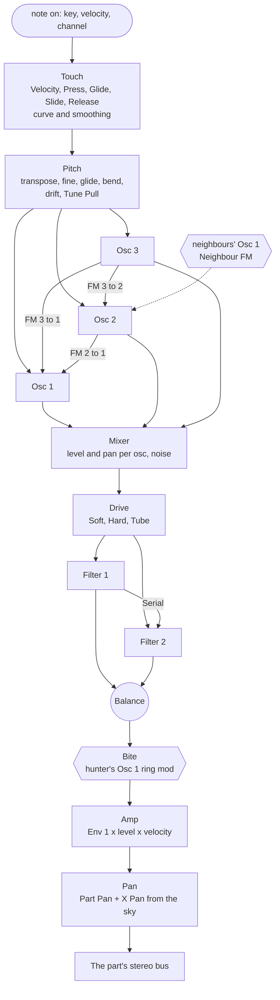
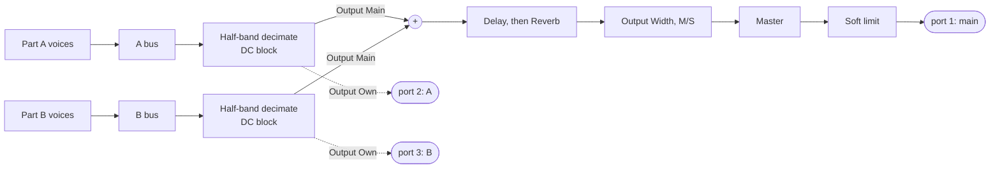

# How JSynth works

This is the whole of JSynth, from the note that comes in to the samples that go out, written from
the code in [`src/`](src). The [README](README.md) says what the plugin does; this says how. Where
it gives a number, the number is the one in the code.

- [The pieces](#the-pieces)
- [Signal flow](#signal-flow)
- [Timing](#timing)
- [Notes, parts and voices](#notes-parts-and-voices)
- [Touch and MPE](#touch-and-mpe)
- [Pitch](#pitch)
- [The oscillators](#the-oscillators)
- [The FM grid](#the-fm-grid)
- [Mixer and drive](#mixer-and-drive)
- [The filters](#the-filters)
- [Amp and pan](#amp-and-pan)
- [Envelopes and LFOs](#envelopes-and-lfos)
- [Routes and MAP](#routes-and-map)
- [The flock](#the-flock)
- [Between creatures](#between-creatures)
- [The output stage](#the-output-stage)
- [Every parameter](#every-parameter)
- [Presets](#presets)
- [The dice](#the-dice)
- [Threads, timing and state](#threads-timing-and-state)

## The pieces

| File | What it holds |
| --- | --- |
| [`src/params.h`](src/params.h) | Every parameter: id, range, default, how it prints and parses, and the list of route destinations. |
| [`src/engine.h`](src/engine.h) | All the audio: notes and voices, touch, routes, the voice's oscillators, FM, filters and amp, the couplings between creatures, decimation and output. |
| [`src/dsp.h`](src/dsp.h) | The voice's building blocks: table sine, waves, noise, SVF, ladder, comb, envelope, LFO and the half-band decimator. |
| [`src/flock.h`](src/flock.h) | The boids: every creature's flight, who hears whom, the ink field and the eight flock sources. |
| [`src/plugin.cpp`](src/plugin.cpp) | The CLAP plugin: params, state, note and MIDI events, ports, NOTE_END, and what the panel reads back. |
| [`src/presets.h`](src/presets.h) | The factory bank and user preset files. |
| [`src/randomize.h`](src/randomize.h) | The dice: Randomize and Mutate for one part, their section locks, and the history UNDO steps through. |
| [`src/editor.cpp`](src/editor.cpp) | The panel: the sky, its two views (SYNTH with big drawn panels beside the sky, SKY alone), MAP, the route list and the dice card. |

A part's params are written once, as offsets, and `partId(part, offset)` gives the host's id: part
A's start at 64 and part B's at 1088. Each module (oscillator, filter, envelope, LFO, route) is a
block of ids with room to grow, so ids can stay put once released.

## Signal flow

One voice, as it runs at the oversampled rate:



And the two parts out to the host:



The hexagons are the couplings between creatures: Neighbour FM reads the Osc 1 of up to three
nearby creatures of the same species, and Bite reads the Osc 1 of the hunter holding this one. Both
take the other voice's sample from one sample ago (see [Between creatures](#between-creatures)).

Two things about the shape matter more than anything else:

1. **Each part is a whole synth.** Both parts have the same voice, the same 64 routes and the same
   flock params; only the play mode and the sky are shared.
2. **The flock is in the audio path.** The engine flies the flock on the audio thread, so a
   creature's speed or turning is a modulation source as exact as an envelope, and what the panel
   draws is what you hear.

## Timing

Everything runs on a **control tick** of 32 samples at the host's rate, counted across `process()`
calls, so a render comes out the same at any host block size (a test checks this).

- **Notes** start and stop on their exact sample: the plugin splits the host block at each event.
- **Param and expression changes** only set targets; the next tick reads them.
- **Per tick**, the engine reads every part param (continuous ones through a 10 ms one-pole, choices
  as they are), recompiles the routes if any changed, runs the part-wide LFOs, and then for each
  voice: its touch, its routes, envelopes 2 and 3, its LFOs, its pitch, and a linear ramp across the
  tick for every value the sample loop reads.
- **Env 1** (the amp) runs every sample at the base rate.
- **The flock** steps at a fixed 500 Hz, counted with an integer accumulator (samples × 500 against
  the sample rate), so it flies the same at any rate. A voice reads its creature's sources
  interpolated between the last two steps, then through a 2 ms smoother, so a route from a flock
  source never steps.

**Quality** (1x, 2x, 4x; 2x by default) runs the voices oversampled. Buffers are sized for 4x in
`prepare()`, and Quality is a setting, not automatable.

**Rendering a tick.** Voices that don't hear each other run their whole span one voice at a time,
which keeps each voice's state in cache. When any voice has Neighbour FM on, or a Bite that is
sounding, all the voices run in step instead, a sample at a time, so each hears the others' last
sample. Both give the same sound. Inside a voice, work that has nothing to do is skipped: FM cells
at zero, a silent oscillator that modulates nothing (only its phase moves), noise at zero, filter
ramps a type doesn't read, and a ladder that is wide open with no resonance or drive (Filter 2 as it
starts), which passes the sound through with its state kept ready.

## Notes, parts and voices

**The voice pool** is 40 slots for both parts. Each part sounds at most its Polyphony (1 to 16, 8 by
default); the spare slots let a stolen voice fade out over 3 ms in its own slot while the new note
starts in another. When a part is at its polyphony, the oldest released voice is stolen first, then
the oldest held. If all 40 are busy, the fading voice furthest down its fade is taken. The host is
told 32 voices (`voice-info`), with overlapping notes.

**Play mode** decides which part a note plays, after each part's Key Low and Key High:

| Mode | Part A plays | Part B plays |
| --- | --- | --- |
| Single | every note | nothing |
| Layer | every note | every note |
| Split | from the Split Key up | below the Split Key |
| MPE Zones | member channels 2 to 8, and channel 1 | member channels 9 to 16, and channel 1 |
| Velocity | below the Velocity Split | at or above the Velocity Split |
| Expression | every note, faded out as the crossfade source rises | every note, faded in |

In Expression mode the two parts' levels crossfade with equal power by Slide or Press (Crossfade
Source), per note.

**Mono and Legato** keep one voice per part and a stack of up to 16 held notes. A new note restarts
the voice in place (Mono) or moves it to the new pitch without restarting (Legato, while a note is
held). Letting go goes back to the last note still held, with that note's own touch.

**Sustain** (CC 64) holds released notes until the pedal lifts; CC 120 and 123 release everything.

**NOTE_END** goes to the host when the last voice playing a host note ends, at the sample it ended
on (one note can sound in both parts, so it waits for both). A voice that produces a non-finite
sample is reset rather than passed on.

## Touch and MPE

Each voice has five touch dimensions, in MPE order, all route sources. Release is 0 while the note
is held and its release velocity after.

| Touch | From |
| --- | --- |
| **Velocity** | note-on velocity |
| **Press** | CLAP pressure, or the MIDI channel's pressure |
| **Glide** | the bend, as -1..1 of the part's bend range |
| **Slide** | CLAP brightness, or the channel's CC 74 |
| **Release** | release velocity |

Each goes through its own **Curve** (-1..1: the value is raised to the power 4<sup>-curve</sup>, so
positive curves respond more early) and **Smoothing** (a one-pole at control rate; 2 ms for Glide,
8 ms for the others by default). A new note takes its touch at once.

**MIDI.** Channel 1 is the MPE manager and a plain keyboard's channel: its bend moves every note by
the Manager Bend Range (2 semitones by default), CC 1 is the Mod Wheel source, CC 64 is sustain, and
once it has sent pressure or CC 74 those reach every note too (pressure as the greater of the note's
and the manager's, CC 74 as an offset from its middle). Channels 2 to 16 are member channels, each
with its own bend (by the part's MPE Bend Range, 48 semitones by default), pressure and CC 74; a new
note on a channel starts from that channel's last values. CLAP notes use note expressions (tuning,
pressure, brightness) instead. The plugin takes CLAP, MIDI and MIDI MPE dialects and prefers CLAP.

**Per-note host modulation.** Every route destination takes CLAP parameter modulation per note id,
key, channel or port. Each voice keeps up to eight such offsets, eased over 10 ms like the params,
and they add to the param before its routes do. A new note starts with none.

## Pitch

Per tick, a voice's pitch in semitones is:

```
note (gliding) + Transpose + Fine/100 + Drift + Tune Pull, then + bend × the oscillator's Bend
```

- **Glide** is a one-pole toward the new note with a time constant of a quarter of Glide (0 ms to
  20 s). Glide Mode Always glides from the part's last note; Legato only from a note still held.
- **Glide Rounding** pulls a finger that has stopped sliding to the nearest semitone, by the
  Rounding amount, over the Rounding Time (150 ms by default). While the finger moves, the pitch
  follows it exactly.
- **Drift** is a smooth random LFO of its own per voice at 0.3 Hz, up to ±0.15 semitones.
- **Tune Pull** is in [Between creatures](#between-creatures).

## The oscillators

Three per voice, each with its phase kept in double precision, so a low note stays in tune over a
long hold.

**Pitch mode:**

- **Note:** the voice's pitch plus Coarse (±48 semitones) and Fine (±100 cents).
- **Ratio:** the voice's pitch (with Fine) times Ratio, ×0.25 to ×16.
- **Fixed:** 1 Hz to 10 kHz, times Fine; it ignores the note.

Key Track Off pitches Note and Ratio from middle C instead of the note. Every oscillator is clamped
below 0.45 of the oversampled rate.

**Waves** (15):

| Wave | How |
| --- | --- |
| Sine | 4096-point table, linear interpolation. |
| Triangle | Straight lines. |
| Saw | polyBLEP band-limited, always. |
| Square, Pulse | polyBLEP edges at both ends, with their DC removed. Shape sets the width: 10 to 90% for Square, 5 to 50% for Pulse. |
| Half Sine, Abs Sine, Quarter, Alt Sine, Alt Half, Camel, Alt Camel | The TX81Z's other seven waves, each built from the table sine. |
| White, Pink | Noise; pink is Paul Kellet's economy filter on white. |
| Random | One of Sine to Alt Camel, drawn from the voice's own random sequence at each note. |

For every wave but Saw, Square and Pulse, **Shape** is a phase distortion: 50% is straight, and
toward 0 or 100% the first half of the cycle is squeezed or stretched.

**Sync** (Osc 2 and 3) restarts the phase on Osc 1's wrap a sample ago. **Retrigger** On starts each
note at Phase; Off starts it at a random phase. Under phase FM the band-limiting is told how far the
wave really moved that sample, so a modulated saw stays clean.

## The FM grid

A 3×3 grid of cells, 0 to 100%: the cell in row *from* and column *to* is how much oscillator *from*
modulates oscillator *to*, and the diagonal is each oscillator's feedback. Each cell's value is
squared before use, so the knob is even by ear.

Within a sample the oscillators run in the order 3, 2, 1. So 3 into 2, 3 into 1 and 2 into 1 hear
this sample's output; every other cell, and the feedback, hears the last sample's. Feedback uses the
average of its last two samples (the DX7 trick), which keeps it from going to noise.

**FM Type:**

- **Phase** is phase modulation. A cell at full adds up to 2 cycles (about 12.6 radians) of phase
  per unit of modulator; feedback is scaled by a quarter of that.
- **Exponential** moves the pitch instead, by 2<sup>2·m</sup>, clamped to ±4 octaves.

## Mixer and drive

Each oscillator has a **Level** and an equal-power **Pan** (centre is unity gain). **Noise** has a
level and a **Color** that crossfades pink (-100%) to white (+100%). Noise made at 2x or 4x is made
louder by the square root of the factor, so it comes out of the decimator as loud at any quality.

A voice is mono until an oscillator is panned (or a route moves a pan); then it runs both filter
channels, and the right channel's filters take up where the shared ones were.

**Drive** sits before the filters. The gain is 1 + 15·Drive², the shape is Soft (tanh), Hard (a
clip) or Tube (asymmetric, for even harmonics), and the result is divided by the square root of the
gain, so turning it up thickens the sound more than it louders it.

## The filters

Two per voice. **Cutoff** runs 20 Hz to 20 kHz on an even knob (20 × 1000<sup>value</sup>), with
**Key Track** moving it with the note around middle C, by up to an octave per octave. Each filter
also has its own **Drive** (a tanh on its input, gain 1 to 5, gain compensated).

| Type | How |
| --- | --- |
| Low Pass, High Pass, Band Pass | Zavalishin TPT state variable stages, cascaded for 12, 24, 36 or 48 dB (one to four stages) with Butterworth damping. Resonance raises the last stage's Q up to 30 times. |
| Notch | One SVF stage, low plus high. Slope is ignored. |
| Peak | One SVF stage: the band added back, up to 4 times, by Resonance. |
| Ladder | A 4-pole transistor ladder, zero-delay feedback solved with one linear step, tanh on the input. Resonance up to just past self-oscillation. |
| Comb +, Comb - | A delay tuned to the cutoff (30 Hz up), feedback 30 to 98% by Resonance. Comb + rings at every harmonic, Comb - at the odd ones. |

**Routing:**

- **Serial:** Filter 1 into Filter 2. Filter 2 starts as an open ladder, so serial changes nothing
  until it is turned down.
- **Parallel:** each filter hears what goes into it; **Balance** turns each down from the centre out.

Each oscillator and the noise picks its filter (**Filter**: 1+2, F1 or F2). In serial, F1 and 1+2
go through both filters and F2 through Filter 2 only. In parallel, a source in only one filter is at
full level with Balance at centre, and the other side turns it down. A source in both goes half
into each at centre and all into one at either end, so it crossfades. Osc 1 on F1 and the rest on F2
splits the voice between the filters.

## Amp and pan

The voice's gain is the part's **Level** (-60 to +6 dB) times its velocity response
(1 - Velocity + Velocity × Velocity) times 0.35 for headroom, and in Expression mode times the
crossfade. Env 1 multiplies it every sample.

Its pan is the part's **Pan** plus **X Pan** times where its creature is, left to right
(-1 at the left edge of the sky, +1 at the right), clamped and equal-power. With X Pan at 0 the
flock never moves the stereo image.

## Envelopes and LFOs

**Three envelopes** per voice, each Delay, Attack, Hold, Decay, Sustain, Release (times 0 ms to
20 s on an even knob, about 100 ms in the middle), with a curve per segment (-1..1) and a
**Velocity** amount that scales the whole envelope by the note's velocity. A retrigger starts from where the
level is, so it never clicks. **Loop** Held repeats attack and decay while the note is held; Free
keeps repeating after the note is let go too, until the voice ends. Env 1 is the amp and always
releases on note off. Env 1 runs every sample; Env 2 and 3 at control rate.

The panel's envelope editor doesn't draw that knob taper. It places each time by milliseconds, on a
cube of the envelope's **Time Range** (Short, Normal or Long: up to 1, 5 or 20 s a stage), so half
way is an eighth of the range. Time Range is a view setting saved with the patch, not automatable,
and never changes a time; factory presets with a time past 5 s open on Long.

**Shape mode**, after XAOC's Zadar: an envelope's **Mode** switches it from ADSR to playing one drawn
contour from a library of 60 ([`src/shapes.h`](src/shapes.h)), ten banks of six: Rise, Fall, Swell,
Pulse, Waves, Steps, Drift, Strike, ADSR (the classic stages drawn) and Acoustic (after instruments).
The ADSR and Acoustic shapes are drawn as points joined by bowed stages. Each shape is a 513-point table worked out once, which the
engine reads with linear interpolation and the panel draws. One pass takes the shape's **Time** (1 ms
to 30 minutes, about 1.3 s in the middle) or, with **Sync**, a **Length** in the host's tempo (1/16
to 64 bars). **Warp** bows time (+ pushes the contour later, - pulls it sooner) and **Bend** bows
level (+ lifts it, - sinks it), both with the curve the ADSR stages use; **Level** scales it all down
(Zadar's level); **Reverse** plays it backwards. A **Sustain Point** (100% is off) stops it there
while the gate is held, as Zadar's sustain does, and it plays on from there when the gate drops; it
stays where it is from the start when the shape is reversed. **Repeat** plays it once, a number of times (2 to 16), while the note is held (it then
finishes its pass), or forever; after its last pass it holds the level it ended on. **Retrigger** is
what a new note does while it plays: Smooth starts it from the first place the contour passes the
level it is at now (Zadar's analog mode, so it never jumps), Restart from the top, Ignore lets it play
on. Neither ever clicks: a Restart, or a Smooth onto a level the contour never reaches, glides from
the level it was at into the contour over 5 ms. Env 1 still fades over its Release on note off, while
the shape keeps moving under the fade; with a sustain point the rest of the shape plays first, as the
release, and the fade follows. Env 2 and 3 play on. Like the ADSR times, the progress is kept as a fraction of a pass, so a routed
Time changes the speed, never the place.

**Env Chain** (per part) lets one Shape envelope start another, as Zadar's chains do: 1 > 2, 2 > 3,
1 > 2 > 3, or the same as loops back to the first. The first of a chain starts with the note; each
next one waits, holding its level, until the one before it has played its **Chain Phase** of its
whole run (all its passes): 0% starts it with the one before, 100% when that one ends. In a loop the
first starts again from the last the same way. Inside a chain Held and Forever play once, so the
chain moves on. A link only holds between two envelopes in Shape mode; an ADSR envelope in a chain
starts with the note. The chain is checked once a tick.

**Four LFOs** per voice. Each has six shapes (Sine, Triangle, Saw, Square, S&H, Smooth, which
glides between random values), a Rate of 0.02 to 50 Hz or a tempo Division (1/32 to 4/1, with
triplets and dots), a Phase, a fade-in Delay and a Polarity (bipolar or unipolar).

**Trigger:**

- **Retrigger** restarts the voice's LFO at Phase on each note.
- **Free** starts each note's LFO in step with the part's running one, plus Phase.
- **Global** uses one LFO for the whole part; routes can't move its rate per voice.

Synced to a Division, Free and Global LFOs are locked to the host's song position rather than
counted from when they started: each tick works out how many cycles into the song it is (the
host's beats over the Division's, plus Phase), so a 1/16 lands on the sixteenths of the bar
however playback got there, starting mid-song or jumping round a loop. Their S&H and Smooth
values come from the cycle's number, so a looped bar repeats them. With the transport stopped,
or no beat position from the host, they count on at the tempo from where they were. A
Retriggered LFO still starts with each note, at the tempo.

The first two LFOs move the flock, and aren't route sources:

- **Wingbeat** (5 Hz, Sine) bobs each creature across its path, by **Push**.
- **Wind** (0.2 Hz, Smooth, Global) is one gust for the whole sky, pushing every creature of the
  species one way (a direction that turns slowly on its own), by **Push**.

LFO 1 (4 Hz, Sine) and LFO 2 (0.5 Hz, Triangle) only modulate.

## Routes and MAP

Each part has a pool of **64 routes**, each a source, a destination and an amount (-100 to +100%),
all host params. The panel shows only the ones in use, so it reads as an open-ended list. Source and
Destination are settings (not automatable); amounts are automatable and can be modulated.

**Sources** (25): Env 1 to 3; LFO 1, LFO 2; Velocity, Press, Glide, Slide, Release; Key; the flock's four
(Speed, Nearest, Heading, Turn); Random; Mod Wheel; Macro 1 to 4; Bus 1 to 4. They are unipolar 0..1 except the
LFOs (by their polarity), Glide, Turn, Random (one value per note, -1..1), Key, which is
(key - 60) / 48, clamped to -1..1, and the buses, -1..1.

**Destinations** (181): every continuous part param a voice reads: level, pan, X Pan, fine, glide
and drift; each oscillator's shape, coarse, fine, ratio, fixed pitch and phase; all nine FM cells;
the mixer; drive and balance; each filter's cutoff, resonance, drive and key track; each envelope's
times and sustain; each LFO's rate, phase and delay (and Push for the two that have it); the flock's
twelve continuous params; every route's own amount; then each envelope's Shape Time, Warp, Bend and
Chain Phase, then its Sustain Point and Shape Level, and last the four buses' inputs (each later
addition goes at the end, so a saved route keeps its destination).

**How a route moves a param.** Per voice per tick:

1. **Pass 1:** routes onto another route's amount add `source × amount` (scaled to the amount's
   range) at their own unmodulated amounts.
2. **The buses**, in order (see below), from the routes onto them, at their amounts as moved in
   pass 1. A bus routed onto a later bus is this tick's value; onto itself or an earlier one, last
   tick's.
3. **Pass 2:** every other route adds `source × its amount (as moved in pass 1)` to its
   destination's offset.
4. A param's value is `denormalise(clamp(normalise(base) + offset, 0, 1))`, in its own 0..1 range.
   Ratio is normalised in log space, so a route moves it by musical intervals; Coarse moves
   continuously.

### Mod buses

Each part has **four buses**: a place to mix sources into one value, shape it, and route it on as a
source of its own (Bus 1 to 4), so a mix used in several places is made once. Routes onto a bus's
**Base** are its inputs, not an offset on it: each input is `source × amount`, and they combine by
the bus's **Mode**: Sum adds them, Multiply multiplies them (one gates or scales another), Min keeps
the lowest and Max the highest. Then, per voice per tick:

1. `x = clamp(mix + Base, -1, 1)` (Base is -100 to +100%, and takes the host's per-note modulation).
2. **Curve**: Linear; Exponential `sign·x²` (slow near 0); Log `sign·√|x|` (quick near 0); S-Curve
   `sign·(3x² − 2|x|³)`; Absolute `|x|`.
3. **Polarity**: As Is; Unipolar `(x + 1) / 2`; Bipolar `2x − 1`; Invert `−x`. Clamped to -1..1.
4. **Onset**: times 0 until **Delay** after the note starts, then rising linearly over **Fade**, so
   a bus can bring in vibrato two seconds into a held note.
5. **Lag**: a one-pole toward that, with Lag as its time constant (none at 0; a new voice starts
   there at once).

**Global** makes a bus one value for the whole part: the part's newest voice works it out, every
voice reads it, and its onset runs from the part's first key down (a note played while another is
held doesn't start it again). Each bus has a name, up to 24 bytes, saved in the plugin's state
(version 4) and in user presets as `bus <part> <bus> <name>` lines, which older versions skip; the
chips, route lists and MAP hint show it.

A route's amount is smoothed with the other params, so automating one doesn't zipper. The routes
are compared against a cached copy each tick and recompiled when any changed, so a half-written
route is corrected a tick later.

A route whose destination is a flock param moves that creature's own flight: Press onto Speed makes
the creature you press harder fly faster. Those are read only on ticks that end with a flock step.

**MAP** writes the same routes from the panel: touch a source chip (which turns MAP on with it
armed), then drag a knob; touching the armed chip again turns MAP off. The
first drag on a knob takes a free route for that source and destination; double-click flips its
sign, right-click removes it. The value boxes MAP the same way, and a Shape envelope's drawing
takes a sideways drag as a route onto its Warp and an up-or-down one onto its Bend. Route rings show only in MAP with a source armed: each knob that
source moves shows a ring in its colour. Outside MAP the knobs show no rings.
**ROUTES** lists the routes in use, sixteen to a page: **+ ADD** starts one (Env 2 onto Filter 1
Cutoff, at 0) and **X** removes one.

A new part starts with three routes: Env 2 to Filter 1 Cutoff (+30%), Press to Speed (+40%) and
Press to Filter 1 Cutoff (+20%).

## The flock

Every sounding voice is a creature in its slot, and only those: the sky is empty until a note
plays. Randomness is our own xorshift, reseeded on activate, on reset and when the transport
starts with nothing sounding, so a bounce matches playback from the same start.

**The sky** is 4:3 wide and 1 high. **Size** (0..1) scales everything in it: at a bigger sky the
creatures, their ranges and their speeds are relatively smaller (a scale of 1.4 - 0.8 × Size).
**Walls** Soft turns creatures back near the edge, Wrap carries them round to the other side, and
Open only turns them back well past it.

**A creature's energy** (how bright and present it is) rises toward 0.55 + 0.45 × Press while held,
follows its amp envelope after release, and when its voice ends it fades and goes.

**Forces on each creature, per step:**

| Force | What it does |
| --- | --- |
| Cohesion | Toward the weighted middle of the neighbours of its own species within Range. Scatter reverses it. |
| Alignment | Toward the neighbours' average velocity. |
| Separation | Away from any neighbour within 40% of Range. |
| Lure | Toward a point that roams around the note's lure on a leash: loose near it, so the flock and the wander shape the path there, and firm when the creature strays. Each creature roams on two slow orbits of its own, wider with Wander. |
| Wander | A heading that drifts, with a turn rate that drifts too, so a creature sometimes sweeps a long curve and sometimes jinks. |
| Wind, Wingbeat | As in [Envelopes and LFOs](#envelopes-and-lfos). |
| Walls | As above. |

Neighbours count by a smooth kernel, (1 - distance / Range)² times their energy, so one drifting in
or out of range fades in or out. Range runs from 0.08 to 0.4 of the sky's height (times the scale).
Speed is clamped between 20% and 100% of a top speed of (0.08 + 0.42 × Speed) × (1 + 0.8 × Press).

**Behaviour:**

- **Shoal** flies with its own kind.
- **Scatter** keeps apart: cohesion pushes away from the middle.
- **Hunt** chases the nearest creature of the other species within 2.5 times Range, and everyone
  shies from a hunter a little.
- **Flee** runs hard from the other species, whatever it does.

**Where a lure sits.** Lure X and Lure Y each choose what places a note's lure along that axis:
Pitch (four octaves from C2, with bend), Velocity, Press, Slide, Release, Random (a place per note) or
Centre. By default X is Pitch and Y is Slide, so low notes fly left, high notes right, and more
Slide flies higher.

**The flock's sources**, each continuous:

| Source | What it is |
| --- | --- |
| Speed | How fast it flies, against the fastest it could at full Press (0..1). |
| Nearest | How near the nearest neighbour is (0..1). |
| Heading | How much it flies upward: 1 straight up, 0 straight down, smooth all the way round. |
| Turn | How fast its heading turns: + a right turn on screen, - a left one, tanh of the rate over 4 radians a second, smoothed over about 170 ms so the wingbeat barely shows in it (-1..1). |

The flock also keeps, for the voice but not as route sources, **Caught** (whether a hunter has it:
rises in about 20 ms, lets go over about 500 ms; it scales Bite) and the creature's place left to
right (for X Pan).

**Ink** is the panel's alone: it draws ink from the creatures' positions, fading with **Tail** and
blooming with **Spread**. The engine keeps no ink. How the sky is drawn (its look, Sumi or Aurora, and
each look's palette) is panel state too, kept with the plugin's state (version 5) but never a param.

## Between creatures

Every link from the flock to the sound starts at zero, so a plain patch is plain.

**Neighbour FM.** Each creature hears the three strongest neighbours of its own species (weighted
by the kernel and their energy). Their Osc 1 outputs from a sample ago, weighted, phase-modulate this
voice's Osc 2, by Neighbour FM squared (the same scale as an FM cell). A neighbour keeps its place
while it stays near, and a new one only takes a place whose weight has faded out, at most a full
weight per 10 ms, so a change of neighbour never clicks. A tight flock rings and a loose one is
clean.

**Tune Pull.** For each neighbour heading within 30° of this creature's heading, the engine finds
the just interval (1/1, 6/5, 5/4, 4/3, 3/2, 5/3, 2/1, octave-reduced) nearest the interval between
their unpulled pitches, and pulls this voice toward it, weighted by neighbour, at most ±30 cents
times Tune Pull, over about 150 ms. Using the unpulled pitch keeps two creatures from chasing each
other.

**Bite.** When a hunter of the other species comes within 0.06 of a creature, the creature is
Caught. While it is, the hunter's Osc 1 ring-modulates it, crossfaded by the hunter's part's Bite
times Caught. A new hunter waits for the old one's bite to fade first.

## The output stage

Each part's voices sum to its own stereo bus at the oversampled rate. At 2x and 4x the bus is
decimated by polyphase IIR half-bands (two chains of allpasses, as in Laurent de Soras' HIIR: flat
to 0.45 of the output rate and over 100 dB down past 0.55), one stage per halving, with no latency to
report. A gentle DC block follows, for what the drive and the asymmetric waves leave.

A part set to **Output Own** plays on its own stereo port (part A on the second, part B on the
third) and skips the main bus, dry. Otherwise it goes to the main bus, through the FX, then
**Output Width** (mid/side, 0 is mono, 100% as is, 200% wider) and **Master** (-6 dB by default),
then a soft limit: above 0.8 the level bends smoothly toward 1.0.

The FX are JBreath's own, shared through `jclap::dsp` (`jclap/dsp/stereo_delay.h` and
`jclap/dsp/reverb.h`), on the panel's **FX** tab under the sky. Both are off by default, so a patch
that doesn't ask for them is dry.

- **Delay**: a stereo echo, its time free (10 ms to 2 s) or synced to the host's tempo as a note
  value. Feedback (soft clipped) sets the repeats, Tone darkens each one (a lowpass from 400 Hz to
  open), and Spread crossfades from straight down each side to ping-pong. A time that moves glides,
  like tape; switching it on or off fades.
- **Reverb**: a small room, eight mutually prime delay lines (30 to 73 ms, scaled by Size) through a
  Householder mix, each damped and decaying to -60 dB in Decay, after a pre-delay. Switched off, it
  takes nothing more in but what's in it rings out. After a silence longer than it rings it empties
  itself and costs nothing.

## Every parameter

Ranges and defaults as in [`src/params.h`](src/params.h). Part params exist once for each part and
are named "A ..." and "B ..." in the host. Everything is automatable except the route sources and
destinations and Quality; every continuous param takes CLAP modulation, and route destinations take
it per note.

### Global

| Param | Range | Default | What it does |
| --- | --- | --- | --- |
| Play Mode | Single, Layer, Split, MPE Zones, Velocity, Expression | Single | Which part a note plays. |
| Split Key | C-1 to G9 | C4 | Split: B below, A from it up. |
| Velocity Split | 1 to 127 | 80 | Velocity: B at or above. |
| Crossfade Source | Slide, Press | Slide | Expression: what crossfades A to B. |
| Quality | 1x, 2x, 4x | 2x | Oversampling of the voices. |
| Master Level | -60 to +6 dB | -6 dB | The main bus's level. |
| Output Width | 0 to 200% | 100% | The main bus's stereo width. |
| Manager Bend Range | 1 to 96 st | 2 st | Channel 1's bend, on every note. |
| Glide Rounding | 0 to 100% | 0% | Pulls a resting finger to the nearest semitone. |
| Rounding Time | 0 ms to 20 s | 150 ms | How long the pull takes. |
| Macro 1 to 4 | 0 to 100% | 0% | Sources for routes. |
| Velocity/Press/Glide/Slide/Release Curve | -1 to +1 | 0 | Each touch's response curve. |
| Velocity/Press/Glide/Slide/Release Smoothing | 0 ms to 20 s | 8 ms (Glide 2 ms) | Each touch's smoothing. |
| Size | 0 to 100% | 50% | How big the sky is. |
| Walls | Soft, Wrap, Open | Soft | What the sky's edges do. |
| Reverb | Off, On | Off | The reverb on the main bus. |
| Reverb Mix | 0 to 100% | 15% | How much reverb. |
| Reverb Size | 0 to 100% | 50% | A closet to a hall. |
| Reverb Decay | 0.2 to 10 s | 1.6 s | How long it rings, to -60 dB. |
| Reverb Damping | 0 to 100% | 50% | How fast its highs die away. |
| Reverb Pre-Delay | 0 to 100 ms | 12 ms | The gap before it answers. |
| Delay | Off, On | Off | The delay on the main bus, before the reverb. |
| Delay Mix | 0 to 100% | 30% | How loud the repeats are. |
| Delay Time | 10 ms to 2 s | 375 ms | The time between repeats, when Sync is Free. |
| Delay Sync | Free, 1/32 to 1/1 (with triplets and dots) | Free | A note value against the host's tempo. |
| Delay Feedback | 0 to 95% | 40% | How many repeats. |
| Delay Tone | 0 to 100% | 72% | How bright the repeats stay. |
| Delay Spread | 0 to 100% | 50% | Down each side, or ping-pong. |

### Voice (per part)

| Param | Range | Default | What it does |
| --- | --- | --- | --- |
| Level | -60 to +6 dB | 0 dB | The part's level. |
| Pan | -100 to +100% | 0 | The part's pan. |
| X Pan | 0 to 100% | 0% | How far the creature's place left to right pans its voice. |
| Transpose | ±48 st | 0 (B: -12) | In semitones. |
| Fine | ±100 ct | 0 | In cents. |
| Key Low, Key High | C-1 to G9 | C-1, G9 | The part's key range. |
| Polyphony | 1 to 16 | 8 | Sounding notes at most. |
| Voice Mode | Poly, Mono, Legato | Poly | |
| Glide | 0 ms to 20 s | 0 | Portamento time. |
| Glide Mode | Always, Legato | Always | Glide from any last note, or only a held one. |
| MPE Bend Range | 1 to 96 st | 48 st | A member channel's bend range. |
| Drift | 0 to 100% | 0% | A slow random pitch wander per voice, up to ±0.15 st. |
| Velocity | 0 to 100% | 100% | How much velocity sets the level. |
| Output | Main, Own | Main | The main mix, or the part's own port. |

### Oscillators (per part, Osc 1 to 3)

| Param | Range | Default | What it does |
| --- | --- | --- | --- |
| Wave | 15 waves | Saw (Osc 2, 3: Sine) | See [The oscillators](#the-oscillators). |
| Shape | 0 to 100% | 50% | Pulse width, or phase distortion. |
| Pitch Mode | Note, Ratio, Fixed | Note (Osc 2, 3: Ratio) | |
| Coarse | ±48 st | 0 | Note mode. |
| Fine | ±100 ct | 0 | Every mode. |
| Ratio | ×0.25 to ×16 | ×1 (Osc 3: ×3) | Ratio mode. |
| Fixed | 1 Hz to 10 kHz | 440 Hz | Fixed mode. |
| Sync | Off, On | Off | Osc 2 and 3: restart on Osc 1's wrap. |
| Retrigger | Off, On | On | Start each note at Phase. |
| Phase | 0 to 360° | 0 | |
| Bend | 0 to 100% | 100% | How much the bend moves it. |
| Key Track | Off, On | On | Off pitches it from middle C. |
| Filter | 1+2, F1, F2 | 1+2 | Which filter it goes into. |
| Level (mixer) | 0 to 100% | 100% (Osc 2, 3: 0%) | |
| Pan (mixer) | -100 to +100% | 0 | |

### FM, noise and drive (per part)

| Param | Range | Default | What it does |
| --- | --- | --- | --- |
| FM 1 > 2 ... FM 3 > 2, FM Feedback 1 to 3 | 0 to 100% | 0% | The nine cells. |
| FM Type | Phase, Exponential | Phase | |
| Noise Level | 0 to 100% | 0% | |
| Noise Color | -100 to +100% | 0 | Pink to white. |
| Noise Filter | 1+2, F1, F2 | 1+2 | Which filter the noise goes into. |
| Drive Type | Soft, Hard, Tube | Soft | |
| Drive | 0 to 100% | 0% | Before the filters. |

### Filters (per part)

| Param | Range | Default | What it does |
| --- | --- | --- | --- |
| Filter Routing | Serial, Parallel | Serial | |
| Filter Balance | -100 to +100% | 0 | Filter 1 against Filter 2. |
| Type | Low Pass, High Pass, Band Pass, Notch, Peak, Ladder, Comb +, Comb - | Low Pass (Filter 2: Ladder) | |
| Slope | 12, 24, 36, 48 dB | 24 dB | Low, high and band pass. |
| Cutoff | 20 Hz to 20 kHz | 1.26 kHz (Filter 2: 20 kHz) | |
| Resonance | 0 to 100% | 20% (Filter 2: 0%) | |
| Drive | 0 to 100% | 0% | The filter's own input drive. |
| Key Track | 0 to 100% | 0% | |

### Envelopes (per part, Env 1 to 3)

| Param | Range | Default | What it does |
| --- | --- | --- | --- |
| Delay | 0 ms to 20 s | 0 | |
| Attack | 0 ms to 20 s | 5 ms | |
| Hold | 0 ms to 20 s | 0 | |
| Decay | 0 ms to 20 s | 400 ms (Env 2, 3: 300 ms) | |
| Sustain | 0 to 100% | 70% (Env 2, 3: 30%) | |
| Release | 0 ms to 20 s | 300 ms | |
| Attack, Decay, Release Curve | -1 to +1 | 0 | |
| Loop | Off, Held, Free | Off | |
| Velocity | 0 to 100% | 0% | How much velocity scales the envelope. |
| Mode | ADSR, Shape | ADSR | Shape plays a contour from the shape library instead. |
| Shape | 60 shapes in 10 banks | Swell: Arch | Shape mode's contour. |
| Shape Time | 1 ms to 30 min | 2 s | One pass, when Shape Sync is off. |
| Shape Sync | Off, On | Off | |
| Shape Length | 1/16 to 64 bars | 1 bar | One pass, in the host's tempo, when Shape Sync is on. |
| Warp | -100 to +100% | 0% | + pushes the contour later, - pulls it sooner. |
| Bend | -100 to +100% | 0% | + lifts the contour, - sinks it. |
| Repeat | Once, 2x to 16x, Held, Forever | Once | |
| Reverse | Off, On | Off | |
| Retrigger | Smooth, Restart, Ignore | Smooth | What a new note does while the shape plays. |
| Chain Phase | 0 to 100% | 100% | In a chain, how far through the one before it this one starts. |
| Sustain Point | 0 to 100%, Off | Off | Where it holds while the note is. |
| Shape Level | 0 to 100% | 100% | The shape's height. |

**Env Chain** (per part): Off, 1 > 2, 2 > 3, 1 > 2 > 3, 1 > 2 Loop, 2 > 3 Loop, 1 > 2 > 3 Loop.

### LFOs (per part: Wingbeat, Wind, LFO 1, LFO 2)

| Param | Range | Default | What it does |
| --- | --- | --- | --- |
| Shape | Sine, Triangle, Saw, Square, S&H, Smooth | Sine (Wind: Smooth, LFO 2: Triangle) | |
| Rate | 0.02 to 50 Hz | 5, 0.2, 4, 0.5 Hz | |
| Sync | Off, On | Off | Use Division instead. |
| Division | 1/32 to 4/1 | 1/4 | |
| Trigger | Retrigger, Free, Global | Retrigger (Wind: Global) | |
| Phase | 0 to 360° | 0 | |
| Delay | 0 ms to 20 s | 0 | Fade-in. |
| Polarity | Bipolar, Unipolar | Bipolar | |
| Push | 0 to 100% | 20% (Wind: 30%) | Wingbeat and Wind only: how hard it moves the creatures. |

### Buses (per part, Bus 1 to 4)

| Param | Range | Default | What it does |
| --- | --- | --- | --- |
| Base (named "Bus 1" etc.) | -100 to +100% | 0% | Added to the mix; routes onto it are the bus's inputs. |
| Mode | Sum, Multiply, Min, Max | Sum | How the inputs combine. |
| Curve | Linear, Exponential, Log, S-Curve, Absolute | Linear | |
| Polarity | As Is, Unipolar, Bipolar, Invert | As Is | |
| Delay | 0 ms to 20 s | 0 | How long after the note before it comes in. |
| Fade | 0 ms to 20 s | 0 | Then how long it takes to come in. |
| Lag | 0 ms to 20 s | 0 | Smoothing. |
| Global | Off, On | Off | One value for the part, from its newest note. |

### Flock (per part)

| Param | Range | Default | What it does |
| --- | --- | --- | --- |
| Behaviour | Shoal, Scatter, Hunt, Flee | Shoal (B: Hunt) | |
| Cohesion | 0 to 100% | 50% | Pull toward the neighbours' middle. |
| Alignment | 0 to 100% | 50% | Fly the way the neighbours fly. |
| Separation | 0 to 100% | 40% | Keep clear of the nearest. |
| Speed | 0 to 100% | 40% (B: 55%) | Top speed. |
| Wander | 0 to 100% | 20% | Restlessness, and how far it roams round its lure. |
| Lure | 0 to 100% | 60% | How hard the note pulls its creature. |
| Range | 0 to 100% | 35% | How near counts as a neighbour. |
| Neighbour FM | 0 to 100% | 0% | Neighbours' Osc 1 into Osc 2. |
| Tune Pull | 0 to 100% | 0% | Toward just intervals, up to ±30 cents. |
| Bite | 0 to 100% | 0% | This part's ring mod on what it catches. |
| Tail Length | 0 to 100% | 50% | How long the ink lasts. |
| Tail Spread | 0 to 100% | 50% | How far it blooms. |
| Lure X, Lure Y | Pitch, Velocity, Press, Slide, Release, Random, Centre | Pitch, Slide | What places the lure. |

### Routes (per part, Route 1 to 64)

| Param | Range | Default | What it does |
| --- | --- | --- | --- |
| Source | Off and the 25 sources | Off (the first three: Env 2, Press, Press) | |
| Destination | the 181 destinations | Filter 1 Cutoff (Route 2: Speed) | |
| Amount | -100 to +100% | 0 (+30, +40, +20%) | |

## Presets

The factory bank is compiled in ([`src/presets.h`](src/presets.h)): **Init** and 83 presets in
8 categories, in the menu's order (`kCategoryOrder`, whatever order they are written in).
The bank is built around the flock: nearly every patch is a held sound the creatures play, each
note's creature moving that note's filter, oscillator shape, mix and FM with its Heading, Turn,
Speed and Nearest. Shape envelopes loop under them and reach back into the flock (its speed, wander,
cohesion, range, the wind's push) and into the depth of the flock's own routes, so the modulation
itself moves. Many routes go through a bus that turns Heading bipolar (diving to climbing), takes
the absolute of Turn (how sharply, either way) or multiplies two sources (an LFO by Speed, say), and
the buses are named for what they carry.

**Ambient Drones** (soft, spacey held sounds: each creature's climb, turns and speed move its own note's filter, shape, mix and FM, under long halls); **Dark Drones** (low, slow and ominous: ladders, growls, stone-room combs and dark choirs that gather, sink and grind as the flock moves); **Textures** (patterns, grains and particles: Shape envelopes as the amp, each creature setting its own pace and colour); **Industrial** (heavily modulated machinery: sync grind, hard drive, inharmonic FM, combs and noise, driven and hammered by the flock); **Landscapes** (both parts at once: two flocks in one sky, hunting, biting, crossfaded by Press or split by velocity or key); **Pads** (the classic pad shapes, flown by the flock); **Keys and Bells** (played sounds, each note shaded by its creature); **Bass and Leads** (one creature each, playing its own tone).

Each preset is written as what it changes from the defaults, and loading one puts every other param
(and bus name) at its default, so nothing (a route, say) carries over. Most answer the mod wheel and
Press, so they play from any keyboard.

**Rooms.** Each category has its own reverb (`spaces` in the bank): long, soft halls for the ambient
and dark drones, shorter rooms for textures, pads and keys, and a small bright room for the
industrial patches. A preset can set its own instead, and the sparkling textures and the leads add
echoes in time with the host.

Every preset's level is matched by measurement: a trim table at the end of the bank sets each
preset's part levels so the loudest 400 ms of a three-note chord at velocity 0.8 and a quarter
Press, held 16 s (one note for the mono patches), sits near -20 dBFS with its room (keys and bells
-21). A trim moves both parts together, so a layer keeps its balance.

| Category | Preset | What makes it |
| --- | --- | --- |
| Ambient Drones | Slow Murmuration | Saws and a sub under a slow, wide flock: each creature's climb opens its own filter, its turns swing it across the stereo field and its speed brings up the sub. A 9 s Breath loop makes the flock restless and deepens the climb as it peaks. |
|  | Aurora Choir | A choir in two formants: each creature's climb opens its vowel from "oo" toward "ah", its turns brighten the second formant, and Tune Pull draws the chord into just intervals. Flying fast deepens the vibrato, and a slow Twin Hills loop lets the vowels swing wider, then settle. |
|  | Weightless | FM glass that floats: the faster each creature flies the brighter its FM, its climb swells a sub an octave down, and its turns pull its carrier a few cents either way so the chord beats. A 20 s Arch loop speeds the whole flock up and lets it rest. |
|  | Tidal Breath | Breath through a resonant band pass at the note: a 17 s Surge loop strengthens the wind, the gusts carry every creature at once, and how fast each is carried brings up its breath and rings its band; its climb swings the band up and down. |
|  | Halo | A ring of light: a triangle and air through a comb tuned to the note. Each creature's climb lengthens its ring, its turns shade the ring a few cents off the note, and how near its neighbours are thickens the air. A 25 s Shimmer loop brightens the whole halo. |
|  | Horizon Glass | Three-operator glass: each creature's climb rings its ×3 partial, crowding feeds the modulator back on itself, and a 31 s Wander drifts the ×3 off true and back, so the glass tints from pure to bell-like. |
|  | Floating Organ | Sine drawbars that drift: each creature's climb draws out the octave, its turns either way the twelfth, and Tune Pull keeps the chord pure. Its speed sets the depth of a slow chorus. |
|  | Nebula | Saws in a moving band: a low pass that each creature's climb opens and a high pass its speed raises, so a fast creature thins to a bright band. A 30 s Wander loop widens the flock's range and pulls it back, so creatures fall in and out of each other's company. |
|  | Deep Field | The slowest of them: a pulse and a saw on a Slow S fade-in, and creatures in a huge sky whose climbs, lagged over two seconds, open the filter so slowly it reads as weather. A 40 s Brownian walk sets how fast they fly, and the amp itself deepens the flock's hold on the filter as the chord blooms. |
|  | Lumen | Pulse waves whose widths the creatures bend as they turn, one each way, under a filter their climb opens; LFO 1 at an odd 0.13 Hz breathes the second width, and speed brightens the voice. |
|  | Ether Strings | A string machine flown by the flock: each creature's speed is its vibrato depth, its climb its brightness, and its turns pull its two saws apart. Tune Pull keeps the section together. |
|  | Snow Light | High and airy: an alt-sine and its far partials with a breath of white noise, the creatures scattered across a wrapping sky. Each one's speed lifts its air, its climb its top partial, its turns pan its fourth harmonic, and a 12 s Shimmer loop sparkles the lot. |
|  | Breathing Planet | Envelopes that move each other, under the flock: a 12 s Breath on Env 2 opens the filter and quickens Env 3's wobble as it fills; each creature's climb leans its breath early or late, and its speed sets how deep its wobble runs. |
|  | Cirrus | Soft sines that ring each other: Neighbour FM makes a gathered flock shimmer and a scattered one fall pure. A 22 s Arch loop pulls the creatures together and lets them drift apart, so the shimmer comes and goes; each one's climb lifts it into its octave. |
| Dark Drones | Abyssal | A sub and a growl in a low ladder: each creature's climb opens the ladder, how near its neighbours are drives it, and a 23 s Surge loop sends the flock racing, so the growl rings when it does. |
|  | Leviathan | A low 1:2 FM growl: each creature's speed turns up its modulator's feedback, its turns slide the modulator a little off its ratio so the growl beats and rolls, and its climb deepens the FM. |
|  | Cavern | Dark air in a stone room: pink noise and a low saw through a comb tuned an octave down. Each creature's turns colour the noise, its climb lengthens the ring, and a 33 s Plateau loop lets the cave breathe out. |
|  | Black Monolith | A pulse and a saw an octave apart in a resonant ladder that never opens far: each creature's climb slides its pulse width, crowding rings the resonance, and a Brownian walk slowly tilts the cutoff. Monolithic, but never still. |
|  | Night Tide | Low saws on a slow tide: a 41 s Gusts shape strengthens the wind, and each gust carries the whole flock one way, so the chord leans together: the creatures' climbs open the filter, their turns pan them, and how fast they are carried rings the resonance. |
|  | Obsidian Choir | A low, dark choir in two formants near "oo": each creature's climb opens its vowel toward "oh", its speed adds breath, and Tune Pull holds the chord in just intervals. A 29 s Bow loop deepens how far the vowels move. |
|  | Submerged | A pad heard from under water: saws through a steep, key-tracked low pass, chorused by each creature's turns. Its climb lifts it toward the surface; a 25 s Brownian walk deepens the flock's hold on the filter and lets it go. |
|  | Event Horizon | A chord that keeps falling in on itself: each creature's dive pulls its pitch a few cents flat and darkens it, Tune Pull keeps trying to straighten the chord, and a 20 s Collapse loop pulls the flock tight, where Neighbour FM grinds. |
|  | Gravity Well | Creatures falling together: a Late Swell on Env 2 raises Cohesion and the range over 16 s, so a held chord gathers; the nearer each creature's neighbours, the more FM and resonance it gains, until the drone tightens into a ringing knot. Let go and it scatters. |
|  | Tectonic | Plates grinding: three saws a few cents apart at the bottom, each creature's speed pushing tube drive and its turns slowly re-tuning the middle saw. A 37 s Wander bends the ladder; the mod wheel drags the filter down. |
| Textures | Firefly Field | Half-sine sparks on a Sparkle amp, in a fast, scattered flock: the faster a creature flies the denser its sparks, its climb lifts their pitch a little, and crowding brightens them. |
|  | Rain on Glass | FM glass struck by Sparkle, each creature its own rainfall: how near its neighbours are deepens the FM, its turns pan it, its speed quickens the drops, and a 20 s Gusts loop brings squalls, flying the flock faster as it rains harder. |
|  | Insect Choir | High FM chirps on a Stutter amp: the wingbeat bobs each creature, its turns bend its chirp, its speed sets how fast it stutters and its climb how bright. A scattered, restless swarm. |
|  | Murmur Grains | A grain cloud: Saw Train as the amp, its rate set by each creature's speed (S-curved and smoothed), its pitch smeared by how near its neighbour is, its colour by its climb. A 15 s Bloom loop makes the flock restless, and the cloud thickens. |
|  | Embers | Pink noise in a comb tuned to the note, crackling on a Flicker amp: each creature's climb bends the comb up and down, its speed whitens the noise, and a hot creature (fast and crowded at once) rings longest. |
|  | Aeolian Harp | A wind harp: noise through a ringing comb at the note in a strong, gusting wind, and how fast each creature is carried sets how loud its string sings; its climb brightens the bow and its turns lean the string a few cents off. |
|  | Chime Flock | A looping Bell as the amp in a wind: FM tines, each struck as often as its creature turns (sharper turns, quicker strikes) and brighter the higher it flies. |
|  | Water Drops | Drops into a still pool: sines that leap and fall on each Sparkle strike (Env 3 plays the same contour onto the pitch), each creature's climb setting how far its drops fall and its speed how often they land. |
|  | Static Swarm | Radio static: white noise and a buzzing pulse through a band pass that jumps on Random 16, its steps quicker the faster each creature flies; its climb tunes the band, its turns the buzz. |
|  | Morse Birds | Sparse Steps as the amp of high sines: each creature a bird keying its own call, quicker the faster it flies, its pitch leaning with its climb and its overtone with its turns. |
|  | Bubble Chamber | Resonant pings bouncing: a ladder on the edge of ringing, struck by a looping Bounce on its cutoff; each creature's speed sets how fast it bounces, crowding tightens the ring and its climb lifts the pitch of the ping. |
|  | Tape Murmur | A tape loop warping: saws whose wow is each creature's climb and whose flutter (LFO 1) runs faster and deeper the faster it flies; its turns tilt the tone, and a Flicker loop crackles in the hiss. |
|  | Frost | Ice forming: a high comb rung by crackling white noise, each creature's crowding lengthening its ring and its climb tuning it a few cents up and down; its speed glints the air above. |
|  | Clockwork Swarm | Gate 8 in time with the host as the amp of plucky saws, each creature's crowding pushing its steps late (Warp) so a tight flock swings; its climb opens each step. |
| Industrial | Foundry | A foundry floor: saws and noise through a comb, hard-clipped. Each creature's speed drives it, its climb bends the comb, and a Saw Train loop hammers the noise, struck faster the more sharply the creature turns. |
|  | Turbine | A turbine spinning up: a Slow S on Env 2 raises the flock's speed over 8 s, pushing the FM modulator's ratio up as it goes, and each creature's speed pushes it further, a whine climbing out of the hum; its turns add feedback, its climb opens the filter. Let go and it winds down. |
|  | Rust Belt | Hard sync, ground by the flock: Osc 2 synced to Osc 1, each creature's climb sweeping the synced pitch, its turns its drive, its crowding the resonance; a Brownian walk keeps the grind uneven. |
|  | Iron Lung | A machine breathing: a looping Breath on Env 2 opens a resonant ladder and lets in hiss, each creature's speed setting how fast it breathes, its crowding how hoarse and its climb how hard it drives. |
|  | Scrapyard | Struck scrap: inharmonic FM (×3.73 and ×7.11) on a looping Collapse as the amp, each strike lower than the last; each creature's turns knock its ratios off true so no two hits ring alike, its speed sets how fast the pile collapses and its crowding how hard it clangs. |
|  | Power Station | Mains hum and a transformer's buzz: a narrow pulse and its octave, tube-driven, with a sample-and-hold crackling the filter at a rate each creature's speed sets; its climb widens the pulse, its turns ring the resonance. |
|  | Grinder | Exponential FM with heavy feedback: each creature's crowding grinds the FM deeper, its turns pitch the modulator sharp and flat, its climb sweeps a band pass over the noise of it. |
|  | Pressure Vessel | Steam under pressure: hiss in an odd-harmonic comb tuned to the note, rising in gusts; each creature's climb tightens the comb, its speed whitens the hiss, its turns pan the leak. |
|  | Conveyor | A conveyor in time with the host: Gate 8 as the amp of hard-driven saws, each creature's speed dragging its steps late, an Arp Up climbing the filter every two bars and the creature's climb opening it further. |
|  | Signal Decay | A dying transmission: FM whose modulator steps on Random 16, quicker the faster each creature flies, through a comb its climb retunes; crowding scrambles it with Neighbour FM. |
|  | Engine Room | Engines idling: detuned saws throbbing on LFO 1, whose rate is each creature's speed (an engine revving) and whose depth is how near its neighbours are; a 26 s Wander leans on the drive. |
|  | Dead Radio | Shortwave between stations: noise and a whistle through a comb whose tuning a sample-and-hold throws about, at a rate set by each creature's speed; its climb sweeps a band pass over it all and its turns bend the whistle. |
|  | Furnace | A furnace roaring: a resonant ladder on the edge of screaming, tube-driven, a Surge loop raising the drive, each creature's climb opening the ladder and crowding pushing the resonance into song. |
|  | Machine Swarm | Layer: a driven saw drone that flees, and B's hunters a fifth up, square saw trains that quicken the faster they chase; when one catches its prey it bites, ring-modulating it. |
| Landscapes | Glass and Iron | Press crossfades a calm sky into a storm: part A is FM glass drifting in a slow shoal, part B a driven comb of noise and saws whose hunters bite. Each part's creatures play its own sound: A's climb rings its glass, B's speed drives its grind and its turns hammer its comb. |
|  | Predator Weather | Layer: a soft saw drone in a slow shoal, and high FM bells (part B, an octave up) that hunt it. When a bell catches a creature of the drone it bites, ring-modulating it; the bells' speed brightens them and their turns shift their ratio. |
|  | Dawn Chorus | Layer: a low drone and, an octave and a fifth up, a scattered flock of birds keying Sparse Steps. The drone's creatures open its filter as they climb; the birds sing quicker as they fly faster and their calls lean with their turns. |
|  | Storm Front | Velocity picks the weather: soft notes play a breathing pad whose creatures open its filter, hard ones a grinding sync drone whose climb sweeps the synced pitch and whose speed drives it. |
|  | Low Tide, High Wind | Split at C3: below, a dark ladder drone whose creatures open it as they climb; above, a wind harp in a strong gusting wind, each string singing as loud as its creature is carried. |
|  | Two Flocks | Layer: two flocks that ring each other. A flees and B hunts it a fifth up, both with Neighbour FM, so each species shimmers when it gathers; A's climb opens its filter, B's speed its FM. |
|  | Hive | Layer: a hive. A buzzing pulse drone whose widths the creatures bend as they turn, and part B's workers an octave up, chirping on a Stutter amp quicker the faster they fly. |
|  | Migration | Layer: a slow migration. A low sine-and-saw drone and, two octaves up, a thin alt-sine line flying with it; both pulled into just intervals, the lower climbing open, the upper chorused by its turns. Arch loops of 34 s and 21 s raise each flock's speed, out of step with each other. |
| Pads | Flock Pad | A warm analog pad: two saws a few cents apart, each creature's climb opening its filter and its turns panning it, its speed adding a touch of resonance. |
|  | Glass Flock | FM glass: a ×3 modulator over a carrier and a sub an octave down, each creature's climb brightening it, how near its neighbours are adding feedback and its turns a slow beat. |
|  | PWM Strings | Pulse-width strings: LFO 1 and each creature's turns move the widths, its climb opens the filter, and its speed is a slow vibrato's depth. |
|  | Choir Flock | A choir on "ah": each creature's climb leans its vowel toward "eh", its turns brighten the second formant, and Tune Pull holds the chord. |
|  | Flock Brass | Brass that swells: two saws, the filter opening a little after the note speaks, each creature's climb brightening it and its speed adding vibrato. |
|  | Wide Unison | Three saws spread wide: each creature's turns pull them apart and back, so the unison breathes wider and narrower note by note, and its climb opens the filter. |
|  | Dream Pad | Soft sines that ring each other when they gather (Neighbour FM) and settle into just intervals (Tune Pull); each creature's climb lifts an octave into its voice. |
|  | Sweep Pad | A slow filter sweep whose rate is each creature's speed: LFO 1 sweeps the cutoff, faster the faster the creature flies, deeper the higher it climbs. |
| Keys and Bells | Flock Tines | A DX electric piano: a 1:1 pair for the body and a ×14 tine, both harder the harder you play. Each creature's climb brightens its note's bark, and its speed is the depth of a tremolo. |
|  | Flock Vibes | A vibraphone: ×4 FM with a tremolo whose depth is how near each creature's neighbours are, so a gathered chord shimmers; its turns pan it. |
|  | Flock Bells | Tubular bells: a ×3.5 modulator over a long ring and a carrier an octave up; each creature's turns knock the modulator off its ratio, so a held bell's colour wavers. |
|  | Kalimba Swarm | A kalimba: a ×3 FM blip with an inharmonic ×5.95 partial; each creature's climb brightens the blip and its turns pan it. |
|  | Rotor Organ | A drawbar organ whose rotary speaker runs at each creature's speed, so a chord's notes spin at their own rates; a key click, and the wheel speeds them all. |
|  | Flock Pluck | A plucked saw and pulse through a resonant filter that each creature's climb tunes, its turns panning it; the wheel lengthens the pluck. |
|  | Music Box Flock | A music box: a high triangle with a faint ×3, its tines ringing out; each creature's climb leans its note a few cents and its speed adds a tremble. |
| Bass and Leads | Sub Flight | A sine sub with a quiet octave; the creature's turns add a little feedback, so it growls only as it banks, and its climb lifts the octave. |
|  | Acid Flight | A saw into a resonant, driven ladder with glide between held notes: the creature's climb opens it, its speed raises the resonance, and harder notes accent the envelope. |
|  | Reese Flight | Two saws over a sub, their detune pulled wider and narrower by the creature's turns; its climb opens the filter, and drive holds it together. |
|  | FM Flight Bass | A DX bass: 1:1 FM with feedback on the modulator, its depth dying away fast; the creature's speed adds feedback grit and its climb holds the FM up. |
|  | Flight Lead | Two detuned saws: the creature's speed is the depth of its vibrato, its climb opens the filter and its turns lean the pitch a few cents. |
|  | Sky Theremin | A theremin: Press lifts the creature up the sky; flying upward bends it sharp, diving flat, through a slow lag, and the wingbeat, deepened by its speed, is its vibrato. |
|  | Sync Flight | Hard sync: Osc 1 is silent and only resets Osc 2, whose pitch the creature's climb sweeps; its turns open the filter either way. |
|  | Growl Flight | A growling bass: FM with a feedback loop the creature's turns pull open, tube drive, and a ladder its climb opens; Press leans on the growl. |

**User presets** are plain text files ending `.jspreset`: a `JSynth preset 1` line, then one
`<param id> <value>` per line, every param. Ids a build doesn't know are skipped, and params a file
doesn't list load at their defaults. They live in:

| OS | Folder |
| --- | --- |
| macOS | `~/Library/Application Support/JSynth/Presets` |
| Windows | `%APPDATA%\JSynth\Presets` |
| Linux | `$XDG_CONFIG_HOME/JSynth/Presets` (or `~/.config/JSynth/Presets`) |

Loading a preset is a normal edit of every param that changes, so the host sees each one and can
undo it.

## The dice

[`src/randomize.h`](src/randomize.h) works on the whole param list and touches one part only: never
the globals, nor the part's key range, polyphony, transpose, bend range, output, its lures' sources or
its envelopes' time ranges. Every other part param belongs to one of eight sections (OSC with the
mixer, FM, FILTER with the drive, ENV with Shape mode and the chain, LFO, ROUTES with the buses,
FLOCK, VOICE), and a locked section is left exactly as it is. The random numbers are SplitMix64, so a
seed gives the same patch on every platform; the panel seeds each roll from the clock.

**Randomize** puts every unlocked param at its default, then builds: analog (40%) or FM, an amp
envelope of a kind (pluck, keys, pad, lead, organ, swell, each with its own time ranges), oscillators
(analog waves at musical intervals and a few cents' detune, or sine-family operators on the ratios
0.5 to 14), an FM topology, filters in ranges by type (a low pass from about 275 Hz to 7 kHz, say),
two modulation envelopes, the LFOs, the flock, and routes drawn by weight from a list that fits the
patch (Env 2 to the cutoff when the filter can sweep, Env 3 to the FM when there is FM, LFO 1 to the
pulse width of a square). No knob gets more than three routes. Complexity (0 to 1) moves the weights:
how many oscillators sound, whether there's FM on an analog patch, a second filter, Shape envelopes
and a chain, how many routes (1 to 7), a bus, and the couplings between creatures. Last, the part's
level comes from the oscillators' summed levels, the drive and the resonance.

**Mutate** moves each continuous value by a normal step of Amount × 15% of its range (pitches by
octaves and fifths now and then, ratios to a neighbour in the list, cents by up to about 12). A value
that is off at 0 (an FM cell, an oscillator's level, a coupling) stays off, but for a 12% × Amount
chance to come in a little. A choice changes on a 20% × Amount chance, and only to a near one: a wave
in its family, low pass and ladder, band pass and peak, a slope by one, a shape in its bank. Then it
holds the patch playable: the amp's attack no longer than 600 ms (or than it was), its delay short,
resonance and FM no higher than they were or a sane top, a low pass no lower than about 240 Hz, pans
no wider than half way, and enough oscillator to sound. Above 40% it can add a route.

The panel keeps the patches the dice replaced (every param, the preset's name and the bus names),
64 deep, for UNDO and REDO, which a new roll clears forward of. A randomized patch gets a two-word
name, and a mutated one its name with a count, "Starling Bells ~2".

## Threads, timing and state

**The audio thread** owns the engine and the flock. Each block it drains the panel's edits (and
tells the host about them), reads the transport (tempo for synced LFOs, and the start edge that
reseeds), plays the panel's queued notes at the top of the block, then renders up to each event and
applies it. Nothing on it allocates after `activate`, takes a lock or calls the OS, and it runs
with denormals off. With no main port, it renders into scratch so time and the flock keep moving.

**The panel** reads a `FlockFrame` ([`src/flock.h`](src/flock.h)) that the audio thread publishes
about 120 times a second through a triple buffer: every live creature's place, velocity, energy,
press, wingbeat, lure, sources, its strongest neighbour and its hunter; each part's newest note's
envelope and LFO levels (for the chips' lights); and where every sounding voice is on its envelopes
(for the dots riding the curves); and how many seconds of audio had been processed when it was taken.
The frames come when the host runs its blocks, which is in bursts, so the panel plays them back
through a `jclap::ui::FrameSmoother`: a clock of its own, about a block behind the newest frame, at
which each creature is drawn partway between the two frames either side. The panel steps on screen
refreshes picked by a `jclap::ui::FramePacer` (60 a second, or 72 at 144 Hz), and draws its fading
colours through `jclap::ui::steady()` so Visage can reuse them rather than upload new ones every
frame (see `libs/ui/README.md`). The panel keeps its ink, trails and stars to itself. Notes played
on the sky go to the audio thread through a lock-free queue; while the host isn't processing, the
panel flies its own copy of the same flock so the sky still moves.

**State** is a `JJSY` magic, a version (2), a count, then that many (id, value) pairs, then the
preset name. Each value carries its id, so a state from a build with fewer params loads, unknown
ids are skipped, and a param the state doesn't mention keeps its default. A state is read in full
before anything changes, so a bad one leaves the current sound alone.
