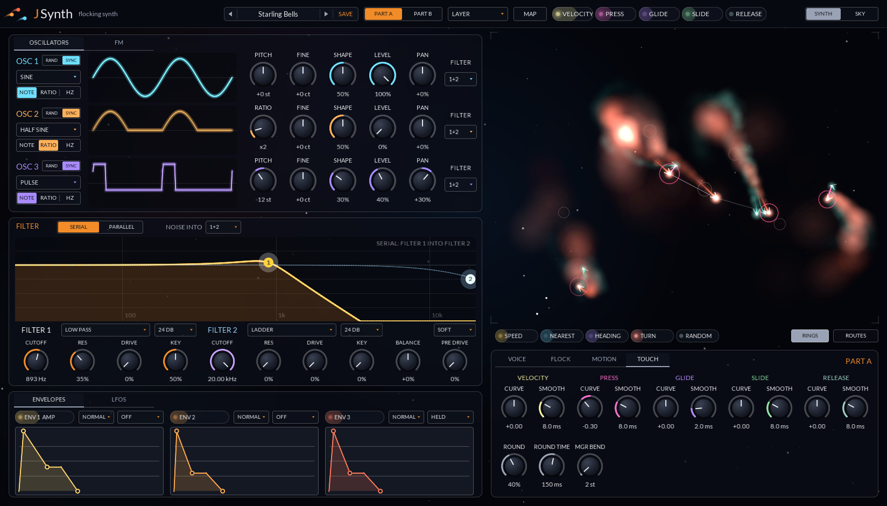
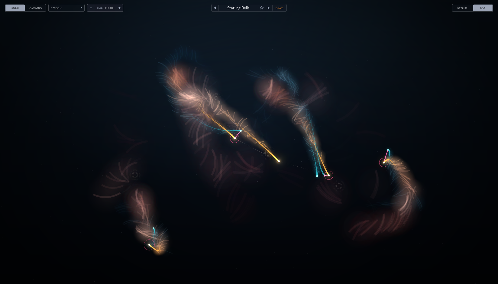

# JSynth

A bi-timbral MPE synth where every note is a creature and the creatures flock. Two species, each a three-oscillator FM patch with two filters, three envelopes and two LFOs, and creatures that fly near each other modulate each other. Each one trails ink.

    

**[Read the user manual (PDF)](docs/JSynth-User-Manual.pdf)**: installing, a quick start, every control with its
range and default, the flock, MAP and routes, the presets, sound-design recipes and troubleshooting.

[ARCHITECTURE.md](ARCHITECTURE.md) walks through all of it from the code: the signal flow, timing,
the voice, the flock and its sources, the couplings between creatures, every parameter with its range,
the presets, and threads and state.

| Part A | Part B |
|---|---|
|  |  |
| **MAP mode, with SPEED armed** | **The route list** |
|  |  |
| **The TOUCH tab** | **The SKY view** |
|  |  |

**Two views**, switched at the top right. **SYNTH** puts big, drawn panels down the left beside the
sky: the oscillators with their waves drawn (and an FM tab that draws what comes out), the filters'
response, which you drag to set cutoff and resonance and which follows the modulated cutoff of the
newest note as it plays, and the envelopes (and an LFOS tab). Under the sky a panel has VOICE (the
stereo field, the voices in use, and live meters for A, B and the master that glow with the level),
FLOCK, MOTION and TOUCH (the touch curves and glide rounding) tabs; RINGS and ROUTES sit just under
the sky. **SKY** hides everything but the flocks.

## The design

- **Every note is a creature.** Your finger is its lure: the note sets where the lure sits left to
  right, Glide moves it sideways, Slide lifts it, and Press makes the creature fly faster and
  brighter. Let go and it flies off as it fades. LURE X and LURE Y on the FLOCK tab choose what
  places the lure, and RINGS under the sky shows or hides each held note's lure ring.
- **Two species, A and B**, each a whole patch with its own way of flying: Shoal, Scatter, Hunt or
  Flee. The play mode decides which species a note hatches (Single, Layer, Split, MPE Zones,
  Velocity or Expression). Each plays up to 16 creatures.
- **A voice:** three oscillators (analog waves, the TX81Z's eight FM waves, noise, or Random: a
  wave drawn fresh for each note; pitched by
  note, ratio or fixed Hz), a 3×3 FM grid whose diagonal is each oscillator's feedback, noise, drive,
  and two filters, serial or parallel, with each oscillator and the noise picking Filter 1, Filter 2
  or both.
- **Between creatures:** the nearest neighbour's Osc 1 feeds this creature's Osc 2 (Neighbour FM), so
  a tight flock rings and a loose one is clean. Creatures flying the same way drift toward pure
  intervals (Tune Pull). A hunter that catches its prey ring-modulates it (Bite).
- **Ink:** each creature sheds ink in the sky that blooms (Spread) and fades (Tail).
- **Stereo:** X Pan sets how far each creature's place in the sky, left to right, pans its voice,
  so a flock can spread across the stereo field. Output Width sets the whole output's width.
- **Three envelopes, ADSR or Shape.** Each is a DAHDSR with curves and loops, or, in Shape mode
  (after XAOC's Zadar), one contour from a library of 48 in eight banks, stretched over 1 ms to 30
  minutes or a tempo length, warped, bent, reversed and repeated. An Env Chain starts one Shape
  envelope from another at a phase of its run, in a line or a loop, for drones and textures that keep
  moving.
- **Four LFOs.** Two move the flock: the wingbeat, one per creature, and the wind, one gust for the
  whole sky (Push sets how hard). They only move the flock. LFO 1 and LFO 2 are plain LFOs, the two
  to map.

## Modulation: MAP

There is no matrix page. Touch a source chip, which turns **MAP** on with it armed, then drag any knob: the drag sets how much that
source moves it, shown as a ring in the source's colour (up to four per knob). Double-click a knob to
flip its route, right-click to remove it. The sources are the touch chips in the header (Velocity,
Press, Glide, Slide, and Release, the release velocity), the envelope and LFO chips on their panels,
and the flock's own under the sky: Speed, Nearest, Heading, and Turn (which way and how hard the
creature is turning, + right, - left). Each chip's LED glows with its source as it moves. Random (a
value per note) has a chip under the sky; Key, Mod Wheel and the four macros are in the
route list. The FM grid and the flock params are knobs, so they map like any other. While a part plays,
each knob its routes move shows a white line on its outer ring out to where the newest note has it
now, MAP or not, and the oscillator, FM and LFO pictures draw that note's values.

Underneath, each part has a pool of 64 routes (source, destination, amount) as host params, so route
depths can be automated. **ROUTES** lists the ones in use, sixteen to a page, to edit by name: **+ ADD**
starts one and **X** removes it.

## Presets

As in JVerb: the arrows step through the presets, the name opens them by category, and **SAVE** saves
the current sound as a user preset (`.jspreset`, plain text, in the user's application data folder
under `JSynth/Presets`). SAVE opens a name box: type a name and press Enter or click SAVE again to
save it, or press Escape or click anywhere else to back out. To remove a user preset, load it, open the name
menu and pick **Delete**; it asks once more before the file goes. A factory preset loads every param it doesn't set at its default, so nothing
from the last patch carries over.

The 191 factory presets run in 20 categories: **Bass**, **Leads**, **Keys**, **Mallets and Bells**, **Plucks**, **Brass**, **Strings**, **Pads**, **Rhythmic**, **Atmospheres**, **Voices**, **Drums and FX**, **Expressive**, **Monsta**, **Motion**, **Drones**, **Textures**, **Interplay**, **Layers and Splits** and **Flock**. The instrument families come first,
from plain patches to ones with more going on, and most answer the mod wheel and Press so they play
from any keyboard. **Keys** has an acoustic piano among its electric ones, and **Voices** is formants,
throats and whispers. **Expressive** is played with Press, which bows, blows, bends, gates or blooms
the sound rather than just opening a filter, and **Monsta** is variations on MicroMonsta 2 programs. **Motion** holds patches that keep moving on their own (looping shapes, tempo-synced
and random LFOs, the Random wave, every MPE dimension at once), **Drones** and **Textures** are built
on Shape-mode envelopes (long drifting shapes and chains under a held chord, and shapes as the amp so
each held note plays a pattern), **Interplay** routes envelopes onto each other's Time, Warp and
Bend, **Layers and Splits** uses both parts
(layers, some brought in by Press, splits at C3, velocity switches and Press and Slide crossfades), and **Flock** is the creatures playing
the sound: Neighbour FM, Bite, and routes from the flock's sources. Every preset's level is matched, so
stepping through the bank doesn't jump.

`jsynth-record out.wav|out.mp4 [preset] [cm7-swell|four-bar|drone]` (built with the tools) plays a
phrase through a preset and writes the audio, or a video of the panel with it: a held Cm7 whose
pressure swells up and back over 15 seconds, four strummed chords (Cm9, Abmaj7, Fm9, G7b9) with the
pressure swelling through each bar, or a low chord built up over half a minute.

## Params

`src/params.h` writes a part's params once, as offsets, and `partId(part, offset)` gives the host's
id. Each module is a block of ids with room to grow (oscillators 16 apart, routes 4 apart), so ids can
stay put once released. The state saves each value with its id, so a state from a build with fewer
params loads, and unknown ids are skipped.
