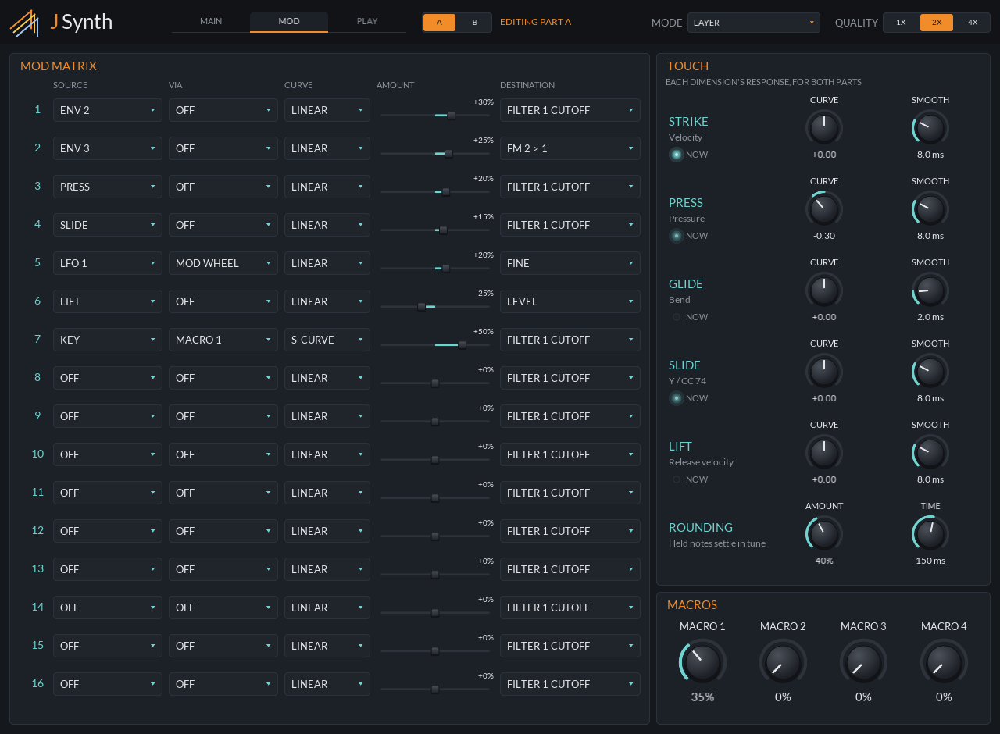
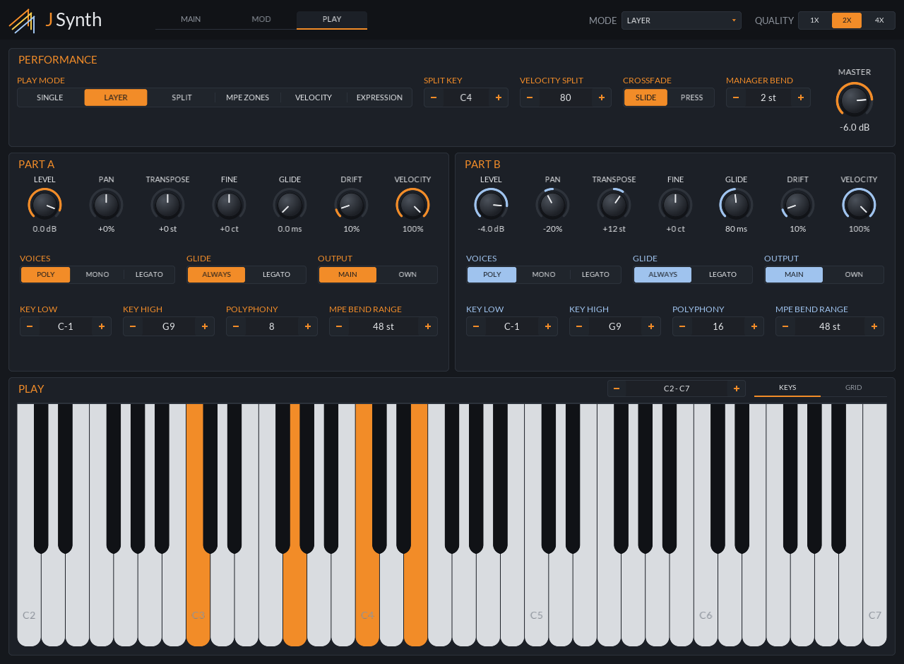

# JSynth

A bi-timbral MPE synth in the spirit of Basic Synth: two parts, each with three cross-modulating oscillators, two filters, three envelopes, two LFOs and a 16-slot mod matrix.

      

## Status

> [!IMPORTANT]
> **This is the panel mock.** Every param exists, can be automated, and saves and loads, and the panel
> edits them all, but the plugin makes **no sound** yet. It builds into `build/preview/`, which CI
> checks but never ships.

| Main (part A) | Main (part B) |
|---|---|
|  |  |
| **Mod** | **Play** |
|  |  |

## The design

- **Two parts, A and B**, each a whole patch. The play mode decides which part a note goes to:
  Single, Layer, Split (by key), MPE Zones (lower zone to A, upper to B), Velocity, or Expression (a
  per-note crossfade by Slide or Press). Each part plays up to 16 notes.
- **A voice:** three oscillators (analog waves, the TX81Z's eight FM waves, or noise; pitched by
  note, ratio or fixed Hz), a 3×3 FM matrix whose diagonal is each oscillator's feedback, ring mod
  and sync, a mixer, drive, two filters (serial, parallel or split, each oscillator choosing in
  split), a shaper, and the amp.
- **Modulation:** Env 1 is the amp; Env 2, Env 3 and the LFOs go wherever the matrix sends them.
  Each of the 16 slots is a source, a via source that scales it, a curve, an amount, and a
  destination, which is any continuous param of the part (including another slot's amount).
- **Touch:** Strike, Press, Glide, Slide and Lift each have a response curve and smoothing. Glide
  rounding pulls a resting finger to the nearest semitone.

## The panel

- **MAIN** edits the selected part's voice. **A / B** in the header picks the part.
- **MOD** is the selected part's matrix, beside the touch response and the four macros (both shared).
- **PLAY** has the play mode, both parts' voice settings side by side, and a keyboard or MPE note
  grid.

## Params

`src/params.h` writes a part's params once, as offsets, and `partId(part, offset)` gives the host's
id. Each module is a block of ids with room to grow (oscillators 16 apart, matrix slots 8 apart), so
ids can stay put once released. The state saves each value with its id, so a state from a build with
fewer params loads, and unknown ids are skipped.
