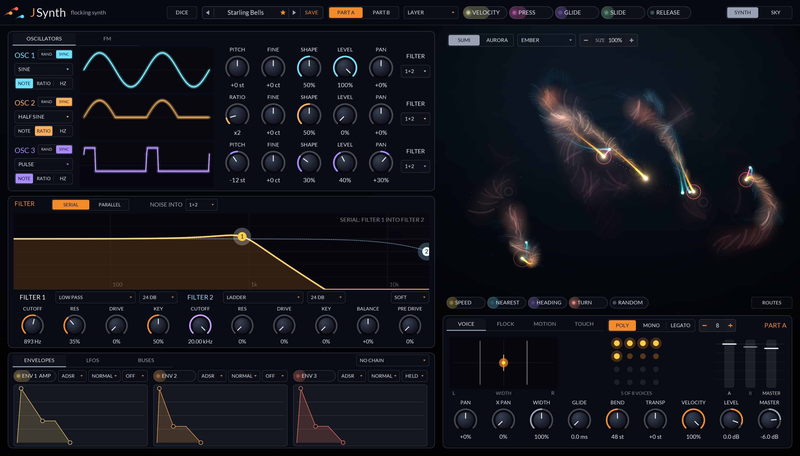
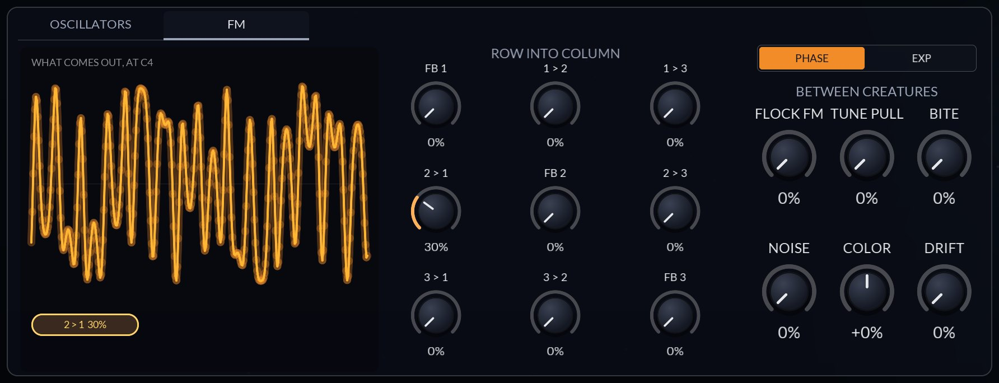
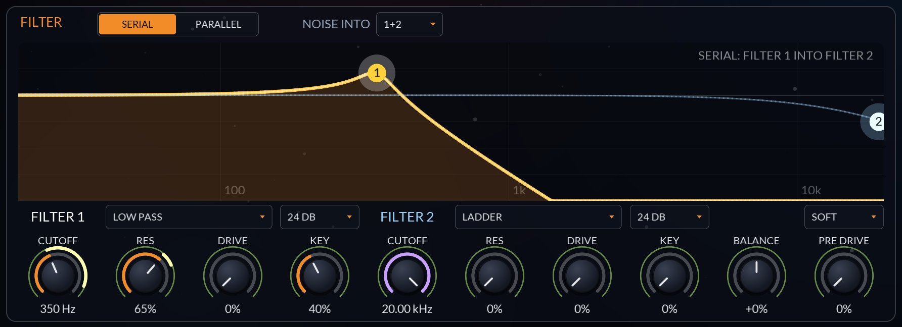
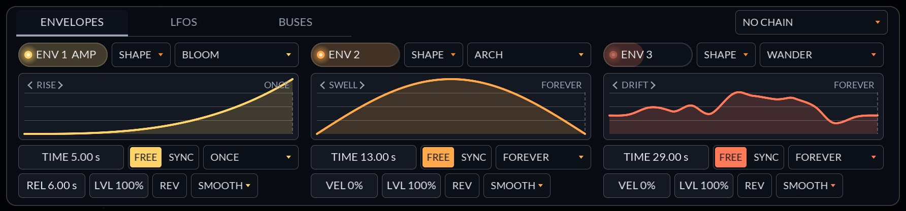
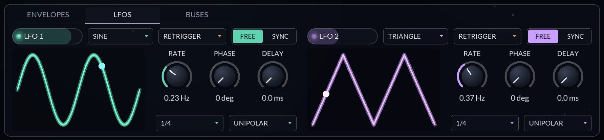
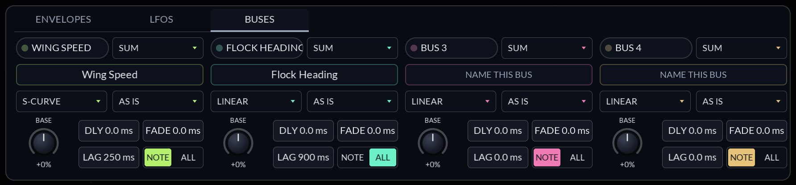
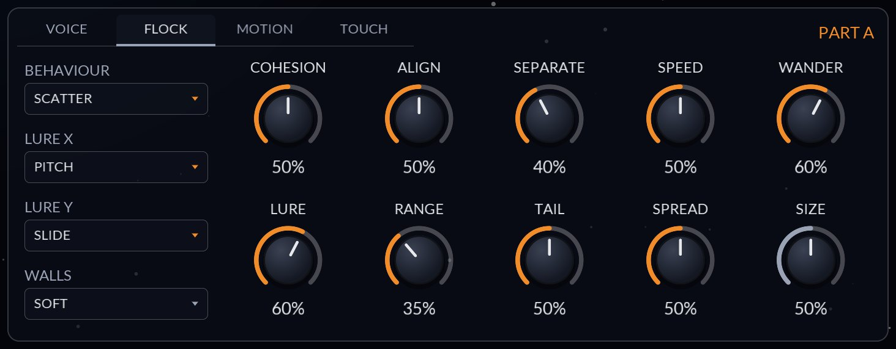
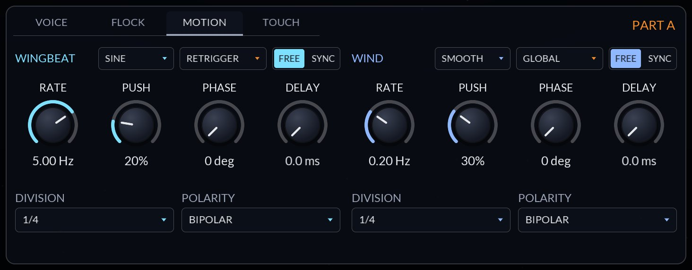
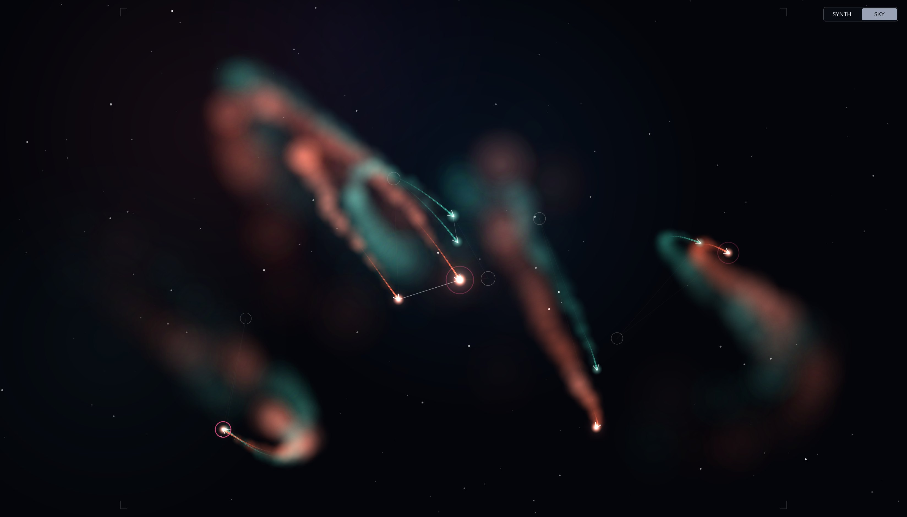
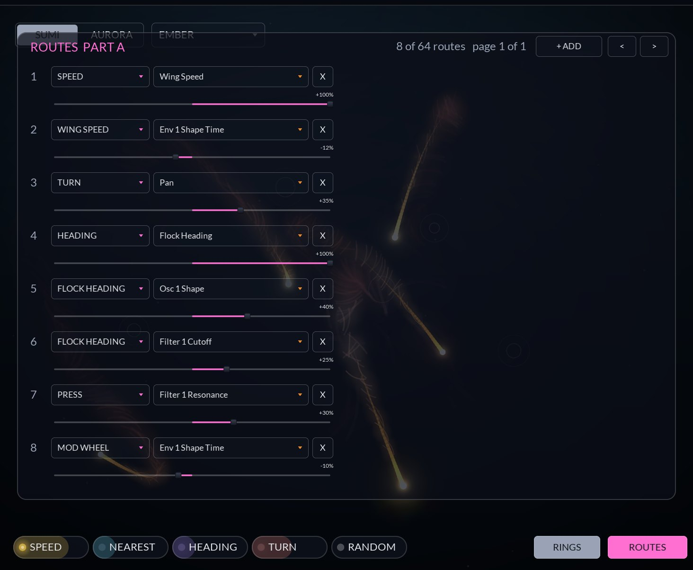

# JSynth

A two-part MPE synth where every note is a creature, and the creatures flock. How they fly shapes how
they sound: a tight flock rings, a loose one is clean, a hunter that catches its prey bites it, and
each one trails ink across the sky.

    

**[User manual (PDF)](docs/JSynth-User-Manual.pdf)** · **[Architecture](ARCHITECTURE.md)** · **[Install](../../README.md)**

## At a glance

- **Two parts, A and B**, each a whole patch: three oscillators, a 3×3 FM grid, noise, drive, two
  filters, three envelopes, two LFOs and four mod buses. Play one, layer both, split the keyboard, or
  pick the part by MPE zone, velocity or pressure.
- **Every note is a creature.** It hatches where your note puts its lure, flies with the others of
  its species, and fades off when you let go. Up to 16 per part.
- **The flock is a modulation source.** Speed, Nearest, Heading and Turn route anywhere, and three
  couplings run between creatures: Neighbour FM, Tune Pull and Bite.
- **Shape envelopes** after XAOC's Zadar: 60 contours in ten banks, from 1 ms to 30 minutes, chained
  into each other.
- **MAP** instead of a matrix page: arm a source, drag a knob.
- **166 factory presets** in ten categories, with favorites.

## Sound

Each oscillator plays an analog wave (sine, triangle, saw, square, pulse), one of the TX81Z's eight FM
waves, white or pink noise, or **Random**, a wave drawn fresh for every note. It's pitched by note,
by ratio or at a fixed Hz. The **FM** tab above is the 3×3 grid, row into column, with each
oscillator's feedback on the diagonal, and draws what actually comes out at C4. Beside it sit the
couplings **between creatures** and the part's noise and drift.

Two filters, serial or parallel with a balance between them: low pass, high pass, band pass, notch,
peak, ladder and two combs, 12 to 48 dB. Each oscillator and the noise picks Filter 1, Filter 2 or
both. The response is drawn and draggable (handle 1 and 2 set cutoff and resonance), and it follows
the newest note's modulated cutoff as it plays. A drive stage (soft, hard or tube) sits after them.
This shot is in MAP mode with the Wah bus of *Finger Wah* armed: the rings on Cutoff and Res are how
far it moves them.

## Envelopes, LFOs and buses

The card at the bottom left has three tabs.

**ENVELOPES.** Each of the three is an ADSR (a DAHDSR with curves and loops) or a **Shape**: one
contour from a library of 60 in ten banks (Rise, Fall, Swell, Pulse, Waves, Steps, Drift, Strike,
ADSR and Acoustic), stretched over 1 ms to 30 minutes or a tempo length, then warped, bent, scaled,
reversed, repeated and held at a sustain point. **Env Chain** starts one Shape envelope from another
at a phase of its run, in a line or a loop, so drones keep moving. Above, *Two Tides*: Bloom, Arch
and Wander, five, thirteen and twenty-nine seconds long.

**LFOS.** Two plain LFOs per part (sine, triangle, saw, square, S&H, smooth), free or tempo-synced,
retriggered per note, free-running or one for the whole part. *Twin Pulse* multiplies these two so
its drone only swells where both are up.

**BUSES.** Four per part. A bus mixes the routes into it by **Sum, Multiply, Min or Max**, bends the
result (linear, exponential, log, S-curve, absolute), sets its polarity (as is, unipolar,
bipolar, inverted), can wait and fade in
after the note, lags it, and runs per note or once for the whole part. Name it and it routes on under
that name, as *Flight Steps* does with **Wing Speed** and **Flock Heading**.

## The flock

### What boids are

JSynth's creatures are **boids**, Craig Reynolds' 1986 model of a flock. No creature knows where the
flock is going. Each one only looks at the neighbours near it and follows three rules:

1. **Cohesion**: steer toward the middle of your neighbours.
2. **Alignment**: fly the way your neighbours fly.
3. **Separation**: don't get too close to any one of them.

Run those three rules on every creature 500 times a second and murmurations, shoals and swarms come
out of nothing. JSynth adds a few forces of its own: your note's **lure** (each held note pulls its
creature toward a point in the sky), **wander** (each creature's own restlessness), the **wind** and
the **wingbeat**, the sky's **walls**, and a **behaviour** that decides how each species treats the
other.

Each part is a **species**. A creature flocks only with its own kind; the other species matters only
when one of them hunts or flees. A creature lives as long as its voice: it hatches at its lure when
the note starts, flies with the flock while the note is held, drifts free of its lure as the note
releases, and fades out with its sound.

### How the flock reaches the sound

The flock never changes the sound by itself, so a plain patch is plain. It gets in three ways, and
only these:

- **Sources.** Each creature is a modulation source for its own note: **Speed** (how fast it flies),
  **Nearest** (how near its nearest neighbour is), **Heading** (how much it flies upward) and **Turn**
  (which way and how hard it turns). Route them anywhere with MAP, like an envelope.
- **Between creatures.** Three knobs on the FM tab let creatures hear each other: **Flock FM**,
  **Tune Pull** and **Bite** (below).
- **X Pan** on the VOICE tab pans each voice by where its creature is, left to right.

So the flock controls shape the sound *through* those: tighten the flock and Nearest climbs and Flock
FM rings; turn up Wander and Turn gets busy. The ink is only drawn and never changes the sound.

### The controls

The **FLOCK** tab under the sky sets how each species flies. Every knob here except Size can take
routes, and a route moves each creature by its own note: Press onto Separation, say, and the note you
lean on breaks formation while the rest hold together.

| Control | What the creatures do | What you hear, through the sources and couplings |
|---|---|---|
| **Behaviour** | **Shoal** flocks with its own kind. **Scatter** turns cohesion inside out, pushing creatures away from their neighbours' middle. **Hunt** chases the nearest creature of the other species, and can catch it. **Flee** runs from the other species. | Shoal gives high Nearest and steady Flock FM; Scatter low Nearest and a clean sound; Hunt and Flee give sudden Speed and Turn, and Hunt drives Bite. |
| **Cohesion** | Rule 1: how hard each creature steers toward the middle of its neighbours. | Up, creatures bunch: Nearest rises, more neighbours are in range, Flock FM rings and X Pan narrows. |
| **Align** | Rule 2: how hard each one matches its neighbours' heading and speed. | Up, the flock flies as one: Heading and Turn move together across a chord, and Tune Pull engages (it only pulls creatures heading the same way). |
| **Separate** | Rule 3: how hard each one steers away from a neighbour inside 40% of Range. | Up, creatures keep their distance: Nearest stays lower and steadier, Flock FM gentler. |
| **Speed** | Top speed. Press raises it, up to 80% more. Creatures never drop below a fifth of it. | Faster flight moves every source faster: neighbours come and go sooner, X Pan sweeps quicker. The Speed source is measured against the top speed at full Press, so pressing is what fills it. |
| **Wander** | Each creature's own restlessness: a heading that drifts, sometimes a long curve, sometimes a jink, and a wider roam around its lure. | Up, Turn gets busy and Heading wanders, so routes from them get livelier; the flock holds together less. |
| **Lure** | How hard a held note pulls its creature toward its lure, on a leash that is loose near it and firm when it strays. | High pins each creature where you play, so X Pan follows Lure X (by default the pitch). Low lets the flock carry creatures off. |
| **Range** | How near counts as a neighbour, from 8% to 40% of the sky's height. | How far the three rules, Nearest, Flock FM and Tune Pull reach. A hunter sees 2.5 times as far. |
| **Lure X**, **Lure Y** | What places a note's lure: Pitch, Velocity, Press, Slide, Release, Random or the centre. By default low notes sit left and high right, and Slide lifts them. | Lure Y on Press sends the note you press up the sky, so its Heading rises as you lean in. |
| **Walls** (shared) | **Soft** turns creatures back near the edge, **Wrap** carries them round to the other side, **Open** lets them fly past it first. | With Wrap, a creature leaving one side reappears at the other, so X Pan jumps across the stereo field. |
| **Size** (shared) | How big the sky is for both species. Bigger makes the creatures, their Range and their speed relatively smaller. | Flocks spread out: fewer neighbours, lower Nearest, slower sweeps. |
| **Tail**, **Spread** | How long the ink lasts (about half a second to five) and how far it blooms. | Nothing: ink is only drawn. |

**MOTION** holds the two LFOs that move only the flock: the **wingbeat**, one per creature, bobs each
one across its path, and the **wind**, one gust for the whole species, pushes them all one way from a
direction that turns slowly. **Push** sets how hard each shoves. They aren't route sources; to hear
them, use LFO 1 or 2 at the same rate, or route the flock sources they stir up (the wingbeat shows in
Turn a little, the wind in Speed and Heading). **VOICE** has the stereo field (X Pan), polyphony and
mono/legato, glide, bend range, levels and live meters. **TOUCH** has a curve and smoothing for each
touch dimension and glide rounding for MPE slides.

### Between creatures

These three knobs sit on the FM tab and start at zero.

- **Flock FM** (Neighbour FM). Each creature listens to up to three neighbours of its own species
  within Range, nearer ones louder, and their Osc 1 phase-modulates its Osc 2. A tight flock rings and
  a loose one is clean. Osc 2 has to be heard for it to matter: give it level, or route it into Osc 1
  on the FM grid. Neighbours fade in and out over about 10 ms, so a change never clicks.
- **Tune Pull.** For each neighbour heading within 30° of the same way, the creature drifts toward
  the nearest just interval from it (unison, minor and major third, fourth, fifth, major sixth,
  octave), up to 30 cents, over about 150 ms. A chord on a flock that flies together settles into
  just intonation; when the flock breaks up, it drifts back.
- **Bite.** When a hunter comes within reach of a creature of the other species, it catches it, and
  the hunter's Osc 1 ring-modulates the prey's sound. Set Bite on the **hunting** part. A catch takes
  hold in about 20 ms and lets go over half a second, so each bite rings out as the prey escapes.

### Reading the sky

**SKY**, top right, hides everything but the flocks. Part A's creatures are orange and B's blue and
teal; grey rings are lures (**RINGS** shows or hides them), a pink ring is a creature that's been
caught, and thin lines join each creature to the neighbour it hears most. A creature glows brighter
the harder you press, and fades with its sound after you let go. The flock flies on the audio
thread, so what you see is exactly what the voices hear, and a render plays back the same every time
from the same start.

## Modulation: MAP and routes

There is no matrix page. Click a source chip and **MAP** turns on with it armed; drag any knob and
the drag sets how far that source moves it, drawn as a ring in the source's colour (up to four per
knob). Double-click a knob to flip its route, right-click to remove it. Sources are the touch chips
in the header (Velocity, Press, Glide, Slide, Release), the envelope, LFO and bus chips on their
cards, and the flock's own under the sky (Speed, Nearest, Heading, Turn, Random). Key, Mod Wheel and
four macros are in the route list. While a part plays, each moved knob shows a white line out to
where the newest note has it now, MAP or not.

Each part has 64 routes (source, destination, amount), all host params, so depths can be
automated. **ROUTES** lists the ones in use, sixteen to a page, to edit by name: **+ ADD** starts
one and **X** removes it.

## Play it with your hands

JSynth is MPE first. Your finger is the creature's lure: the note sets where it sits left to right,
**Glide** (pitch bend) moves it sideways, **Slide** lifts it, and **Press** makes the creature fly
faster and brighter. Release velocity is a source too. The play mode decides which part a note
hatches in: **Single, Layer, Split, MPE Zones, Velocity** or **Expression**. Most presets also answer
the mod wheel, so they play from any keyboard.

## Presets

The arrows step through presets, the name opens them by category, and **SAVE** stores the current
sound as a user preset (`.jspreset`, plain text, under `JSynth/Presets` in your application data
folder). To delete a user preset, load it and pick **Delete** from the name menu. Click the **star**
to make any preset a favorite; **Favorites** sits at the top of the menu and is shared by every
instance.

The 166 factory presets are level-matched and come in ten categories:

| Category | What's in it |
|---|---|
| **Essentials** | Plain patches to start from: basses, leads, keys, bells, plucks, brass, strings, pads, splits |
| **Flock** | The creatures playing the sound: Neighbour FM, Bite, Tune Pull and the flock's sources |
| **Pressure** | Press shaped by the buses: curved, multiplied, delayed and lagged |
| **Expressive** | Played with Press, which bows, blows, bends, gates or blooms the sound |
| **Drones** | Long drifting Shape envelopes under a held chord |
| **Textures** | Shapes as the amp, so each held note plays a pattern |
| **Motion** | Patches that keep moving on their own |
| **Interplay** | Envelopes routed onto each other's Time, Warp and Bend |
| **Landscapes** | Both parts at once on Shape envelopes that move each other |
| **Monsta** | Variations on MicroMonsta 2 programs |

## For developers

- [ARCHITECTURE.md](ARCHITECTURE.md) walks through the code: signal flow, timing, the voice, the
  flock, the couplings, every parameter with its range, the presets, threads and state.
- `src/params.h` writes a part's params once, as offsets; `partId(part, offset)` gives the host's id.
  Each module is a block of ids with room to grow, so ids stay put once released, and unknown ids in
  a saved state are skipped.
- With `-DJCLAP_BUILD_TOOLS=ON`:
  - `jsynth-screenshot out.png [part [routes [map-source [width height [view [voice-tab [env-tab
    [osc-tab [preset]]]]]]]]]` renders the panel offscreen. [`docs/readme/make.sh`](docs/readme/make.sh)
    makes this page's pictures with it.
  - `jsynth-record out.wav|out.mp4 [preset] [cm7-swell|four-bar|drone|landscape]` plays a phrase
    through a preset and writes the audio, or a video of the panel with it.
