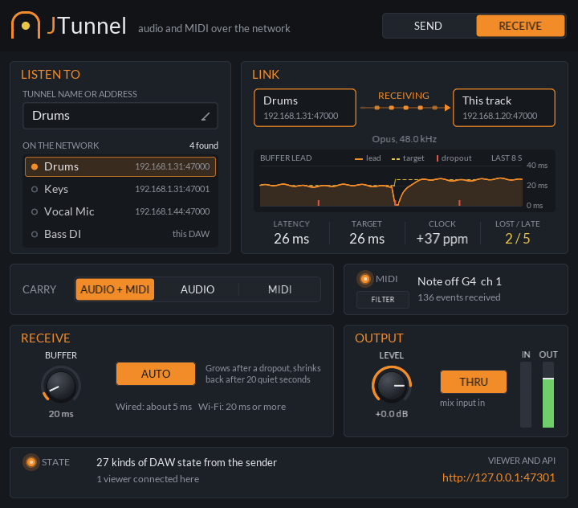
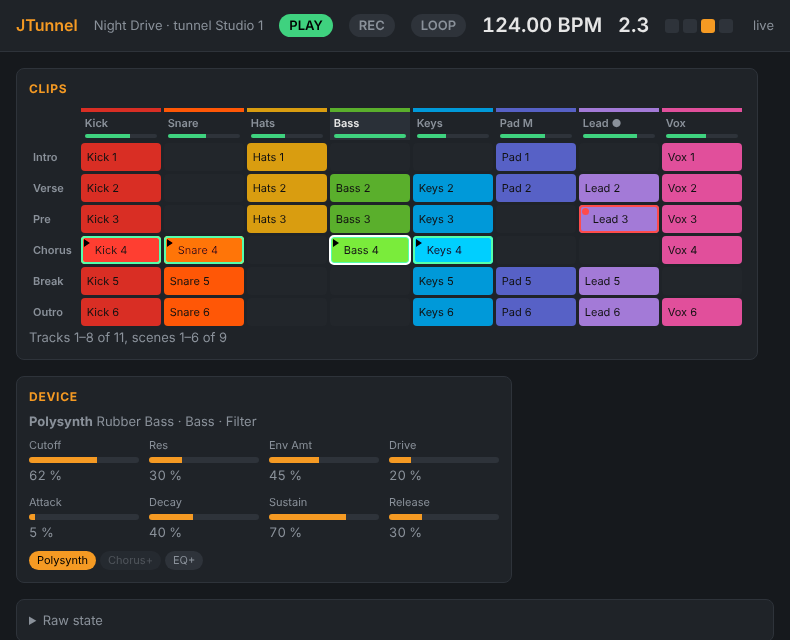
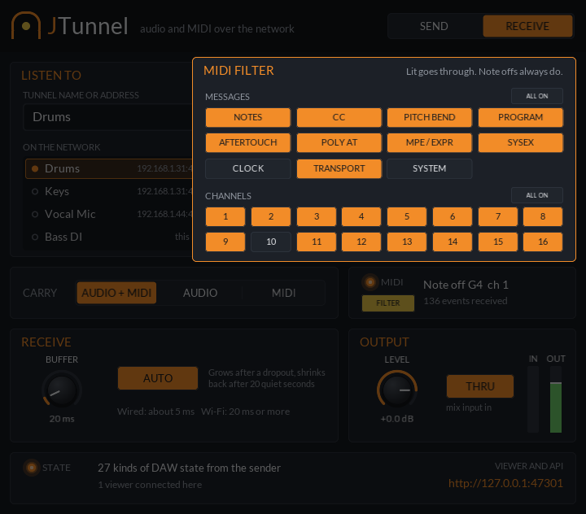
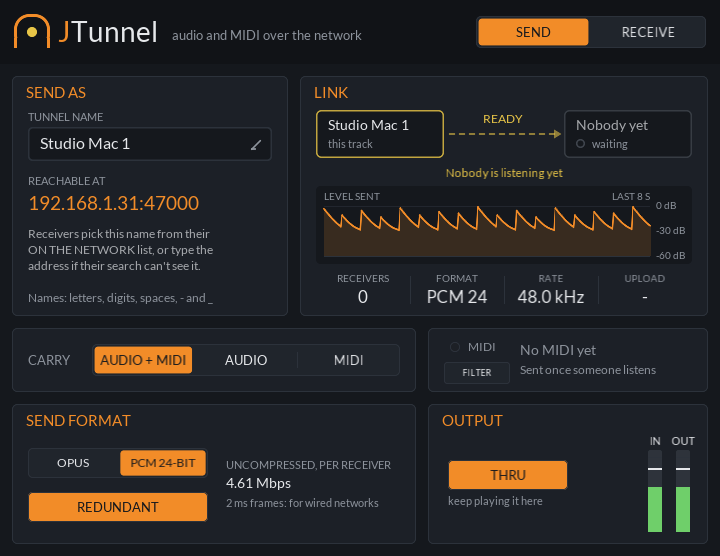

<div align="center">

# JTunnel

Sends a track's audio and MIDI to other JTunnel instances on the network, or plays what they send,
with Bitwig's clip grid, transport and device beside them for a stream overlay.

[](https://github.com/jeffmhopkins/Jclap/actions/workflows/build.yml) [](https://github.com/free-audio/clap) [](#panel) [](https://opus-codec.org) [](../../LICENSE)

</div>

Put JTunnel on a track on one computer as a **sender**, give the tunnel a name, and put another
JTunnel on a track on another computer (or another DAW, or another track) as a **receiver**
listening to that name. The receiver plays the sender's audio and MIDI. Built for a home or studio
LAN, Wi-Fi included.



## Using it

1. On the sending track, add **JTunnel**, leave it on **SEND** and type a name under **SEND AS**
   (it starts as this computer's name and a number).
2. On the receiving track, add **JTunnel**, switch it to **RECEIVE**, and pick the tunnel from the
   **ON THE NETWORK** list, or type its name.
3. Audio starts within a second. The link turns green and **LATENCY** shows how much the receiver
   is buffering.

One sender can feed any number of receivers. All of a track's MIDI travels with the audio,
sample-locked to it, so a receiver can drive an instrument on the far machine: notes, CC, pitch
bend, aftertouch (channel and polyphonic), program changes, clock, start, stop and song position,
SysEx of any length up to 15 KB, and CLAP note expressions (MPE-style per-note tuning, pressure and
brightness). A long SysEx message goes over a few frames, and one that loses a piece on the way is
dropped whole rather than delivered broken. Both ends need JTunnel 0.11 or later: older versions
don't speak this format, and simply don't hear each other.

**CARRY** picks what goes through: **AUDIO + MIDI**, **AUDIO** or **MIDI**. On a sender it is what
gets sent; on a receiver, what of the stream gets played. **MIDI** alone sends no audio at all, in
1 ms frames instead of 5, so with a small buffer on a wired network notes arrive in a few
milliseconds.

If the list stays empty (see [macOS](#macos-local-network) below, or a router that blocks
multicast), type the sender's address into the **LISTEN TO** box instead: the sender's panel shows
it under **REACHABLE AT**, such as `192.168.1.20:47000`.

## How it works

- **Discovery:** senders announce `<name>._jtunnel._udp.local.` over mDNS, the multicast group
  Bonjour uses. Instances in the same process (two tracks in one DAW) also find each other directly.
  Receivers look their tunnel up by name every 2 s, so a project reopened days later finds its
  sender again wherever its address or port has moved.
- **One sender per name:** a name belongs to whoever had it first. A sender whose name is already
  on the network (a duplicated track, say) doesn't announce it, and its panel says **NAME IN USE**
  and where the other one is; when the other goes, it takes the name over. Two that start at once
  settle it by which claimed the name first.
- **Transport:** plain UDP, unicast to each receiver, which renews its subscription twice a second.
  Senders listen on port 47000 (or the next free one up to 47015).
- **Format:** Opus at 48 kHz in 5 ms frames by default (64 to 512 kbps), or uncompressed 24-bit PCM
  at the host's rate in 2 ms frames. MIDI only sends 1 ms frames with no audio in them (about
  230 kbps with redundancy, nearly all packet headers), keeping the clock that times the notes. With **REDUNDANT** on, every packet also carries the previous
  frame, so a single lost packet costs nothing.
- **Clock drift:** two machines' audio clocks never run at exactly the same speed. The receiver
  measures how far ahead of playback the freshest audio arrives and nudges its playback rate (by
  a few hundred ppm at most, inaudible) to hold that lead at the **BUFFER** setting. **CLOCK** shows
  the measured difference, once it has had 15 seconds to measure (packet arrival times keep it
  accurate between audio blocks). Different sample rates on the two ends are resampled too.
- **Jitter and loss:** a lost frame is concealed (Opus fills it in convincingly; PCM fades) and
  skipped. A late one, as when Wi-Fi stalls, is concealed while playback waits for it. With **AUTO**
  on, each such dropout grows the buffer by the length of the stall, and after 20 quiet seconds it
  shrinks back by 1 ms every 5 s. A sender that stops or restarts isn't a dropout: the receiver
  waits, picks it up again (on whatever port it comes back on) and keeps its buffer.
- **Threads:** the audio thread never touches the network. The sender codes frames and queues
  packets for a send thread; a receive thread puts frames in a lock-free ring the audio thread reads.
  A third thread runs the [side channel](#side-channel-the-daws-state) and its local server.

## Parameters

| Param | Range | What it does |
|---|---|---|
| Mode | Send, Receive | What this instance does |
| Format | Opus, PCM 24-bit | How a sender codes audio. Opus is the one to use on Wi-Fi |
| Bitrate | 64 to 512 kbps | Opus bitrate. 192 is transparent for most material |
| Redundancy | Off, On | Repeat each frame in the next packet (doubles the bandwidth) |
| Buffer | 1 to 250 ms | The receiver's lead over late packets. About 5 ms on Ethernet, 20 or more on Wi-Fi |
| Auto Buffer | Off, On | Grow the buffer after dropouts, and shrink it slowly when the network is quiet |
| Thru | Off, On | Sender: keep playing its input locally. Receiver: mix its input in with what it receives |
| Level | -inf to +12 dB | Receiver output level |
| Carry | Audio + MIDI, Audio, MIDI | What a sender sends, or what a receiver plays of what arrives |
| Notes, CC, Pitch Bend, Channel Pressure, Poly Pressure, Program Change, Note Expressions, SysEx, Clock, Transport, System Messages | On, Off | The MIDI filter's kinds: whether each goes through (sent, or played), all on by default |
| Channel 1 to Channel 16 | On, Off | The MIDI filter's channels, all on by default |

The tunnel name and the listen target are saved with the project, not as parameters.

## Latency

One way, on top of the host's own buffers: the sender's frame (5 ms for Opus, 2 ms for PCM),
Opus's 2.5 ms of lookahead, the network, and the receiver's buffer. On wired Ethernet with PCM and
a 3 ms buffer that is under 10 ms. On Wi-Fi with Opus expect 25 to 60 ms, more on a busy network. MIDI only drops the frame to 1 ms
and has no lookahead, so on Ethernet with a 2 ms buffer it is a few milliseconds plus the host
blocks; on Wi-Fi the buffer still has to cover the jitter.
Neither host can compensate for it, so JTunnel suits monitoring, jamming and feeding another
machine's effects, not sample-tight overdubs across machines.

> [!NOTE]
> A stream runs in real time. JTunnel tells the host so (CLAP's render extension); an offline
> bounce, faster than real time, won't capture what a receiver is receiving.

## Side channel: the DAW's state

Beside the audio and MIDI, a tunnel carries what the DAW is doing, so a streaming app on the far
machine can draw the clip launcher grid with clips blinking as they play, the transport, the beat,
meters and the selected device's controls.



<sub>The viewer page every JTunnel serves, here drawing a made-up project.</sub>

**In Bitwig.** A plugin can't see the clip launcher, so a controller extension reads it:

1. Copy [bitwig/JTunnel.control.js](bitwig/JTunnel.control.js) to
   `Documents/Bitwig Studio/Controller Scripts/`.
2. In **Settings > Controllers**, add **Jclap > JTunnel**. It needs no MIDI ports.
3. Every JTunnel sender on this computer picks it up within a second; its panel says **Bitwig
   extension connected**.

The extension's settings (under the controller in **Settings > Controllers**) set the grid's size
(**Tracks** and **Scenes**, 1 to 32, 16 by default), **Follow** (**Selection** or **Off**), **Only to
tunnel** (one sender's name, or empty for all of them) and, under **Send**, a switch for each kind
of state below. A coloured frame in Bitwig's launcher shows the part of the grid that goes out.

**Following the screen.** Bitwig doesn't tell extensions where its own window is scrolled, so the
grid follows the selection instead: the tracks keep the selected track in view, and the scenes
scroll when the selected clip leaves them. Click a clip (or a track) in Bitwig and the grid moves to
it. With **Follow** off it stays where it is.

**Without the extension**, or in another DAW, a sender still sends the `clock` key from the host's
transport (tempo, playing, recording, bar and beat), which every CLAP host gives a plugin.

**On the receiving machine**, each JTunnel serves its state on this computer only (127.0.0.1), on
the first free port from 47300 (up to 47315), shown under **VIEWER AND API** on the panel. A
sender serves its own state the same way.

| Request | Answer |
|---|---|
| `GET /` | The viewer page above, for a browser or a browser source |
| `GET /state` | Every key and its message, as one JSON object |
| `GET /state/<key>` | One key's message, such as `/state/transport` (404 if there's none) |
| `GET /ws` | A WebSocket: `{"type":"snapshot","state":{...}}` when it opens (and again if the state starts over, as when the sender restarts), then `{"type":"update","key":"track/3","value":{...}}` for every change |

```js
const state = {};
const ws = new WebSocket("ws://127.0.0.1:47301/ws");
ws.onmessage = (e) => {
  const m = JSON.parse(e.data);
  if (m.type === "snapshot") Object.assign(state, m.state);   // (clear it first)
  else state[m.key] = m.value;
};
```

Each key's message is the whole of that thing, never a change to it, so a client only ever replaces
a key. HTTP answers allow any origin (`Access-Control-Allow-Origin: *`), and a request whose `Host`
isn't this computer is refused. The keys:

| Key | From | What's in it |
|---|---|---|
| `clock` | the host (any DAW) | `playing`, `recording`, `looping`, `tempo`, `beats` (song position in quarter notes), `seconds`, `bar` and `beat` (from 1), `beatPhase` (0 to 1 through the beat), `timeSignature` `[4,4]`, `loop` `[start,end]`. 30 times a second while playing |
| `sender` / `receiver` | JTunnel | `tunnel`, `host`; a sender's `extension` (whether Bitwig's is talking), a receiver's `connected` and `source` |
| `project` | extension | `name`, `layout` (the panel layout), `engine` (audio engine on), `host` (Bitwig's version) |
| `transport` | extension | `playing`, `recording` (arranger record), `arrangerOverdub`, `launcherOverdub`, `automationWrite` (`mode`, `arranger`, `launcher`, `overridden`), `loop`, `loopStart`, `loopLength`, `punchIn`, `punchOut`, `metronome`, `preRoll`, `fill`, `tempo`, `tempoText`, `timeSignature`, `position` and `positionText` ("3.2.1.00"), `seconds`, `playStart`, `launchQuantization`, `postRecordingAction`, `crossfade` |
| `grid` | extension | The window sent: `tracks` and `scenes` (its size), `trackOffset` and `sceneOffset` (where it starts in the project), `trackCount` and `sceneCount` (the project's), `follow`, `selectedTrack` and `selectedScene` (-1 for none) |
| `scenes` | extension | `items`: each scene's `index` (in the project), `exists`, `name`, `color`, `clips` |
| `track/0` ... `track/N` | extension | One per column of the grid: `index` (in the project), `exists`, `name`, `color` (`#rrggbb`), `type`, `group`, `selected`, `armed`, `monitor`, `mute`, `solo`, `mutedBySolo`, `active`, `volume` and `pan` (0 to 1) with `volumeText` and `panText`, `stopped`, `stopQueued`, `playing` (the scene playing, or -1), and `slots`: each clip's `scene`, `name`, `color`, `hasContent`, `state` (`empty`, `stopped`, `playing` or `recording`), `queued` (`play`, `record`, `stop` or null: blink it) and `selected` |
| `mixer` | extension | `master` and `fx` (the effect tracks), each with the channel fields above |
| `meters` | extension | Peak levels, 0 to 1, `[left, right]`: `tracks` (one per grid column), `fx`, `master` |
| `notes` | extension | Notes sounding now, `[pitch, velocity]`: `tracks` (one list per grid column), `master` |
| `expression` | extension and senders | `tracks`: one per grid column, `null` for a track with no JTunnel sender on it. Each is the track's MIDI, channel by channel (channels 1 to 16, so MPE's channel per note shows): `bend` (-1 to 1, 0 the centre: the channel bent furthest) and `pressure` (0 to 1: the hardest anywhere) for the whole track; `channels`, each channel in use (a held note, a bend off the centre or any pressure) with its `channel`, `bend` and `pressure`; and `notes`, each held note's `channel`, `pitch`, `velocity` (0 to 127), `bend` (its channel's) and `pressure` (the harder of its own and its channel's). Up to 15 times a second while it moves |
| `device` | extension | The selected device: `exists`, `track`, `trackColor`, `name`, `preset`, `category`, `creator`, `enabled`, `plugin`, `windowOpen`, `pinned`, `page` (`index`, `name`, `names`), `params` (its 8 remote controls: `name`, `value` and `modulated` 0 to 1, `text`, `exists`) and `chain` (the track's devices: `name`, `enabled`, `selected`) |
| `clip` | extension | The selected launcher clip: `exists`, `track`, `scene`, `name`, `color`, `playing`, `playingStep`, `playStart`, `loopStart`, `loopLength`, `loop` |
| `markers` | extension | `items`: the arranger's cue markers, `name`, `position` (beats), `color` |

**Pitch bend and pressure.** Bitwig shows an extension a track's playing notes only as pitch and
velocity, so the `expression` key comes from the tracks themselves: each JTunnel sender reads its
own track's MIDI (pitch bend, channel and poly pressure, CLAP pressure expressions and which notes
are held, on every channel, whatever its MIDI filter lets through) and tells the extension, at most
15 times a second while anything moves and once a second while nothing does. The extension puts
each in its track's column, found by the track's name (Bitwig gives a plugin its track's name and
colour), so put a JTunnel sender on every track whose expression you want, and give tracks
distinct names; two with the same name are told apart by colour. Every sender's track goes into
the key, whichever tunnel **Only to tunnel** picks.

A key the extension's settings turn off is dropped from every receiver; so are all its keys when
Bitwig closes or the extension is removed.

**On the wire**, state goes in its own packets beside the stream's, to everyone listening: what
changed at once, and everything again about once a second, so a lost packet is put right within a
second. A message too long for one packet (a track with many clips) goes in pieces. It is small:
a few kilobytes a second while things change. Receivers older than 0.13 ignore these packets.

The extension talks to the senders on its own computer over OSC on loopback: it listens on UDP port
47250, and each sender says hello from one of 47251 to 47266.

## macOS Local Network

Since macOS 15, apps need **Local Network** permission to talk to other machines, and a plugin
runs with its host's. The first time JTunnel runs, macOS asks whether your DAW may find devices on
the local network; allow it, or turn it on later in **System Settings > Privacy & Security > Local
Network**. Without it nothing reaches the network, though instances in the same DAW still work.

## Testing on a bad network

To try a link against Wi-Fi-like trouble on a wired network or one machine, start the sender's host
with `JTUNNEL_IMPAIR` set:

```sh
JTUNNEL_IMPAIR="jitter=6,stall=80,every=10,loss=1" /Applications/Bitwig\ Studio.app/Contents/MacOS/BitwigStudio
```

Every packet it sends is then held back a random time (`jitter` ms on average, kept in order as Wi-Fi
does), everything stops for `stall` ms about every `every` seconds and goes out in a burst, and
`loss` percent are dropped. Any key can be left out. The sender's panel says the impairment is on.

## Panel

**SEND / RECEIVE** in the header sets the mode, and the panel below follows it. **LINK** draws the
link, the sending end on the left and the receiving end on the right, in green while audio flows,
amber while waiting and red without a socket, with warnings under it. Its graph shows the last 8
seconds: a receiver's lead (what **LATENCY** shows) against its **TARGET**, with a red tick for each
lost or late frame; a sender's level going out.

- **Receiving:** **LISTEN TO** takes a tunnel's name or a typed address, and lists the tunnels
  **ON THE NETWORK**; click one to listen to it. The readouts are **LATENCY** (the buffer),
  **TARGET** (what it is aiming for), **CLOCK** (the sender's clock against this one) and
  **LOST / LATE** frame counts. **RECEIVE** holds the buffer and **AUTO**.
- **Sending:** **SEND AS** holds the name and the address receivers can type. The readouts are the
  receivers, the format, the rate and the upload they cost together. **SEND FORMAT** holds the
  codec, the bitrate (Opus only) and **REDUNDANT**.

Under them, **CARRY** sets what the tunnel carries, and the **MIDI** light flashes for each event
going out (a sender) or coming in (a receiver), with the last one in words and the count. It says
so in amber when **CARRY** is keeping MIDI back. **FILTER** under the light opens the MIDI filter:



It has a switch for each kind of MIDI (**NOTES**, **CC**, **PITCH BEND**, **PROGRAM**, channel
**AFTERTOUCH**, **POLY AT**, **MPE / EXPR** for CLAP note expressions, **SYSEX**, **CLOCK** with
MIDI time code, **TRANSPORT** for start, stop, continue, song position and song select, and
**SYSTEM** for tune request, active sensing and reset), and one for each of the 16 channels. A lit
switch goes through; **ALL ON** lights a row again. Like **CARRY**, on a sender it decides what is
sent and on a receiver what is played. Note offs always go through, so turning a switch off while
a note is held can't leave it hanging. FILTER lights amber while anything is held back, and a
second click on it, or a click anywhere off the card, closes it. Each switch is also a host
parameter, so a project can automate it.

**OUTPUT** has **THRU**, the receiver's **LEVEL**, and input and output meters.

**STATE** along the bottom is the [side channel](#side-channel-the-daws-state), and it's only there
while there is Bitwig state: on a sender while the Bitwig extension is connected, on a receiver while
its sender's is. Without it the row is hidden and the panel is shorter (720 x 556 instead of
720 x 632, as below); the row comes back by itself when the extension does. The tempo, bar and beat
still go to the viewer page and the API either way. Its light flashes for each change; beside it, a
sender says how much the extension is sending and a receiver how much state has come from the
sender, and how many viewers are reading it. **VIEWER AND API** is the address to open in a
browser, or to point a streaming app at.



> [!TIP]
> To regenerate `docs/panel.png`, configure with `-DJCLAP_BUILD_TOOLS=ON` and run
> `build/plugins/jtunnel/jtunnel-screenshot plugins/jtunnel/docs/panel.png`. Add `1440 0 send` for
> the sender's view (a height of 0 keeps the panel's own shape), and `idle` after that to see either before anything connects (or `taken` for a
> sender whose name is in use, `midi` for a tunnel carrying MIDI only, or `filter` for the MIDI
> filter open).

## Tests

`jtunnel-engine-tests` checks the packet format, both codecs, the resampler (over 90 dB clean at
every rate pair), and a sender and receiver whose clocks run 150 ppm apart, joined by a simulated
Wi-Fi link with jitter, 60 ms stalls and 2% loss, for 90 simulated seconds: the receiver must find
the clock offset, stop dropping out, keep the tone at its level and deliver a note with its length
intact, and a MIDI-only link that must deliver a note within 30 ms. It also sends every kind of
MIDI event through a sender and receiver, a 1000-byte SysEx dump among them, and checks they come
out in order and whole, and that a dump missing a piece never comes out. For the side channel it
checks the JSON checks, a long state message cut into pieces and put back together through loss,
repeats and reordering, a store of 25 keys sent over a link losing one packet in five that ends up
identical on the far side, the bar and beat in 4/4 and 6/8, and the OSC and WebSocket pieces. `jtunnel-plugin-tests` runs two whole plugins in one process over real UDP on the loopback
interface, one sending a tone, a note, CC, pitch bend, both kinds of aftertouch, a program change,
an MPE voice, clock, SysEx and a note expression, the other finding the tunnel by name and playing
them, with the sender's MIDI filter holding transport back and the receiver's holding channel 10
back. Then a stand-in for the Bitwig extension answers the sender's hello with a track of 64 clips
and the scenes, the host's transport plays, and all of it must come out of the receiver's local
server, over HTTP and a WebSocket, which must also refuse a request for another host.
