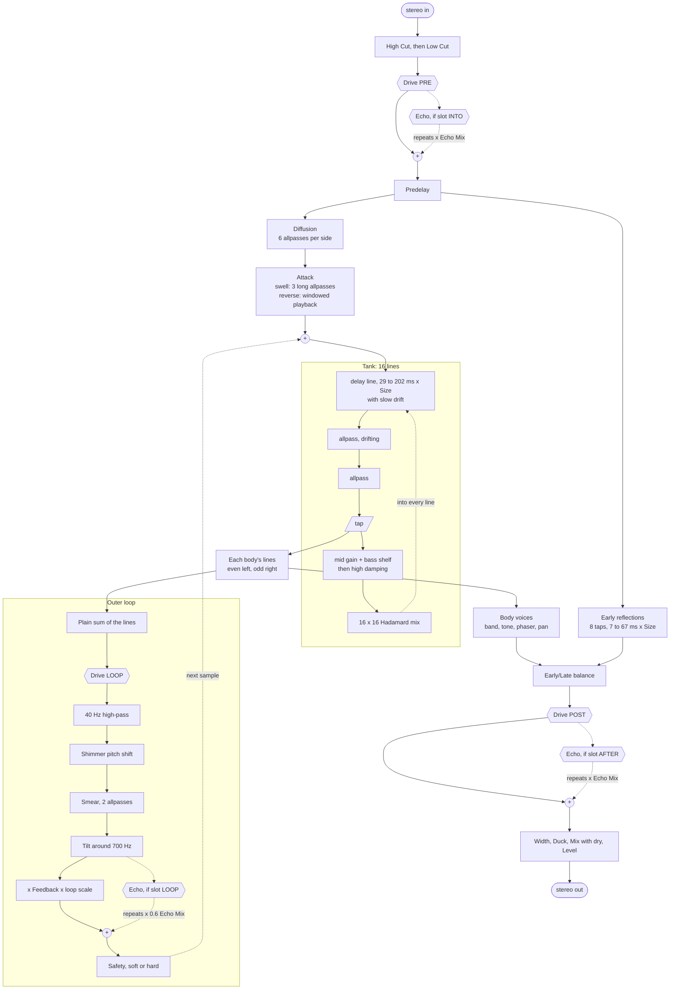
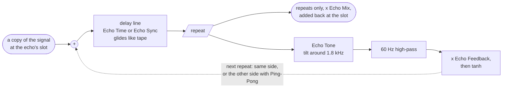

# How JVerb works

This is the whole of JVerb, from the samples that come in to the samples that go out, written from
the code in [`src/`](src). The [README](README.md) says what the plugin does; this says how. Where
it gives a number, the number is the one in the code.

- [The pieces](#the-pieces)
- [Signal flow](#signal-flow)
- [The input stage](#the-input-stage)
- [The tank](#the-tank)
- [The body voices](#the-body-voices)
- [The outer loop](#the-outer-loop)
- [Drive](#drive)
- [Echo](#echo)
- [The output stage](#the-output-stage)
- [The orbit simulation](#the-orbit-simulation)
- [How the bodies move the sound](#how-the-bodies-move-the-sound)
- [Up to 100% and past it](#up-to-100-and-past-it)
- [Every parameter](#every-parameter)
- [Presets](#presets)
- [Threads, timing and state](#threads-timing-and-state)

## The pieces

| File | What it holds |
| --- | --- |
| [`src/params.h`](src/params.h) | Every parameter: id, range, default, how it prints and parses. |
| [`src/engine.h`](src/engine.h) | All the audio: filters, predelay, early reflections, diffusion, attack, the 16-line tank, the body voices, the outer loop, drive, echo and output. |
| [`src/orbit.h`](src/orbit.h) | The gravity simulation of two to six bodies. |
| [`src/plugin.cpp`](src/plugin.cpp) | The CLAP plugin: reads params, steps the orbits, turns body positions into what the engine hears, the transient analyzer, state. |
| [`src/presets.h`](src/presets.h) | The factory bank and user preset files. |
| [`src/shared.h`](src/shared.h) | What the audio thread and the panel pass each other. |
| [`src/editor.cpp`](src/editor.cpp) | The panel. |

Everything runs on a **control tick** of 32 samples. Once per tick the plugin reads every param,
steps the orbits, works out what each body is doing, and hands the engine one `Control` struct in
plain units. The engine then derives its coefficients, and every gain ramps linearly across the next
32 samples so nothing zippers. Line lengths, allpass lengths and voice gains glide on their own
one-pole smoothers (25 ms for lengths, 80 ms for pans and voice gains), so a change never steps.

## Signal flow

The hexagons are the slots. **Drive** sits in exactly one of PRE, LOOP or POST, in line with the
signal. The **echo** is a single unit drawn at all three of its possible places (the dotted
branches), and only the one its slot names is live. Wherever it sits it works as a send and return:
it takes a copy of the signal at that point and adds only its repeats back in, scaled by Echo Mix, so
the signal itself always passes straight through. See [Echo](#echo) for how it works inside.
Neither switches in one sample: when Drive On, the drive's slot or type, or the echo's slot changes,
that unit fades out over 5 ms (eased, so the fade has no corners), switches, and fades back in, and
the echo's input fades with it so no step is written into its repeats.

Two things about the shape matter more than anything else:

1. **The voices are on the way out only.** The outer loop is fed from the plain sum of the lines,
   taken before the voices, so nothing a voice does (a boost, a ringing phaser, a stereo flip) is
   ever fed back into the tank. That is what lets Pan, Tone and Swirl go to 200% safely.
2. **The tank is tapped before its damping.** What you hear from each line is the line after its two
   allpasses; the decay gain and damping are applied on the way back in.

## The input stage

**Filters.** The input goes through a lowpass (High Cut, 1 to 20 kHz) and a high-pass (Low Cut,
20 Hz to 1 kHz). Only the reverb hears them; the dry signal is untouched.

**Drive PRE** comes next if the drive is in that slot (see [Drive](#drive)). Then, if the echo's
slot is INTO, the echo takes a copy of the signal here and adds its repeats back, so both the early
reflections and the tank hear every repeat (see [Echo](#echo)).

**Predelay** is a delay of 0 to 500 ms.

**Early reflections** are eight taps off the predelay line at 7.1, 11.3, 17.9, 23.3, 31.1, 41.9, 53.3
and 67.1 ms past the predelay, each scaled by System Size. The left side takes taps 1, 3, 5, 7 and the
right takes 2, 4, 6, 8, with gains falling from 0.55 to 0.16 and two of them inverted. They never
enter the tank; they go straight to the Early/Late balance.

**Diffusion** is six Schroeder allpasses per side (about 3.3 to 23 ms, different on each side). Their
gain is Diffusion times 0.72 for the first two and times 0.62 for the rest, so at 0% the input goes
into the tank as a clean impulse and at 100% as a smeared cloud.

**Attack** shapes how the tail starts:

- **Swell** (0 to +100%): three long allpasses per side (41 to 107 ms, scaled by the square root of
  Size, at most twice), with a gain that rises from 0.55 to 0.85. The knob crossfades from the
  diffused signal to this bloom, so transients soften into a slow swell.
- **Reverse** (0 to -100%): the diffused signal is played backwards in two overlapping Hann windows.
  The window grows from 80 ms to 580 ms with the knob (also scaled by the square root of Size), and
  the knob crossfades to it.

What comes out is injected into the tank, together with the outer loop's return from the previous
sample. Freeze closes this input.

## The tank

The tank is a feedback delay network of **sixteen lines**. At System Size 1 they run 29.3, 33.1,
37.9, 42.7, 48.9, 55.3, 63.1, 71.9, 81.7, 92.9, 105.7, 120.3, 137.1, 155.9, 177.7 and 201.9 ms: even on
a log scale, none a simple ratio of another. System Size (0.25 to 10 AU) scales them all, so at
10 AU the longest line runs 2.02 s (the cap is 2.09 s). The early taps stop growing at 4x. The panel
draws the system at its System Size, a quarter of the stage at 0.25 AU and all of it at 10, with
faint AU rings while the knob turns or the mouse is over the system. The number of lines never changes, whatever the bodies do.

Each pass through a line goes:

1. **Read the line** at its length plus a slow **drift** (see Motion below).
2. **First allpass**, 4.9 to 23.3 ms at Size 1 (scaled by Size, at most twice), whose own length also
   drifts a little.
3. **Second allpass**, 2.1 to 7.9 ms, fixed.
4. **Tap**: this is what the line contributes to what you hear.
5. **Decay and bass**: a mid gain chosen so the whole loop (line plus both allpasses) falls 60 dB in
   the Decay time, and a lowpass shelf at Bass Xover that brings the lows to a gain set by Decay times
   Bass Mult. Both are written as one shelf after the mid gain, so the loop's gain at every frequency
   stays at or below the larger of the two (a split-and-sum crossover can poke above both and run
   away at long decays).
6. **High damping**: a one-pole lowpass at Damp High, moved up or down by the tone of the body that
   owns the line.

Then all sixteen damped outputs go through a **16 x 16 Hadamard matrix**, scaled by 1/4 so it is
energy preserving, and each line is written with its share of that mix plus the input. The input
goes into every line, left into the even lines and right into the odd, with a fixed pattern of signs
and a gain of 0.3. A soft limiter on every write leaves anything below 2 untouched and bends harder
signals toward 3, a last guard so nothing can make the lines run away.

**Diffusion** also sets the gain of the tank's allpasses, from 0.2 at 0% to 0.65 at 100%. A body's
phase sweep nudges the gain of the allpasses in its own lines by up to 0.12 times Swirl either way
(capped at 0.8), so the tank's colour swirls with the orbit too. Neither this nor anything else the
bodies do changes a line's length, so nothing bends pitch.

**Motion** is how far the lines drift. Each line has a slow sine at its own rate, 0.11 to 1.17 Hz,
spread over a decade and shuffled. Its depth is set in cents of pitch bend per pass rather than in
samples, so however fast it runs it bends a pass by no more than that: up to 4 cents at Motion 100%
(and 1 cent for the drifting allpass). Past 80% the warble is added on top; see
[below](#up-to-100-and-past-it). A swing never
reaches past 45% of a line's length, so even the wildest drift only reads what was written.

**Freeze** sets every line's gain to exactly 1, fades the damping out over 50 ms, slows the drift to
a stop over half a second and then lets every read land on a whole sample (where reading between
samples can't dull it), and closes the input and the outer loop: the tail holds as it is, its level
and its brightness, forever.

**How the lines are shared out.** Line *k* belongs to body (*k*/2) mod Bodies, so the lines are dealt
out in left/right pairs. With three bodies, body 1 has lines 1-2, 7-8 and 13-14, body 2 has 3-4, 9-10
and 15-16, body 3 has 5-6 and 11-12. Each body therefore owns a spread of short and long lines on both
sides. Each body's taps (with a fixed sign pattern) are summed into its own stereo bus, and that bus
is the body's **voice**.

## The body voices

Each voice takes its body's bus and does four things, all controlled from the ORBIT page. With Pan,
Tone and Swirl at zero a voice passes its lines straight through.

**Band.** With *n* bodies the spectrum is cut into *n* bands, log-spaced from 150 Hz to 6 kHz, body 1
lowest. The lowest band is open below and the highest open above. The edges are two one-poles each,
so a voice falls 12 dB an octave outside its band. **Orbit Pan** crossfades each voice from full
range to its band (fully narrowed at 100%).

**Place.** Orbit Pan also moves each voice from a wide spread (the lines' own left/right) toward a
point at the body's left/right position: the mid is panned to the body's x (x / 1.3, clamped), and
the side is turned down by the same amount.

**Tone.** Each body's tone comes from how far it is from the centre of mass: bright near the centre,
dark out on the swing (about 0.9 units is neutral), times **Orbit Tone**. The voice gets a shelf at
2.5 kHz and a level change:

| Tone | Above 2.5 kHz | Level | Its lines' damping |
| --- | --- | --- | --- |
| -1 (dark) | -12 dB | -3 dB | an octave lower |
| +1 (bright) | +4 dB | +3 dB | an octave higher |
| -2 (past 100%) | -24 dB | -3 dB | three octaves lower |
| +2 (past 100%) | +14 dB | +3 dB | three octaves higher |

Because tone also moves the damping in the body's lines, a dark body's part of the tail dies darker
as well as sounding darker.

**Swirl.** Each voice has a four-stage first-order allpass phaser, its two sides swept in opposite
directions. The sweep follows the body's angle around the centre: sin(2 x angle), so it goes round
the phaser twice per lap. **Orbit Swirl** sets how deep it goes: the phaser's coefficient reaches 0.85
times the sweep, and Swirl mixes it in up to half and half (that is where the notches are deepest).

## The outer loop

The outer loop goes round the whole tank. It takes the plain sum of all the lines (the same sum the
voices see, before the voices), shapes it, and adds it to the tank's input on the next sample:

1. **Drive LOOP**, if the drive is in that slot.
2. A **40 Hz high-pass**, so the loop never builds up DC or sub rumble.
3. **Shimmer**: a delay-line pitch shifter (two read heads sweeping a 60 ms window, crossfaded with
   Hann windows that sum to one). Shimmer crossfades from the plain loop to the shifted one; Shimmer
   Pitch sets the interval, -24 to +24 semitones. Each pass goes up (or down) again, so the tail
   climbs. Below 40% Feedback the shifted part also goes round on its own at 40% (times the loop
   scale), so Shimmer is heard from Feedback 0; at 40% and up it rides the loop's own gain alone.
4. **Smear**: two short allpasses (17 to 28 ms) with gain 0.7 times Smear, mixed in by Smear.
5. **Tilt**: a seesaw around 700 Hz, up to 6 dB each way. Below 40% Feedback Tilt also tilts the
   late tail as it is heard, up to 9 dB each way at Feedback 0 and fading out by 40%, where the loop,
   tilting the tail again each pass, has taken over (see [The output stage](#the-output-stage)).
6. **Feedback**, times the **loop scale**.
7. **Echo LOOP**, if the echo is in that slot: echoes of the shaped tail (taken before the Feedback
   gain) are added here. See [Echo](#echo).
8. **Safety**: Soft is a tanh; Hard is a clip at ±1.

**Why Feedback means the same at every decay.** The tank's resonances get louder the longer the
decay: their peak gain grows about as one over what a line loses each pass. So the loop is scaled by
that loss: loop scale = min(1.25, 3.3 x (mean loss per pass)^0.83), times (3 / Size)^0.2 past Size
3, where the long lines ring up more than the curve expects, and times 0.8 to 1 below 50% Diffusion
(0.8 at 0%), where the thinner allpasses let resonances ring up harder. The curve was fitted by bisecting, over
Decay 1 to 30 s and Size 0.5 to 3, the Feedback where a tail first sustains; it lands between 96% and
123%, mostly 100% to 115%. At Size 6 and 10 it lands between 72% and 127%. So below 100% the tail still dies away (just longer and
more coloured by the loop), and past it the loop grows until the safety stage holds it. Feedback runs
to 150%, so every decay and size has room past the point where its tail sustains.

## Drive

One stereo drive, which sits in one of three slots: **PRE** (on the input, before the echo and the
tank), **LOOP** (in the outer loop) or **POST** (on the wet signal, before Echo AFTER). Each sample:

1. **Tone emphasis**: a one-pole split at 900 Hz tilts the spectrum by 1 + 0.75 x Drive Tone (bright
   side up and dark side down, or the other way) up to ±50%; past it, on in even dB steps to 6 dB
   each way at ±100%.
2. **Gain**: Drive, 0 to +36 dB.
3. **Shape**, at 2x oversampling (31-tap half-band Blackman-windowed sinc, up and down):
   - **Tape**: tanh.
   - **Tube**: tanh(x + 0.6 b) - tanh(0.6 b), asymmetric, more even harmonics as Bias (b) rises.
   - **Fuzz**: a hard exponential knee, offset by 0.4 b.
   - **Fold**: sin(pi/2 x (1 + b)), which folds back on itself as it is driven.
   - **Crush** (not oversampled): bit depth falls from 12 to 3 bits as the drive rises, and a
     sample-and-hold holds each sample for up to 15 samples as Bias rises.
4. A 12 Hz **DC blocker**, then the **de-emphasis** that undoes step 1, so Tone changes what distorts
   rather than the overall balance.
5. **Makeup and Trim.** In PRE and POST the output is scaled by Trim / sqrt(gain). In the LOOP slot a
   quiet signal must never come out louder than it went in, or the loop would grow below 100%
   Feedback, so up to 100% Feedback the makeup there undoes the whole small-signal gain (drive times
   the shape's slope at rest) and Trim can only cut. Past 100% it undoes less: the drive's gain is
   undone as gain^m, with m falling from 1 at 100% to 0 at 150%. The drive then pushes the loop up
   into its shaper and the tail screams and holds, where a full makeup would choke it.
6. **Mix** between the clean and driven signal.

## Echo

One stereo delay, up to 4 seconds long, which can sit at one of three points in the reverb. It is a
send and return: it never replaces the signal where it sits, it adds repeats of it.

### Inside the echo

Each side (left and right) has its own line. Every sample:

1. **Read** the line at the echo time. That is the repeat, and it is all the echo returns: the echo's
   output has no dry signal in it.
2. **Feed back** the repeat into the line, through Echo Tone, a 60 Hz high-pass and a tanh
   saturator with Echo Feedback as its gain. So the first repeat is the signal as it went in, and
   each one after it is a little more filtered and a little more saturated than the last.
3. **Write** the line: the incoming signal plus the fed-back repeat.

**Time.** With Echo Sync on Free, the time is Echo Time, 10 to 4000 ms. Any other Sync value is a
note value (1/16 to 2 bars, including triplets and dotted values) at the host's tempo; at 120 BPM the
default 1/8D is 375 ms. A synced time longer than 4 s, at slow tempos, is halved until it fits. The
line's read point glides toward a new time with a 120 ms time constant, the way a tape machine's
speed settles, so turning the time knob (or a tempo change) bends the pitch of the repeats already in
the line instead of clicking.

**Feedback** is the level of each repeat relative to the one before, 0 to 105%. Because the feedback
goes through a tanh, past about 100% the repeats grow until they saturate rather than blowing up, so
the echo holds at a dense, driven level.

**Tone** works on the feedback only, so it shapes each later repeat more than the one before:

| Echo Tone | Each pass, below 1.8 kHz | Each pass, above 1.8 kHz |
| --- | --- | --- |
| -100% | 0 dB | -18 dB (repeats get darker fast) |
| -20% (default) | 0 dB | -2.4 dB |
| 0% | 0 dB | 0 dB |
| +100% | -13.5 dB | +4.5 dB (repeats thin out and brighten) |

Up to ±50% each step is even; past it each step goes twice as far.

The 60 Hz high-pass keeps low end from piling up however many times a repeat goes round.

**Ping-Pong.** Off, each side echoes itself: left feeds the left line and its repeats feed back on the
left, the same on the right. On, the input is summed to mono and written only into the left line;
each repeat then feeds back into the other side's line. So the first repeat is on the left, the
second on the right, and they alternate from there.

**Echo On** ramps Echo Mix to zero rather than stopping the echo. The echo runs every sample in
whichever slot it is set to, so turning it back on never replays repeats from long ago, and moving it
to another slot keeps what is already in its lines.

### The three slots

| Slot | It takes a copy of | Its repeats are added to | What you hear |
| --- | --- | --- | --- |
| **INTO** | the input, after the cuts and Drive PRE | the input, before the predelay | Every repeat is reverberated: the early reflections and the tank hear each one as a new note, so you get a rhythm of reverb swells. |
| **LOOP** | the outer loop: the tank's plain sum after Drive LOOP, shimmer, smear and tilt, before the Feedback gain | the outer loop's return, before the safety stage, at 0.6 x Echo Mix x the loop scale | The tail comes back into the tank in long, spaced passes, one per echo time, even with Feedback at 0. With Feedback up the two loops stack. |
| **AFTER** | the finished wet signal: early and late after Drive POST | the wet signal, before Width, Duck and Mix | Plain echoes of the reverb. They are part of the wet, so Width, Duck and Mix act on them too, but they are never reverberated. |

A few things about the LOOP slot follow from where it sits:

- Its repeats go into the tank, so they are reverberated again and again, each pass one echo time
  later and through the tank's decay, the loop's tilt and shimmer, and the echo's own tone.
- Its level is scaled by the same loop scale that keeps Feedback meaning the same at any decay, so
  the echo returns about as strongly at a 2 s decay as at a 30 s one.
- It shares the loop's safety stage (soft tanh or hard clip), which keeps the echo and the outer loop
  bounded together.
- Freeze closes it along with the input and the outer loop, so a frozen tail stays as it is.

The factory presets show each slot: Swirling Slapback, Dotted Echo Hall and Dub Chamber use INTO,
Tape Loop Orbit and Infinite Return use LOOP, and Ping-Pong Space and Triplet Rain use AFTER.

## The output stage

**Early/Late** is an equal-power balance: early reflections times 1.4 cos, late tail times sin, from
all early at 0% to all late at 100%. Then Drive POST and the echo's repeats, if they are in those
slots.

Below 40% Feedback, **Tilt** tilts the late tail here before the balance (see [The outer
loop](#the-outer-loop)). After the echo, a **guard** leaves the wet signal untouched up to 1 and bends
anything above softly toward 1.2, for a loop run past 100%.

**Width** scales the wet signal's side (0% mono, 100% as is, 200% doubled). **Duck** follows the dry
input with a 5 ms attack and 300 ms release and turns the wet down by up to Duck while the input
plays. **Mix** is a linear crossfade of dry and wet. **Level** is the output gain, -24 to +12 dB, on
both.

If a sample ever comes out NaN or infinite, the plugin outputs silence and restarts the tank, at most
once a block.

## The orbit simulation

[`orbit.h`](src/orbit.h) is two to six bodies under their mutual gravity. The acceleration on each
body is G x mass / r² toward every other body, with G the **Gravity** param and a softening of 0.05 so
close passes stay finite. Inside 0.16 units (about the size a body is drawn) gravity turns repulsive,
balancing at 0.16, so two bodies can circle each other closely but never sink on top of each other. It
steps with velocity Verlet, taking smaller substeps during close passes (up to 64 per tick) so
slingshots stay accurate, and recentres the centre of mass at the origin and at rest after every step
so the system never drifts off. A body flung past 2.4 units is pulled back by a spring.

**Keeping the energy.** Gravity on its own pairs bodies off: a close pass hands energy from one body to
the rest, and the pair it leaves behind is bound tighter. Anything that keeps taking energy out makes
that worse, and a drag on escaping bodies used to do just that, so after a few minutes the pairs had
hardened into bodies stuck on top of each other (the system lost ten times its starting energy in ten
minutes). Now the sim keeps the energy it was given: the start, a drag or throw on the panel, a
**Velocity** or **Mass** change, or a body added or removed sets the energy to keep (per unit of
Gravity), and after every step all speeds are scaled alike to ease back towards it over about four
time units. A transient's kick doesn't set it, so what **React** puts in dies away over a few seconds,
and the drag past the tether runs only while there's such energy to spare, so a kicked body is still
caught and turned around rather than bounced.

**Where they start.** Three bodies start on the figure-eight orbit, which is stable with equal masses;
the default masses (1, 1.25, 0.8) break it up within a few laps into motion that never repeats. Any
other count starts on a ring at its circular speed, with slightly different radii so the ring breaks
up. Each body's **Velocity** scales its start speed (and, when moved later, scales its current speed
by as much). Start speeds scale with the square root of Gravity, so stronger gravity gives the same
shapes, only faster.

**The clock.** With Clock on Free the sim runs 0.8 time units a second, so the figure-eight comes
round about every 8 s. **Sync** fits one lap of the start orbit into Sync Bars bars at the host tempo
and time signature, and when the transport starts, loops or jumps it restarts and runs the orbits on
to where they'd be at that point of the cycle, so they line up with the bars; **Retrig** runs free but restarts with the transport. **Run**
off stops the orbits where they are; the tail keeps sounding, with every voice held where its body
stopped. Restarts are
deterministic: the same params and input give the same orbits and the same render every time.

**Adding and removing.** Raising Bodies adds one body per tick, outside the others (or where you
double-clicked), moving at circular speed around the rest. Lowering it removes the newest.

**React.** A three-band analyzer on the dry input (split at 250 Hz and 2.5 kHz) flags transients when
a fast envelope jumps past 2.2 times a slow one, with a 90 ms holdoff. Each transient kicks the bodies
that follow its band (lows to bodies 1 and 4, mids to 2 and 5, highs to 3 and 6) by 0.35 x React x
how hard it hit x sqrt(G), in a direction from a fixed random sequence. So the input changes the
orbit, and through the orbit the sound.

## How the bodies move the sound

Every tick, each body produces five things.

| What | From | Goes to |
| --- | --- | --- |
| **Pan** | its x position / 1.3, clamped to ±1 | where its voice sits, times Orbit Pan |
| **Tone** | 1.2 x (1 - its distance from the centre / 0.9), clamped to ±1, times Orbit Tone | its voice's shelf and level, and its lines' damping |
| **Phase** | sin(2 x its angle round the centre) | its voice's phaser sweep and its tank allpass gains, times Orbit Swirl |
| **Signal** | see below | one routed parameter |
| **Mass** | its Mass param | the gravity it exerts (and how big it is drawn) |

Mass and Velocity change the orbit itself, and so everything the orbit drives: a heavy body sits near
the centre and its light partners swing wide, so the light ones' voices go dark and wide while the
heavy one stays bright.

**The modulation signal.** Each body's signal is its speed against the mean speed of all bodies
(through a tanh, so ±1 for a body far faster or slower than the rest) plus how close its nearest
neighbour is (1 / (1 + distance / 0.25)), clamped to ±1 and smoothed over about 60 ms. So a body
slingshotting past another spikes high.

**Targets.** Each body's Target routes its signal, times its Amount (-100% to +100%), to one param.
Several bodies on the same target add up. Bodies start routed to Off, so nothing moves the sound that
the panel doesn't show; a routed param's knob shows the movement on its modulation ring.

| Target | At signal x Amount = 1 |
| --- | --- |
| Decay | Decay moves 2.5 octaves (x5.7, or /5.7 at -1) |
| Damping | Damp High moves 3.75 octaves |
| Diffusion | +125 points |
| Early/Late | +125 points |
| Drive | +45 dB |
| Shimmer | +125 points |
| Feedback | +100 points |
| Tilt | +200 points |
| Width | +200 points |

Each result is clamped to its param's range. Host modulation (CLAP param mod) is added to the knob's
value first, then the bodies' offset.

## Up to 100% and past it

Four knobs, **Motion**, **Orbit Pan**, **Orbit Tone** and **Orbit Swirl**, run to 200%, with a tick on
the knob at 100%. Up to the tick they are tuned to stay lovely: nothing bends pitch audibly and
nothing rings. Past it is the extreme zone, for the weird stuff. Because the outer loop is taken
before the voices, none of the voice extremes are fed back; only Motion acts inside the tank.

| Knob | 0 to 100% | 100 to 200% |
| --- | --- | --- |
| **Motion** | Drift grows to 4 cents a pass (1 cent in the allpasses). A chorus-like blur, never pitchy, up to 80% (where every factory preset outside Modulation, Texture and Extremes sits). From 80% a warble is added on top, about 30 cents a pass by 100%. | The warble grows steadily to 150 cents a pass (30 in the allpasses), and runs up to 4 times faster. With Feedback high the tail warbles and groans. |
| **Orbit Pan** | Voices narrow to their bands and move from a wide spread to where their bodies are. | Voices are thrown further out (at 200% six times as far), so most pin to the edges, and each voice's own side turns negative: its stereo turns inside out. |
| **Orbit Tone** | Up to -12 / +4 dB above 2.5 kHz, ±3 dB level, damping ±1 octave. | Up to -24 / +14 dB above 2.5 kHz, damping up to ±3 octaves, and the bodies get up to 3 times as sensitive to their distance, so the swing between them gets hard. |
| **Orbit Swirl** | Phaser depth up to its full mix; two sweeps per lap. | The phaser feeds back on itself, up to 0.8, until it rings (the output is scaled by 1 - 0.75 x feedback, so the loudest resonance rings out at up to +6 dB); its share of the voice grows from half to all of it; the sweep widens and goes round up to 8 times per lap; the tank allpass nudge doubles. |

The ORBIT page's voice list draws the same 0 to 200% scale, with the tick at 100%.

Other params that go past unity: **Feedback** to 150% (the tail grows into the safety stage),
**Echo Feedback** to 105% (repeats saturate), and **Width** to 200%.

## Every parameter

Ids are indexes, in this order, and only ever appended so saved projects keep working. Every param
is automatable; "Mod" means the host can also modulate it (CLAP param modulation).

### Space

| Param | Range | Default | What it does |
| --- | --- | --- | --- |
| Decay | 0.2 to 60 s | 4 s | RT60 of the tank's mids. Mod, and a body target. |
| System Size | 0.25 to 10 | 1 | Scales every tank line, the tank allpasses (up to 2x), the early taps (up to 4x), the swell and reverse windows, and how big the stage draws the system. Mod. |
| Gravity | 0.25 to 4 | 1 | G in the sim: higher is faster and tighter. Mod. |
| Bodies | 2 to 6 | 3 | How many bodies, voices and bands. |
| Motion | 0 to 200% | 40% | Tank line drift. See above. Mod. |
| Attack | Reverse 100% to Swell 100% | Off | Reverse windows or a slow bloom. Mod. |
| Diffusion | 0 to 100% | 70% | Input diffuser gain, and tank allpass gain (0 at 0%, 0.425 at 50%, 0.65 at 100%). At 0% the bare lines ring metallic. Mod, and a body target. |
| Early/Late | 0 to 100% late | 75% | Equal-power balance of early reflections and tail. Mod, and a body target. |
| Predelay | 0 to 500 ms | 20 ms | Mod. |
| Damp High | 1 to 20 kHz | 7 kHz | Treble damping in the tank, per pass. Mod, and a body target. |
| Bass Mult | x0.25 to x2.5 | x1.2 | Bass decay time relative to Decay. Mod. |
| Bass Xover | 80 to 800 Hz | 250 Hz | Where Bass Mult takes over. Not on the panel (it barely changes the sound); automation and presets only. Mod. |
| Low Cut | 20 Hz to 1 kHz | 40 Hz | High-pass on the reverb's input. Mod. |
| High Cut | 1 to 20 kHz | 16 kHz | Lowpass on the reverb's input. Mod. |

### Orbit

| Param | Range | Default | What it does |
| --- | --- | --- | --- |
| Run | On/Off | On | Off stops the orbits. |
| Clock | Free, Sync, Retrig | Free | How the orbits are clocked. |
| Sync Bars | 1 to 16 | 4 | Bars per lap in Sync. |
| React | 0 to 100% | 30% | How hard input transients kick the bodies. Mod. |
| Orbit Pan | 0 to 200% | 75% | Voice band and placement. Mod. |
| Orbit Tone | 0 to 200% | 60% | Voice tone and damping from distance. Mod. |
| Orbit Swirl | 0 to 200% | 60% | Voice phaser depth. Mod. |

### Bodies (one set per body: Io, Kepler, Vesta, Titan, Rhea, Luna)

| Param | Range | Default | What it does |
| --- | --- | --- | --- |
| Mass | 0.1 to 3 | 1, 1.25, 0.8, 1, 1, 1 | Its gravity. Mod. |
| Velocity | x0.5 to x1.5 | x1 | Scales its speed. Mod. |
| Target | Off, Decay, Damping, Diffusion, Early/Late, Drive, Shimmer, Feedback, Tilt, Width | Off | Where its signal goes. |
| Amount | -100% to +100% | +50% | How much. Mod. |

### Loop

| Param | Range | Default | What it does |
| --- | --- | --- | --- |
| Feedback | 0 to 150% | 0% | Outer loop gain, scaled to mean the same at any decay. Mod, and a body target. |
| Shimmer | 0 to 100% | 0% | How much of the loop is pitch shifted; heard from Feedback 0. Mod, and a body target. |
| Shimmer Pitch | -24 to +24 st | +12 st | The shift's interval, in whole semitones. |
| Tilt | -100% to +100% | 0% | 6 dB seesaw around 700 Hz in the loop up to ±40%; past it the bass lift slows (+4.2 dB at -100%) and the treble lift steepens (+8.4 dB at +100%). Also up to ±9 dB on the tail below 40% Feedback. Mod, and a body target. |
| Smear | 0 to 100% | 30% | Allpass blur in the loop. Not on the panel (it barely changes the sound); automation and presets only. Mod. |
| Safety | Soft, Hard | Soft | tanh or a clip at ±1 on the loop's return. |
| Freeze | On/Off | Off | Holds the tail forever. |

### Drive

| Param | Range | Default | What it does |
| --- | --- | --- | --- |
| Drive On | On/Off | Off | |
| Drive Slot | Pre, Loop, Post | Pre | Where it sits. |
| Drive Type | Tape, Tube, Fuzz, Fold, Crush | Tube | The shape. |
| Drive | 0 to +36 dB | +12 dB | Gain into the shape. Mod, and a body target. |
| Drive Tone | -100% to +100% | 0% | Emphasis tilt around 900 Hz. Mod. |
| Drive Bias | 0 to 100% | 20% | Asymmetry (Tube, Fuzz), fold depth (Fold), hold length (Crush). Mod. |
| Drive Mix | 0 to 100% | 100% | Mod. |
| Drive Trim | -18 to +6 dB | 0 dB | Output trim; only cuts in the LOOP slot. Mod. |

### Echo

| Param | Range | Default | What it does |
| --- | --- | --- | --- |
| Echo On | On/Off | Off | |
| Echo Slot | Into, Loop, After | Into | Where it sits. |
| Echo Time | 10 to 4000 ms | 375 ms | Used only when Echo Sync is Free, which is not the default. Mod. |
| Echo Sync | Free, 1/16, 1/8T, 1/16D, 1/8, 1/4T, 1/8D, 1/4, 1/2T, 1/4D, 1/2, 1/2D, 1 Bar, 2 Bars | 1/8D | Note value at the host tempo. |
| Echo Feedback | 0 to 105% | 45% | Mod. |
| Echo Tone | -100% to +100% | -20% | Dark to bright repeats. Mod. |
| Echo Ping-Pong | On/Off | On | |
| Echo Mix | 0 to 100% | 50% | Mod. |

### Output

| Param | Range | Default | What it does |
| --- | --- | --- | --- |
| Width | 0 to 200% | 100% | Wet side gain. Mod, and a body target. |
| Duck | 0 to 100% | 0% | Turns the wet down while the input plays. Mod. |
| Mix | 0 to 100% | 35% | Dry/wet. Mod. |
| Level | -24 to +12 dB | 0 dB | Output gain. Mod. |

## Presets

The factory bank is compiled in ([`src/presets.h`](src/presets.h)). Each preset is written as what it
changes from the defaults, then filled out with every other param at its default, so loading one
sets the whole sound and nothing (a body's routing, say) carries over from the last. Loading is a
normal edit of every param, so the host sees and can undo it, followed by a restart of the orbits
from the new masses and velocities.

| Category | Preset | What makes it |
| --- | --- | --- |
| Rooms | Init | The defaults: a 4 s tail with three bodies. |
| Rooms | Vocal Booth | 0.3 s, the smallest size, mostly early reflections. |
| Rooms | Studio Room | 0.55 s, small and even, lighter bass. |
| Rooms | Wood Room | 0.75 s, small and a little dark. |
| Rooms | Live Room | 1.1 s, a bigger room with some air. |
| Rooms | Drum Reactor | React 100%, Duck and Low Cut; Io routed to Damping. |
| Rooms | Gated Snare | 0.4 s in a big, fully diffused space, thin bass: a dense burst that stops short. |
| Plates | Vocal Plate | 1.8 s, 25 ms predelay, Low Cut 180 Hz, a little Duck. |
| Plates | Snare Plate | 1.3 s, Diffusion 100%, very bright, thin bass. |
| Plates | Figure-Eight Plate | 2.4 s, Diffusion 95%, all late, bright. |
| Plates | Gold Plate | 3.2 s, Diffusion 100%, Motion 50%, Smear, a little wider. |
| Plates | Dark Plate | 2.6 s, damped at 3.8 kHz. |
| Plates | Orbit Plate | A 2.2 s plate with four bodies; Io on Width and Vesta on Damping. |
| Halls | Echo Chamber | 1.6 s, mid-sized, a strong early part. |
| Halls | Stone Chamber | 2.2 s, darker, long bass, half early. |
| Halls | Vocal Hall | 2.8 s, 35 ms predelay, Low Cut, Duck. |
| Halls | Concert Hall | 2.6 s, Size 1.6, 28 ms predelay, long bass. |
| Halls | Strings Hall | 3.4 s, Size 1.9, 40 ms predelay, a slight swell. |
| Halls | Grand Hall | 4.5 s, Size 2.4, 45 ms predelay, long bass. |
| Halls | Cathedral Drift | 13 s, Size 2.6, 45 ms predelay, long bass. |
| Echoes | Swirling Slapback | A 140 ms straight echo INTO the reverb, free-running; Io on Damping. |
| Echoes | Ping-Pong Space | Synced 1/4 ping-pong echo AFTER the reverb. |
| Echoes | Triplet Rain | Bright 1/8T ping-pong echo AFTER a short plate. |
| Echoes | Dotted Echo Hall | Synced 1/8D echo INTO a 3 s hall. |
| Echoes | Dub Chamber | Dark 1/4 echo INTO a chamber at 70%, light tape drive PRE. |
| Echoes | Tape Loop Orbit | A 1-bar echo in the LOOP plus tape drive in the LOOP; Vesta on Tilt. |
| Echoes | Infinite Return | A 1/2-note echo in the LOOP, Feedback 70%, a little shimmer. |
| Shimmer | Swell Machine | Swell 85%, 6 s. |
| Shimmer | Reverse Bloom | Reverse 80%: each note breathes in before it sounds. |
| Shimmer | Shimmer Halo | Octave-up shimmer 45%, Feedback 85%, 9 s. |
| Shimmer | Fifth Cathedral | A fifth up, Shimmer 35%, Feedback 80%, 10 s, 40 ms predelay. |
| Shimmer | Ice Crystals | Two octaves up, Low Cut 300 Hz, bright and wide. |
| Shimmer | Octave Under | Octave-down shimmer, Feedback 80%, dark. |
| Shimmer | Choir Cloud | Octave up, Swell 60%, Motion 80%, Swirl 100%, 12 s. |
| Orbits | Small Orbit | 1 s, four bodies, bright. |
| Orbits | Binary Star | Two bodies, a heavy pair; Kepler on Width. |
| Orbits | Heavy Moon | One heavy body (2.8) and two light ones. |
| Orbits | Synced Orbit | Clock SYNC, 2 bars a lap; Vesta on Tilt. |
| Orbits | Comet Pass | A light, fast Vesta on Damping: the tail brightens each time it swings past. |
| Orbits | Tidal Breath | Two bodies at low gravity; Io on Decay and Kepler on Early/Late, so the tail breathes. |
| Orbits | Six Moons | Six bodies, Orbit Pan and Tone 100%: six bands drifting around the stereo field. |
| Orbits | Pulsar | Clock SYNC at 1 bar, Gravity 2; Kepler on Width and Titan on Tilt. |
| Orbits | Slow Ballet | Gravity 0.35, Smear 60%, 8 s. |
| Orbits | Chaos Engine | Six bodies, Gravity 2.5, React 80%; bodies on Damping and Feedback. |
| Modulation | Vibrato Plate | A 2.5 s plate with Motion at 130%: a steady, pitchy vibrato. |
| Modulation | Seasick Hall | Motion 150%, Feedback 60%, Swirl 120%: a hall that lurches. |
| Modulation | Underwater | Motion 180%, damped at 1.5 kHz, Orbit Tone 200%: murky and wobbling. |
| Modulation | Phaser Galaxy | Orbit Swirl 200% with four fast bodies: ringing phaser sweeps across the stereo field. |
| Modulation | Wobble Choir | Octave shimmer with Motion 160% and Swirl 150%: a warbling choir. |
| Modulation | Drunk Tape | Motion 200%, tape drive and a 1/4D echo in the LOOP: wow and flutter gone wrong. |
| Modulation | Tremor Field | Six fast bodies at Gravity 4, routed hard to Width, Tilt and Damping: a fluttering tail. |
| Modulation | Strobe Orbit | Clock SYNC at 1 bar; bodies at full on Early/Late, Width and Diffusion: a rhythmic stutter. |
| Modulation | Pressure Wave | React 100%, Gravity 2.5, two bodies pulling Decay up and down: the tail pumps. |
| Modulation | Drive Throb | Tube POST, with Kepler pushing the drive at Gravity 3: distortion that throbs. |
| Modulation | Kaleidoscope | Six bodies, Orbit Pan and Tone 200%, Motion 140%; bodies on Shimmer, Width and Tilt. |
| Texture | Hot Input | Tape drive in the PRE slot at +15 dB. |
| Texture | Lo-Fi Radio | Band-limited to 450 Hz to 4 kHz, light crush POST. |
| Texture | Burning Loop | Tube drive in the LOOP at +18 dB, Feedback 55%, dark tilt. |
| Texture | Crushed Satellites | Crush in the LOOP, five bodies, Feedback 40%. |
| Texture | Tape Ghosts | Tape drive and a dark 1/2-note echo in the LOOP, Motion 95%: a worn tape memory. |
| Texture | Fuzz Cloud | Fuzz POST at +24 dB, 60% mix, 7 s. |
| Texture | Folded Space | Fold in the LOOP, Shimmer 25%, Feedback 80%. |
| Washes | Nebula | 22 s, Size 3, slow attack, wide. |
| Washes | Aurora | 25 s, a little octave shimmer; Kepler on Shimmer, so it comes and goes with the orbit. |
| Washes | Deep Field | 30 s, six bodies, low gravity, 60 ms predelay. |
| Washes | Galaxy Shimmer | 35 s, octave-up shimmer, Feedback 50%, wide. |
| Washes | Glacier | 40 s at Size 7, Swell 70%, Smear 70%, dark. |
| Washes | Event Horizon | 45 s, Size 4, Diffusion 100%, dark, 80 ms predelay. |
| Washes | Dark Matter | 50 s, Size 4, very dark, octave-down shimmer, long bass. |
| Washes | Frozen Ring | 60 s, all late, a little Duck. |
| Extremes | Singing Tank | Diffusion 0, Size 0.3, Feedback 90%, no damping: metallic ringing that slowly builds. |
| Extremes | Steel Cathedral | Diffusion 0, a fifth up, Feedback 100%: ringing metal that climbs and holds. |
| Extremes | Whale Song | 30 s, Size 4, Motion 160%, Shimmer -5 st, dark, Swirl 160%. |
| Extremes | Sub Collapse | Two octaves down, Feedback 115%, dark tilt: a growl that sinks and holds. |
| Extremes | Feedback Bloom | Feedback 145%, a little +7 st shimmer, bright tilt: the tail dips, then blooms. |
| Extremes | Screaming Loop | Tube in the LOOP at +24 dB, Feedback 130%: it holds and screams. |
| Extremes | Glitch Hold | Crush in the LOOP, Feedback 110%, a 1/16 echo in the LOOP: a stuttering digital hold. |
| Extremes | Orbit Riot | Six bodies, Gravity 2.5, React 100%, every body routed hard. |
| Extremes | Inside Out | Orbit Pan, Tone, Swirl and Width all at 200%, Motion 120%. |
| Extremes | Backwards Universe | Reverse 100% at Size 6, octave-down shimmer, Motion 130%. |
| Extremes | Echo Runaway | Dotted-quarter echo in the LOOP at 105%, tape drive in the LOOP, Feedback 80%. |

**User presets** are saved with SAVE in the header, as `.jvpreset` text files: a `JVerb preset 2`
line (version 1 files from 0.4.x, which list 69 params, get their body targets translated as old
states do), then one `<param id> <value>` line for every param (so a user preset sounds the same even if a
later version changes a default). Files are written beside their final name and renamed over it, so a
failed save never leaves half a preset. They live in:

- macOS: `~/Library/Application Support/JVerb/Presets`
- Windows: `%APPDATA%\JVerb\Presets`
- Linux: `$XDG_CONFIG_HOME/JVerb/Presets` (or `~/.config/JVerb/Presets`)

## Threads, timing and state

**The audio thread** owns the sim and the engine. At the start of each control tick it drains param
events and the panel's commands, reads the transport, steps the orbits, builds the `Control` and
hands it to the engine. Because all of this happens on 32-sample ticks counted across blocks, a render
comes out the same at any host block size. Nothing on the audio thread allocates after activate,
takes a lock or calls the OS.

**The panel** reads an `OrbitFrame` ([`src/shared.h`](src/shared.h)) that the audio thread publishes
every 4 ticks (about 375 a second at 48 kHz) through a triple buffer: positions, velocities, masses,
each body's signal, target and amount, what each voice is doing (pan, tone, swirl), the analyzer's
band levels and transients, the tail's level, the decay, whether it is running or frozen, and how
many seconds of audio had been processed when it was taken. The panel steps about 60 times a second,
on screen refreshes a `jclap::ui::FramePacer` picks. The frames come in bursts, as the host runs its
blocks, so a `jclap::ui::FrameSmoother` plays them back on a clock about a block behind the newest
and the bodies are drawn partway between the two frames either side. Its fading colours go through
`jclap::ui::steady()` (see `libs/ui/README.md`). It keeps the trails, gas and dust to itself. Drags, velocity edits, spawns and resets go back through a lock-free queue. Neither side ever
waits for the other.

**The knobs show what is heard.** For each param the bodies can move, the audio thread stores the
value it actually used, and the panel draws that on the knob's modulation ring.

**State** is a `JVRB` magic, a version (2), the param count, one double per param in id order, then
the preset name. A state with fewer params loads them and leaves the rest at their defaults. Version
1 states had body targets Delay Mod, Size and Echo, which are mapped to Off on load. Loading a state
restarts the orbits from the loaded masses and velocities.
