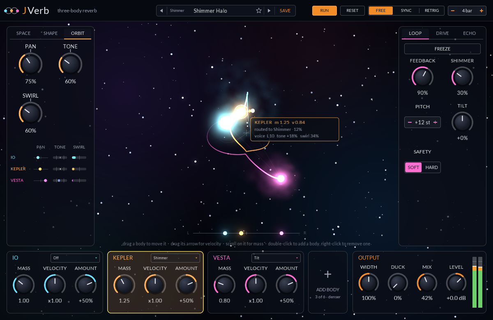
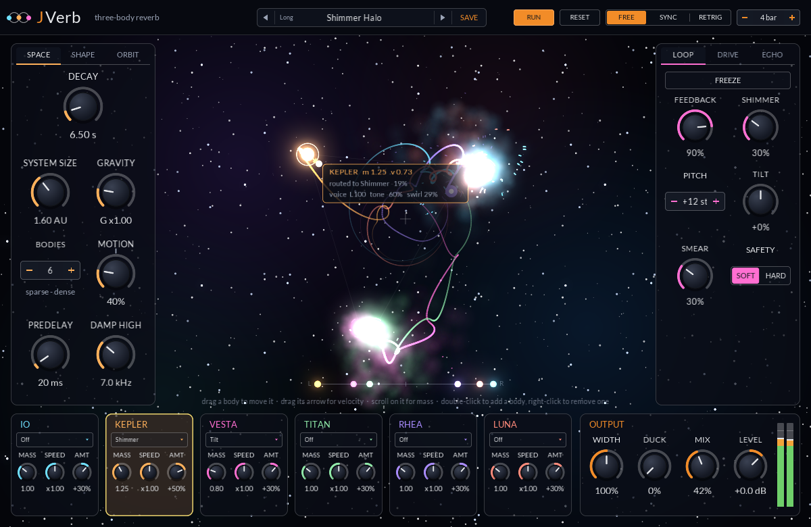

<div align="center">

# JVerb

A reverb whose tail is moved by a live three-body gravity simulation, each body its own voice in it,
with a long echo, a drive you can loop into the tail, and presets.

[](https://github.com/jeffmhopkins/Jclap/actions/workflows/build.yml) [](../../CMakeLists.txt) [](https://github.com/free-audio/clap) [](../../libs/dsp) [](https://github.com/VitalAudio/visage)

</div>


## How it sounds the way it does

The tail comes from sixteen delay lines, 29 to 202 ms at System Size 1, each with two allpasses
inside it and all mixed into each other every pass, so a sound smears into a dense wash within about
150 ms, and decays run up to a minute. Each line drifts slowly on its
own, which blurs the resonances the way a chorus would, but never by more than 4 cents a pass (up to
Motion 100%), so the tail never sounds pitchy. The bodies share out the lines, and each body's share
leaves through its own voice, so the tail swirls around the stereo field as the orbit turns. Three
bodies (the default) start on a figure-eight that slowly turns chaotic; add more, up to six, and the
movement gets busier.

```
in -> low/high cut -> [drive PRE] -> [echo INTO] -> predelay + early reflections
   -> diffusion -> attack (swell, or reverse windows)
   -> tank: 16 lines, each with a slow drift and two allpasses, Hadamard mix, bass and high damping
   -> outer loop (taken before the voices): [drive LOOP] -> shimmer -> smear -> tilt -> feedback
      -> [echo LOOP] -> safety -> back in
   -> body voices: band, pan, tone, swirl
   -> early/late -> [drive POST] -> [echo AFTER] -> duck, width, mix, level -> out
```

- **Space**: Decay (RT60), System Size (scales every line and the early reflections), Gravity (how
  fast and tight the orbits run), Bodies, Motion (how far the lines drift), Predelay and Damp High.
  **Shape** has Attack, Diffusion, Early/Late, the bass multiplier and crossover, the input cuts and
  React.
- **Orbit**: each body's voice narrows to its own band of the spectrum (log-spaced from 150 Hz to
  6 kHz, body 1 lowest). Pan moves the voices from a wide spread to where each body is, Tone darkens a
  voice as its body swings out and brightens it near the centre, and Swirl sets how deep each voice's
  four-stage phaser goes, swept twice a lap by its orbit. None of them bend pitch.
- **Past 100%**: Motion, Pan, Tone and Swirl run to 200% for the weird stuff, with a tick on the knob
  where it starts. Motion grows the drift to 150 cents a pass and up to four times faster, so with
  Feedback high the tail warbles and groans. Pan throws the voices to the edges and turns their stereo
  inside out, Tone cuts or boosts hard and swings the damping, and Swirl feeds the phasers back until
  they ring. The outer loop takes the tank before the voices, so none of this is fed back.
- **Bodies**: each has Mass and Velocity, which change the orbit itself, and a Target with an Amount.
  A body's modulation signal comes from its speed against the others and how close its nearest
  neighbour is, and goes to Decay, Damping, Diffusion, Early/Late, Drive, Shimmer, Feedback, Tilt or
  Width. Bodies start routed to Off. A routed body's movement shows on its target knob's modulation
  ring.
- **Loop**: Feedback sends the tank's output back to its input; past 100% it grows into the safety
  stage (soft saturation or a hard clip). Shimmer pitch shifts the loop, Smear blurs it, Tilt colours
  it, Freeze holds the tail forever.
- **Drive**: Tape, Tube, Fuzz, Fold or Crush, oversampled 2x, in the PRE, LOOP or POST slot.
- **Echo**: up to four seconds, free in milliseconds or synced to a note value, with feedback, tone and
  ping-pong. INTO puts the repeats into the reverb, LOOP sends echoes of the tail back into the tank
  so it returns in long passes, AFTER echoes the reverb itself. Changing the time bends the repeats
  like a tape machine.

[ARCHITECTURE.md](ARCHITECTURE.md) walks through all of it from the code: the signal flow, the tank,
the voices, the loop, every parameter with its range, the 0-100% and 100-200% zones, how the bodies
move the sound, and the presets.

## The orbit view

Drag a body to move it, drag the arrow on the selected body to set its velocity, scroll on a body to
change its mass (heavier bodies are drawn bigger). Double-click empty space to add a body there,
right-click a body to remove one. Clicking a body's card at the bottom selects it too. The selected
body's readout shows its voice and where it is routed.

Each body shows what its voice is doing: a bright voice burns whiter and wider and a dark one deeper,
and arcs spin around the body faster the harder its phaser sweeps. A strip under the stage places each
voice left to right. The ORBIT page lists every voice with its place, its tone and its swirl:



Each transient in the input blows a shell of soft gas out of the bodies that follow its band (lows
go to bodies 1 and 4, mids to 2 and 5, highs to 3 and 6). It billows out, drifts on a slow swirl and
falls back toward them. Where two bodies' clouds meet they push each other apart, and the seam heats
up and glows whiter. Each band (lows, mids, highs) also makes its bodies glow and spark dust, which
falls through the system's gravity. React also kicks the bodies on transients, so the input changes
the orbit itself and through it the sound.

The clock runs the orbits free, synced (one lap of the start orbit fits into Sync Bars, restarting
when the host starts), or free but restarted with the transport (RETRIG).

## Presets

The preset bar in the header steps through the factory bank, ordered from short rooms to washes
that ring for most of a minute (Short, Medium, Long, Washes), and your own. SAVE names the current settings and writes them to:

- macOS: `~/Library/Application Support/JVerb/Presets`
- Windows: `%APPDATA%\JVerb\Presets`
- Linux: `$XDG_CONFIG_HOME/JVerb/Presets` (or `~/.config/JVerb/Presets`)

Each is a small text file, `.jvpreset`, listing the params that differ from their defaults. The
preset's name is saved with the project.

## Threads

The audio thread owns the simulation and the reverb. Every 32 samples it steps the orbits and
updates the network, so a render comes out the same at any block size. A few hundred times a second
it publishes a frame (positions, band levels, transients) through a triple buffer; the panel reads
the newest one when it draws, about 60 times a second, and keeps the trails, gas and dust to itself.
Drags go back through a lock-free queue. Neither side ever waits for the other, and nothing on the
audio thread allocates after activate.

## Panel

1200 x 780, scalable. Renders for the docs come from `jverb-screenshot out.png [bodies [page]]` (page 0
SPACE, 1 SHAPE, 2 ORBIT), which runs the orbits with a made-up drum and pad input. With
`-DJCLAP_BUILD_TOOLS=ON`, `ctest` checks all three renders in `docs/`:


