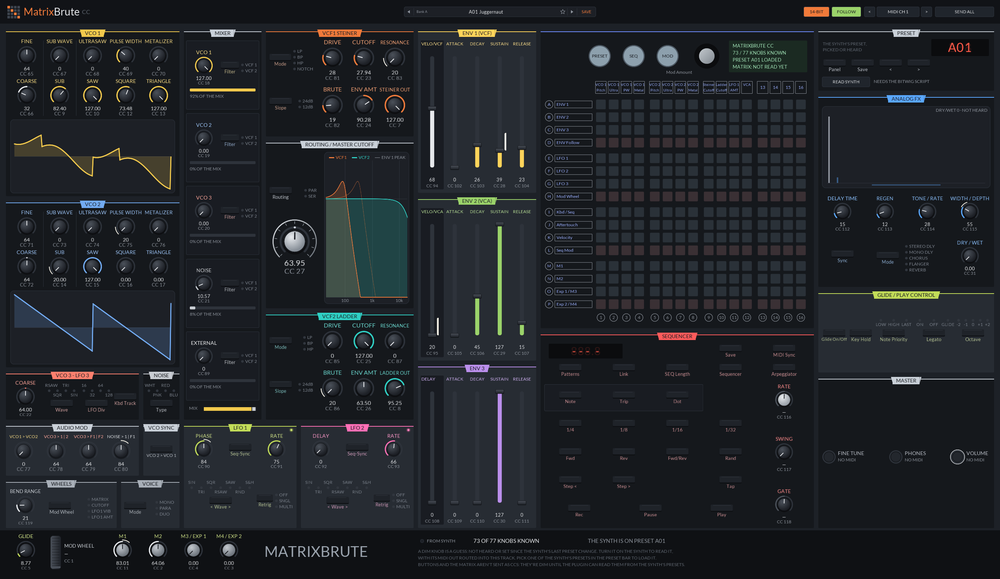

# MatrixBrute CC

A two-way knob panel for the Arturia MatrixBrute: every parameter it takes over MIDI CC, and knobs that follow the synth's own.

   

A CLAP note effect for the Arturia MatrixBrute. Every sound parameter the synth accepts over MIDI CC
is a host parameter, so it can be automated or modulated, and each change goes out to the synth as a
CC. Notes and other MIDI pass straight through.

The MatrixBrute also sends its knobs and sliders as CCs. Route its MIDI out into the plugin's track
and the panel follows the hardware: turn the synth's cutoff and the plugin's cutoff turns with it,
and the host can record the move as automation.

## Using it in Bitwig

1. Put **MatrixBrute CC** on the track that plays the MatrixBrute, before the hardware instrument
   (or HW Instrument) device that sends MIDI to the synth.
2. Set the track's input to the MatrixBrute (USB or 5-pin), so its keys and knobs reach the plugin.
3. Set the panel's **MIDI CH** to the synth's MIDI channel.
4. On the synth, turn **Local** off (Settings row P, or MIDI Control Center). Its keys and knobs then
   reach its sound engine only through the plugin, so what the host records is what you hear, and
   nothing plays twice.
5. Turn knobs on either side, automate them, or drop Bitwig modulators on them. Modulation is added
   on top of the knob's setting, and the number under the knob is the value actually sent.

> [!TIP]
> Leave the synth's MIDI param send and receive on (Settings row E). Its pot mode (Hook, Jump or
> Scaled) decides when a hardware knob starts sending after a preset change.

## The synth's presets

The preset bar lists the synth's own presets, A01 to P16, filed by bank. Picking one:

- sends Bank Select (CC 0 = bank, 0-15 for A-P) and Program Change (0-15 for slot 01-16) on the
  panel's MIDI channel, so the synth loads it;
- moves every knob to that preset's value without sending it, since the synth already has it. Turning
  a knob afterwards sends it as usual.

> [!IMPORTANT]
> The synth ignores Program Changes until its **Program Change** setting is on: in MIDI Control
> Center, open the MatrixBrute's Device Settings and turn it on.

A preset stores 73 of the panel's knobs. The sequencer's rate, swing and gate and the mod wheel aren't
part of a preset, so they stay where they are. The buttons and the matrix are in the preset too, but
they aren't CCs and where they sit in the preset data isn't mapped yet, so the panel draws them dim.

> [!NOTE]
> Arturia hasn't published the preset format. The bank here is the 158 named presets read off a real
> unit the way MIDI Control Center reads them (`tools/mb_dump.py`, raw replies in `data/dump`), which
> is the factory bank plus whatever its owner saved. `tools/mb_bank.py` decodes it into
> `src/factory_bank.inc` and checks the decoding against `data/calib`: one scratch slot read back
> after `tools/mb_calibrate.py` set every CC to a known pattern and the panel was saved there. The
> protocol and the format are written up in the two scripts, and [docs/capture.md](docs/capture.md)
> is how the USB capture of MIDI Control Center was made.
>
> To build your own synth's presets in: close MIDI Control Center, run `python tools/mb_dump.py data/dump`
> with the synth on USB, then `python tools/mb_bank.py data/dump src/factory_bank.inc` and rebuild.

### Reading them off the synth (Bitwig)

**READ SYNTH** (in the PRESET section) reads every preset stored on the synth, which takes about a
minute, and lists those in the preset bar in place of the built-in bank. A plugin can't send or
receive SysEx in Bitwig, so a controller script does the reading:

1. Copy [bitwig/MatrixBrute.control.js](bitwig/MatrixBrute.control.js) to
   `Documents/Bitwig Studio/Controller Scripts/`.
2. In Bitwig's Settings > Controllers, add **Arturia > MatrixBrute presets** with **MatrixBrute** as
   its input and output. Bitwig gives a MIDI port to one controller only, so remove any generic
   controller on that port: this one passes the synth's keys and knobs on to tracks instead. Set the
   MatrixBrute track's input to it.
3. Press **READ SYNTH** in the plugin (or Read in the controller's panel). The status next to the
   button counts the presets as they come in.

The script serves the presets by OSC on UDP port 58017 of this computer (answering on ports
58018-58025, where the plugin and the log tool listen), which is how the plugin
gets them; the last read stays there until Bitwig closes, and a plugin opened later picks it up. It only sends read requests
to the synth, the same ones MIDI Control Center uses to read presets. `tools/mb_bitwig_log.py`
follows its log, for checking a read without the script console. The synth's second USB port
(MIDIIN2/MIDIOUT2) answers the identity request but not preset reads, so the script needs the main
one.

## What the plugin knows

The synth doesn't say what its knobs are set to: it only sends a knob when it moves. So the panel
draws a knob dim, with a dash for its value, until it knows it, which is when:

- the plugin sent it (a panel edit, automation, modulation, a saved project or SEND ALL),
- the plugin loaded one of the synth's presets, or
- the synth sent it (its own knob moved, or a controller on the track did).

When a Program Change comes in on the channel the synth has loaded another preset, so every knob goes
dim again. (The synth only sends one with its Program Change setting on.) The bottom strip shows how many knobs are known and the last
preset change heard. **FOLLOW** off keeps the knobs where they are; incoming CCs still pass through to
the synth and the plugin doesn't push its own value back over them.

> [!NOTE]
> The buttons (filter modes, LFO waves, routing...) and the matrix's routing aren't sent as CCs, so the
> plugin can't show or change them, and the panel leaves them out.

## How it sends

> [!NOTE]
> A CC is only sent once its knob has been set (by you, automation, modulation or the synth). Inserting
> the plugin never overwrites the synth's current sound with the plugin's defaults.

- Saved projects remember which knobs were set and send them again when the project opens.
  **SEND ALL** pushes every knob's value to the synth now. A knob never set sends its default, which
  is an init patch rather than all zeros: VCO 1's saw into the mixer, both cutoffs and the sustains
  open, the filter outs at 100 and centered knobs at 64.
- Modulation sends each CC at most every 5 ms, so a fast modulator can't flood 5-pin MIDI. The
  latest value always goes out.
- **14-BIT** sends the fine byte of the 7/14-bit controls (CC 1-31) as well, 32 above the CC (Steiner
  cutoff is 23 and 55). Turn the synth's **Enable 14-bit automation** (Settings row E) on to match.
  The manual marks those controls 14-bit but doesn't name the fine CC; CC + 32 is the MIDI standard.
  Incoming fine bytes are always read.
- Values are 0 to 127 (two decimals with 14-bit on). The manual doesn't say how each CC maps to ms,
  Hz or semitones, so the panel shows the raw value.

## CC map

From the *MatrixBrute manual v2.0.3*, section 7.1. The full list is in [docs/cc-map.csv](docs/cc-map.csv).

| Section | Parameters (CC) |
|---|---|
| VCO 1 | Sub 9, Saw 10, Square 12, Tri 13, Coarse 66, Fine 65, Wave select 67, Ultrasaw 68, PW 69, Metalizer 70 |
| VCO 2 | Sub 14, Saw 15, Square 16, Tri 17, Coarse 72, Fine 71, Wave select 73, Ultrasaw 74, PW 75, Metalizer 76 |
| VCO 3 / LFO 3 | Coarse 22 |
| Audio Mod | VCO1>VCO2 77, VCO1<VCO3>VCO2 78, VCF1<VCO3>VCF2 79, VCO1<Noise>VCF1 80 |
| Mixer | VCO 1 18, VCO 2 19, VCO 3 20, Noise 21, External 89 |
| Steiner filter | Cutoff 23, Resonance 83, Brute factor 82, Drive 81, Env 1 amount 24, Out 7 |
| Ladder filter | Cutoff 25, Resonance 87, Brute factor 86, Drive 85, Env 1 amount 26, Out 8 |
| Master | Cutoff 27 |
| Envelopes | ENV 1 A/D/S/R 102/103/28/104, Velo 94 · ENV 2 105/106/29/107, Velo 95 · ENV 3 Delay/A/D/S/R 108/109/110/30/111 |
| LFOs | LFO 1 Rate 91, Phase 90 · LFO 2 Rate 93, Delay 92 |
| Analog FX | Time 112, Regen 113, Tone/Rate 114, Width/Depth 115, Dry/Wet 31 |
| Sequencer | Rate 116, Swing 117, Gate 118 |
| Performance | Mod wheel 1, Glide 5, Bend range 119, Macros M1 11, M2 2, M3 4, M4 3 |

The sustain pedal (64) is left out; it passes through.

## Panel

Built from the shared [jclap::ui](../../libs/ui) widgets, which draw with Visage. `src/editor.cpp`
holds the layout and `src/visuals.h` the pictures. It follows the synth's panel in six columns: VCO 1
and 2 (enhancers above the wave levels, the wave mix drawn tall under them), VCO 3 and noise, audio
mod and VCO sync, the wheels and voice down the left; the mixer (each row a level knob, its Filter
button and lights, and a meter of its share of the mix) and the Steiner and ladder filters with the
routing and the big silver Master Cutoff between them, over LFO 1 and LFO 2 side by side, mirror
images of each other; the three envelopes' sliders; the 16 x 16 matrix as a square block with
square pads, the sequencer under it; and the preset display with the read from the synth, the
analog effects, glide and play control, and master (fine tune, phones and volume, drawn but
not on MIDI) on the right. Along the bottom, like the synth's front edge, are glide, the mod wheel,
the macros and what the plugin knows. Each box's title tab and top rule are in its accent (the
filters' orange and teal, the envelopes' yellow, green and purple, the matrix's blue, and so on, with
silver for the boxes that route or hold the rest), and its controls are named in a light tint of it;
the mixer and audio mod name each source in that source's colour. Values and CC numbers stay grey
and white. The synth's buttons, lights and matrix aren't on MIDI, so they're drawn as dim
indicators until you load a preset read off the synth (READ SYNTH): then every button's light, the
routed matrix cells and both LFOs' custom shapes show how that preset has them. The preset layout
comes from the [Matrixbrute Patch Viewer](https://github.com/MatrixbrutePatchViewer/MBPV), checked
against button presses read back off a real unit.

The preset display shows the synth's preset: the one picked in the preset bar, or the last Bank
Select and Program Change heard. The pictures are drawn from the CC values: each VCO's wave mix, the
two filters' responses (low-pass guides) and the effect's echoes. The envelopes are just their
sliders, as on the synth.

Drag a knob or slider up or down (shift for fine), use the mouse wheel for single steps, double-click
to reset. Right-click a control to reset it, type a value, or reach the host's menu for that
parameter; right-click the background to pick a UI size.

> [!TIP]
> To regenerate `docs/panel.png`, configure with `-DJCLAP_BUILD_TOOLS=ON` and run
> `build/plugins/matrixbrute/matrixbrute-screenshot plugins/matrixbrute/docs/panel.png`. With tools
> on, `ctest` checks the panel still renders like that image.
