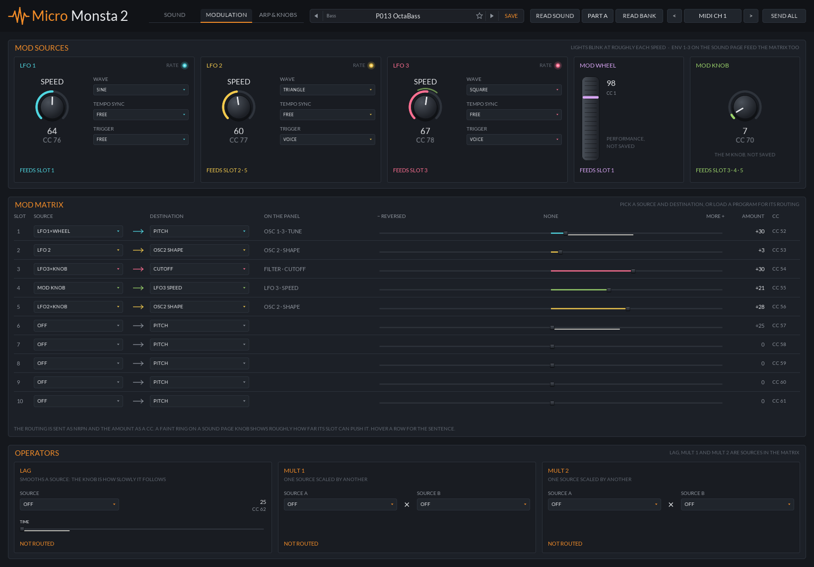
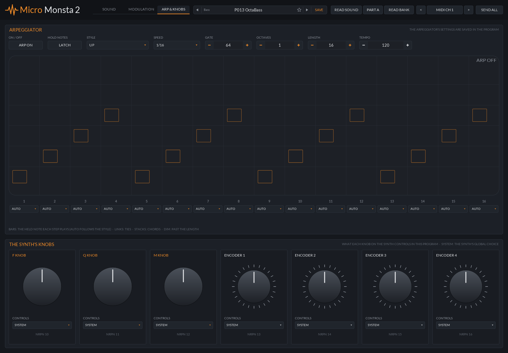

# MicroMonsta 2 CC

A full panel for the Audiothingies MicroMonsta 2: every sound parameter, sent as MIDI CC or NRPN.

   

A CLAP note effect for the Audiothingies MicroMonsta 2. Every sound parameter the
synth accepts over MIDI CC is a host parameter, so it can be automated or modulated, and each change goes
out to the synth as a CC. The program settings no CC reaches (the mod matrix routing, oscillator
algorithms, filter type, LFO waves and sync, voice and effect modes, the arpeggiator and more) are
host parameters too, sent as NRPN. Notes and other MIDI pass straight through.

## Using it in Bitwig

1. Put **MicroMonsta 2 CC** on the track that plays the MicroMonsta 2, before the hardware instrument
   (or HW Instrument) device that sends MIDI to the synth.
2. Set the panel's **MIDI CH** to the synth's MIDI channel (SYSTEM page S02).
3. Turn knobs, automate them, or drop Bitwig modulators on them. Modulation is added on top of the
   knob's setting: the knob stays where you put it, a thin white arc shows how far the modulator moves
   it, and the number under the knob is the value actually sent.

> [!TIP]
> In bi-timbral mode Program B listens on the MIDI channel + 1, so use a second instance for it.

## Programs

The bar at the top lists the programs stored on the synth, by slot and category ("P013 OctaBass").
Picking one:

- sends Bank Select (CC 0 = 0, CC 32 = 0-2) and Program Change (0-99) on the panel's MIDI channel, so
  the synth loads that program (P001-P100 are bank 0, P101-P200 bank 1, P201-P300 bank 2);
- moves every knob to that program's value without sending it, since the synth already has it. Turning
  a knob afterwards sends it as usual. Mod wheel, mod knob and volume aren't part of a program and stay
  where they are;
- fills in the mod matrix table with the program's routing in plain English: each slot's source
  ("LFO 2", "LFO1×Wheel" for LFO 1 scaled by the mod wheel), what it modulates ("CUTOFF", "RELEASES"
  for all three envelopes) and where that is on the panel. Slots with no source or destination say
  OFF. Hovering a slot's amount says it in a sentence: "Mod slot 1: LFO 2 modulates the pitch of all
  oscillators. The slider sets how much: none at the centre, reversed below it (CC 52)." A knob a slot
  is aimed at gets a faint ring in the source's colour, roughly as far as that slot's amount can push
  it. Each LFO, the mod wheel and the mod knob say which slots they feed;
- renames the mod matrix parameters in the host to match, so automation lanes read "Mod 1: LFO 2 →
  Pitch" instead of "Mod Matrix 1".

CCs can only change a slot's amount, so the routing stays until another program is picked. The names
follow the manual's description of each source and destination (sections 6.8.4 and 6.8.5).

The project remembers the program and sends its Program Change again when it opens. **SAVE** stores the
knobs as your own preset (under "User"), which sends its CCs when loaded and doesn't change the program.
The star beside the preset name marks it a favorite, and **Favorites** at the top of the name menu
lists them; they're shared by every instance and kept between sessions.

> [!NOTE]
> Audiothingies hasn't published the factory bank or the SysEx program format. The bank here is the 209
> named programs from a full dump of a real unit (`data/bank.syx`, UTILITY U02), which is the factory
> bank plus a few programs its owner saved. `tools/mm2_bank.py` decodes it into `src/factory_bank.inc`
> and checks the decoding against `data/cal-*.syx`: single-program dumps taken after
> `tools/mm2_capture.py` set every CC to a known pattern. Tune, fine tune, cutoff and the ±99 amounts are
> stored in their own ranges, so the panel shows the CC value that gives the stored value.
>
> To use your own synth's bank: run `python tools/mm2_capture.py data` with the synth on USB (it walks
> you through the U02 and U01 dumps), then `python tools/mm2_bank.py data/bank.syx src/factory_bank.inc`
> and rebuild.

### Reading the synth (Bitwig)

A plugin can't send or receive SysEx in Bitwig, so a controller script talks to the synth for it:

1. Copy [bitwig/MicroMonsta2.control.js](bitwig/MicroMonsta2.control.js) to
   `Documents/Bitwig Studio/Controller Scripts/`.
2. In Bitwig's Settings > Controllers, add **Audiothingies > MicroMonsta 2 programs** with the
   MicroMonsta 2's USB port as its input and output. Bitwig gives a MIDI port to one controller only,
   so remove any generic controller on that port: this one passes the synth's keys and knobs on to
   tracks instead. Set the MicroMonsta 2 track's input to it.

Then, in the header:

- **READ SOUND** reads the sound on the part beside it (**PART A** or **PART B**) into the panel: every
  knob and the mod matrix routing, edits you haven't saved included. Nothing is sent to the synth, and
  the preset bar names the program it came from when the name matches one. It needs firmware 2.7 or
  later, which answers the request; a project saved afterwards sends those knobs again when it opens.
- **READ BANK** lists the programs stored on the synth in the preset bar, in place of the built-in
  bank. The synth only sends them from its own panel, so the line under the header says what to do:
  **UTILITY > U02**, choose every program (from P001, so they're numbered right), then hold **Yes**.
  The line counts them as they come in. The script keeps the last bank until Bitwig closes, and a
  panel opened later picks it up.

The script serves the programs on `localhost:58018`. The one message it sends the synth is the sound
request (`F0 00 21 22 4D 02 41 F7` for part A, `42` for part B), which the
[Monstaguru](https://monstaguru.com/) librarian uses too; nothing on the synth is changed or stored.

## How it sends

> [!NOTE]
> A CC is only sent once its knob has been set (by you, automation or modulation). Inserting the
> plugin never overwrites the synth's current sound with the plugin's defaults.

- Saved projects remember which knobs were set and send them again when the project opens.
  **SEND ALL** pushes every knob's value to the synth now. A knob never set sends its default, which
  is an init patch rather than all zeros: Volume 100, Osc1 Level, Cutoff and the env sustains at 127,
  the LFO speeds and centered knobs at 64, and the rest at 0. Resetting a knob to its default sends
  the same value.
- Modulation sends each CC at most every 5 ms, so a fast modulator can't flood 5-pin MIDI. The
  latest value always goes out.
- A CC from your controller that passes through on the synth's channel counts as sent: the plugin
  doesn't push its knob back over it until you move that knob.
- Values are plain 0 to 127. The manual doesn't say how each CC maps to ms, Hz or semitones, so the
  panel shows the raw value. Tune, fine tune, filter env amount, EQ and the mod matrix amounts are drawn
  as centered (64 = middle).

> [!WARNING]
> The manual lists no MIDI out jack and doesn't say the synth sends CCs, so the panel doesn't follow
> the synth's own knobs.

## CC map

From the *MicroMonsta 2 User manual v2.8*, section 7.1. The full list is in
[docs/cc-map.csv](docs/cc-map.csv).

| Section | Parameters (CC) |
|---|---|
| Oscillators | Osc1 Shape 39, Tune 40, Fine 41 · Osc2 42-44 · Osc3 45-47 |
| Mix | Osc1 48, Osc2 49, Osc3 50, Noise 51 |
| Filter | Cutoff 74, Resonance 71, Env Amount 88, Tracking 89, FM 90 |
| Envelopes | Env1 A/D/S/R 73/75/79/72 · Env2 80-83 · Env3 84-87 |
| LFO | Speed 76, 77, 78 |
| Mod Matrix | Levels 1-10 52-61, Lag 1 62 |
| Effects | Delay Time 26, Feedback 27, Level 28 · Reverb Decay 29, Mod 30, Level 31 · EQ 25 |
| Voice | Glide 5, Detune 33, Osc Detune 34, Drive 91, Pan Spread 35, VCA/Filter Env Velocity 36/37 |
| Performance | Mod Wheel 1, Mod Knob 70, Volume 7 |

Bank select (0/32), sustain (64) and All Sound/Notes Off (120/123) are left out.

## Settings (NRPN)

The synth stores 84 settings in a program that no CC reaches. The plugin sends them as NRPN on the
panel's channel (CC 99 = NRPN >> 7, CC 98 = NRPN & 127, CC 6 = the value, and CC 38 = its low 7 bits
for the 14-bit ones), the same way the Monstaguru editor sends its live edits. The numbers, ranges and
dump bytes come from that editor, and the full list is in `src/settings.h`.

| Group | Settings (NRPN) |
|---|---|
| Oscillators | Osc1/2/3 algorithm 27/31/35 (wavetables on 2 and 3), phase reset 124 |
| Filter | Type 125, character 126 |
| Envelopes | Env1/2/3 reset to zero 120-122 |
| LFOs | Wave 61/64/67, tempo sync 62/65/68, trigger 63/66/69 |
| Mod matrix | Slot 1-10 source and destination 70-98, lag source 100, mult 1 and 2 sources 102-105 |
| Voice | Voice mode 117, unison 118, pan spread mode 119, bend down 23 and up 24 |
| Effects | Chorus mode 127, delay mode 128, delay sync 108 |
| Arpeggiator | On 130, latch 131, style 114, speed 116, gate 115, octaves 132, length 133, steps 1-16 134-149 |
| Program | Tempo 18, volume 17, category 9, F/Q/M knobs and encoders 1-4 10-16 |

- As with the CCs, a setting only goes out once something has set it. After a Program Change or a
  sound read off the synth, the program's settings count as sent.
- A tempo sync (LFO or delay) overrides its speed knob on the synth. Setting it back to FREE sends the
  speed knob's CC again.
- Programs from the built-in bank, READ BANK and READ SOUND bring their settings, so the panel shows
  the program's routing, modes and arp pattern.

> [!NOTE]
> These were checked against the Monstaguru editor's code and the factory bank, not yet on a synth.

## Panel

Built from the shared [jclap::ui](../../libs/ui) widgets, which draw with Visage. `src/editor.cpp`
holds the layout and `src/visuals.h` the pictures. The tabs in the header pick one of three pages:

- **Sound** reads top to bottom like the synth. First the audio path: sources (three oscillators with
  their algorithms and levels, noise and osc detune), filter (with its type and character), voice,
  effects and out. Then the three envelopes: drag a corner, or drag or type in the A/D/S/R boxes under
  each. Every stage keeps a minimum width, so a zero attack or decay still leaves each corner grabbable.
  Last, the voice mode, unison, bend range, effect modes and the program's tempo, volume and category.
- **Modulation:** the three LFOs (speed, wave, tempo sync and trigger), the mod wheel and mod knob,
  the mod matrix table with each slot's source and destination, and the lag and multiply operators.
- **Arp & knobs:** the arpeggiator's settings and its 16 steps, drawn as a small piano roll, and what
  the synth's own F, Q and M knobs and four encoders control in the program.

The pictures are drawn only from the CC values and the program's routing, since the plugin can't hear
the synth: a lowpass filter response (a guide, whatever the filter type), delay echoes from time
and feedback, a reverb tail from decay, the EQ tilt, the pan spread and the mix. The delay and reverb
pictures dim when their level is 0. The LFO lights blink at a guess of each speed.

Drag a knob up or down (shift for fine), use the mouse wheel for single steps, double-click to reset.
Right-click a knob to reset it, type a value, or reach the host's menu for that parameter;
right-click the background to pick a UI size. The window can be resized and keeps its shape.

> [!TIP]
> To regenerate `docs/panel.png`, configure with `-DJCLAP_BUILD_TOOLS=ON` and run
> `build/plugins/micromonsta2/micromonsta2-screenshot plugins/micromonsta2/docs/panel.png`. Add
> `1640 1142 1` or `1640 1142 2` for the other pages (`panel-modulation.png`, `panel-arp.png`). With
> tools on, `ctest` checks the pages still render like those images.
