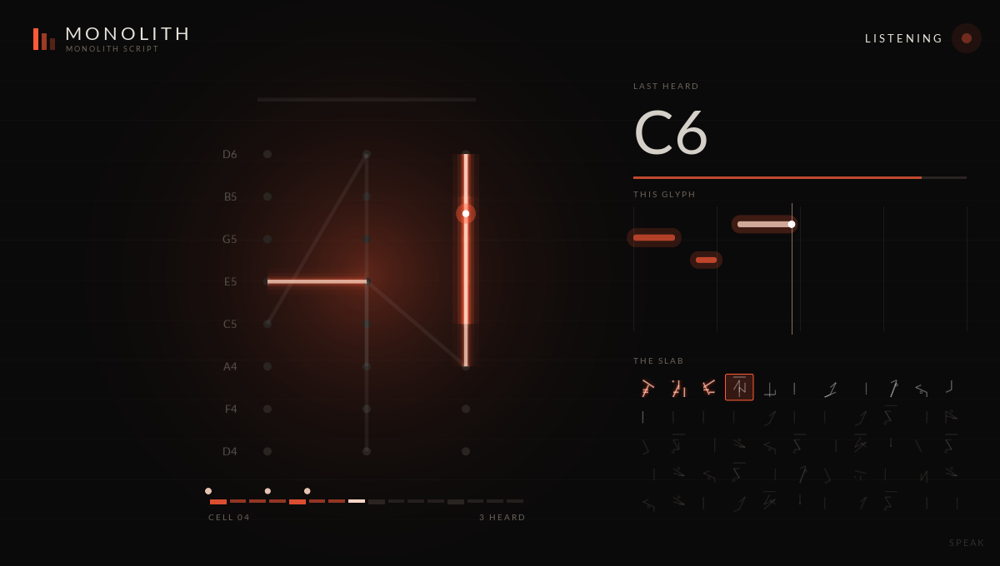

# Monolith

A note generator that reads a slab of alien glyphs out as MIDI phrases.

  

A CLAP note effect. A scribe writes 55 glyphs onto a stone slab in a made-up script, and a voice reads
them out as notes, one glyph per sixteen steps, in time with the host. A short, locked slab is a loop
that repeats exactly; a long one that drifts and erodes is a phrase that keeps changing a glyph at a
time. Put it before any instrument.

## How a glyph reads

A glyph is one to six strokes drawn between the 24 nodes of a 3 x 8 grid. Each stroke is a note:

| | |
|---|---|
| Start node's row | Pitch: the eight rows play eight notes of the scale, top row highest |
| Start node's column | Velocity: soft, medium, hard from left to right |
| Stroke length | Duration: a step and a half per grid unit (a column apart), rounded |
| Stroke order | Rhythm: notes play back to back in the order drawn |
| Same start node | Chord: a stroke that starts where the last one started plays with it |
| Dot | A soft one-step ghost note after the strokes |
| Overbar | The last note holds to the end of the glyph |

The decode view shows the glyph being read (or the one you click) large, with its strokes numbered
in playing order and the notes they read as.

## Scripts

**SCRIPT** picks the orthography the scribe writes in. Each draws strokes its own way and allows only
certain shapes, which gives it a feel: Monolith allows anything; Runic writes upright staves and
short branches; Circuit runs along the grid only; Halo writes around rings and along spokes; Cuneiform
presses short wedges between nearby nodes. A stroke plays the same in any script (lengths are
always measured on the grid), so switching scripts changes the language, not the decoder.

## From a one-bar loop to 32 bars

- **LENGTH** is how many glyphs are read before the voice goes round again. At 1/16 a glyph is one bar,
  so 1, 2, 4, 8, 16 and 32 are the knob's stops (55 reads the whole slab). It starts at 2.
- **START** is the first glyph read: the voice reads LENGTH glyphs from there, going round the slab's
  end if it has to. Click a glyph to start there, or drag across glyphs to read just those. START has
  no knob, but the host can automate and modulate it, so a phrase can walk across the slab.
- **LOCK** holds the slab still. With it on, the phrase repeats exactly.
- **DRIFT** is the chance the scribe rewrites a glyph after it's read, and **ERODE** the chance it
  loses a stroke instead. **RESTORE** brings eroded strokes back.
- **RATE** sets the step: 1/32 to 1/4, triplets included. **DIRECTION** reads forward, in reverse,
  ping-pong or at random (the same random order each time round).

## Density and complexity

- **DENSITY** is the strokes per glyph, so notes per glyph.
- **LEXICON** is how many words the scribe knows. With few, the phrase keeps coming back to the same
  shapes; with many, it keeps saying something new.
- **GRAMMAR** is how freely words follow one another. Each word has two favourite successors; low
  grammar keeps to them, high grammar wanders and bends the words themselves.
- **SEED** chooses the script's words. The same settings and seed always write the same slab;
  **REROLL** picks a new seed.

## Playing with it

- Click a glyph to start reading there: the voice reads it next, and the decode view shows it (click
  it again to follow the voice). Drag across glyphs to read just those: the drag sets START and
  LENGTH to the span. Alt-click to read a glyph next without moving the start. Shift-click to have
  the scribe write that one again.
- In the decode view, drag from node to node to carve a stroke, and right-click a stroke to wipe it.
- **ROOT**, **SCALE**, **SPREAD** and **OCTAVE** set what the eight rows play (A Aeolian, the natural
  minor, by default). The root is on the third row up, and SPREAD is how far apart the rows are in
  the scale: STEPS spans about an octave, THIRDS (the default) two, FOURTHS three and FIFTHS four. Projects saved before glyphs had eight
  rows load with their glyphs' shapes kept.
- **RANGE** and **PATH** take the phrase through more octaves without spreading the rows apart.
  RANGE is how many octaves it moves through, upward from OCTAVE (1, the default, stays put). PATH is
  how it moves: LOOP goes up an octave each time round the glyphs read and back down, like an
  arpeggiator's octave range; CLIMB wanders up or down an octave a glyph at a time; CONTOUR arches
  over the glyphs read, low at the ends and highest in the middle. Each note takes whichever octave
  is nearest the note before it, pulled toward where the path is heading, so the line changes octave
  where its own leap is shortest and gets there by the glyph's last note.
- **MODE** LISTEN plays nothing: notes you play are carved, a glyph per sixteen steps, into the cell
  being read, written in the current script. Switch back to SPEAK to hear them read back. While it
  listens the panel becomes the stage (below).
- **KEY FOLLOW** makes a held note the root while you hold it. Otherwise played notes pass through.
- **SWING**, **VELOCITY**, **GATE** and **HUMANIZE** shape the output. Humanizing is the same each
  time round, so a locked loop stays a loop.

With no transport (a host that doesn't send one), Monolith keeps its own time at 120 BPM.

## The stage

In LISTEN the controls give way to a display made for capturing on a stream (an OBS window capture,
say). The glyph being carved stands large in the middle, a stroke cut as each note is played, over
the faint glyph it replaces. Beside it are the last note heard, the notes of this glyph so far as
trails of embers, and the whole slab, glowing where it has been carved by what it heard. The light
in the corner beats with the song.

Right-click the stage to pick a UI size that suits the capture. **SPEAK**, faint in the bottom right
corner until the mouse finds it, switches back to the panel; so does switching MODE from the host.

## Presets

The preset bar steps through a factory bank of 50 presets and then your own. Click the name for a
menu of them by category:

| Category | What's in it |
|---|---|
| Loops | Locked slabs from one to eight bars that repeat exactly |
| Bass | Low, short, locked lines in steps, for a groove that holds |
| Arps and Leads | Fast lines over a wide spread, including one that follows the key you hold |
| Evolving | Phrases that drift or erode a glyph at a time, up to the whole 55-glyph slab |
| Rhythmic | Swing, short gates and random order, with the pitch kept close |
| Textures | Slow, sparse or scattered lines for pads and atmospheres |
| Journeys | RANGE and PATH carry the phrase up and down through two to four octaves |
| Listen | Silent until you play: they carve what you play and read it back |

**SAVE** names the current settings and writes them as a small text file:

- macOS: `~/Library/Application Support/Monolith/Presets`
- Windows: `%APPDATA%\Monolith\Presets`
- Linux: `~/.config/Monolith/Presets`

A preset holds the settings, not the slab: the same settings always write the same slab, so a preset
always sounds the same. A slab you have carved, or that has drifted, is saved with the project.

Click the **star** beside the name to make the current preset a favorite (click again to unstar it).
**Favorites** at the top of the name menu lists every starred preset, factory or your own. Favorites
are kept in `Favorites.txt` beside the `Presets` folder, so they last between sessions and every
instance of the plugin shares them.

## Building

Built with the rest of the repo; see the [top-level README](../../README.md). The engine is plain C++
in `src/engine.h` and `src/glyph.h`, tested on its own in `tests/test_engine.cpp`.
