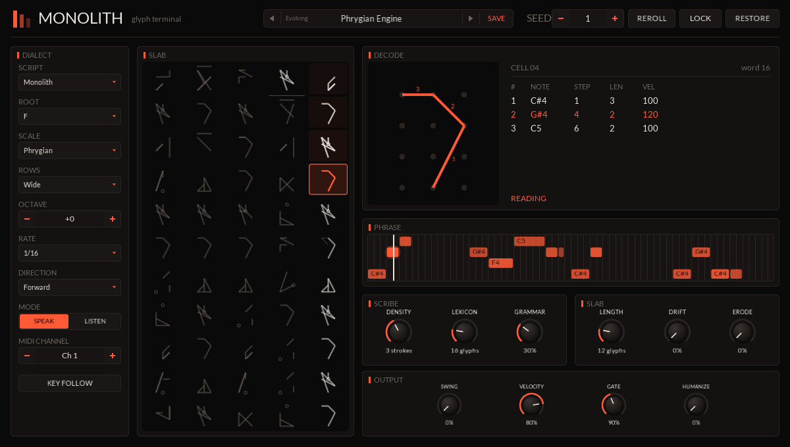
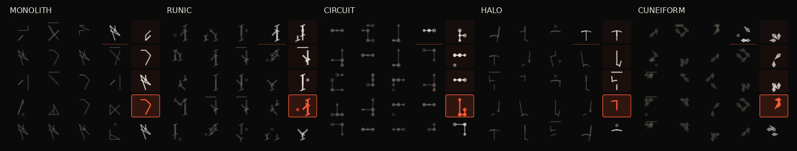

# Monolith

A note generator that reads a slab of alien glyphs out as MIDI phrases.

  

A CLAP note effect. A scribe writes 55 glyphs onto a stone slab in a made-up script, and a voice reads
them out as notes, one glyph per sixteen steps, in time with the host. A short, locked slab is a loop
that repeats exactly; a long one that drifts and erodes is a phrase that keeps changing a glyph at a
time. Put it before any instrument.

## How a glyph reads

A glyph is one to six strokes drawn between the twelve nodes of a 3 x 4 grid. Each stroke is a note:

| | |
|---|---|
| Start node's row | Pitch: the four rows play four notes of the scale, top row highest |
| Start node's column | Velocity: soft, medium, hard from left to right |
| Stroke length | Duration: a step and a half per grid unit, rounded |
| Stroke order | Rhythm: notes play back to back in the order drawn |
| Same start node | Chord: a stroke that starts where the last one started plays with it |
| Dot | A soft one-step ghost note after the strokes |
| Overbar | The last note holds to the end of the glyph |

The decode view shows the glyph being read (or the one you click) large, with its strokes numbered
in playing order and the notes they read as.

## Scripts

**SCRIPT** picks the orthography the scribe writes in. Each draws strokes its own way and allows only
certain shapes, which gives it a feel: Monolith allows anything; Runic writes upright staves and
short branches; Circuit runs along the grid only; Halo writes around rings and along spokes; Cuneiform
presses short wedges between neighbouring nodes. A stroke plays the same in any script (lengths are
always measured on the grid), so switching scripts changes the language, not the decoder.

## From a one-bar loop to 32 bars

- **LENGTH** is how many glyphs are read before the voice goes round again. At 1/16 a glyph is one bar,
  so 1, 2, 4, 8, 16 and 32 are the knob's stops (55 reads the whole slab).
- **LOCK** holds the slab still. With it on, the phrase repeats exactly.
- **DRIFT** is the chance the scribe rewrites a glyph after it's read, and **ERODE** the chance it
  loses a stroke instead. **RESTORE** brings eroded strokes back.
- **RATE** sets the step: 1/32 to 1/4, triplets included. **DIRECTION** reads forward, in reverse,
  ping-pong or at random (the same random order each time round).

## Density and complexity

- **DENSITY** is the strokes per glyph, so notes per glyph.
- **LEXICON** is how many words the scribe knows. With few, the phrase keeps coming back to the same
  shapes; with many, it keeps saying something new.
- **GRAMMAR** is how freely words follow one another. Each word has two favourite successors; low
  grammar keeps to them, high grammar wanders and bends the words themselves.
- **SEED** chooses the script's words. The same settings and seed always write the same slab;
  **REROLL** picks a new seed.

## Playing with it

- Click a glyph to decode it (click it again to follow the voice). Double-click to read it next.
  Shift-click to have the scribe write that one again.
- In the decode view, drag from node to node to carve a stroke, and right-click a stroke to wipe it.
- **ROOT**, **SCALE**, **ROWS** and **OCTAVE** set what the four rows play. Rows WIDE puts the root
  second from the bottom; STACKED is a seventh chord; STEPS four neighbouring notes; OPEN root,
  fifth, octave and ninth.
- **MODE** LISTEN plays nothing: notes you play are carved, a glyph per sixteen steps, into the cell
  being read, written in the current script. Switch back to SPEAK to hear them read back.
- **KEY FOLLOW** makes a held note the root while you hold it. Otherwise played notes pass through.
- **SWING**, **VELOCITY**, **GATE** and **HUMANIZE** shape the output. Humanizing is the same each
  time round, so a locked loop stays a loop.

With no transport (a host that doesn't send one), Monolith keeps its own time at 120 BPM.

## Presets

The preset bar steps through a factory bank (Loops, Evolving, Textures) and your own. **SAVE** names
the current settings and writes them as a small text file:

- macOS: `~/Library/Application Support/Monolith/Presets`
- Windows: `%APPDATA%\Monolith\Presets`
- Linux: `~/.config/Monolith/Presets`

A preset holds the settings, not the slab: the same settings always write the same slab, so a preset
always sounds the same. A slab you have carved, or that has drifted, is saved with the project.

## Building

Built with the rest of the repo; see the [top-level README](../../README.md). The engine is plain C++
in `src/engine.h` and `src/glyph.h`, tested on its own in `tests/test_engine.cpp`.
