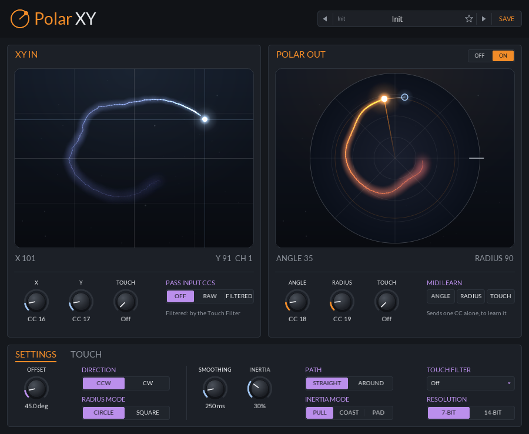

# Polar XY

Turns an XY controller's two CCs into angle and radius CCs for Omnisphere's Orb.

    

A small CLAP note effect. It listens for two MIDI CCs carrying an X/Y position
(Cartesian) and sends out two CCs carrying the same position as an angle and a radius (polar), ready to
MIDI Learn onto Omnisphere's Orb. Built for Bitwig, but any CLAP host with note effects works, and
there is a VST3 build for hosts without CLAP.

## Using it in Bitwig

1. Put **Polar XY** on the Omnisphere track, before Omnisphere.
2. Send your X/Y controller to CC 16 (X) and CC 17 (Y). The plugin swallows those two CCs and emits
   CC 18 (angle) and CC 19 (radius) on the same MIDI channel. Everything else passes through untouched.
3. In Omnisphere, right-click the Orb, choose **MIDI CC Learn**, and move the controller so it learns
   the angle (CC 18). Right-click again, choose **Switch to Radius**, MIDI CC Learn again and it learns
   the radius (CC 19).

> [!TIP]
> While learning, wiggle only along one axis near the edge so the CC you want is the one that changes
> most.

## Using it in Ableton Live (Max for Live)

Live doesn't load CLAPs, and won't put a VST3 in front of an instrument on the same track, so for Live
there is a Max for Live MIDI effect instead: `Polar XY.amxd`, in the `Max for Live` folder of
`jclap-PolarXY-<version>.zip` (and of `jclap-macOS.zip` and `jclap-Windows.zip`) on the release page,
or [m4l/](m4l) here. It needs Live Suite, or Live Standard with Max for Live.

1. Copy the `Polar XY` folder from `Max for Live`, which keeps `Polar XY.amxd` and `polarxy.js`
   together, for example into your User Library (`Presets/MIDI Effects/Max MIDI Effect`).
2. Drag `Polar XY.amxd` onto the Omnisphere track, in front of Omnisphere. No extra track or MIDI
   routing is needed.
3. MIDI Learn the Orb as in Bitwig (step 3 above), using the **ANGLE** and **RADIUS** learn buttons.

It is the same conversion and motion as the plugin, with the same settings, each a Live parameter
you can automate or map. The panel has no XY pad or night skies: a status line shows the last
channel's X/Y in and angle/radius out. The motion steps every 4 ms rather than every 32 samples.

> [!NOTE]
> To make it one self-contained file, open it in the Max editor (the edit button in its title bar)
> and press **Freeze Device**, then save. The device is written by
> [m4l/make_device.py](m4l/make_device.py) from the logic in [m4l/polarxy.js](m4l/polarxy.js);
> `node m4l/test_polarxy.js` runs its tests.

## VST3

`PolarXY.vst3` is the same plugin, wrapped by clap-wrapper. It's in each system's folder of
`jclap-PolarXY-<version>.zip`, and in the `VST3` folder of `jclap-<OS>.zip`, on the release page; see
the [main README](../../README.md#download-and-install) for where it goes.

- It shows up as an instrument (VST3 has no MIDI-effect category), with a MIDI input and output.
- The X/Y CCs reach it the usual VST3 way, as the host's MIDI CC mapping, and the angle and radius
  go out as MIDI CC events, so the host has to pass a plugin's MIDI output on to the next device.
  Ableton Live can't put it in front of an instrument on the same track; use the
  [Max for Live device](#using-it-in-ableton-live-max-for-live) there instead.

## Mapping

- X and Y are 0..127 with 64 as center. Y grows upward.
- **Radius**: 0 at center, 127 at the edge. A square XY pad can reach about 1.41 in the corners; by
  default this is clamped to the unit circle (`Radius Mode = Clamp to circle`). `Fill square` instead
  uses `max(|x|, |y|)` so the whole square edge reaches full radius.
- **Angle**: one full turn in steps of 1/127, so 0..126. 0 is +X (pointing right), increasing
  counter-clockwise. 127 would be a full turn, the same angle as 0, so the wrap goes from 126 to 0.
- Around dead center (within about two CC steps) the angle is undefined, so the plugin holds the last
  angle and sends radius 0. Controller jitter at rest can't swing the Orb across quadrants. Outside
  that the radius starts at 1.
- X and Y arriving at the same moment are one move: only the final point goes out.
- Each MIDI channel has its own position. Output CCs are only sent when their value changes.
- If X and Y In (or Angle and Radius Out) are set to the same CC, nothing is converted and the input
  CCs pass through. The panel shows a warning.

## Motion

By default the Orb jumps to wherever the controller is. **Smoothing** and **Inertia** make it travel
there instead, sending a stream of in-between CCs (one step every 32 samples, only when a value
changes) until it arrives. Each channel moves on its own.

- **Smoothing** is roughly how long the Orb takes to glide to the controller's position.
- **Inertia** gives it weight: the heavier it is, the slower it gets going and the further it swings
  past the target before settling. At 100% it swings for about 5 s; the knob's low end stays light.
  When the controller stops (or you let go of the pad), the Orb doesn't stop with it: it carries on
  the way the controller was going, slowing down (over a couple of seconds at 100%), and bounces off
  the edge. It settles wherever it runs out of speed, and the controller's next move picks it up from
  there. A jump from rest has no speed to carry, so it settles on the spot.
- **Inertia Mode** (INERTIA MODE on the panel) picks how Inertia follows. *Pull*, as above, draws the
  Orb to where the controller is. *Coast* only lets the controller's movement move it: while the
  controller moves, the Orb picks up its speed and direction (slower the heavier it is), and once it
  holds still it has no say at all, so the Orb coasts on, slows to a stop and stays there. Where the
  controller is doesn't matter, only how it's moving, so the Orb can end up anywhere on the pad.
  *Pad* treats the controller like a trackpad, for a touch XY controller used as a chaos pad.
  Touching down doesn't move the Orb, wherever the finger lands; dragging moves it by as much as the
  finger moves, from wherever it is; and letting go mid-drag flings it on, gliding and bouncing off
  the walls, with Inertia setting how far (at 0% it stops where you let go). Touching again catches
  it. A pad that jumps back to the centre when released is fine: any big jump counts as a finger
  landing or lifting, not a drag. With Path on *Around*, dragging across turns the Orb (a full sweep
  of the pad is a full turn) and dragging up and down changes the radius.
- **Motion Path** (PATH on the panel) picks what moves. *Straight* glides across the pad in X/Y, so going from one side to the
  other passes through the centre. *Around* moves the angle and radius on their own, so the Orb travels
  round the circle the short way. The angle keeps counting past a full turn, so stirring the controller
  with some Inertia sets the Orb whirling, and it carries on past where you stop. A radius that swings
  or coasts in past the centre comes out the other side rather than waiting there.

The first position on a channel is jumped to, as there's nowhere to glide from. A reset lands anything
still moving.

## Touch Filter

A resistive XY pad reads its position through the finger's contact, so for a few milliseconds while
the finger presses down and while it lifts off, the contact is light and the readings are wrong: they
skitter toward an edge or the centre, and the Orb jumps there and back. Smoothing hides that by
smearing it into every move. **Touch Filter** (TOUCH FILTER in the SETTINGS section) instead finds the
edges of each touch and throws them away, leaving the rest exactly as it came:

- X and Y that arrive within 3 ms of each other are one reading, so no point made of the new X and the
  old Y goes out.
- A reading that jumps more than the Jump Limit (16 CC steps), or lands somewhere new after a 50 ms
  pause, starts a touch. For its first stretch, the press (the Touch Filter time, unless Press Delay is
  set apart), nothing goes out. Then the latest reading goes out if the last two agree (within Agree,
  4 CC steps), and everything after flows on. A touch that never gets two readings, such as a single
  blip as the finger lifts, never goes out.
- Everything is held back by the Touch Filter time, so when a jump starts a new touch, the readings
  from just before it (the last touch lifting off) are thrown away. The last few milliseconds of a
  drag go with them.

Touch Filter is a time in ms: pick 10, 20, 40, 50 or 60 ms from its menu, or Custom for any time up
to 100 ms. It costs that much latency (plus the press at the start of a touch), but never smears a
move. A slow drag from a controller that only sends when the value changes comes through whole. Use
the shortest time that stops the skitter. The panel's XY pad doesn't go through it.

The panel's **TOUCH** tab (next to SETTINGS at the bottom) tunes it further:

| Control | Default | |
|---|---|---|
| Press Delay | Same | How long a new touch's press is held back; Same follows Touch Filter |
| Jump Limit | 16 steps | How far one reading may move before it waits for a second to agree. It's measured from the last reading and from where the finger was heading (its speed and direction carried on), whichever is nearer, so a fast drag that keeps its course passes, and so does a sharp turn back |
| Agree | 4 steps | How close two readings must be to agree |
| Center | Off | A zone around the middle that steadies the angle and, with Around, makes motion straight (see below) |

The **Geren** factory preset is tuned on recordings of a resistive pad (an XYMIDI mini) with a touch
CC: X In 12, Y In 13, Touch In 92, Angle and Radius Out 107 and 108, Touch Filter 50 ms, Jump Limit
24 steps, Center 15% and Smoothing 150 ms. For another resistive pad, load it
and set the CCs to that pad's. **Init** has every setting at its default, with no filtering. On those recordings, lift-offs sometimes started
skittering two or three readings (up to about 50 ms) before the touch CC went off, which is why it
holds back 50 ms.

### Center

**Center** is a zone around the middle, as a share of the radius (up to 50%; Off at 0). Inside it:

- **The angle holds still through small wobbles.** Near the centre, a wobble of a CC step or two swings
  the angle a long way, and across the centre it flips it half a turn. In the zone, the angle is read
  from a point the position drags along on a short string (4 CC steps): a wobble shorter than that
  doesn't move it, and a real move pulls it along at once. It goes by distance, not time, so a move
  through the centre is never held up and the Orb never hangs there. The string shrinks to nothing
  toward the zone's edge.
- **With Motion Path on Around, motion goes straight.** Around moves the angle and radius on their own,
  so a glide across the middle would swing round the centre; in the zone it fades to Straight, so the
  Orb cuts through the middle and orbits further out.

The radius always goes out exactly. Try 15-25%.

### Touch CC

Many pads also send a CC that is on (64 and up) while a finger is down and off when it lifts. Set
**Touch In CC** (TOUCH under XY IN) to it and Touch Filter knows the edges for certain instead of
guessing them from jumps:

- While the touch is off, X and Y are ignored.
- When it goes on, the press is held back as above, and then the latest reading goes out (one is
  enough, as the finger is known to be down). A jump later in the touch still waits for a second
  reading to agree, and a pause no longer counts as a new touch: the finger is known to be down, and
  a pad that only sends changes goes quiet while the finger rests.
- When it goes off, everything still held back is thrown away. That is the last Touch Filter time
  before the lift, so a lift-off is dropped even when it slides away gently with no jump to give it
  away. The touch CC usually arrives a reading or more after the skitter starts, so use a time at
  least that long (40 to 50 ms for a pad that sends 60 times a second).

Until the first touch CC arrives, Touch Filter works as above, so a pad that doesn't send one loses
nothing. Touch In CC needs Touch Filter on; with it off, the touch CC only goes on to Touch Out.

**Touch Out CC** (TOUCH under POLAR OUT) sends the touch on, as 127 and 0, in step with the filtered
motion: on just before a touch's first position goes out, off once it lifts. A touch whose press never
went out sends neither. Holding the mouse down on the panel's XY pad is a touch too.

### Passing the CCs on, filtered

**Pass Input CCs** sends the X/Y CCs (and the touch CC) on as well as converting them. *Raw* sends
them on the moment they arrive, exactly as the controller sent them, skitter and all. *Filtered* sends
them on as Touch Filter lets them through instead: the same CCs and values, a window later, with each
touch's press and lift-off left out and the touch CC in step. So Polar XY can clean up a resistive
pad's X/Y for something else, alongside the angle and radius, or on its own with **Polar Out**
off (no angle or radius goes out at all). With Touch Filter off, Filtered is the same as Raw.

> [!IMPORTANT]
> Spectrasonics doesn't document where the Orb's angle 0 sits or which way it turns, so these are
> exposed as settings. If the Orb dot lands rotated or mirrored from your controller, adjust
> `Angle Offset` (degrees) and `Direction`.

## 14-bit output

A 7-bit CC gives the angle 127 steps round the circle (about 2.8 degrees each) and the radius 127
steps, so a slow sweep moves in audible stairs. **Output Resolution** set to 14-bit (**RESOLUTION**
in the SETTINGS section of the panel) sends each value as a standard 14-bit CC pair: the top 7 bits on the output CC,
then the bottom 7 on that CC + 32 (so the defaults, 18 and 19, also send on 50 and 51). That is
16383 steps each. It needs both output CCs below 32; on higher ones the output stays 7-bit and the
panel says so. Whether the receiving end reads the pair as one fine value is up to it; one that
doesn't just sees the coarse CC move as before, plus two extra CCs.

Input takes 14-bit too, with nothing to set: when an input CC is below 32, an LSB on that CC + 32
(sent after the MSB, as 14-bit controllers do) places the axis between the CC steps. The LSB CCs are
taken like the input CCs (passed on only with Pass Input CCs). A 7-bit controller never sends them,
and each MSB on its own is the whole value, so nothing changes for one.

## Panel

**XY IN** shows the last X/Y position received, with its channel, and **POLAR OUT** the angle and
radius the plugin sent for that channel (a dash until both axes have arrived),
with angle 0 marked by the tick on the right. Comparing the two shows what `Angle Offset` and
`Direction` do. Under each view are its CCs: X, Y and Touch In with Pass Input CCs, and angle, radius
and Touch Out with the MIDI learn buttons. Below them, two tabs: **SETTINGS** holds Angle Offset,
Direction and Radius Mode, then Smoothing, Inertia, Path, Inertia Mode, Touch Filter and Resolution;
**TOUCH** holds Touch Filter's tuning and Center (see [Touch Filter](#touch-filter)). Hover
over any control for a tip on what it does. Every setting is also a plain host parameter.

The OFF / ON switch in the POLAR OUT title is **Polar Out**. Off, the view goes dark and says so, and
the angle and radius CCs and their learn buttons are greyed out: nothing goes out on them. Touch Out
still works.

Both views are small night skies that move at the screen's rate. The input dot and the output orb
leave a trail of ink that drifts and fades behind them, so you can see the path a glide took
(straight across, or round the circle) and Inertia swinging it past the target and back. The orb
is drawn where the output really is, between the CC steps, and while Smoothing or Inertia hold it
back a faint band ties it to a blue ring where the controller is pointing it.

You can also play the Orb from the panel: click or drag in **XY IN** and that channel goes there just as
if the controller had sent it, gliding with Smoothing and Inertia like any other move (and, with Pass
Input CCs on, sending the X/Y CCs on too). The pad's position isn't rounded to CC steps, and its moves
always get at least 40 ms of Smoothing, so the angle and radius follow the mouse evenly instead of
stepping each time it reports. While the mouse is down it has that channel, so the
controller's X/Y CCs on it are ignored; once you let go, the controller takes over again with its next
move. Double-click puts it back in the centre. Before any CC has arrived the pad drives channel 1.

To map the outputs with a MIDI learn, press **ANGLE**, **RADIUS** or **TOUCH** under MIDI LEARN: it
sends that CC alone, once, at the value last sent on it (64 before anything was sent; TOUCH as it is,
released before any), so the learn picks it up without the others getting in first. At 14-bit it sends
only the MSB CC, the one to learn. TOUCH needs a Touch Out CC set. The Max for Live device's SEND
buttons work the same way, and so does typing a number into its Angle, Radius or Touch Out and pressing
Enter, even when the number is the one already there. Its status line shows what each one sent (or why
it sent nothing) for a few seconds, and ends with the device's version.

The preset bar in the header steps through presets with its arrows, lists them from the name, stars
favourites, and SAVE stores the current settings as your own preset. The factory bank is a single
**Init** with everything at its default.

> [!TIP]
> To regenerate `docs/panel.png`, configure with `-DJCLAP_BUILD_TOOLS=ON` and run
> `build/plugins/polar-xy/polar-xy-screenshot plugins/polar-xy/docs/panel.png`. With tools on,
> `ctest` checks the panel still renders like that image. Add `--polar-off` to see it with Polar Out off.

## Settings

| Parameter | Default | |
|---|---|---|
| X In CC / Y In CC | 16 / 17 | Input CC numbers |
| Angle Out CC / Radius Out CC | 18 / 19 | Output CC numbers |
| Angle Offset | 0 deg | Rotates the angle |
| Direction | Counter-clockwise | Flip to clockwise to mirror |
| Radius Mode | Clamp to circle | Or Fill square |
| Pass Input CCs | Off | Also send on the X/Y (and touch) CCs: Raw as they came, or Filtered through Touch Filter |
| Smoothing | 0 ms | Glide time, up to 2 s |
| Inertia | 0% | Weight: lag and overshoot |
| Motion Path | Straight | Or Around, to move round the circle |
| Inertia Mode | Pull | Or Coast, where only the controller's movement moves the output, or Pad, to use it like a trackpad |
| Output Resolution | 7-bit | Or 14-bit (RESOLUTION on the panel): MSB on the output CC, LSB on CC + 32 |
| Touch Filter | Off | 10 to 100 ms: throws away each touch's press and release, for a resistive pad |
| Press Delay, Jump Limit, Agree | Same, 16, 4 | Touch Filter's tuning (the TOUCH tab) |
| Center | Off | Steadies the middle, and makes Around motion straight there (the TOUCH tab) |
| Touch In CC | Off | The pad's touch CC, so Touch Filter knows each touch's edges |
| Touch Out CC | Off | Sends the touch on (127 / 0), in step with the filtered motion |
| Polar Out | On | Off sends no angle or radius at all, for using Polar XY just to filter the X/Y CCs |
